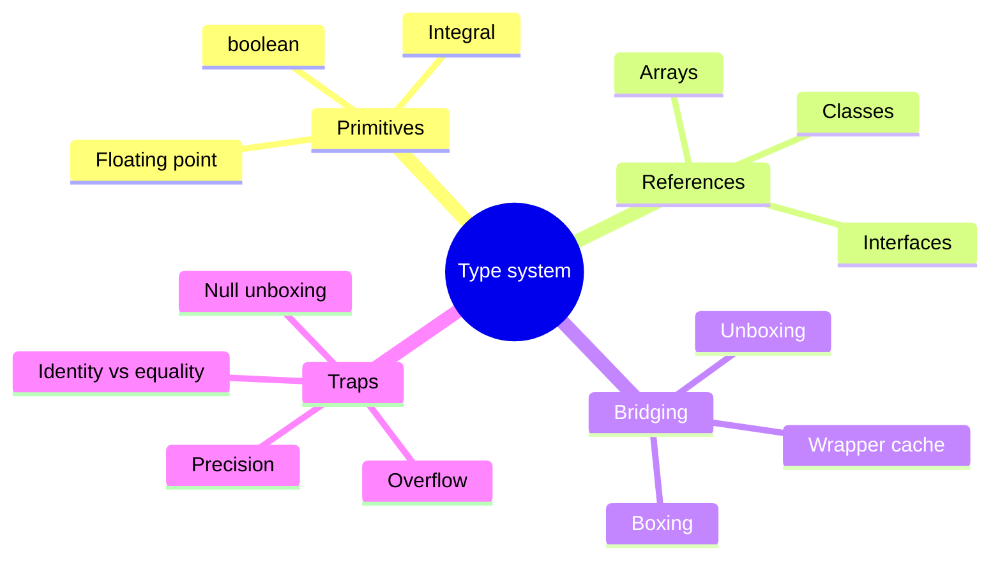
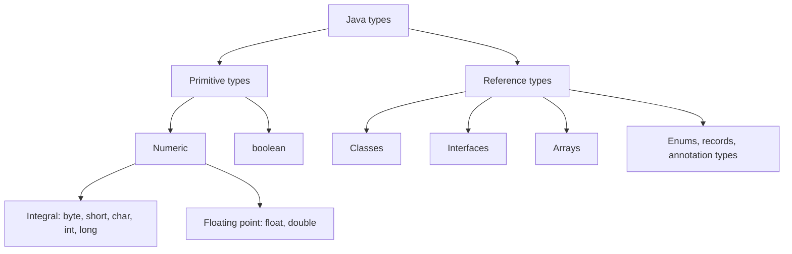
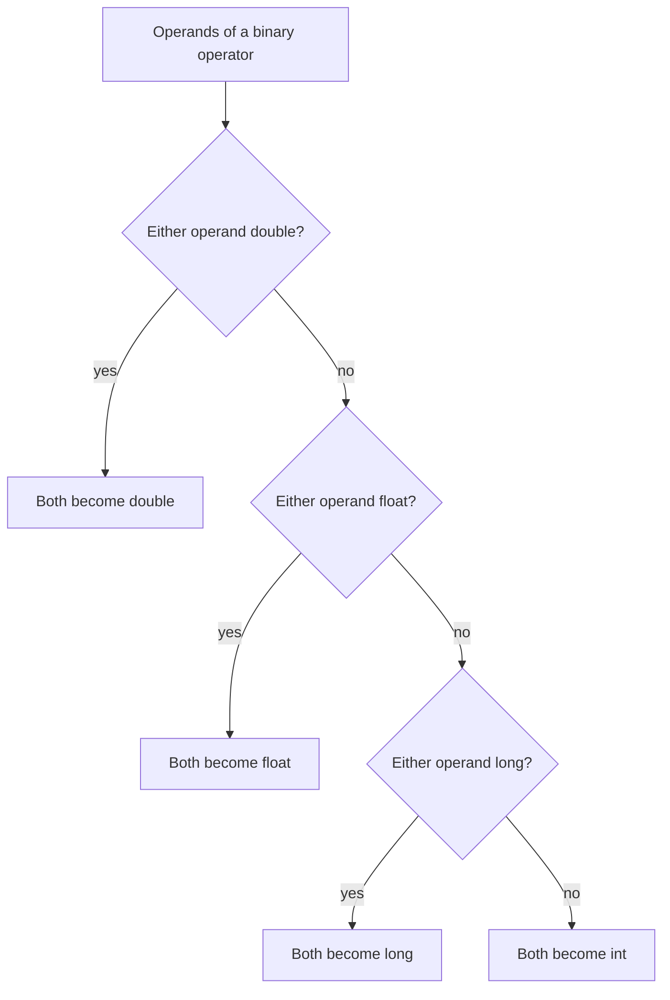
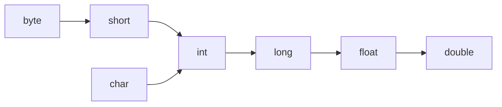
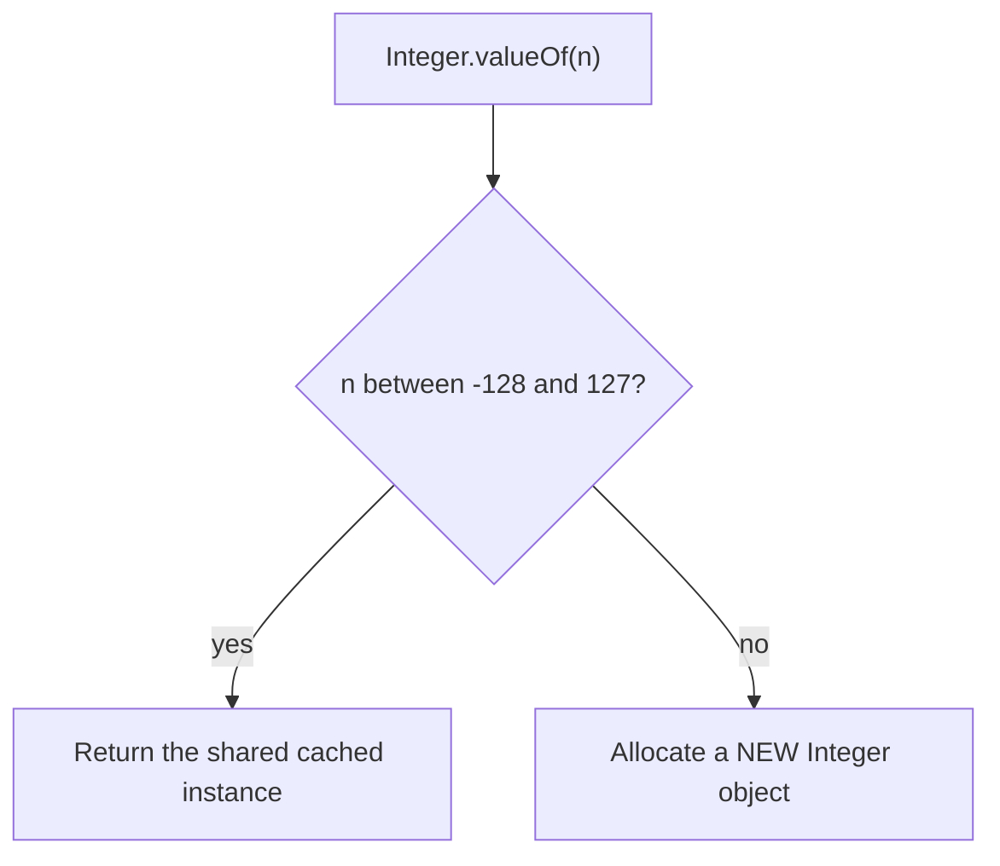
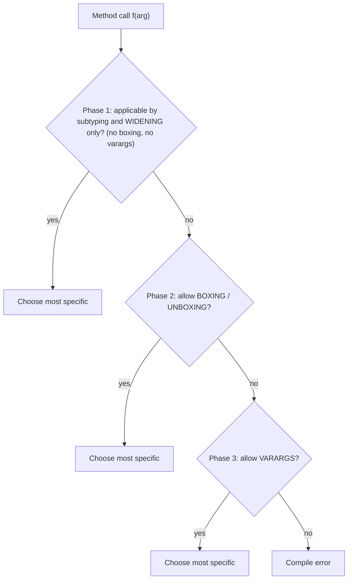

# 1.1 Type System and Boxing

> **Goal:** Know exactly what Java does with numbers, references and wrappers, so overflow, precision, `==`, `null` unboxing and overload surprises never catch you in production or in an interview.

**Level:** refresher for a 7-year engineer. Skim what you know, slow down at the gotchas.
**Verified on:** OpenJDK 21.0.12 (`javac` + `java`). Every output in this chapter was produced by actually running the code.

## Contents

1. [The big picture: primitives vs references](#1-the-big-picture-primitives-vs-references)
2. [Integer arithmetic: overflow, division, shifts, promotion](#2-integer-arithmetic-overflow-division-shifts-promotion)
3. [Floating point and BigDecimal](#3-floating-point-and-bigdecimal)
4. [Conversions and casts](#4-conversions-and-casts)
5. [Variables hold values: pass-by-value](#5-variables-hold-values-pass-by-value)
6. [Wrapper types and boxing](#6-wrapper-types-and-boxing)
7. [Overload resolution with widening, boxing, varargs](#7-overload-resolution-with-widening-boxing-varargs)
8. [`final` is not "immutable"](#8-final-is-not-immutable)
9. [Equality at a glance](#9-equality-at-a-glance)
10. [Default values and definite assignment](#10-default-values-and-definite-assignment)
11. [Common gotchas](#11-common-gotchas)
12. [Interview questions](#12-interview-questions)



---

## 1. The big picture: primitives vs references

**Intuition.** A primitive variable is a box that *contains the value itself* (the number 42). A reference variable is a box that contains *an address* of an object that lives elsewhere (on the heap). Copying a primitive copies the value. Copying a reference copies the address, so now two variables point at the same object.



```text
   Stack frame (per method call)                    Heap
  +-------------------------------+      +-------------------------------+
  | int   count   = 42            |      |                               |
  | double price  = 9.99          |      |   +-----------------------+   |
  | Order order   = ──────────────┼─────►|   | Order object          |   |
  | Order alias   = ──────────────┼─────►|   |  id=7, total=...      |   |
  | String name   = null          |      |   +-----------------------+   |
  +-------------------------------+      +-------------------------------+
   primitives live IN the slot            order and alias are two copies
   references hold an ADDRESS             of the same address
```

The eight primitives:

| Type | Size | Range / values | Default (field) | Wrapper | Notes |
|---|---|---|---|---|---|
| `byte` | 8-bit signed | -128 .. 127 | `0` | `Byte` | Arithmetic promotes to `int` |
| `short` | 16-bit signed | -32,768 .. 32,767 | `0` | `Short` | Rarely useful outside arrays/IO |
| `char` | 16-bit **unsigned** | 0 .. 65,535 | `'\u0000'` | `Character` | A UTF-16 code unit, not always a "character" |
| `int` | 32-bit signed | about ±2.1 billion | `0` | `Integer` | The default integer type |
| `long` | 64-bit signed | about ±9.2 quintillion | `0L` | `Long` | Needs the `L` suffix on literals |
| `float` | 32-bit IEEE 754 | ~7 decimal digits | `0.0f` | `Float` | 24-bit significand |
| `double` | 64-bit IEEE 754 | ~15-16 decimal digits | `0.0d` | `Double` | 53-bit significand; default for `1.5` |
| `boolean` | not specified | `true`, `false` | `false` | `Boolean` | HotSpot uses 1 byte in arrays, an `int` slot on the stack |

Concrete limits, straight from the JVM:

```java
public class PrimitiveLimits {
    public static void main(String[] args) {
        // 1. Ranges
        System.out.println("byte  : " + Byte.MIN_VALUE + " .. " + Byte.MAX_VALUE);
        System.out.println("short : " + Short.MIN_VALUE + " .. " + Short.MAX_VALUE);
        System.out.println("char  : " + (int) Character.MIN_VALUE + " .. " + (int) Character.MAX_VALUE);
        System.out.println("int   : " + Integer.MIN_VALUE + " .. " + Integer.MAX_VALUE);
        System.out.println("long  : " + Long.MIN_VALUE + " .. " + Long.MAX_VALUE);

        // 2. Overflow wraps silently
        System.out.println("int max + 1        = " + (Integer.MAX_VALUE + 1));
        System.out.println("Math.abs(int min)  = " + Math.abs(Integer.MIN_VALUE));
        long wrong = 1000 * 60 * 60 * 24 * 365;   // int arithmetic overflows BEFORE widening to long
        long right = 1000L * 60 * 60 * 24 * 365;
        System.out.println("ms in a year wrong = " + wrong);
        System.out.println("ms in a year right = " + right);
        try {
            Math.addExact(Integer.MAX_VALUE, 1);
        } catch (ArithmeticException e) {
            System.out.println("addExact          -> " + e.getMessage());
        }

        // 3. The classic binary-search midpoint bug
        int low = Integer.MAX_VALUE - 1, high = Integer.MAX_VALUE;
        System.out.println("(low+high)/2       = " + (low + high) / 2);
        System.out.println("(low+high)>>>1     = " + ((low + high) >>> 1));
        System.out.println("low+(high-low)/2   = " + (low + (high - low) / 2));

        // 4. Compound assignment hides a cast
        byte b = 10;
        b += 300;                  // b = (byte)(b + 300)
        System.out.println("byte b += 300      = " + b);
        // b = b + 1;              // does NOT compile: int cannot be assigned to byte
        char c = 'A';
        c += 1;
        System.out.println("char c += 1        = " + c);
        System.out.println("c + 1 (int)        = " + (c + 1));
        System.out.println("(char)(c + 1)      = " + (char) (c + 1));

        // 5. Integer division and remainder
        System.out.println("7 / 2              = " + 7 / 2);
        System.out.println("-7 / 2             = " + -7 / 2);
        System.out.println("-7 % 3             = " + -7 % 3);
        System.out.println("floorMod(-7, 3)    = " + Math.floorMod(-7, 3));
        System.out.println("floorDiv(-7, 2)    = " + Math.floorDiv(-7, 2));
        try {
            System.out.println(1 / (args.length));
        } catch (ArithmeticException e) {
            System.out.println("1 / 0 (int)        -> " + e.getMessage());
        }
        System.out.println("1.0 / 0            = " + 1.0 / 0);

        // 6. Shifts
        System.out.println("-8 >> 1            = " + (-8 >> 1));
        System.out.println("-8 >>> 1           = " + (-8 >>> 1));
        System.out.println("1 << 33 (int)      = " + (1 << 33));
        System.out.println("1L << 33           = " + (1L << 33));

        // 7. Narrowing casts
        System.out.println("(int) 3.99         = " + (int) 3.99);
        System.out.println("(int) -3.99        = " + (int) -3.99);
        System.out.println("(int) 1e20         = " + (int) 1e20);
        System.out.println("(int) NaN          = " + (int) Double.NaN);
        System.out.println("(byte) 200         = " + (byte) 200);
        System.out.println("(char) 65          = " + (char) 65);
        System.out.println("(int) 3_000_000_000L = " + (int) 3_000_000_000L);
    }
}

// ---- Output ----
// byte  : -128 .. 127
// short : -32768 .. 32767
// char  : 0 .. 65535
// int   : -2147483648 .. 2147483647
// long  : -9223372036854775808 .. 9223372036854775807
// int max + 1        = -2147483648
// Math.abs(int min)  = -2147483648
// ms in a year wrong = 1471228928
// ms in a year right = 31536000000
// addExact          -> integer overflow
// (low+high)/2       = -1
// (low+high)>>>1     = 2147483646
// low+(high-low)/2   = 2147483646
// byte b += 300      = 54
// char c += 1        = B
// c + 1 (int)        = 67
// (char)(c + 1)      = C
// 7 / 2              = 3
// -7 / 2             = -3
// -7 % 3             = -1
// floorMod(-7, 3)    = 2
// floorDiv(-7, 2)    = -4
// 1 / 0 (int)        -> / by zero
// 1.0 / 0            = Infinity
// -8 >> 1            = -4
// -8 >>> 1           = 2147483644
// 1 << 33 (int)      = 2
// 1L << 33           = 8589934592
// (int) 3.99         = 3
// (int) -3.99        = -3
// (int) 1e20         = 2147483647
// (int) NaN          = 0
// (byte) 200         = -56
// (char) 65          = A
// (int) 3_000_000_000L = -1294967296
```

> Read the output slowly. Every "surprising" line (`int max + 1`, `byte b += 300`, `(int) 1e20`) is covered in the next sections.

---

## 2. Integer arithmetic: overflow, division, shifts, promotion

### 2.1 Overflow wraps around silently

**Intuition.** An `int` is like a car odometer with 32 binary digits. After the maximum it rolls over to the minimum. Java does **not** throw. This is called two's-complement wrap-around.

```text
 Integer.MAX_VALUE  =  0111 1111 ... 1111   (2,147,483,647)
              + 1   =  1000 0000 ... 0000   (-2,147,483,648)   <- Integer.MIN_VALUE
```

Three real-world consequences you saw in the output above:

1. **`Math.abs(Integer.MIN_VALUE)` is still negative.** There is no positive counterpart for `MIN_VALUE`.
2. **The widening happens too late.** In `1000 * 60 * 60 * 24 * 365` every operand is an `int`, so the multiplication overflows *before* the result is widened to `long`. Fix: make **one operand** a `long` (`1000L * ...`).
3. **The midpoint bug.** `(low + high) / 2` overflows for large indexes. This bug lived in the JDK's own binary search for years. Safe forms: `low + (high - low) / 2` or `(low + high) >>> 1`.

When overflow must be an error, use the exact methods (`Math.addExact`, `subtractExact`, `multiplyExact`, `incrementExact`, `toIntExact`). They throw `ArithmeticException`.

### 2.2 Binary numeric promotion

Before an arithmetic operator runs, Java promotes the operands:



So `byte + byte` is an `int`, `char + int` is an `int`, `short * short` is an `int`. That is why:

```java
byte b = 10;
b = b + 1;     // does NOT compile: int cannot be assigned to byte without a cast
b += 1;        // compiles: compound assignment contains a hidden cast  b = (byte)(b + 1)
```

The hidden cast is what turned `b += 300` into `54` in the output (`10 + 300 = 310`, and `(byte) 310` keeps only the low 8 bits).

### 2.3 Division, remainder and shifts

- Integer division **truncates toward zero**: `-7 / 2 == -3`.
- `%` takes the sign of the **dividend**: `-7 % 3 == -1`. For "always non-negative" (hash buckets, circular indexes) use `Math.floorMod(-7, 3) == 2`. `Math.floorDiv` is the matching division.
- Integer `/ 0` and `% 0` throw `ArithmeticException`; floating point `/ 0` gives `Infinity` or `NaN` (next section).
- `>>` shifts and keeps the sign bit, `>>>` shifts in zeros. The shift distance is masked: for `int` only the low 5 bits count, for `long` the low 6, so `1 << 33` is `1 << 1`.

```text
 -8        = 1111 ... 1111 1000
 -8 >>  1  = 1111 ... 1111 1100  = -4           (sign extended)
 -8 >>> 1  = 0111 ... 1111 1100  = 2147483644   (zero filled)
```

---

## 3. Floating point and BigDecimal

**Intuition.** Computers store `float`/`double` in binary scientific notation: `sign × 1.fraction × 2^exponent`. Just as `1/3` is `0.3333...` forever in decimal, `0.1` is a repeating fraction in binary (`0.000110011001100...`). It cannot be stored exactly, so the nearest representable number is stored instead.

```text
 double (64 bits):  | 1 sign | 11 exponent | 52 fraction (+1 implicit) = 53 significant bits |
 float  (32 bits):  | 1 sign |  8 exponent | 23 fraction (+1 implicit) = 24 significant bits |
```

Rules that follow from this:

- Never compare floating point results with `==`. Compare within a tolerance, or use `Double.compare`.
- `float` loses integers above 2^24 (16,777,216). `double` loses them above 2^53.
- Special values exist: `NaN` (not equal to itself!), `+Infinity`, `-Infinity`, and `-0.0` (equal to `0.0` with `==`, but different with `equals`).
- Since **Java 17** (JEP 306) all floating-point arithmetic is strict IEEE 754, so the `strictfp` modifier is redundant.

```java
import java.math.BigDecimal;
import java.util.HashSet;
import java.util.Set;
import java.util.TreeSet;

public class FloatingPoint {
    public static void main(String[] args) {
        double a = 0.1 + 0.2;
        System.out.println("0.1 + 0.2          = " + a);
        System.out.println("0.1 + 0.2 == 0.3   = " + (a == 0.3));
        System.out.println("within 1e-9        = " + (Math.abs(a - 0.3) < 1e-9));

        float f = 16_777_216f;      // 2^24: the first float where +1 is lost
        System.out.println("2^24 + 1 (float)   = " + (f + 1) + "  same? " + (f + 1 == f));

        // NaN, infinities, negative zero
        double nan = Double.NaN;
        System.out.println("NaN == NaN         = " + (nan == nan));
        System.out.println("isNaN(NaN)         = " + Double.isNaN(nan));
        System.out.println("Double.valueOf(NaN).equals(NaN) = " + Double.valueOf(nan).equals(nan));
        System.out.println("0.0 == -0.0        = " + (0.0 == -0.0));
        System.out.println("Double.valueOf(0.0).equals(-0.0) = " + Double.valueOf(0.0).equals(-0.0));
        System.out.println("0.0 / 0            = " + 0.0 / 0);
        System.out.println("-1.0 / 0           = " + -1.0 / 0);
        System.out.println("Math.sqrt(-1)      = " + Math.sqrt(-1));

        // BigDecimal: construct from String (or valueOf), never from a double literal
        System.out.println("new BigDecimal(0.1)        = " + new BigDecimal(0.1));
        System.out.println("new BigDecimal(\"0.1\")      = " + new BigDecimal("0.1"));
        System.out.println("BigDecimal.valueOf(0.1)    = " + BigDecimal.valueOf(0.1));
        BigDecimal sum = new BigDecimal("0.1").add(new BigDecimal("0.2"));
        System.out.println("0.1 + 0.2 (BigDecimal)     = " + sum);

        // equals considers scale, compareTo does not
        BigDecimal x = new BigDecimal("1.0"), y = new BigDecimal("1.00");
        System.out.println("1.0 equals 1.00    = " + x.equals(y));
        System.out.println("1.0 compareTo 1.00 = " + x.compareTo(y));
        Set<BigDecimal> hash = new HashSet<>(Set.of(x, y));
        Set<BigDecimal> tree = new TreeSet<>(Set.of(x, y));
        System.out.println("HashSet size       = " + hash.size());
        System.out.println("TreeSet size       = " + tree.size());

        // Money: use scale and rounding explicitly
        BigDecimal price = new BigDecimal("19.99");
        BigDecimal total = price.multiply(new BigDecimal("3")).multiply(new BigDecimal("1.075"));
        System.out.println("total unrounded    = " + total);
        System.out.println("total rounded      = " + total.setScale(2, java.math.RoundingMode.HALF_EVEN));
    }
}

// ---- Output ----
// 0.1 + 0.2          = 0.30000000000000004
// 0.1 + 0.2 == 0.3   = false
// within 1e-9        = true
// 2^24 + 1 (float)   = 1.6777216E7  same? true
// NaN == NaN         = false
// isNaN(NaN)         = true
// Double.valueOf(NaN).equals(NaN) = true
// 0.0 == -0.0        = true
// Double.valueOf(0.0).equals(-0.0) = false
// 0.0 / 0            = NaN
// -1.0 / 0           = -Infinity
// Math.sqrt(-1)      = NaN
// new BigDecimal(0.1)        = 0.1000000000000000055511151231257827021181583404541015625
// new BigDecimal("0.1")      = 0.1
// BigDecimal.valueOf(0.1)    = 0.1
// 0.1 + 0.2 (BigDecimal)     = 0.3
// 1.0 equals 1.00    = false
// 1.0 compareTo 1.00 = 0
// HashSet size       = 2
// TreeSet size       = 1
// total unrounded    = 64.46775
// total rounded      = 64.47
```

### Choosing a number type for money

| Need | Use | Why |
|---|---|---|
| Money, tax, anything legally exact | `BigDecimal` (built from `String`/`valueOf`) with explicit scale and `RoundingMode` | Exact decimal arithmetic |
| Money in a high-throughput hot path | `long` of the smallest unit (paise/cents) | Fast and exact, you manage scale |
| Science, graphics, statistics | `double` | Speed; error is acceptable and bounded |
| Counting, indexing | `int` / `long` | Exact |

Key `BigDecimal` rules:

- `new BigDecimal(0.1)` captures the *already-inexact* double. Use `new BigDecimal("0.1")` or `BigDecimal.valueOf(0.1)`.
- `equals` compares **value and scale** (`1.0` is not equal to `1.00`). `compareTo` compares only the numeric value. Mixing them up breaks `HashSet` (uses `equals`) versus `TreeSet` (uses `compareTo`), as the output showed: sizes 2 and 1.
- `divide` without a scale or `MathContext` throws `ArithmeticException` for non-terminating results such as `1/3`.

---

## 4. Conversions and casts



- **Widening** (arrow direction) is implicit and safe in range, but `int → float` and `long → float/double` can lose precision.
- **Narrowing** (against the arrows) needs an explicit cast and can lose information:

| Cast | Rule | Example result |
|---|---|---|
| floating → integral | Truncate toward zero | `(int) -3.99 == -3` |
| floating → int, too big | Clamp to `MAX_VALUE`/`MIN_VALUE` | `(int) 1e20 == 2147483647` |
| `NaN` → integral | `0` | `(int) Double.NaN == 0` |
| integral → narrower integral | Keep the low-order bits | `(byte) 200 == -56` |
| `int` → `char` | Low 16 bits, interpreted unsigned | `(char) 65 == 'A'` |

One special rule: a **compile-time constant** that fits is assigned without a cast: `byte b = 10;` and `char c = 65;` compile, while `int i = 10; byte b = i;` does not.

---

## 5. Variables hold values: pass-by-value

**Java is always pass-by-value.** For a reference type the value that is copied is the *reference* (the address). The callee can therefore change the object the caller can see, but it can never re-point the caller's variable.

```java
import java.util.Arrays;

public class PassByValue {
    static void incrementInt(int n) { n++; }
    static void reassign(StringBuilder sb) { sb = new StringBuilder("brand new"); }
    static void mutate(StringBuilder sb) { sb.append("!"); }
    static void swap(int[] pair) { int t = pair[0]; pair[0] = pair[1]; pair[1] = t; }
    static void badSwap(Integer a, Integer b) { Integer t = a; a = b; b = t; }

    public static void main(String[] args) {
        int n = 5;
        incrementInt(n);
        System.out.println("int after increment      = " + n);

        StringBuilder sb = new StringBuilder("hello");
        reassign(sb);
        System.out.println("after reassign(sb)       = " + sb);
        mutate(sb);
        System.out.println("after mutate(sb)         = " + sb);

        int[] pair = {1, 2};
        swap(pair);
        System.out.println("swap via array           = " + Arrays.toString(pair));

        Integer a = 1, b = 2;
        badSwap(a, b);
        System.out.println("badSwap(a, b)            = " + a + ", " + b);
    }
}

// ---- Output ----
// int after increment      = 5
// after reassign(sb)       = hello
// after mutate(sb)         = hello!
// swap via array           = [2, 1]
// badSwap(a, b)            = 1, 2
```

```text
 caller                               callee
 sb ──► [ "hello" ]                   sb(copy) ──► [ "hello" ]       both point to the same object

 after  sb = new StringBuilder(...)   inside callee only:
 sb ──► [ "hello" ]                   sb(copy) ──► [ "brand new" ]   caller is unaffected
```

This is why a generic `swap(a, b)` cannot exist for variables in Java: the usual workaround is an array or a small holder object.

---

## 6. Wrapper types and boxing

### 6.1 Why wrappers exist

- Generics and collections only work with **reference types**: `List<int>` is illegal, `List<Integer>` is fine.
- A wrapper can be `null` (meaning "absent").
- Wrappers carry utility methods (`parseInt`, `compare`, `MAX_VALUE`, `toBinaryString`).

### 6.2 What the compiler really writes

Autoboxing is pure compiler sugar:

```java
Integer boxed = 5;            // Integer boxed = Integer.valueOf(5);
int prim = boxed;             // int prim = boxed.intValue();
boxed++;                      // boxed = Integer.valueOf(boxed.intValue() + 1);
```

`valueOf` is the key. It uses a **cache**:



| Wrapper | Cached values |
|---|---|
| `Integer`, `Short`, `Long` | -128 .. 127 (the upper bound of `Integer` can be raised with `-XX:AutoBoxCacheMax=<n>`) |
| `Byte` | all 256 values |
| `Character` | 0 .. 127 |
| `Boolean` | `TRUE` and `FALSE` |
| `Float`, `Double` | none, always a new object |

`new Integer(5)` is deprecated (since Java 9) and **marked for removal** (since Java 16). Always use `valueOf` or autoboxing. Wrappers are also *value-based classes* (JEP 390, Java 16): do not synchronize on them, the compiler warns.

### 6.3 The classic traps

```java
import java.util.ArrayList;
import java.util.HashMap;
import java.util.List;
import java.util.Map;

public class BoxingDemo {
    static Integer maybeNull() { return null; }

    public static void main(String[] args) {
        // 1. The Integer cache: -128..127
        Integer a = 127, b = 127;
        Integer c = 128, d = 128;
        System.out.println("127 == 127         : " + (a == b));
        System.out.println("128 == 128         : " + (c == d));
        System.out.println("128 equals 128     : " + c.equals(d));
        System.out.println("valueOf(100) same? : " + (Integer.valueOf(100) == Integer.valueOf(100)));

        // 2. Wrapper types are immutable: ++ creates a new object
        Integer x = 1000;
        Integer y = x;
        x++;
        System.out.println("x=" + x + " y=" + y + " same object? " + (x == y));

        // 3. equals() is type-sensitive
        Long big = 127L;
        System.out.println("Long.equals(127)   : " + big.equals(127));
        System.out.println("Long.equals(127L)  : " + big.equals(127L));
        System.out.println("Long == Integer value (unboxed) : " + (big == 127));

        // 4. Unboxing null -> NullPointerException
        try {
            int n = maybeNull();
        } catch (NullPointerException e) {
            System.out.println("unbox null         -> " + e.getMessage());
        }
        Map<String, Integer> counts = new HashMap<>();
        try {
            counts.put("a", counts.get("a") + 1);
        } catch (NullPointerException e) {
            System.out.println("map.get(missing)+1 -> " + e.getMessage());
        }
        counts.merge("a", 1, Integer::sum);       // the safe idiom
        counts.merge("a", 1, Integer::sum);
        System.out.println("after merge         = " + counts);

        // 5. Ternary unboxing trap
        Integer boxed = null;
        boolean flag = true;
        try {
            Integer r = flag ? boxed : 0;          // type of ?: is int, so boxed is unboxed
            System.out.println("r = " + r);
        } catch (NullPointerException e) {
            System.out.println("ternary trap       -> NPE");
        }
        Integer safe = flag ? boxed : Integer.valueOf(0);   // both Integer: no unboxing
        System.out.println("safe ternary       = " + safe);

        // 6. List.remove(int) vs remove(Object)
        List<Integer> list = new ArrayList<>(List.of(10, 20, 30, 1));
        list.remove(1);                            // index 1
        System.out.println("remove(1)          = " + list);
        list.remove(Integer.valueOf(1));           // the element 1
        System.out.println("remove(Integer 1)  = " + list);

        // 7. Comparison operators unbox, == on two wrappers does not
        Integer p = 1000, q = 1000;
        System.out.println("p == q             : " + (p == q));
        System.out.println("p <= q && p >= q   : " + (p <= q && p >= q));
        System.out.println("p == 1000          : " + (p == 1000));
    }
}

// ---- Output ----
// 127 == 127         : true
// 128 == 128         : false
// 128 equals 128     : true
// valueOf(100) same? : true
// x=1001 y=1000 same object? false
// Long.equals(127)   : false
// Long.equals(127L)  : true
// Long == Integer value (unboxed) : true
// unbox null         -> Cannot invoke "java.lang.Integer.intValue()" because the return value of "BoxingDemo.maybeNull()" is null
// map.get(missing)+1 -> Cannot invoke "java.lang.Integer.intValue()" because the return value of "java.util.Map.get(Object)" is null
// after merge         = {a=2}
// ternary trap       -> NPE
// safe ternary       = null
// remove(1)          = [10, 30, 1]
// remove(Integer 1)  = [10, 30]
// p == q             : false
// p <= q && p >= q   : true
// p == 1000          : true
```

Walk through the output:

| Output line | Lesson |
|---|---|
| `127 == 127: true`, `128 == 128: false` | `==` on two wrappers compares identity; only cached values happen to share one instance. **Use `equals`.** |
| `x=1001 y=1000 same object? false` | Wrappers are immutable. `x++` creates a new `Integer` and re-points `x`. |
| `Long.equals(127)` is `false` | `equals` checks the **type first**: `127` is boxed to `Integer`, not `Long`. |
| `unbox null -> Cannot invoke "java.lang.Integer.intValue()" because ...` | Unboxing a `null` is an NPE. The message (Java 15+) tells you which expression was null. |
| `counts.get("a") + 1` NPE | `Map.get` returns `null` for a missing key. Use `merge`, `getOrDefault` or `computeIfAbsent`. |
| ternary trap | In `flag ? boxed : 0` one operand is `Integer`, the other `int`, so the result type is `int` and `boxed` is **unboxed** even when the condition picks it. |
| `remove(1)` vs `remove(Integer.valueOf(1))` | `List.remove(int index)` is preferred over `remove(Object)` for an `int` argument. |

### 6.4 Cost of boxing

An `int` is 4 bytes. An `Integer` is a heap object: with compressed references HotSpot typically needs 16 bytes for the object plus 4 bytes for each reference to it.

| 1,000,000 numbers | Approximate heap | Cache friendliness |
|---|---|---|
| `int[]` | ~4 MB, one contiguous block | Excellent |
| `List<Integer>` | ~20 MB (array of references + one object each) | Poor: pointer chasing |

Rules of thumb:

- Keep hot loops, accumulators and arrays **primitive** (`long total`, never `Long total` updated in a loop: each `+=` allocates).
- Use primitive streams (`IntStream`, `LongStream`) when streaming numbers (Part 04).
- Project Valhalla (value classes) aims to reduce this overhead in future JDKs; its status is tracked in `08-lts-java-25/09-beyond-25-previews.md`.

---

## 7. Overload resolution with widening, boxing, varargs

The compiler picks the method in **three phases** and stops at the first phase that finds a candidate:



```java
public class OverloadResolution {
    static void f(long x)      { System.out.println("f(long)"); }
    static void f(Integer x)   { System.out.println("f(Integer)"); }
    static void f(Object x)    { System.out.println("f(Object)"); }
    static void f(int... x)    { System.out.println("f(int...)"); }

    static void g(Integer x)   { System.out.println("g(Integer)"); }
    static void g(int... x)    { System.out.println("g(int...)"); }

    static void h(Object o)    { System.out.println("h(Object)"); }
    static void h(String s)    { System.out.println("h(String)"); }

    public static void main(String[] args) {
        f(5);                 // phase 1: widening beats boxing
        f(Integer.valueOf(5));// exact match
        f("text");            // Object
        f();                  // only varargs applies
        g(5);                 // phase 2 (boxing) beats phase 3 (varargs)
        h("s");
        h((Object) "s");      // the static type decides, not the runtime type
        h(null);              // most specific wins: String
    }
}

// ---- Output ----
// f(long)
// f(Integer)
// f(Object)
// f(int...)
// g(Integer)
// h(String)
// h(Object)
// h(String)
```

- `f(5)` picks `f(long)`: widening (phase 1) beats boxing (phase 2).
- `g(5)` picks `g(Integer)` over `g(int...)`: boxing (phase 2) beats varargs (phase 3).
- `h((Object) "s")` calls `h(Object)`: overloads are chosen from the **static (compile-time) type**, never the runtime type. (Overriding, in contrast, uses the runtime type; see Part 02.)
- `h(null)` picks the **most specific** applicable method, `h(String)`.

---

## 8. `final` is not "immutable"

`final` means *this variable cannot be re-assigned*. It says nothing about whether the object it points to can change.

| Where | Effect of `final` |
|---|---|
| Local variable / parameter | Cannot be re-assigned. Lambdas and inner classes may capture it (a variable that is never re-assigned is "effectively final" even without the keyword) |
| Instance field | Must be assigned exactly once by the end of every constructor; gets special memory-visibility guarantees (Part 11) |
| `static final` field | Assigned once in the static initializer; a compile-time constant if it is a primitive/`String` initialized with a constant expression |
| Method | Cannot be overridden |
| Class | Cannot be extended |

A class is **immutable** only when *all* of these hold:

1. Declared `final` (or has only private constructors) so it cannot be subclassed into a mutable variant.
2. All fields are `private final`.
3. No setters, and no method changes state.
4. Mutable inputs are **copied in** and mutable outputs are **copied out** (or exposed as unmodifiable views).
5. `this` does not escape during construction.

```java
import java.util.ArrayList;
import java.util.List;

public class FinalVsImmutable {

    // BROKEN: final fields, but the object is not immutable
    static final class LeakyTeam {
        private final List<String> members;
        LeakyTeam(List<String> members) { this.members = members; }       // keeps caller's reference
        List<String> members() { return members; }                        // hands out internal state
    }

    // FIXED: defensive copy in, unmodifiable view/copy out
    static final class SafeTeam {
        private final List<String> members;
        SafeTeam(List<String> members) { this.members = List.copyOf(members); }
        List<String> members() { return members; }                        // already immutable
    }

    public static void main(String[] args) {
        final List<String> names = new ArrayList<>();
        names.add("final does not freeze the object");
        System.out.println("final list contents      = " + names);
        // names = new ArrayList<>();   // compile error: cannot assign a value to final variable

        List<String> input = new ArrayList<>(List.of("asha", "ravi"));
        LeakyTeam leaky = new LeakyTeam(input);
        input.add("intruder");                         // caller mutates after construction
        leaky.members().clear();                       // outsider mutates internals
        System.out.println("LeakyTeam members        = " + leaky.members());

        List<String> input2 = new ArrayList<>(List.of("asha", "ravi"));
        SafeTeam safe = new SafeTeam(input2);
        input2.add("intruder");
        System.out.println("SafeTeam members         = " + safe.members());
        try {
            safe.members().clear();
        } catch (UnsupportedOperationException e) {
            System.out.println("SafeTeam.clear()         -> UnsupportedOperationException");
        }
    }
}

// ---- Output ----
// final list contents      = [final does not freeze the object]
// LeakyTeam members        = []
// SafeTeam members         = [asha, ravi]
// SafeTeam.clear()         -> UnsupportedOperationException
```

Immutable objects are automatically thread-safe, safe as map keys and safe to share. Part 02 (`02-encapsulation-and-access-control.md`) goes deeper, and `record` (Java 16) automates much of this.

---

## 9. Equality at a glance

Deep dive: `02-oop-deep-dive/A-foundations/05-object-contract-equals-hashcode-tostring-clone.md`. The essentials:

| Expression | Compares |
|---|---|
| `a == b` on primitives | the values |
| `a == b` on references | **identity** (same object?) |
| `a.equals(b)` | whatever the class defines; defaults to identity (`Object.equals`) |
| `Objects.equals(a, b)` | null-safe `equals` |
| Arrays | `Arrays.equals` (shallow content), `Arrays.deepEquals` (nested content) |

```java
import java.util.ArrayList;
import java.util.Arrays;
import java.util.LinkedList;
import java.util.List;
import java.util.Objects;
import java.util.Set;

public class EqualityGlance {
    public static void main(String[] args) {
        int[] a = {1, 2, 3}, b = {1, 2, 3};
        System.out.println("a == b                  : " + (a == b));
        System.out.println("a.equals(b)             : " + a.equals(b) + "   (arrays use identity equals)");
        System.out.println("Arrays.equals(a, b)     : " + Arrays.equals(a, b));
        System.out.println("hashCodes (Arrays)      : " + (Arrays.hashCode(a) == Arrays.hashCode(b)));

        int[][] n1 = {{1}, {2}}, n2 = {{1}, {2}};
        System.out.println("Arrays.equals nested    : " + Arrays.equals(n1, n2));
        System.out.println("Arrays.deepEquals nested: " + Arrays.deepEquals(n1, n2));

        String nothing = null;
        System.out.println("Objects.equals(null,null): " + Objects.equals(nothing, nothing));
        System.out.println("\"x\".equals(null-string)  : " + "x".equals(nothing));
        try {
            nothing.equals("x");
        } catch (NullPointerException e) {
            System.out.println("null.equals(\"x\")        -> NullPointerException");
        }

        // Collections define equals by content, across implementations
        List<Integer> arrayList = new ArrayList<>(List.of(1, 2));
        List<Integer> linkedList = new LinkedList<>(List.of(1, 2));
        System.out.println("ArrayList equals LinkedList: " + arrayList.equals(linkedList));
        System.out.println("Set.of(1,2) equals Set.of(2,1): " + Set.of(1, 2).equals(Set.of(2, 1)));

        // The Arrays.asList(int[]) trap: T is inferred as int[], not Integer
        System.out.println("Arrays.asList(new int[]{1,2}).size()     = " + Arrays.asList(new int[]{1, 2}).size());
        System.out.println("Arrays.asList(new Integer[]{1,2}).size() = " + Arrays.asList(new Integer[]{1, 2}).size());
    }
}

// ---- Output ----
// a == b                  : false
// a.equals(b)             : false   (arrays use identity equals)
// Arrays.equals(a, b)     : true
// hashCodes (Arrays)      : true
// Arrays.equals nested    : false
// Arrays.deepEquals nested: true
// Objects.equals(null,null): true
// "x".equals(null-string)  : false
// null.equals("x")        -> NullPointerException
// ArrayList equals LinkedList: true
// Set.of(1,2) equals Set.of(2,1): true
// Arrays.asList(new int[]{1,2}).size()     = 1
// Arrays.asList(new Integer[]{1,2}).size() = 2
```

Tip: put the constant on the left, `"x".equals(s)`, or use `Objects.equals`, to avoid an NPE when `s` may be `null`.

---

## 10. Default values and definite assignment

Fields and array elements get zero values automatically. **Local variables never do**: the compiler refuses to read one that is not definitely assigned.

```java
import java.util.Arrays;

public class DefaultsDemo {
    static byte b;
    static short s;
    static char c;
    static int i;
    static long l;
    static float f;
    static double d;
    static boolean z;
    static String str;
    static Integer boxed;

    public static void main(String[] args) {
        System.out.println("byte=" + b + " short=" + s + " char=(int)" + (int) c + " int=" + i
                + " long=" + l + " float=" + f + " double=" + d);
        System.out.println("boolean=" + z + " String=" + str + " Integer=" + boxed);
        System.out.println("new int[3]     = " + Arrays.toString(new int[3]));
        System.out.println("new boolean[2] = " + Arrays.toString(new boolean[2]));
        System.out.println("new String[2]  = " + Arrays.toString(new String[2]));

        int local;
        // System.out.println(local);   // compile error: variable local might not have been initialized
        local = 1;
        System.out.println("local after assignment = " + local);
    }
}

// ---- Output ----
// byte=0 short=0 char=(int)0 int=0 long=0 float=0.0 double=0.0
// boolean=false String=null Integer=null
// new int[3]     = [0, 0, 0]
// new boolean[2] = [false, false]
// new String[2]  = [null, null]
// local after assignment = 1
```

---

## 11. Common gotchas

| Gotcha | Why it happens | Fix |
|---|---|---|
| `Integer.MAX_VALUE + 1` is negative | Silent two's-complement wrap | `Math.addExact` or use `long` |
| `1000 * 60 * 60 * 24 * 365` is wrong | `int` overflow before widening | Make one operand `long` (`1000L`) |
| `(low + high) / 2` fails for big values | Sum overflows | `low + (high - low) / 2` or `>>> 1` |
| `0.1 + 0.2 != 0.3` | Binary floating point | Tolerance compare, or `BigDecimal` from `String` |
| `new BigDecimal(0.1)` is ugly | Captures the inexact double | `new BigDecimal("0.1")` / `valueOf` |
| `BigDecimal("1.0").equals("1.00")` is false | `equals` includes scale | `compareTo(...) == 0` |
| `Integer a = 128, b = 128; a == b` is false | Cache covers only -128..127 | `equals` / `intValue()` |
| `long.equals(int)` style mismatch | `equals` checks type | Compare same types, or unbox |
| `int x = map.get(k)` throws NPE | Unboxing `null` | `getOrDefault`, `merge`, null check |
| `cond ? integerObj : 0` throws NPE | Ternary unboxing | Make both branches `Integer` |
| `list.remove(1)` removes by index | Overload prefers `int` | `remove(Integer.valueOf(1))` |
| `Long total` in a loop is slow | Allocates a `Long` per update | Use primitive `long` |
| `Math.abs(Integer.MIN_VALUE) < 0` | No positive counterpart | `Math.absExact` throws instead |
| `Arrays.asList(intArray).size()` is 1 | `T` inferred as `int[]` | Use `Integer[]` or `Arrays.stream(...)` |
| `b = b + 1` (byte) won't compile | Promotion to `int` | `b += 1` (hidden cast) |
| `final` list still changes | `final` is about the reference | Use `List.copyOf` / immutable types |
| Overload picks the "wrong" method | Static type + 3-phase resolution | Cast, or rename overloads |

---

## 12. Interview questions

<details>
<summary><strong>Q1. Is Java pass-by-value or pass-by-reference?</strong></summary>

Always pass-by-value. For objects the *value* is the reference (address), copied into the parameter. The callee can mutate the shared object but cannot make the caller's variable point somewhere else (`reassign(sb)` left `sb` untouched in the demo).
</details>

<details>
<summary><strong>Q2. Why is <code>Integer a = 127, b = 127; a == b</code> true but with 128 false?</strong></summary>

Autoboxing calls `Integer.valueOf`, which returns cached shared instances for -128..127 and allocates new objects otherwise. `==` compares identity, so only cached values are "equal". Use `equals`. The upper bound can be raised with `-XX:AutoBoxCacheMax`, which is one more reason never to rely on it.
</details>

<details>
<summary><strong>Q3. What does <code>Integer.MAX_VALUE + 1</code> return? How do you detect overflow?</strong></summary>

`-2147483648` (silent wrap-around). Detect/forbid with `Math.addExact`/`multiplyExact` (throw `ArithmeticException`), widen to `long` early, or use `BigInteger`.
</details>

<details>
<summary><strong>Q4. Why does <code>byte b = 10; b = b + 1;</code> not compile but <code>b += 1;</code> does?</strong></summary>

`b + 1` is promoted to `int`, and an `int` cannot be implicitly narrowed to `byte`. Compound assignment `b += 1` is defined as `b = (byte)(b + 1)`, i.e. it contains an implicit cast, which also means it can silently overflow.
</details>

<details>
<summary><strong>Q5. Why is <code>0.1 + 0.2 == 0.3</code> false? How should you compare doubles and handle money?</strong></summary>

`0.1` and `0.2` have no exact binary representation, so the sum is `0.30000000000000004`. Compare with a tolerance (`Math.abs(a - b) < eps`) or `Double.compare`. For money use `BigDecimal` constructed from `String` (or `valueOf`) with explicit scale and `RoundingMode`, or integer minor units in a `long`.
</details>

<details>
<summary><strong>Q6. What is the difference between <code>BigDecimal.equals</code> and <code>compareTo</code>? Why does it matter for collections?</strong></summary>

`equals` requires equal value **and** scale (`1.0 != 1.00`); `compareTo` compares only numeric value. `HashSet` uses `equals`/`hashCode` (size 2 in the demo) while `TreeSet` uses `compareTo` (size 1). A `Comparable` that is inconsistent with `equals` makes sorted and hashed collections disagree.
</details>

<details>
<summary><strong>Q7. What happens when you unbox a null <code>Integer</code>? Give two sneaky ways it happens.</strong></summary>

`NullPointerException` from `intValue()`. Sneaky cases: `int x = map.get(missingKey)`, and a ternary such as `flag ? nullableInteger : 0` (mixed `Integer`/`int` makes the result `int`, forcing an unbox even if the Integer branch is chosen). Also `+=` on a null `Integer`, and passing a null to an `int` parameter.
</details>

<details>
<summary><strong>Q8. Why does <code>list.remove(1)</code> on a <code>List&lt;Integer&gt;</code> not remove the value 1?</strong></summary>

Overload resolution phase 1 (no boxing) finds `remove(int index)` applicable, so it wins over `remove(Object)`. To remove the value use `list.remove(Integer.valueOf(1))`.
</details>

<details>
<summary><strong>Q9. Which overload does <code>f(5)</code> call if <code>f(long)</code>, <code>f(Integer)</code>, <code>f(Object)</code> and <code>f(int...)</code> exist?</strong></summary>

`f(long)`. Phase 1 (subtyping and widening only) finds it before boxing (phase 2) or varargs (phase 3) are considered. Overloads are selected on **static types** at compile time.
</details>

<details>
<summary><strong>Q10. Does <code>final</code> make an object immutable?</strong></summary>

No. `final` prevents re-assignment of the variable. An object is immutable only if its class is designed so (final class, private final fields, no mutators, defensive copies in and out). `final List<String> l` can still have elements added; the `LeakyTeam` example showed an object with all-`final` fields being mutated from outside.
</details>

<details>
<summary><strong>Q11. Explain the integer midpoint bug and its fixes.</strong></summary>

`(low + high) / 2` overflows to a negative number when `low + high > Integer.MAX_VALUE`, giving a negative index. Use `low + (high - low) / 2` (never overflows for `low <= high`) or `(low + high) >>> 1` (the unsigned shift treats the wrapped sum as an unsigned 32-bit value).
</details>

<details>
<summary><strong>Q12. What does <code>(int) 1e20</code>, <code>(int) Double.NaN</code> and <code>(byte) 200</code> give, and why?</strong></summary>

`2147483647` (floating to int saturates), `0` (NaN converts to 0), `-56` (integral narrowing keeps the low 8 bits: `200 = 0xC8 = 1100 1000`, which is -56 as a signed byte).
</details>

<details>
<summary><strong>Q13. Why use primitive <code>long</code> rather than <code>Long</code> for a counter in a loop?</strong></summary>

Every `total += x` on a `Long` unboxes, adds and boxes into a new `Long` (outside the cache range), producing garbage and pointer-chasing memory. A primitive keeps the value in a register or stack slot. The same reasoning favors `int[]` over `List<Integer>` and `IntStream` over `Stream<Integer>`.
</details>

<details>
<summary><strong>Q14. <code>Long l = 127L; l.equals(127)</code>: true or false?</strong></summary>

`false`. `127` is boxed to `Integer`, and `Long.equals` returns `false` for any argument that is not a `Long`. `l == 127` is `true` because `==` between a `Long` and an `int` unboxes `l` and compares numerically.
</details>

<details>
<summary><strong>Q15. What are <code>NaN</code>'s equality rules and why do <code>Double.equals</code> and <code>==</code> disagree?</strong></summary>

`NaN == NaN` is `false` and `0.0 == -0.0` is `true` (primitive IEEE comparison). `Double.equals` compares the bit patterns after canonicalizing NaN, so `Double.valueOf(NaN).equals(NaN)` is `true` and `Double.valueOf(0.0).equals(-0.0)` is `false`. This keeps `equals` reflexive, which hash-based collections require.
</details>

---

[Part index](./README.md) · Next: [1.2 Exceptions and Resources](./02-exceptions-and-resources.md)