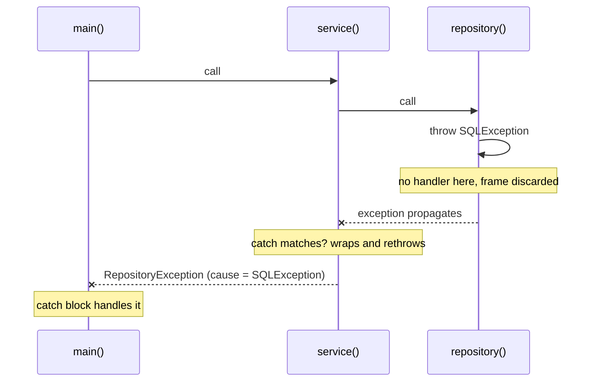
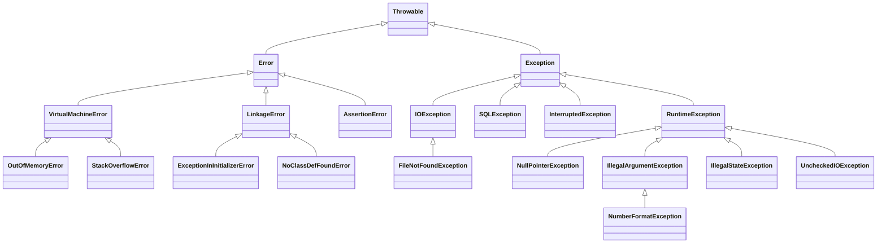
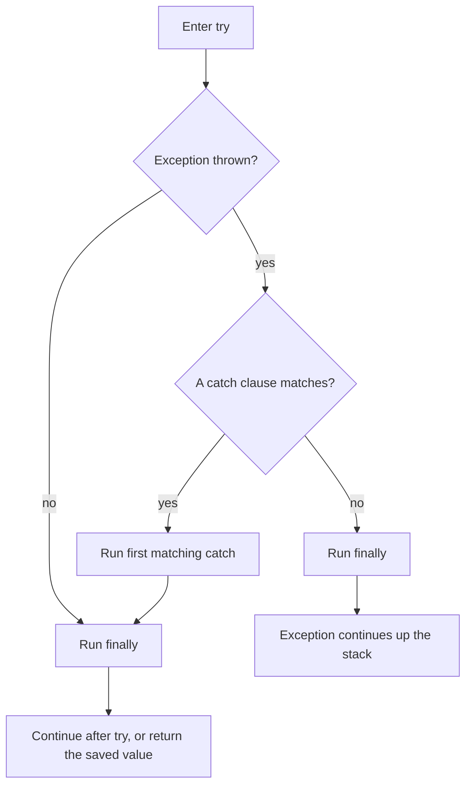
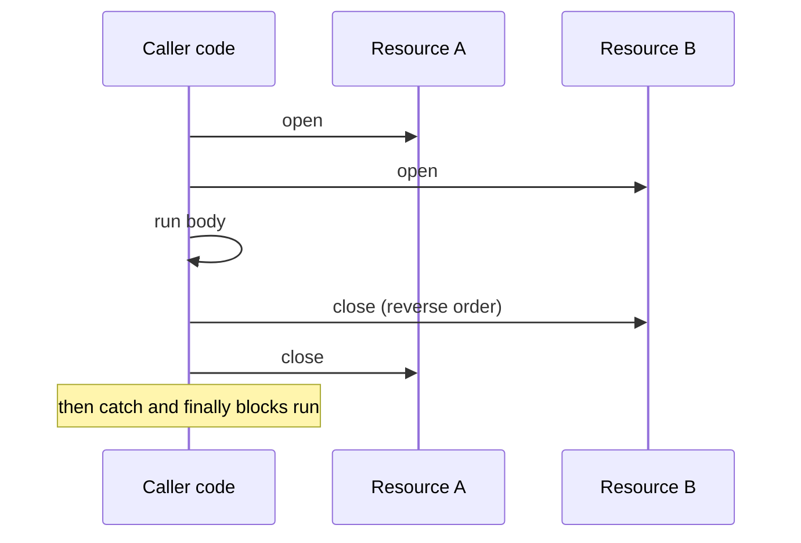

# 1.2 Exceptions and Resources

> **Goal:** Understand how exceptions travel through the JVM, how `finally` and try-with-resources really behave, and how to design exception handling that is correct, debuggable and cheap.

**Level:** refresher with under-the-hood detail. The mechanics (exception tables, `finally` duplication, suppressed exceptions) are what interviews and production incidents test.
**Verified on:** OpenJDK 21.0.12. Every output below was produced by running the code.

## Contents

1. [What an exception is and how the JVM unwinds the stack](#1-what-an-exception-is-and-how-the-jvm-unwinds-the-stack)
2. [The hierarchy: Error, checked, unchecked](#2-the-hierarchy-error-checked-unchecked)
3. [try / catch / finally in detail](#3-try--catch--finally-in-detail)
4. [try-with-resources](#4-try-with-resources)
5. [Chaining, stack traces and their cost](#5-chaining-stack-traces-and-their-cost)
6. [Helpful NullPointerException messages](#6-helpful-nullpointerexception-messages)
7. [Designing and wrapping exceptions](#7-designing-and-wrapping-exceptions)
8. [Errors that come from the JVM: static init failures](#8-errors-that-come-from-the-jvm-static-init-failures)
9. [InterruptedException: do not swallow it](#9-interruptedexception-do-not-swallow-it)
10. [Assertions and argument validation](#10-assertions-and-argument-validation)
11. [Best practices and anti-patterns](#11-best-practices-and-anti-patterns)
12. [Common gotchas](#12-common-gotchas)
13. [Interview questions](#13-interview-questions)

---

## 1. What an exception is and how the JVM unwinds the stack

**Intuition.** Think of a smoke alarm in a building. Instead of every room returning an "OK/not OK" code to its neighbour, the alarm rings and the signal travels up the floors until someone responsible (a `catch` block) handles it. If nobody does, the whole building (the thread) shuts down.

An exception is an **object** (a `Throwable`) created at the point of failure. It records a snapshot of the call stack. When it is thrown, the JVM looks for a handler in the current method; if none matches, the method's frame is discarded and the search repeats in the caller.



### How `catch` and `finally` exist in bytecode

There is no "try" instruction. The compiler emits an **exception table** next to the code. Each row says: *if an exception of this type is thrown while the program counter is in range [from, to), jump to target*.

```java
public class ExceptionTableDemo {
    static int work(String s) {
        try {
            return Integer.parseInt(s);
        } catch (NumberFormatException e) {
            return -1;
        } finally {
            System.out.println("cleanup");
        }
    }

    public static void main(String[] args) {
        System.out.println(work("7"));
        System.out.println(work("x"));
    }
}

// ---- Output ----
// cleanup
// 7
// cleanup
// -1
```

Real `javap -c -p ExceptionTableDemo` output (method `work` only):

```text
  static int work(java.lang.String);
    Code:
       0: aload_0
       1: invokestatic  #7                  // Method java/lang/Integer.parseInt:(Ljava/lang/String;)I
       4: istore_1
       5: getstatic     #13                 // Field java/lang/System.out:Ljava/io/PrintStream;
       8: ldc           #19                 // String cleanup
      10: invokevirtual #21                 // Method java/io/PrintStream.println:(Ljava/lang/String;)V
      13: iload_1
      14: ireturn
      15: astore_1
      16: iconst_m1
      17: istore_2
      18: getstatic     #13                 // Field java/lang/System.out:Ljava/io/PrintStream;
      21: ldc           #19                 // String cleanup
      23: invokevirtual #21                 // Method java/io/PrintStream.println:(Ljava/lang/String;)V
      26: iload_2
      27: ireturn
      28: astore_3
      29: getstatic     #13                 // Field java/lang/System.out:Ljava/io/PrintStream;
      32: ldc           #19                 // String cleanup
      34: invokevirtual #21                 // Method java/io/PrintStream.println:(Ljava/lang/String;)V
      37: aload_3
      38: athrow
    Exception table:
       from    to  target type
           0     5    15   Class java/lang/NumberFormatException
           0     5    28   any
          15    18    28   any
```

How to read it:

| Rows | Meaning |
|---|---|
| `0 5 15 NumberFormatException` | While executing `parseInt` (pc 0-4), a `NumberFormatException` jumps to the catch block at 15 |
| `0 5 28 any` | Any other exception from the try body jumps to the "finally then rethrow" block at 28 |
| `15 18 28 any` | An exception thrown *inside the catch block* also runs `finally` (28) before propagating |

Key insight: **`javac` copies the `finally` block to every exit path** (pcs 5-14 normal return, 18-27 return from catch, 29-38 exception path). That is why `finally` runs on every path, and why a `return` inside `finally` can override anything.

---

## 2. The hierarchy: Error, checked, unchecked



```java
import java.io.FileNotFoundException;
import java.io.UncheckedIOException;

public class Hierarchy {
    static void chain(Class<?> c) {
        StringBuilder sb = new StringBuilder();
        for (Class<?> k = c; k != null; k = k.getSuperclass()) {
            sb.append(k.getSimpleName());
            if (k != Object.class) sb.append(" -> ");
        }
        System.out.println(sb);
    }

    public static void main(String[] args) {
        chain(FileNotFoundException.class);           // checked
        chain(IllegalArgumentException.class);        // unchecked
        chain(NumberFormatException.class);           // unchecked
        chain(UncheckedIOException.class);            // unchecked wrapper for IOException
        chain(StackOverflowError.class);              // Error
        chain(AssertionError.class);                  // Error
        chain(ExceptionInInitializerError.class);     // Error
    }
}

// ---- Output ----
// FileNotFoundException -> IOException -> Exception -> Throwable -> Object
// IllegalArgumentException -> RuntimeException -> Exception -> Throwable -> Object
// NumberFormatException -> IllegalArgumentException -> RuntimeException -> Exception -> Throwable -> Object
// UncheckedIOException -> RuntimeException -> Exception -> Throwable -> Object
// StackOverflowError -> VirtualMachineError -> Error -> Throwable -> Object
// AssertionError -> Error -> Throwable -> Object
// ExceptionInInitializerError -> LinkageError -> Error -> Throwable -> Object
```

| Category | Class tree | Compiler forces handling? | Typical meaning |
|---|---|---|---|
| **Checked** | `Exception` but not `RuntimeException` | **Yes**: catch or declare with `throws` | Recoverable, expected failure the *caller* can act on (file missing, network down) |
| **Unchecked** | `RuntimeException` and subclasses | No | Programming error or violated precondition (null, bad argument, illegal state) |
| **Error** | `Error` and subclasses | No | The JVM or environment is in trouble (out of memory, stack overflow, linkage failures). Usually not recoverable |

### Choosing checked vs unchecked

- Use **checked** when a reasonable caller can recover and you want the compiler to force them to think about it (and the failure is a normal part of the API contract).
- Use **unchecked** for bugs (`IllegalArgumentException`, `IllegalStateException`, `NullPointerException`) and for failures the caller usually cannot handle (most infrastructure failures, which are better translated and handled at a boundary).
- Checked exceptions do not compose well with lambdas and streams (see section 7), which pushes modern code towards unchecked exceptions for infrastructure failures.
- Avoid declaring `throws Exception`: it tells callers nothing about what can actually go wrong and forces them to catch everything.

---

## 3. try / catch / finally in detail



Rules:

- Catch clauses are checked **top to bottom**; the first match wins. A subclass catch after its superclass is a compile error (unreachable).
- **Multi-catch** (`catch (IOException | SQLException e)`, Java 7): the alternatives must not be subclasses of each other; `e` is implicitly final.
- **Precise rethrow** (Java 7): `catch (Exception e) { throw e; }` only "throws" the checked types the `try` body can actually throw (shown in section 7).
- `finally` runs on normal completion, on `return`, `break`, `continue` and on exceptions. It does **not** run if the JVM exits (`System.exit`, `Runtime.halt`, crash) or the thread is killed or stuck forever.

### The `finally` traps

```java
import java.util.ArrayList;
import java.util.List;

public class FinallyTraps {

    // 1. return inside finally wins over the try's return
    @SuppressWarnings("finally")
    static int overridesReturn() {
        try {
            return 1;
        } finally {
            return 2;
        }
    }

    // 2. return inside finally swallows the exception
    @SuppressWarnings("finally")
    static int swallowsException() {
        try {
            throw new IllegalStateException("lost forever");
        } finally {
            return 42;
        }
    }

    // 3. finally cannot change an already-evaluated primitive return value...
    static int primitiveSnapshot() {
        int x = 1;
        try {
            return x;          // value 1 is copied out here
        } finally {
            x = 99;            // too late for the caller
        }
    }

    // 4. ...but it CAN mutate an object that is returned by reference
    static List<String> referenceMutation() {
        List<String> list = new ArrayList<>();
        try {
            list.add("from try");
            return list;
        } finally {
            list.add("from finally");
        }
    }

    // 5. an exception thrown in finally replaces the original one
    static void replacesException() {
        try {
            throw new RuntimeException("original problem");
        } finally {
            throw new IllegalStateException("cleanup failed");
        }
    }

    // 6. finally runs even for break/continue, but not after System.exit or a JVM crash
    static void loopWithContinue() {
        for (int i = 0; i < 3; i++) {
            try {
                if (i == 1) continue;
                System.out.println("  body " + i);
            } finally {
                System.out.println("  finally " + i);
            }
        }
    }

    public static void main(String[] args) {
        System.out.println("overridesReturn()   = " + overridesReturn());
        System.out.println("swallowsException() = " + swallowsException());
        System.out.println("primitiveSnapshot() = " + primitiveSnapshot());
        System.out.println("referenceMutation() = " + referenceMutation());
        try {
            replacesException();
        } catch (RuntimeException e) {
            System.out.println("replacesException  -> " + e.getClass().getSimpleName() + ": " + e.getMessage());
            System.out.println("suppressed count    = " + e.getSuppressed().length + " (original is gone)");
        }
        System.out.println("loopWithContinue:");
        loopWithContinue();
    }
}

// ---- Output ----
// overridesReturn()   = 2
// swallowsException() = 42
// primitiveSnapshot() = 1
// referenceMutation() = [from try, from finally]
// replacesException  -> IllegalStateException: cleanup failed
// suppressed count    = 0 (original is gone)
// loopWithContinue:
//   body 0
//   finally 0
//   finally 1
//   body 2
//   finally 2
```

| Case | Result | Why |
|---|---|---|
| `return` in both `try` and `finally` | `2` | The `finally` return replaces the pending return |
| `throw` in try, `return` in `finally` | returns `42`, exception **vanishes** | A `return` in `finally` discards the pending exception |
| primitive returned, then modified in `finally` | `1` | The return value was already copied out |
| returned object mutated in `finally` | sees the mutation | The caller holds the same reference |
| `throw` in `finally` | **original lost** | The new exception replaces the old one, with no suppressed record (unlike try-with-resources) |

**Rule: never `return`, `break` or `throw` out of a `finally` block.** Keep `finally` for cleanup that cannot fail, or use try-with-resources.

---

## 4. try-with-resources

Introduced in **Java 7**. Any object implementing `AutoCloseable` can be a resource. The compiler generates the close calls, closes in **reverse order of opening**, and never loses the original exception.

Conceptually (JLS 14.20.3), `try (R r = init()) { body }` behaves like:

```text
{
    final R r = init();
    Throwable primary = null;
    try {
        body
    } catch (Throwable t) {
        primary = t;
        throw t;
    } finally {
        if (r != null) {
            if (primary != null) {
                try { r.close(); } catch (Throwable s) { primary.addSuppressed(s); }
            } else {
                r.close();
            }
        }
    }
}
```



```java
import java.util.Arrays;

public class TryWithResources {

    static class Res implements AutoCloseable {
        private final String name;
        private final boolean failOnClose;

        Res(String name, boolean failOnClose) {
            this.name = name;
            this.failOnClose = failOnClose;
            System.out.println("  open  " + name);
        }

        Res(String name) { this(name, false); }

        @Override
        public void close() {
            System.out.println("  close " + name);
            if (failOnClose) throw new IllegalStateException("close failed: " + name);
        }
    }

    static Res failingConstructor() {
        throw new IllegalArgumentException("cannot open C");
    }

    public static void main(String[] args) {
        System.out.println("1) normal: resources close in REVERSE order");
        try (Res a = new Res("A"); Res b = new Res("B")) {
            System.out.println("  body");
        }

        System.out.println("2) body throws AND close throws -> close exception is SUPPRESSED");
        try (Res r = new Res("R", true)) {
            throw new RuntimeException("body failed");
        } catch (RuntimeException e) {
            System.out.println("  caught     : " + e.getMessage());
            System.out.println("  suppressed : " + Arrays.toString(e.getSuppressed()));
        }

        System.out.println("3) second resource fails to open -> first is still closed");
        try (Res a = new Res("A"); Res c = failingConstructor()) {
            System.out.println("  never reached");
        } catch (IllegalArgumentException e) {
            System.out.println("  caught     : " + e.getMessage());
        }

        System.out.println("4) only close fails -> it becomes the primary exception");
        try (Res r = new Res("R", true)) {
            System.out.println("  body ok");
        } catch (IllegalStateException e) {
            System.out.println("  caught     : " + e.getMessage());
        }

        System.out.println("5) null resource is allowed (close is skipped)");
        try (Res n = null) {
            System.out.println("  body with null resource");
        }

        System.out.println("6) Java 9: reuse an effectively-final variable");
        Res shared = new Res("S");
        try (shared) {
            System.out.println("  body");
        }

        System.out.println("7) catch and finally run AFTER the resources are closed");
        try (Res r = new Res("R")) {
            throw new RuntimeException("boom");
        } catch (RuntimeException e) {
            System.out.println("  catch");
        } finally {
            System.out.println("  finally");
        }
    }
}

// ---- Output ----
// 1) normal: resources close in REVERSE order
//   open  A
//   open  B
//   body
//   close B
//   close A
// 2) body throws AND close throws -> close exception is SUPPRESSED
//   open  R
//   close R
//   caught     : body failed
//   suppressed : [java.lang.IllegalStateException: close failed: R]
// 3) second resource fails to open -> first is still closed
//   open  A
//   close A
//   caught     : cannot open C
// 4) only close fails -> it becomes the primary exception
//   open  R
//   body ok
//   close R
//   caught     : close failed: R
// 5) null resource is allowed (close is skipped)
//   body with null resource
// 6) Java 9: reuse an effectively-final variable
//   open  S
//   body
//   close S
// 7) catch and finally run AFTER the resources are closed
//   open  R
//   close R
//   catch
//   finally
```

What each scenario teaches:

1. Resources close in **reverse** order of declaration.
2. If the body throws **and** `close()` throws, the body's exception is the primary one and the close exception is attached via `getSuppressed()`. (A hand-written `finally` would have *lost* the body's exception.)
3. If a later resource fails to open, earlier ones are still closed.
4. If only `close()` throws, that exception is the primary exception.
5. A `null` resource is allowed; its `close()` is skipped.
6. **Java 9:** an existing `final`/effectively-final variable can be used directly: `try (shared) { ... }`.
7. `catch` and `finally` run **after** the resources are closed, so a catch block cannot use the resource.

Design rules for `close()`:

- Make it **idempotent** (safe to call twice). `Closeable.close()` requires this; `AutoCloseable` merely recommends it.
- Prefer declaring a narrower `throws` (or none) on your own `close()`.
- `AutoCloseable.close()` may throw `Exception`; `Closeable.close()` throws `IOException`.
- Never wrap the same underlying stream twice and close both blindly; closing the outer decorator closes the inner one.

---

## 5. Chaining, stack traces and their cost

### 5.1 Always keep the cause

When you translate an exception between layers, pass the original as the **cause**. The printed trace then shows a `Caused by:` section, and `... N more` means "the remaining frames are identical to the enclosing trace".

```java
import java.io.PrintWriter;
import java.io.StringWriter;
import java.sql.SQLException;

public class ChainingAndStackTraces {

    static class RepositoryException extends RuntimeException {
        RepositoryException(String message, Throwable cause) { super(message, cause); }
    }

    // A lightweight exception for control flow-like use: no stack trace is captured
    static class Cheap extends RuntimeException {
        Cheap(String msg) { super(msg, null, false, false); }
    }

    static void level3() throws SQLException { throw new SQLException("connection reset", "08006", 1234); }

    static void level2() {
        try {
            level3();
        } catch (SQLException e) {
            throw new RepositoryException("could not load customer 7", e);   // keep the cause!
        }
    }

    static void level1() { level2(); }

    static String trace(Throwable t) {
        StringWriter sw = new StringWriter();
        t.printStackTrace(new PrintWriter(sw));
        return sw.toString();
    }

    public static void main(String[] args) {
        try {
            level1();
        } catch (RepositoryException e) {
            System.out.print(trace(e));
            Throwable root = e;
            while (root.getCause() != null) root = root.getCause();
            System.out.println("root cause: " + root.getClass().getName() + " / " + root.getMessage());
            System.out.println("top frame : " + e.getStackTrace()[0]);
        }

        Throwable normal = new RuntimeException("normal");
        Throwable cheap = new Cheap("cheap");
        System.out.println("normal stack frames = " + normal.getStackTrace().length);
        System.out.println("cheap  stack frames = " + cheap.getStackTrace().length);
    }
}

// ---- Output ----
// ChainingAndStackTraces$RepositoryException: could not load customer 7
// 	at ChainingAndStackTraces.level2(ChainingAndStackTraces.java:22)
// 	at ChainingAndStackTraces.level1(ChainingAndStackTraces.java:26)
// 	at ChainingAndStackTraces.main(ChainingAndStackTraces.java:36)
// Caused by: java.sql.SQLException: connection reset
// 	at ChainingAndStackTraces.level3(ChainingAndStackTraces.java:16)
// 	at ChainingAndStackTraces.level2(ChainingAndStackTraces.java:20)
// 	... 2 more
// root cause: java.sql.SQLException / connection reset
// top frame : ChainingAndStackTraces.level2(ChainingAndStackTraces.java:22)
// normal stack frames = 1
// cheap  stack frames = 0
```

### 5.2 Why creating exceptions is not free

`new Exception()` calls `fillInStackTrace()`, which walks the thread's stack and records every frame. Cost grows with stack depth (deep framework stacks make it noticeable). Options:

| Technique | How | Use when |
|---|---|---|
| Normal exception | `new MyException(msg)` | Always, by default |
| No stack trace | `super(msg, cause, false, false)` (the `enableSuppression`, `writableStackTrace` constructor) | Rare, performance-critical control-flow style signalling; as the output shows `cheap stack frames = 0` |
| Avoid the exception | Return a value, `Optional`, or check a precondition first | Expected, frequent failures (parse attempts, cache misses) |
| Walk the stack lazily | `StackWalker` (Java 9) | You only need a few frames, e.g. the caller |

**Production gotcha: `OmitStackTraceInFastThrow`.** HotSpot's JIT may replace a *frequently thrown* implicit exception (`NullPointerException`, `ArrayIndexOutOfBoundsException`, `ArithmeticException`, `ClassCastException`, `ArrayStoreException`) with a pre-allocated instance that has **no stack trace**. If logs suddenly show `java.lang.NullPointerException` with an empty trace, look at an earlier log line with a full trace, or run with `-XX:-OmitStackTraceInFastThrow`.

### 5.3 Logging rules

- **Log or throw, not both.** Logging then rethrowing produces the same failure many times in the logs.
- Log at the boundary that finally handles the exception, passing the exception object so the trace is kept (`log.error("msg", e)`), not `e.getMessage()` only.
- Avoid `e.printStackTrace()` in application code: it writes to `System.err`, bypassing your logging configuration.

---

## 6. Helpful NullPointerException messages

Since **Java 14** (enabled by default from **Java 15**, JEP 358) an NPE tells you *which* expression was `null`:

```java
public class HelpfulNpe {
    static class Address { String city; }
    static class Customer { Address address; String name() { return null; } }

    static Customer find(int id) { return id == 1 ? new Customer() : null; }

    public static void main(String[] args) {
        Customer c = new Customer();
        String[] names = new String[2];

        try { System.out.println(c.address.city); }
        catch (NullPointerException e) { System.out.println(e.getMessage()); }

        try { System.out.println(find(2).address); }
        catch (NullPointerException e) { System.out.println(e.getMessage()); }

        try { System.out.println(c.name().length()); }
        catch (NullPointerException e) { System.out.println(e.getMessage()); }

        try { System.out.println(names[1].trim()); }
        catch (NullPointerException e) { System.out.println(e.getMessage()); }

        try { c = null; System.out.println(c.address); }
        catch (NullPointerException e) { System.out.println(e.getMessage()); }
    }
}

// ---- Output ----
// Cannot read field "city" because "<local1>.address" is null
// Cannot read field "address" because the return value of "HelpfulNpe.find(int)" is null
// Cannot invoke "String.length()" because the return value of "HelpfulNpe$Customer.name()" is null
// Cannot invoke "String.trim()" because "<local2>[1]" is null
// Cannot read field "address" because "<local1>" is null
```

Notes:

- Names of **local variables** appear only if the class was compiled with `-g` (debug info). Without it you get `<local1>`, as above. Build tools (Maven, Gradle) compile with debug info by default.
- Fields, method return values and array elements are always named.
- The message is computed lazily, only when `getMessage()` is called, so it costs nothing when unused.

---

## 7. Designing and wrapping exceptions

```java
import java.io.IOException;
import java.io.UncheckedIOException;
import java.util.List;
import java.util.Objects;
import java.util.function.Function;
import java.util.stream.Stream;

public class DesignAndWrapping {

    // A domain exception: carries a machine-readable code besides the message
    static class PaymentException extends Exception {
        private final String code;
        PaymentException(String code, String message) { super(message); this.code = code; }
        PaymentException(String code, String message, Throwable cause) { super(message, cause); this.code = code; }
        String code() { return code; }
    }

    // Checked exceptions and lambdas do not mix: adapt with a throwing functional interface
    @FunctionalInterface
    interface ThrowingFunction<T, R, E extends Exception> { R apply(T t) throws E; }

    static <T, R> Function<T, R> unchecked(ThrowingFunction<T, R, ? extends IOException> f) {
        return t -> {
            try {
                return f.apply(t);
            } catch (IOException e) {
                throw new UncheckedIOException(e);
            }
        };
    }

    static int parsePositive(String s) throws IOException {
        int n;
        try {
            n = Integer.parseInt(s);
        } catch (NumberFormatException e) {
            throw new IOException("not a number: " + s, e);
        }
        if (n <= 0) throw new IOException("not positive: " + n);
        return n;
    }

    // Precise rethrow: the compiler knows only IOException can escape
    static void preciseRethrow(String s) throws IOException {
        try {
            parsePositive(s);
        } catch (Exception e) {
            System.out.println("  logging: " + e.getMessage());
            throw e;                               // declared type is Exception, thrown type is IOException
        }
    }

    public static void main(String[] args) {
        // multi-catch: alternatives must not be subclasses of each other
        for (String input : new String[]{"12", "abc", "-4"}) {
            try {
                System.out.println("parsed " + parsePositive(input));
            } catch (IOException | RuntimeException e) {
                System.out.println("failed " + e.getMessage());
            }
        }

        try {
            throw new PaymentException("CARD_DECLINED", "card was declined", new IOException("gateway 402"));
        } catch (PaymentException e) {
            System.out.println(e.code() + " / " + e.getMessage() + " / cause=" + e.getCause().getMessage());
        }

        try {
            preciseRethrow("zero");
        } catch (IOException e) {
            System.out.println("rethrown IOException: " + e.getMessage());
        }

        try {
            List<Integer> parsed = Stream.of("1", "2", "oops", "4")
                    .map(unchecked(DesignAndWrapping::parsePositive))
                    .toList();
            System.out.println(parsed);
        } catch (UncheckedIOException e) {
            System.out.println("stream failed: " + e.getCause().getMessage());
        }

        try {
            Objects.requireNonNull(null, "customerId must not be null");
        } catch (NullPointerException e) {
            System.out.println("requireNonNull -> " + e.getMessage());
        }

        try {
            Objects.checkIndex(5, 3);
        } catch (IndexOutOfBoundsException e) {
            System.out.println("checkIndex     -> " + e.getMessage());
        }
    }
}

// ---- Output ----
// parsed 12
// failed not a number: abc
// failed not positive: -4
// CARD_DECLINED / card was declined / cause=gateway 402
//   logging: not a number: zero
// rethrown IOException: not a number: zero
// stream failed: not a number: oops
// requireNonNull -> customerId must not be null
// checkIndex     -> Index 5 out of bounds for length 3
```

Design checklist:

- **Name** after the problem, not the layer: `InsufficientFundsException`, not `ServiceException`.
- **Carry context** (ids, codes) in fields, and put the human-readable detail in the message.
- Provide constructors with `(message)` and `(message, cause)`.
- Extend `RuntimeException` unless you really want callers forced to handle it.
- Do not put secrets or personal data in messages: they end up in logs.
- Exceptions are `Serializable`; add `serialVersionUID` if you ever serialize them (for example across RMI or some messaging setups).

**Translate at boundaries.** The persistence layer should throw a persistence-level exception, not leak `SQLException` to the web layer. The adapter `unchecked(...)` above shows the lambda/stream version of the same idea: wrap a checked exception in an unchecked one (`UncheckedIOException` exists exactly for `IOException`) and unwrap it at the edge.

---

## 8. Errors that come from the JVM: static init failures

`Error` subclasses signal problems with the JVM or the program's environment. Two you must understand:

- `StackOverflowError`, `OutOfMemoryError`: resource exhaustion. Catching them rarely helps; log, alert and fail fast. After an `OutOfMemoryError` the application state may be inconsistent.
- `ExceptionInInitializerError` followed by `NoClassDefFoundError`: a failure in a **static initializer or static field initializer**.

```java
public class StaticInitFailure {

    static class Config {
        static final int PORT = Integer.parseInt("not-a-number");   // fails during class initialization
        static void touch() { System.out.println("never printed"); }
    }

    public static void main(String[] args) {
        for (int attempt = 1; attempt <= 3; attempt++) {
            try {
                Config.touch();
            } catch (Throwable t) {
                System.out.println("attempt " + attempt + ": " + t);
                if (t.getCause() != null) System.out.println("           cause: " + t.getCause());
            }
        }
    }
}

// ---- Output ----
// attempt 1: java.lang.ExceptionInInitializerError
//            cause: java.lang.NumberFormatException: For input string: "not-a-number"
// attempt 2: java.lang.NoClassDefFoundError: Could not initialize class StaticInitFailure$Config
//            cause: java.lang.ExceptionInInitializerError: Exception java.lang.NumberFormatException: For input string: "not-a-number" [in thread "main"]
// attempt 3: java.lang.NoClassDefFoundError: Could not initialize class StaticInitFailure$Config
//            cause: java.lang.ExceptionInInitializerError: Exception java.lang.NumberFormatException: For input string: "not-a-number" [in thread "main"]
```

The first access to the class runs its static initializer. If it throws, the JVM wraps the exception in `ExceptionInInitializerError` and marks the class **permanently unusable**. Every later access throws `NoClassDefFoundError: Could not initialize class ...`. The first failure carries the real exception as its cause; on recent JDKs (seen above on 21) the later errors also carry a cause that names the original exception, but older JDKs show only the bare `NoClassDefFoundError`. When you see `NoClassDefFoundError` for a class that *is* on the classpath, search the logs for the first `ExceptionInInitializerError`.

---

## 9. InterruptedException: do not swallow it

Interruption is Java's cooperative cancellation signal. When a blocking method (`sleep`, `wait`, `join`, queue `take`) is interrupted it **clears the interrupt flag** and throws `InterruptedException`. If you catch it and do nothing, the information that someone asked you to stop is lost.

```java
public class InterruptHandling {

    static void swallow() {
        try {
            Thread.sleep(5_000);
        } catch (InterruptedException e) {
            // BAD: the interrupt status was cleared when the exception was thrown
        }
        System.out.println("  swallow : interrupted flag = " + Thread.currentThread().isInterrupted());
    }

    static void restore() {
        try {
            Thread.sleep(5_000);
        } catch (InterruptedException e) {
            Thread.currentThread().interrupt();         // GOOD: restore the flag for callers
        }
        System.out.println("  restore : interrupted flag = " + Thread.currentThread().isInterrupted());
    }

    public static void main(String[] args) throws InterruptedException {
        Thread t1 = new Thread(InterruptHandling::swallow);
        Thread t2 = new Thread(InterruptHandling::restore);
        t1.start(); t1.interrupt(); t1.join();
        t2.start(); t2.interrupt(); t2.join();
    }
}

// ---- Output ----
//   swallow : interrupted flag = false
//   restore : interrupted flag = true
```

Rules:

1. If you can, **propagate** it (`throws InterruptedException`).
2. If you cannot (for example inside `Runnable.run`), **restore the flag**: `Thread.currentThread().interrupt();` and then stop your work.
3. Never catch it and continue as if nothing happened.

More in `11-jmm-and-concurrency-core/01-threads-and-lifecycle.md`.

---

## 10. Assertions and argument validation

`assert` is a developer-time self-check. It is **disabled by default** and enabled with `-ea`. Because it may not run, the asserted expression must have **no side effects** and must never be used to validate public method arguments.

```java
public class AssertDemo {
    static int sideEffects = 0;

    static boolean check() { sideEffects++; return false; }

    public static void main(String[] args) {
        try {
            assert check() : "invariant violated";
            System.out.println("assert passed or was skipped");
        } catch (AssertionError e) {
            System.out.println("AssertionError: " + e.getMessage());
        }
        System.out.println("check() was called " + sideEffects + " time(s)");
    }
}

// ---- Output ----
// assert passed or was skipped
// check() was called 0 time(s)
```

```java
public class AssertDemo {
    static int sideEffects = 0;

    static boolean check() { sideEffects++; return false; }

    public static void main(String[] args) {
        try {
            assert check() : "invariant violated";
            System.out.println("assert passed or was skipped");
        } catch (AssertionError e) {
            System.out.println("AssertionError: " + e.getMessage());
        }
        System.out.println("check() was called " + sideEffects + " time(s)");
    }
}

// Run with: java -ea AssertDemo
// ---- Output ----
// AssertionError: invariant violated
// check() was called 1 time(s)
```

| Tool | Use for | Always on? |
|---|---|---|
| `assert cond : msg` | Internal invariants, "this cannot happen" | No (needs `-ea`) |
| `Objects.requireNonNull(x, "msg")` | Null checks on arguments (Java 7) | Yes |
| `Objects.checkIndex(i, len)` | Index validation (Java 9) | Yes |
| `IllegalArgumentException` | Bad argument value | Yes |
| `IllegalStateException` | Method called at the wrong time/state | Yes |

---

## 11. Best practices and anti-patterns

| Do | Do not |
|---|---|
| Catch the most specific type you can handle | `catch (Exception e) {}` or `catch (Throwable t)` |
| Preserve the cause when wrapping | `throw new X(e.getMessage())` (loses the trace) |
| Fail fast with clear preconditions | Return `null` or magic values for errors |
| Use try-with-resources for every `AutoCloseable` | Close resources manually in `finally` |
| Restore the interrupt flag | Swallow `InterruptedException` |
| Translate exceptions at layer boundaries | Let `SQLException`/vendor exceptions leak to the API |
| Log once, at the handling boundary | Log and rethrow at every layer |
| Keep exceptions for exceptional conditions | Use exceptions for ordinary control flow (hot loops) |
| Keep `finally` free of `return`/`throw` | Return from `finally` |

---

## 12. Common gotchas

| Gotcha | Why it happens | Fix |
|---|---|---|
| Exception disappears | `return`/`throw` in `finally` | Never exit abruptly from `finally` |
| Original exception lost when closing a resource | Manual `finally { close() }` throws | try-with-resources (adds suppressed) |
| `NoClassDefFoundError` for a class on the classpath | An earlier static initializer failed | Find the first `ExceptionInInitializerError` |
| Empty stack trace on an NPE in production | JIT `OmitStackTraceInFastThrow` | Use an earlier log, or `-XX:-OmitStackTraceInFastThrow` |
| `catch (A \| B e)` won't compile | One alternative is a subclass of the other | Catch only the superclass |
| Checked exception in a lambda | `Function` cannot throw checked exceptions | Wrap in an unchecked exception |
| `assert` never fires | Assertions off by default | Enable `-ea` in tests; do not rely on it in production |
| Assertion with side effects behaves differently | Expression skipped when disabled | No side effects inside `assert` |
| Task exceptions "vanish" in a thread pool | `submit()` stores the exception in the `Future` | Call `Future.get()` or use `execute` with an uncaught-exception handler |
| Interrupt ignored | Flag cleared by the thrown exception | Re-set it with `interrupt()` |
| `e.getMessage()` is `null` | Message is optional | Log the exception object, not just the message |
| Very slow code path throwing exceptions | `fillInStackTrace` per throw | Avoid the exception, or reuse a no-stack-trace one |

---

## 13. Interview questions

<details>
<summary><strong>Q1. Checked vs unchecked exceptions: how do you decide which to use?</strong></summary>

Checked (`Exception` but not `RuntimeException`) when a caller can reasonably recover and the failure is part of the API contract. Unchecked (`RuntimeException`) for programming errors and for infrastructure failures the caller cannot meaningfully handle. Checked exceptions are poor fits for lambdas/streams, and deep `throws` chains leak implementation details, so many teams translate infrastructure failures into unchecked domain exceptions at layer boundaries.
</details>

<details>
<summary><strong>Q2. What is the difference between <code>Error</code> and <code>Exception</code>?</strong></summary>

Both extend `Throwable`. `Error` represents serious JVM/environment problems (`OutOfMemoryError`, `StackOverflowError`, `LinkageError`) that applications are not expected to recover from, and the compiler does not force handling. `Exception` represents conditions applications may handle.
</details>

<details>
<summary><strong>Q3. What does this return, and why? <code>try { return 1; } finally { return 2; }</code></strong></summary>

`2`. The `finally` block executes after the `return 1` value is computed and its `return 2` replaces it. A `return` or `throw` in `finally` also discards any pending exception, which is why it is considered a bug.
</details>

<details>
<summary><strong>Q4. <code>int x = 1; try { return x; } finally { x = 99; }</code> returns?</strong></summary>

`1`. The value of `x` is saved before `finally` runs; modifying the local afterwards does not change the pending return. If `x` were a mutable object returned by reference, changes made in `finally` would be visible to the caller.
</details>

<details>
<summary><strong>Q5. Does <code>finally</code> always run?</strong></summary>

It runs on normal completion, `return`, `break`, `continue` and exceptions. It does not run if the JVM terminates first (`System.exit`, `Runtime.halt`, fatal crash, power loss), or if the thread blocks forever or is killed before reaching it.
</details>

<details>
<summary><strong>Q6. In what order are try-with-resources closed, and what happens if both the body and <code>close()</code> throw?</strong></summary>

Reverse order of declaration. The body's exception remains the primary exception; the `close()` exception is attached to it with `addSuppressed` and retrieved with `getSuppressed()`. With a hand-written `finally`, the close exception would replace the original.
</details>

<details>
<summary><strong>Q7. What is a suppressed exception?</strong></summary>

An exception that occurred while handling another one (typically while closing resources during propagation of a primary exception) and is attached to the primary exception rather than replacing it. Introduced with try-with-resources in Java 7 (`Throwable.addSuppressed`).
</details>

<details>
<summary><strong>Q8. Why is creating an exception expensive and how can you reduce the cost?</strong></summary>

`fillInStackTrace()` walks and records the whole call stack; the cost grows with stack depth. Reduce by not using exceptions for frequent expected outcomes, by using the `(message, cause, enableSuppression, writableStackTrace)` constructor with `writableStackTrace=false` for rare control-flow-like signals, or by using `StackWalker` when only a few frames are needed.
</details>

<details>
<summary><strong>Q9. A production NPE has an empty stack trace. Why?</strong></summary>

HotSpot's `OmitStackTraceInFastThrow` optimization: after an implicit exception (NPE, ArrayIndexOutOfBounds, ArithmeticException, ClassCastException, ArrayStore) is thrown many times in JIT-compiled code, the JVM throws a shared preallocated instance without a trace. Look for the first occurrence with a full trace earlier in the logs, or disable with `-XX:-OmitStackTraceInFastThrow`.
</details>

<details>
<summary><strong>Q10. What are <code>ExceptionInInitializerError</code> and <code>NoClassDefFoundError: Could not initialize class X</code>?</strong></summary>

An exception escaped a static initializer, so the JVM wrapped it in `ExceptionInInitializerError` and marked class X as erroneous. All later uses throw `NoClassDefFoundError` even though the class file exists. The real cause is in the first `ExceptionInInitializerError` (and its `getCause()`).
</details>

<details>
<summary><strong>Q11. How should you handle <code>InterruptedException</code>?</strong></summary>

Prefer to propagate it. If you cannot throw it, restore the status with `Thread.currentThread().interrupt()` and exit promptly. Swallowing it hides the cancellation request from callers and thread pools (the demo printed `false` for the swallowing version and `true` for the restoring one).
</details>

<details>
<summary><strong>Q12. Explain precise rethrow and multi-catch (Java 7).</strong></summary>

Multi-catch lets one handler cover several unrelated exception types (`catch (IOException | SQLException e)`), with `e` effectively final and the alternatives not allowed to be related by subclassing. Precise rethrow lets `catch (Exception e) { throw e; }` compile against a narrower `throws` clause because the compiler tracks that only the checked exceptions the try body can really throw may escape.
</details>

<details>
<summary><strong>Q13. When should you use <code>assert</code> versus throwing an exception?</strong></summary>

`assert` is for internal invariants you believe are always true; it is off by default and must have no side effects. Public API argument validation must always run, so throw `IllegalArgumentException`, `NullPointerException` (`Objects.requireNonNull`) or `IllegalStateException`.
</details>

<details>
<summary><strong>Q14. How do you use checked exceptions with streams and lambdas?</strong></summary>

Standard functional interfaces cannot throw checked exceptions. Wrap the call: catch the checked exception inside the lambda and rethrow an unchecked one (`UncheckedIOException` for `IOException`), or write a small `ThrowingFunction` adapter that does the wrapping once, then unwrap `getCause()` at the call boundary.
</details>

<details>
<summary><strong>Q15. What is the difference between <code>throw e</code> and <code>throw new X(e)</code>? Why preserve the cause?</strong></summary>

`throw e` propagates the same exception object with its original trace. `throw new X(msg, e)` creates a translated exception whose `getCause()` is the original, which prints as `Caused by:` and keeps the root-cause trace. Dropping the cause (for example `new X(e.getMessage())`) destroys the information needed to debug.
</details>

---

[Previous: 1.1 Type System and Boxing](./01-type-system-and-boxing.md) · [Part index](./README.md) · Next: [1.3 Strings and Text Basics](./03-strings-and-text-basics.md)