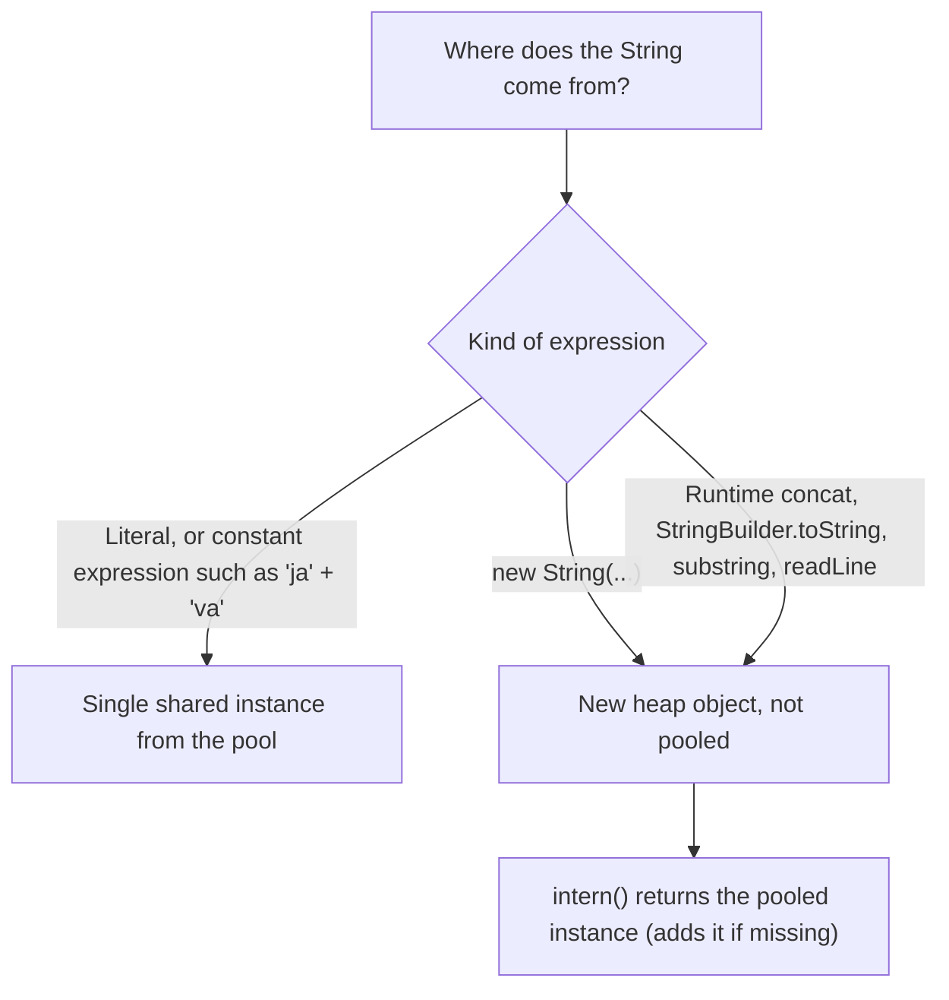

# 1.3 Strings and Text Basics

> **Goal:** Know how `String` is built and stored, why identity comparisons mislead, how Unicode really works, how concatenation compiles, and how to use regex and formatting safely.

**Level:** refresher with internals. The pool, Unicode and regex backtracking sections are the interview-heavy parts.
**Verified on:** OpenJDK 21.0.12. All outputs were produced by running the code with UTF-8 console output (see section 3.4).

## Contents

1. [What a String is (and why it is immutable)](#1-what-a-string-is-and-why-it-is-immutable)
2. [The string pool and identity](#2-the-string-pool-and-identity)
3. [Unicode: bytes, code units, code points, graphemes](#3-unicode-bytes-code-units-code-points-graphemes)
4. [The String API tour](#4-the-string-api-tour)
5. [Concatenation, StringBuilder and StringBuffer](#5-concatenation-stringbuilder-and-stringbuffer)
6. [Regular expressions](#6-regular-expressions)
7. [Formatting and text blocks](#7-formatting-and-text-blocks)
8. [Common gotchas](#8-common-gotchas)
9. [Interview questions](#9-interview-questions)

---

## 1. What a String is (and why it is immutable)

**Intuition.** A `String` is like a sealed, engraved plaque. You can read it, copy it, or order a new plaque derived from it (`toUpperCase()`), but you can never chisel the existing one. Because nobody can change it, it can be shared freely.

Inside `java.lang.String` (HotSpot, Java 9 and later) the essential fields are:

```text
  String object (heap)
  +-----------------------------------------------+
  | header                                        |
  | byte[] value   ───────►  [ 'j','a','v','a' ]  |   the characters (a separate array object)
  | byte   coder             0 = LATIN1, 1 = UTF16|   how to read the bytes
  | int    hash              cached hashCode      |   computed lazily, 0 = not yet computed
  +-----------------------------------------------+
```

**Compact strings (Java 9, JEP 254).** If every character fits in Latin-1 (code point <= 255) the text is stored as **1 byte per character**; otherwise as 2 bytes (UTF-16). Typical applications are mostly Latin-1, so this roughly halves string memory. It is invisible in the API (`charAt` behaves identically) and can be disabled with `-XX:-CompactStrings`.

### Why immutability?

| Reason | What breaks if strings were mutable |
|---|---|
| **Safe sharing** (the pool, literals) | One caller changing a shared literal would corrupt every other user |
| **Hash caching** | A key's hash could change after insertion into a `HashMap`, making the entry unreachable |
| **Thread safety** | No synchronization is ever needed to share a string |
| **Security** | A file path or class name validated once could be altered afterwards (check-then-use bugs) |
| **Class loading and reflection** | Names used as identifiers must not change |

Trade-off: building text piece by piece creates many intermediate strings, which is why `StringBuilder` exists (section 5).

---

## 2. The string pool and identity

The JVM keeps a **string pool** (an internal hash table, stored in the heap since Java 7; its size is tunable with `-XX:StringTableSize`). String **literals** and **compile-time constant expressions** are placed in it, so identical literals share one object.



```java
public class StringPoolDemo {
    static final String CONST_A = "ja";
    static String nonConstB = "va";

    public static void main(String[] args) {
        String s1 = "java";
        String s2 = "java";
        String s3 = new String("java");
        System.out.println("literal == literal      : " + (s1 == s2));
        System.out.println("literal == new String   : " + (s1 == s3));
        System.out.println("literal equals new      : " + s1.equals(s3));
        System.out.println("literal == s3.intern()  : " + (s1 == s3.intern()));

        // compile-time constant expressions are folded and pooled
        String folded = "ja" + "va";
        System.out.println("\"ja\"+\"va\" == literal    : " + (folded == s1));

        final String finalA = "ja";                 // a constant variable
        String viaFinal = finalA + "va";
        System.out.println("final var + literal     : " + (viaFinal == s1));

        String notFinal = "ja";
        String viaVar = notFinal + "va";            // computed at runtime -> new object
        System.out.println("non-final var + literal : " + (viaVar == s1));
        System.out.println("...after intern()       : " + (viaVar.intern() == s1));

        String viaStaticFinal = CONST_A + "va";     // static final constant
        String viaStaticNonFinal = "ja" + nonConstB;
        System.out.println("static final constant   : " + (viaStaticFinal == s1));
        System.out.println("static non-final        : " + (viaStaticNonFinal == s1));

        // equals() is what you want for content
        String fromBuilder = new StringBuilder("ja").append("va").toString();
        System.out.println("builder result == literal: " + (fromBuilder == s1));
        System.out.println("builder result equals    : " + fromBuilder.equals(s1));

        // hash collisions are normal: equal hash does not mean equal strings
        System.out.println("\"Aa\".hashCode() = " + "Aa".hashCode() + ", \"BB\".hashCode() = " + "BB".hashCode()
                + ", equal strings? " + "Aa".equals("BB"));
    }
}

// ---- Output ----
// literal == literal      : true
// literal == new String   : false
// literal equals new      : true
// literal == s3.intern()  : true
// "ja"+"va" == literal    : true
// final var + literal     : true
// non-final var + literal : false
// ...after intern()       : true
// static final constant   : true
// static non-final        : false
// builder result == literal: false
// builder result equals    : true
// "Aa".hashCode() = 2112, "BB".hashCode() = 2112, equal strings? false
```

What decides the result:

| Expression | `== literal`? | Reason |
|---|---|---|
| `"ja" + "va"` | true | Constant expression, folded by `javac` at compile time |
| `finalA + "va"` where `final String finalA = "ja"` | true | A `final` variable with a constant initializer is a **constant variable** |
| `notFinal + "va"` | false | Computed at runtime, creates a new object |
| `new String("java")` | false | `new` always allocates |
| `x.intern()` | true | Returns the canonical pooled instance |

Guidance:

- **Always compare content with `equals`** (or `equalsIgnoreCase`). Use `==` on strings only if you intentionally rely on interning.
- `intern()` can save memory when you read millions of repeated values, but it is a global table with its own cost. Prefer your own `Map`-based canonicalization or the G1 option `-XX:+UseStringDeduplication` (which deduplicates the underlying `byte[]`, not the `String` objects).
- `"Aa"` and `"BB"` have the same `hashCode` (2112). Equal hashes do not imply equal strings; `equals` is the final judge. Hash collisions are why `HashMap` bins can degrade (see Part 09).
- `switch` on a `String` compiles to `hashCode()` followed by `equals()` checks.
- Since Java 7u6, `substring` **copies** the characters; it no longer keeps the original large array alive.

---

## 3. Unicode: bytes, code units, code points, graphemes

### 3.1 Four different "lengths"

```text
  What you see:         é               😀             👨‍👩‍👧
  Graphemes (user-perceived characters)   1               1              1
  Code points (Unicode numbers)           1               1              5   (3 emoji + 2 joiners)
  UTF-16 code units (Java char)           1               2              8
  UTF-8 bytes                             2               4             18
```

- A Java `char` is a **16-bit UTF-16 code unit**, not necessarily a full character.
- Characters above U+FFFF (most emoji, some CJK) use a **surrogate pair**: two `char`s (a high surrogate followed by a low surrogate).
- `String.length()` counts code units. `codePointCount(...)` counts code points. A user-perceived character (grapheme cluster) can need several code points; the regex `\X` (Java 9) matches one grapheme.

```java
import java.nio.charset.StandardCharsets;
import java.util.Locale;

public class UnicodeDemo {
    public static void main(String[] args) {
        String plain = "hello";
        String accented = "héllo";                // h + e-acute + llo
        String emoji = "hi 😀";              // "hi " + grinning face (U+1F600)

        System.out.println("length(\"hello\")      = " + plain.length());
        System.out.println("length(accented)     = " + accented.length());
        System.out.println("emoji.length()       = " + emoji.length() + "   (UTF-16 code units)");
        System.out.println("emoji code points    = " + emoji.codePointCount(0, emoji.length()));
        System.out.println("last code point      = U+" + Integer.toHexString(emoji.codePointAt(3)).toUpperCase());
        System.out.println("charAt(3) is high surrogate? " + Character.isHighSurrogate(emoji.charAt(3)));

        // Reversing: StringBuilder.reverse() understands surrogate pairs, a char loop does not
        String reversedOk = new StringBuilder(emoji).reverse().toString();
        char[] chars = emoji.toCharArray();
        for (int i = 0, j = chars.length - 1; i < j; i++, j--) {
            char t = chars[i]; chars[i] = chars[j]; chars[j] = t;
        }
        String reversedBad = new String(chars);
        System.out.println("StringBuilder.reverse valid pair? "
                + Character.isHighSurrogate(reversedOk.charAt(0)));
        System.out.println("char-loop reverse valid pair?     "
                + Character.isHighSurrogate(reversedBad.charAt(0)) + "  (low surrogate came first)");

        // Bytes depend on the encoding
        System.out.println("UTF-8 bytes  hello   = " + plain.getBytes(StandardCharsets.UTF_8).length);
        System.out.println("UTF-8 bytes  accent  = " + accented.getBytes(StandardCharsets.UTF_8).length);
        System.out.println("UTF-8 bytes  emoji   = " + emoji.getBytes(StandardCharsets.UTF_8).length);
        System.out.println("UTF-16 bytes emoji   = " + emoji.getBytes(StandardCharsets.UTF_16BE).length);
        byte[] latin1 = emoji.getBytes(StandardCharsets.ISO_8859_1);
        System.out.println("Latin-1 of emoji     = " + new String(latin1, StandardCharsets.ISO_8859_1) + "  (unmappable -> '?')");

        // Characters the user SEES (grapheme clusters) can span several code points
        String eAcute = "é";                      // 'e' + combining acute accent
        System.out.println("e + combining accent: length=" + eAcute.length()
                + ", code points=" + eAcute.codePointCount(0, eAcute.length())
                + ", graphemes=" + java.util.regex.Pattern.compile("\\X").matcher(eAcute).results().count());
        String family = "👨‍👩‍👧";   // man + ZWJ + woman + ZWJ + girl
        System.out.println("family emoji        : length=" + family.length()
                + ", code points=" + family.codePointCount(0, family.length())
                + ", graphemes=" + java.util.regex.Pattern.compile("\\X").matcher(family).results().count());

        // Case conversion is locale-sensitive and can change length
        System.out.println("\"TITLE\".toLowerCase()            = " + "TITLE".toLowerCase(Locale.ROOT));
        System.out.println("\"TITLE\".toLowerCase(Turkish)     = " + "TITLE".toLowerCase(Locale.of("tr")));
        System.out.println("\"straße\".toUpperCase(ROOT)         = " + "straße".toUpperCase(Locale.ROOT));
        System.out.println("length changes: " + "straße".length() + " -> " + "straße".toUpperCase(Locale.ROOT).length());

        // Comparing without caring for case, correctly
        System.out.println("equalsIgnoreCase    : " + "straße".equalsIgnoreCase("STRASSE")
                + "  (per-char comparison, no ss expansion)");
    }
}

// ---- Output ----
// length("hello")      = 5
// length(accented)     = 5
// emoji.length()       = 5   (UTF-16 code units)
// emoji code points    = 4
// last code point      = U+1F600
// charAt(3) is high surrogate? true
// StringBuilder.reverse valid pair? true
// char-loop reverse valid pair?     false  (low surrogate came first)
// UTF-8 bytes  hello   = 5
// UTF-8 bytes  accent  = 6
// UTF-8 bytes  emoji   = 7
// UTF-16 bytes emoji   = 10
// Latin-1 of emoji     = hi ?  (unmappable -> '?')
// e + combining accent: length=2, code points=2, graphemes=1
// family emoji        : length=8, code points=5, graphemes=1
// "TITLE".toLowerCase()            = title
// "TITLE".toLowerCase(Turkish)     = tıtle
// "straße".toUpperCase(ROOT)         = STRASSE
// length changes: 6 -> 7
// equalsIgnoreCase    : false  (per-char comparison, no ss expansion)
```

### 3.2 Consequences

- `charAt(i)` can return half of a character. Iterate with `codePoints()` when text may contain supplementary characters.
- Reversing with a `char` loop breaks surrogate pairs; `StringBuilder.reverse()` handles them correctly.
- **Case conversion depends on the locale** and can change length: Turkish maps `I` to dotless `ı`; German `ß` uppercases to `SS`. For protocol identifiers, keys and file extensions use `toLowerCase(Locale.ROOT)`. A classic bug: an app running under a Turkish locale fails on `"TITLE".toLowerCase()`.
- `equalsIgnoreCase` compares character by character; it does not apply expansions such as `ß` to `SS`. For human-language comparison use `java.text.Collator` (Part 15).

### 3.3 Bytes and charsets

Converting between `String` and `byte[]` always involves a **charset**. The no-argument forms (`getBytes()`, `new String(bytes)`) use the default charset: **UTF-8 by default since Java 18 (JEP 400)**, previously platform-dependent. Always pass one explicitly (`StandardCharsets.UTF_8`). Characters that the target charset cannot represent are replaced (for example with `?`), silently losing data.

### 3.4 Console output

What you see on a terminal depends on the console encoding, not on the string. Java 19+ exposes it as the `stdout.encoding` property. The outputs in this chapter were captured with a UTF-8 terminal. On a terminal using a legacy code page, non-ASCII text may show as `?`.

---

## 4. The String API tour

```java
import java.util.Arrays;
import java.util.List;
import java.util.Locale;
import java.util.StringJoiner;
import java.util.stream.Collectors;

public class StringApiTour {
    public static void main(String[] args) {
        // trim() vs strip() (Java 11): trim only removes chars <= U+0020
        String padded = "  hi  ";              // non-breaking space, regular space, em space
        System.out.println("trim  length  = " + padded.trim().length());
        System.out.println("strip length  = " + padded.strip().length());
        System.out.println("isBlank(\" \\t\\n\") = " + " \t\n".isBlank());
        System.out.println("isEmpty(\" \")       = " + " ".isEmpty());

        // repeat, lines, join
        System.out.println("repeat        = " + "ab".repeat(3));
        System.out.println("lines         = " + "one\ntwo\r\nthree".lines().toList());
        System.out.println("join          = " + String.join("-", List.of("a", "b", "c")));
        StringJoiner sj = new StringJoiner(", ", "[", "]");
        sj.setEmptyValue("EMPTY");
        System.out.println("empty joiner  = " + sj);
        sj.add("x").add("y");
        System.out.println("joiner        = " + sj);
        System.out.println("Collectors    = " + List.of(1, 2, 3).stream().map(String::valueOf).collect(Collectors.joining("|")));

        // split gotchas
        System.out.println("\"a,b,,\".split(\",\")        = " + Arrays.toString("a,b,,".split(",")) + " length " + "a,b,,".split(",").length);
        System.out.println("\"a,b,,\".split(\",\", -1)    = " + Arrays.toString("a,b,,".split(",", -1)) + " length " + "a,b,,".split(",", -1).length);
        System.out.println("\"a.b\".split(\".\")          = " + Arrays.toString("a.b".split(".")) + " length " + "a.b".split(".").length);
        System.out.println("\"a.b\".split(\"\\\\.\")        = " + Arrays.toString("a.b".split("\\.")));
        System.out.println("\"\".split(\",\")             = " + Arrays.toString("".split(",")) + " length " + "".split(",").length);
        System.out.println("\" a  b \".split(\" \")       = " + Arrays.toString(" a  b ".split(" ")));
        System.out.println("\" a  b \".trim().split(\"\\\\s+\") = " + Arrays.toString(" a  b ".trim().split("\\s+")));

        // compare
        System.out.println("\"apple\".compareTo(\"banana\") = " + "apple".compareTo("banana"));
        System.out.println("\"Z\".compareTo(\"a\")          = " + "Z".compareTo("a") + "   (uppercase sorts first)");
        System.out.println("equalsIgnoreCase             = " + "Java".equalsIgnoreCase("JAVA"));
        System.out.println("contentEquals                = " + "abc".contentEquals(new StringBuilder("abc")));

        // formatting
        System.out.println(String.format("[%5.2f] [%-6s] [%05d] [%,d]", 3.14159, "ab", 42, 1234567));
        System.out.println("%s is %d years".formatted("Asha", 30));
        System.out.println(String.format(Locale.GERMANY, "%,.2f", 1234567.891));
        System.out.println(String.format(Locale.US, "%,.2f", 1234567.891));
        System.out.println(String.format("%08.3f|%+d|%x|%o|%b|%c|%%", 3.14159, 7, 255, 8, true, 'Z'));

        // indexOf / substring / replace
        String s = "hello, world";
        System.out.println("indexOf(\"o\")      = " + s.indexOf("o") + ", lastIndexOf = " + s.lastIndexOf("o") + ", indexOf(\"o\", 5) = " + s.indexOf("o", 5));
        System.out.println("substring(7)       = " + s.substring(7));
        System.out.println("substring(0, 5)    = " + s.substring(0, 5));
        System.out.println("replace(char)      = " + s.replace('l', 'L'));
        System.out.println("replace(\"l\", \"\")   = " + s.replace("l", ""));
        System.out.println("chars() count of l = " + s.chars().filter(ch -> ch == 'l').count());

        // concatenation traps
        String nothing = null;
        System.out.println("null + \"a\"          = " + (nothing + "a"));
        System.out.println("\"\" + 1 + 2          = " + ("" + 1 + 2));
        System.out.println("1 + 2 + \"\"          = " + (1 + 2 + ""));
        System.out.println("'a' + 'b' + \"c\"      = " + ('a' + 'b' + "c"));
        System.out.println("\"a\" + 'b' + 'c'      = " + ("a" + 'b' + 'c'));
        char c = 'x';
        System.out.println("c + 1 printed       = " + (c + 1) + ", (char)(c + 1) = " + (char) (c + 1));

        // text block (Java 15): incidental indentation is stripped
        String json = """
                {
                  "name": "Asha",
                  "age": 30
                }
                """;
        System.out.print(json);
        System.out.println("text block ends with newline: " + json.endsWith("\n"));
    }
}

// ---- Output ----
// trim  length  = 6
// strip length  = 4
// isBlank(" \t\n") = true
// isEmpty(" ")       = false
// repeat        = ababab
// lines         = [one, two, three]
// join          = a-b-c
// empty joiner  = EMPTY
// joiner        = [x, y]
// Collectors    = 1|2|3
// "a,b,,".split(",")        = [a, b] length 2
// "a,b,,".split(",", -1)    = [a, b, , ] length 4
// "a.b".split(".")          = [] length 0
// "a.b".split("\\.")        = [a, b]
// "".split(",")             = [] length 1
// " a  b ".split(" ")       = [, a, , b]
// " a  b ".trim().split("\\s+") = [a, b]
// "apple".compareTo("banana") = -1
// "Z".compareTo("a")          = -7   (uppercase sorts first)
// equalsIgnoreCase             = true
// contentEquals                = true
// [ 3.14] [ab    ] [00042] [1,234,567]
// Asha is 30 years
// 1.234.567,89
// 1,234,567.89
// 0003.142|+7|ff|10|true|Z|%
// indexOf("o")      = 4, lastIndexOf = 8, indexOf("o", 5) = 8
// substring(7)       = world
// substring(0, 5)    = hello
// replace(char)      = heLLo, worLd
// replace("l", "")   = heo, word
// chars() count of l = 3
// null + "a"          = nulla
// "" + 1 + 2          = 12
// 1 + 2 + ""          = 3
// 'a' + 'b' + "c"      = 195c
// "a" + 'b' + 'c'      = abc
// c + 1 printed       = 121, (char)(c + 1) = y
// {
//   "name": "Asha",
//   "age": 30
// }
// text block ends with newline: true
```

### API by Java version

| Version | Additions |
|---|---|
| 8 | `String.join`, `StringJoiner`, `chars()` via `CharSequence` |
| 9 | Compact strings, `Matcher.results()`, regex `\X` (internal changes also made string concatenation faster, section 5) |
| 11 | `isBlank`, `lines`, `strip`, `stripLeading`, `stripTrailing`, `repeat`, `Character.toString(int)` |
| 12 | `indent`, `transform` |
| 15 | Text blocks (final), `formatted`, `stripIndent`, `translateEscapes` |

### Things this output teaches

- **`trim()` vs `strip()`**: `trim` removes only characters up to U+0020, so it leaves Unicode spaces (non-breaking space, em space). `strip()` (Java 11) uses `Character.isWhitespace`. Prefer `strip`.
- **`isEmpty` vs `isBlank`**: `isBlank` is true for whitespace-only strings.
- **`split` surprises**: trailing empty strings are dropped unless you pass a negative limit; `"a.b".split(".")` is empty because `.` is a regex meaning "any character"; `"".split(",")` returns an array with one empty string (length 1, so it prints as `[]`); a leading separator yields a leading empty string.
- **`compareTo`** is lexicographic by UTF-16 code unit: uppercase letters sort before lowercase.
- **`format`** is locale-sensitive: Germany prints `1.234.567,89` where the US prints `1,234,567.89`. Pass a `Locale` explicitly for machine-readable output.
- **`+` with `char`**: `'a' + 'b'` is integer addition (`195`) unless one side is already a `String`; evaluation is left to right, so `1 + 2 + ""` is `"3"` but `"" + 1 + 2` is `"12"`.

`String.valueOf` and `null`:

```java
public class ValueOfNull {
    public static void main(String[] args) {
        Object o = null;
        System.out.println(String.valueOf(o));
        try {
            System.out.println(String.valueOf((char[]) null));
        } catch (NullPointerException e) {
            System.out.println("valueOf((char[]) null) -> NPE");
        }
    }
}

// ---- Output ----
// null
// valueOf((char[]) null) -> NPE
```

`String.valueOf(null)` written with a literal `null` resolves to the `char[]` overload (most specific) and throws; cast to `Object` to get `"null"`.

---

## 5. Concatenation, StringBuilder and StringBuffer

Because strings are immutable, `s += x` allocates a **new** string and copies everything every time. Inside a loop that is **O(n²)** in total copying.

| Class | Mutable | Thread-safe | Use |
|---|---|---|---|
| `String` | No | Yes (immutable) | Values, keys, constants |
| `StringBuilder` | Yes | No | Building text in one thread (default choice) |
| `StringBuffer` | Yes | Yes (every method synchronized) | Legacy; almost never needed |
| `StringJoiner` / `Collectors.joining` | Builder | No | Delimited lists with prefix/suffix |

### How `+` compiles

- Up to **Java 8**: `javac` rewrote `a + b + c` into a hidden `new StringBuilder().append(a).append(b).append(c).toString()`.
- Since **Java 9 (JEP 280)**: `javac` emits a single `invokedynamic` call to `makeConcatWithConstants`. The JVM picks the best strategy at runtime (it can size the result exactly and avoid the intermediate builder), and the strategy can improve in later JDKs without recompiling your code.

Real `javap -c -p` output for the two methods in the demo below:

```text
  static java.lang.String slowLoop(int);
    Code:
       0: ldc           #7                  // String
       2: astore_1
       3: iconst_0
       4: istore_2
       5: iload_2
       6: iload_0
       7: if_icmpge     24
      10: aload_1
      11: iload_2
      12: invokedynamic #9,  0              // InvokeDynamic #0:makeConcatWithConstants:(Ljava/lang/String;I)Ljava/lang/String;
      17: astore_1
      18: iinc          2, 1
      21: goto          5
      24: aload_1
      25: areturn

  static java.lang.String simpleConcat(java.lang.String, int);
    Code:
       0: aload_0
       1: iload_1
       2: invokedynamic #24,  0             // InvokeDynamic #1:makeConcatWithConstants:(Ljava/lang/String;I)Ljava/lang/String;
       7: areturn
```

Note that even `slowLoop` is one `invokedynamic` per iteration: the call is cheaper than in Java 8, but each iteration still creates a **new** string and copies the whole accumulated text. Use a `StringBuilder` for loops.

```java
public class BuilderAndConcat {

    static String slowLoop(int n) {
        String s = "";
        for (int i = 0; i < n; i++) {
            s += i;                      // new String each iteration: O(n^2) copying overall
        }
        return s;
    }

    static String fastLoop(int n) {
        StringBuilder sb = new StringBuilder();
        for (int i = 0; i < n; i++) {
            sb.append(i);
        }
        return sb.toString();
    }

    static String simpleConcat(String a, int b) {
        return "id=" + a + ", n=" + b;   // one invokedynamic call site, not a chain of appends
    }

    public static void main(String[] args) {
        System.out.println("same result: " + slowLoop(1000).equals(fastLoop(1000)));

        StringBuilder sb = new StringBuilder();
        System.out.println("initial capacity       = " + sb.capacity());
        sb.append("0123456789012345");      // 16 chars: fits exactly
        System.out.println("after 16 chars         = " + sb.capacity());
        sb.append("x");                     // 17th char forces growth
        System.out.println("after 17 chars         = " + sb.capacity());
        sb.append("y".repeat(17));          // 34 chars: fits exactly in the new capacity
        System.out.println("after 34 chars         = " + sb.capacity());
        sb.append("z");                     // 35th char
        System.out.println("after 35 chars         = " + sb.capacity());
        sb.trimToSize();
        System.out.println("after trimToSize()     = " + sb.capacity() + " (length " + sb.length() + ")");

        StringBuilder presized = new StringBuilder(1000);
        System.out.println("presized capacity      = " + presized.capacity());

        // useful mutations
        StringBuilder m = new StringBuilder("hello world");
        m.insert(0, ">> ").replace(3, 8, "HELLO").deleteCharAt(m.length() - 1).setCharAt(0, '<');
        System.out.println(m);
        System.out.println(new StringBuilder("level").reverse().toString().equals("level"));

        // StringBuilder is mutable, so equals() is identity-based
        System.out.println("sb.equals(sb copy)     = " + new StringBuilder("a").equals(new StringBuilder("a")));
        System.out.println("compareTo (Java 11)    = " + new StringBuilder("a").compareTo(new StringBuilder("b")));
    }
}

// ---- Output ----
// same result: true
// initial capacity       = 16
// after 16 chars         = 16
// after 17 chars         = 34
// after 34 chars         = 34
// after 35 chars         = 70
// after trimToSize()     = 35 (length 35)
// presized capacity      = 1000
// <> HELLO worl
// true
// sb.equals(sb copy)     = false
// compareTo (Java 11)    = -1
```

`StringBuilder` growth: the default capacity is 16. When full it grows to `old * 2 + 2` (16 → 34 → 70), copying the old contents. If you know the approximate size, pre-size it (`new StringBuilder(1000)`) to avoid repeated copies.

---

## 6. Regular expressions

**Intuition.** A regex is a tiny program describing a text pattern. The engine runs it by **backtracking**: it tries an option, and if the rest fails it undoes the last choice and tries another.

`java.util.regex` essentials:

| Class | Role |
|---|---|
| `Pattern` | The compiled regex. **Immutable and thread-safe**: compile once, store in a `static final` field |
| `Matcher` | One matching session over an input. Not thread-safe |
| `MatchResult` | Immutable snapshot of a match (used by `Matcher.results()`, Java 9) |

| Syntax | Meaning |
|---|---|
| `matches()` | The **whole** input must match |
| `find()` | Find the next match **anywhere** |
| `(...)` / `(?<name>...)` / `(?:...)` | Capturing group / named group / non-capturing group |
| `$1`, `${name}` in a replacement | Group references (escape literal `$` with `Matcher.quoteReplacement`) |
| `*`, `+`, `?`, `{n,m}` | **Greedy**: take as much as possible, give back if needed |
| `*?`, `+?` | **Reluctant**: take as little as possible |
| `*+`, `++` | **Possessive**: take as much as possible, never give back |
| `(?=x)` `(?<=x)` | Lookahead / lookbehind (zero-width) |
| `Pattern.quote(s)` | Treat user text as a literal |

```java
import java.util.regex.Matcher;
import java.util.regex.Pattern;

public class RegexDemo {
    // compile once, reuse: Patterns are immutable and thread-safe
    private static final Pattern LOG = Pattern.compile(
            "(?<date>\\d{4}-\\d{2}-\\d{2}) (?<level>[A-Z]+) (?<msg>.*)");

    public static void main(String[] args) {
        // matches() needs the WHOLE string, find() looks for a match anywhere
        System.out.println("\"a1\".matches(\"\\\\d\")     = " + "a1".matches("\\d"));
        System.out.println("find \\d in \"a1\"        = " + Pattern.compile("\\d").matcher("a1").find());

        // groups, named groups
        Matcher m = LOG.matcher("2026-10-25 ERROR disk almost full");
        if (m.matches()) {
            System.out.println("date  = " + m.group("date"));
            System.out.println("level = " + m.group("level"));
            System.out.println("msg   = " + m.group("msg"));
            System.out.println("group 0 = " + m.group(0));
            System.out.println("groupCount = " + m.groupCount());
        }

        // greedy vs reluctant
        String html = "<b>bold</b> and <i>italic</i>";
        System.out.println("greedy     <.+>  : " + firstMatch("<.+>", html));
        System.out.println("reluctant  <.+?> : " + firstMatch("<.+?>", html));

        // find all matches (Matcher.results(), Java 9)
        System.out.println("all numbers: " + Pattern.compile("\\d+").matcher("a1 b22 c333").results()
                .map(r -> r.group()).toList());

        // replacement with group references
        System.out.println(Pattern.compile("(\\w+)@(\\w+)\\.com").matcher("mail asha@example.com now")
                .replaceAll("$2:$1"));
        System.out.println("replaceAll with literal $: " + "price".replaceAll("price", Matcher.quoteReplacement("$5")));

        // quoting user input
        String userInput = "1+1=2?";
        System.out.println("matches quoted literal  : " + "x1+1=2?x".matches(".*" + Pattern.quote(userInput) + ".*"));

        // flags
        System.out.println("case-insensitive        : " + Pattern.compile("hello", Pattern.CASE_INSENSITIVE).matcher("HeLLo").matches());
        System.out.println("inline (?i)             : " + "HeLLo".matches("(?i)hello"));

        // quantifier flavours: greedy gives back, reluctant takes little, possessive never gives back
        System.out.println("\"aaa\" matches a*a   (greedy)     : " + "aaa".matches("a*a"));
        System.out.println("\"aaa\" matches a*+a  (possessive) : " + "aaa".matches("a*+a"));
        System.out.println("\"aaa\" matches a*?a  (reluctant)  : " + "aaa".matches("a*?a"));

        // lookahead and lookbehind: match a position without consuming text
        System.out.println("digits followed by %      : " + Pattern.compile("\\d+(?=%)").matcher("save 20% now").results()
                .map(r -> r.group()).toList());
        System.out.println("digits preceded by $      : " + Pattern.compile("(?<=\\$)\\d+").matcher("cost $45 or 30 EUR").results()
                .map(r -> r.group()).toList());
    }

    static String firstMatch(String regex, String input) {
        Matcher m = Pattern.compile(regex).matcher(input);
        return m.find() ? m.group() : "none";
    }
}

// ---- Output ----
// "a1".matches("\\d")     = false
// find \d in "a1"        = true
// date  = 2026-10-25
// level = ERROR
// msg   = disk almost full
// group 0 = 2026-10-25 ERROR disk almost full
// groupCount = 3
// greedy     <.+>  : <b>bold</b> and <i>italic</i>
// reluctant  <.+?> : <b>
// all numbers: [1, 22, 333]
// mail example:asha now
// replaceAll with literal $: $5
// matches quoted literal  : true
// case-insensitive        : true
// inline (?i)             : true
// "aaa" matches a*a   (greedy)     : true
// "aaa" matches a*+a  (possessive) : false
// "aaa" matches a*?a  (reluctant)  : true
// digits followed by %      : [20]
// digits preceded by $      : [45]
```

### Catastrophic backtracking (ReDoS)

If a pattern can match the same text in exponentially many ways, a failing match can take astronomically long. An attacker supplying such input can freeze a thread (a *regular expression denial of service*). Measured on this machine (JDK 21), time to **fail** on `"aaaa...!"` of length n:

```text
n=18  (a+)+$     :     0 ms
n=18  ^(a+)+\1$  :    15 ms
n=22  (a+)+$     :     0 ms
n=22  ^(a+)+\1$  :   101 ms
n=26  (a+)+$     :     0 ms
n=26  ^(a+)+\1$  :  1213 ms
n=30  (a+)+$     :     0 ms
n=30  ^(a+)+\1$  : 21006 ms
```

- The simple nested-quantifier pattern `(a+)+$` showed **no** blow-up: modern JDKs memoize many such loops. Do not assume that, though.
- A pattern with a **backreference** (`\1`) defeats those optimizations and grows roughly 10-20× for every 4 extra characters. Timings are machine-dependent; the **growth rate** is the lesson.

Defenses: avoid nested quantifiers over overlapping alternatives, prefer possessive quantifiers or atomic groups (`(?>...)`) where backtracking is pointless, cap input length before matching, and for untrusted patterns or inputs match against a `CharSequence` wrapper that checks a deadline in `charAt`.

Practical tips: `String.matches`/`replaceAll`/`split` compile the regex on every call (single-character `split` has a fast path), so in hot code use a precompiled `Pattern`.

---

## 7. Formatting and text blocks

`String.format` / `printf` / `formatted` use `java.util.Formatter`:

| Specifier | Meaning | Example |
|---|---|---|
| `%s` | String (calls `toString`) | `%-6s` left-aligned, width 6 |
| `%d` | Integer | `%05d` zero-padded, `%,d` thousands separators, `%+d` always show sign |
| `%f` | Floating point | `%.2f`, `%08.3f` |
| `%x`, `%o` | Hex, octal | `ff`, `10` |
| `%b`, `%c` | Boolean, char | `true`, `Z` |
| `%n`, `%%` | Platform newline, literal percent | |

**Text blocks** (`"""`, Java 15, JEP 378) hold multi-line strings without escapes. The compiler strips the *incidental* indentation (determined by the closing delimiter and the least-indented line) and normalizes line endings to `\n`. See the output at the end of the API tour above. More in `06-lts-java-17/01-switch-expressions-and-text-blocks.md`.

---

## 8. Common gotchas

| Gotcha | Why it happens | Fix |
|---|---|---|
| `s1 == s2` false for equal text | `==` compares identity | `equals` |
| `s.toUpperCase();` seems to do nothing | Strings are immutable; the result is a new string | Assign the result |
| Loop concatenation is slow | New string and full copy per iteration (O(n²)) | `StringBuilder` |
| `"a.b".split(".")` returns nothing | The argument is a regex | `split("\\.")` or `Pattern.quote` |
| Trailing empties vanish in `split` | Default limit 0 removes them | `split(regex, -1)` |
| `length()` is not the number of characters | It counts UTF-16 code units | `codePointCount`, `\X` for graphemes |
| `charAt` splits an emoji | Surrogate pairs are two chars | Iterate `codePoints()` |
| `toLowerCase()` breaks under a Turkish locale | Locale-sensitive mapping | `toLowerCase(Locale.ROOT)` |
| Garbled text when reading bytes | Wrong or default charset | Always specify `StandardCharsets.UTF_8` |
| `trim()` keeps non-breaking spaces | Only strips <= U+0020 | `strip()` (Java 11) |
| `1 + 2 + "x"` vs `"x" + 1 + 2` | Left-to-right evaluation | Parenthesize, or use `String.valueOf`/format |
| `'a' + 'b'` is `195` | `char` arithmetic is integer arithmetic | Start with a `String` |
| `String.valueOf(null)` throws | Resolves to the `char[]` overload | Cast to `Object` |
| `replaceAll` with `$` in the replacement fails | `$` is a group reference | `Matcher.quoteReplacement` |
| `matches()` returns false though text is inside | It needs a full match | `find()` or add `.*` |
| Regex hangs on certain inputs | Catastrophic backtracking | Possessive/atomic groups, input limits |
| `%d` with a `double` throws `IllegalFormatConversionException` | Type must fit the specifier | `%f`, or cast |
| `String.format` output differs between machines | Default locale | Pass an explicit `Locale` |

---

## 9. Interview questions

<details>
<summary><strong>Q1. Why is <code>String</code> immutable? What do you gain?</strong></summary>

Safe sharing through the string pool and literals, a cacheable hash code (so strings are reliable `HashMap` keys), inherent thread safety, security (validated values such as paths or class names cannot change afterwards) and safe use as identifiers in class loading and reflection. The cost is extra allocation when building text, which `StringBuilder` addresses.
</details>

<details>
<summary><strong>Q2. How many objects does <code>new String("abc")</code> create?</strong></summary>

Up to two: the literal `"abc"` in the string pool (created once, when the class is loaded, if not already present) and a new `String` object on the heap created by `new`. The new object is a different instance from the pooled one, so `new String("abc") == "abc"` is `false`.
</details>

<details>
<summary><strong>Q3. What does <code>intern()</code> do, and when would you use it?</strong></summary>

It returns the canonical instance from the pool, adding the string if it is not there. It can save memory when many equal runtime-created strings are retained, but it adds table contention and tuning concerns, so use it sparingly (or use your own cache, or G1 string deduplication).
</details>

<details>
<summary><strong>Q4. Is <code>"ja" + "va" == "java"</code> true? What about with variables?</strong></summary>

True: it is a compile-time constant expression folded by `javac`, so both sides are the same pooled literal. With `final String a = "ja"` (a constant variable) it is still true. With a non-final variable (`String a = "ja"; a + "va" == "java"`) it is false, because the concatenation runs at runtime and allocates; `.intern()` would make it true.
</details>

<details>
<summary><strong>Q5. <code>String</code> vs <code>StringBuilder</code> vs <code>StringBuffer</code>?</strong></summary>

`String` is immutable. `StringBuilder` is a mutable, unsynchronized builder and the default for building text. `StringBuffer` is the older mutable class with synchronized methods; its synchronization is rarely useful because compound operations still need external locking.
</details>

<details>
<summary><strong>Q6. How is <code>a + b + c</code> compiled, and why is concatenation in a loop still a problem?</strong></summary>

Java 8 and earlier: a hidden `StringBuilder` chain. Java 9+ (JEP 280): one `invokedynamic` to `makeConcatWithConstants`, which the JVM optimizes at runtime. In a loop, each iteration still creates a new string and copies the whole accumulated text, giving O(n²) total work; accumulate in a `StringBuilder` instead.
</details>

<details>
<summary><strong>Q7. What are compact strings?</strong></summary>

Since Java 9 (JEP 254) a `String` stores its characters as a `byte[]` plus a coder flag: 1 byte per char (Latin-1) when all characters fit, otherwise 2 bytes (UTF-16). It reduces heap use and is transparent to code. It can be turned off with `-XX:-CompactStrings`.
</details>

<details>
<summary><strong>Q8. Why can <code>length()</code> be different from the number of characters a user sees?</strong></summary>

`length()` counts UTF-16 code units. Characters outside the Basic Multilingual Plane (such as most emoji) take two units (a surrogate pair), and some user-perceived characters are sequences of several code points (`e` + a combining accent, or a family emoji joined with zero-width joiners). Use `codePointCount` for code points and the `\X` regex or `BreakIterator` for graphemes.
</details>

<details>
<summary><strong>Q9. What is wrong with <code>str.toLowerCase()</code> in server code?</strong></summary>

It uses the default locale. In a Turkish locale `"TITLE".toLowerCase()` yields `"tıtle"` (dotless ı), breaking comparisons with identifiers or keywords. Use `toLowerCase(Locale.ROOT)` for technical text and a proper `Locale` for human-facing text.
</details>

<details>
<summary><strong>Q10. What is the default charset in Java today?</strong></summary>

UTF-8 since Java 18 (JEP 400); before that it depended on the platform. Regardless, pass a charset explicitly to `getBytes`, `new String`, `InputStreamReader` and file APIs so behavior is the same everywhere.
</details>

<details>
<summary><strong>Q11. Why does <code>"a,b,,".split(",").length</code> equal 2?</strong></summary>

With the default limit of 0, trailing empty strings are removed from the result. Pass a negative limit (`split(",", -1)`) to keep them (length 4). Also remember the argument is a regex, so `"."` and `"|"` need escaping.
</details>

<details>
<summary><strong>Q12. <code>trim()</code> vs <code>strip()</code>?</strong></summary>

`trim` removes characters up to U+0020 (ASCII whitespace and control characters) and leaves Unicode spaces such as the non-breaking space. `strip` (Java 11) removes everything `Character.isWhitespace` accepts, so it handles Unicode whitespace. Prefer `strip`.
</details>

<details>
<summary><strong>Q13. Greedy, reluctant and possessive quantifiers: what is the difference?</strong></summary>

Greedy (`.*`) takes as much as possible and gives back on failure; reluctant (`.*?`) takes as little as possible and extends on failure; possessive (`.*+`) takes as much as possible and never gives back. `"aaa".matches("a*+a")` is `false` because the possessive `a*+` consumes all three `a`s and leaves nothing for the final `a`.
</details>

<details>
<summary><strong>Q14. What is catastrophic backtracking and how do you defend against it?</strong></summary>

When a regex can match the same input in exponentially many ways, a failed match tries all of them, so runtime explodes with input length (the backreference pattern in the demo went from 15 ms to 21 s for 12 extra characters). Defend by avoiding nested quantifiers on overlapping alternatives, using possessive quantifiers or atomic groups, limiting input size, and applying a time budget when handling untrusted input.
</details>

<details>
<summary><strong>Q15. Is <code>Pattern</code> thread-safe? <code>Matcher</code>?</strong></summary>

`Pattern` is immutable and thread-safe, so compile once and share it (`static final`). `Matcher` holds match state and is **not** thread-safe: create one per use.
</details>

<details>
<summary><strong>Q16. What does <code>'a' + 'b' + "c"</code> evaluate to?</strong></summary>

`"195c"`. The two `char`s are added as integers (97 + 98 = 195) first, because evaluation is left to right and neither operand is a `String` yet; then `195` is concatenated with `"c"`. Whereas `"a" + 'b' + 'c'` is `"abc"`.
</details>

---

[Previous: 1.2 Exceptions and Resources](./02-exceptions-and-resources.md) · [Part index](./README.md) · Next: [2.A.1 Classes, Objects and Initialization](../02-oop-deep-dive/A-foundations/01-classes-objects-and-initialization.md)