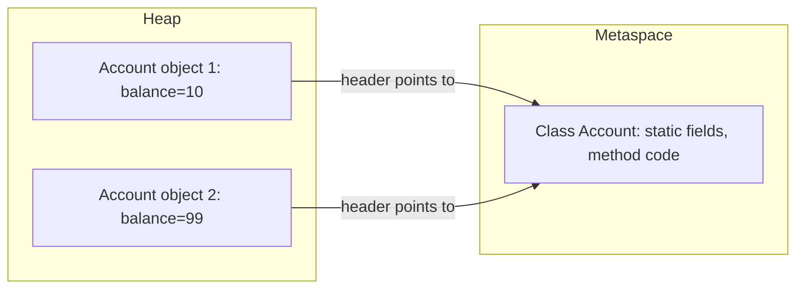

# A.1 Classes, Objects and Initialization

> **Goal:** Know exactly what happens, in what order, when a class is loaded and an object is created, so initialization bugs stop being mysterious.

**Level:** refresher with under-the-hood detail. You have written thousands of constructors; this chapter is about the order of events that interviews and production bugs depend on.
**Verified on:** OpenJDK 21.0.12. Every output below was produced by running the code.

## Contents

1. [Class versus object](#1-class-versus-object)
2. [The life of `new`](#2-the-life-of-new)
3. [Initialization order, proven by running it](#3-initialization-order-proven-by-running-it)
4. [When does a class initialize?](#4-when-does-a-class-initialize)
5. [Constructors and chaining](#5-constructors-and-chaining)
6. [Never call overridable methods from a constructor](#6-never-call-overridable-methods-from-a-constructor)
7. [Static factories, copy constructors and builders](#7-static-factories-copy-constructors-and-builders)
8. [Common gotchas](#8-common-gotchas)
9. [Interview questions](#9-interview-questions)

---

## 1. Class versus object

**Intuition.** A class is the architect's blueprint; an object is one house built from it. The blueprint exists once (loaded by a class loader, with its static fields and method code); houses are created many times on the heap, each with its own copy of the instance fields.

| | Class | Object |
|---|---|---|
| Lives in | Metaspace (as a `Class` mirror plus metadata) | Heap |
| Created by | Class loading + linking + initialization | `new`, reflection, deserialization, `clone` |
| Holds | static fields, method bytecode, constant pool | instance fields, a header pointing at its class |
| Count | one per class loader | as many as you create |



## 2. The life of `new`

`new Account()` is not one step. The JVM performs, in order:

1. **Load, link, initialize the class** (only the first time): read the `.class` bytes, verify them, allocate static fields with default values, then run static initializers.
2. **Allocate memory** on the heap for all instance fields, all zeroed (`0`, `false`, `null`).
3. **Run the constructor chain**: the constructor calls `super(...)` first (implicitly if you do not write it), all the way up to `Object`.
4. **For each class on the way down:** run its instance initializers and field initializers *in source order*, then the rest of that constructor body.

```text
new Child()
  |
  |-- (first use only) Child class initialized, after Parent class initialized
  |-- allocate Child object, all fields = 0/null
  '-- Child() -> super() -> Parent() -> super() -> Object()
                                  |          Parent field initializers + Parent body run
                          Child field initializers + Child body run
```

The key consequence: **between allocation and the end of the constructor the object is partly built**, and fields of a subclass still hold default values while a superclass constructor runs. Section 6 shows the bug this causes.

## 3. Initialization order, proven by running it

The rule of thumb: **static things once, parent before child; then per object: parent fields and constructor, child fields and constructor.**

```java
public class InitOrder {
    static int log(String message) {
        System.out.println(message);
        return 1;
    }

    static class Parent {
        static { log("1. Parent static block"); }
        int parentField = log("3. Parent instance field initializer");
        { log("4. Parent instance initializer block"); }
        Parent() { log("5. Parent constructor body"); }
    }

    static class Child extends Parent {
        static { log("2. Child static block"); }
        int childField = log("6. Child instance field initializer");
        { log("7. Child instance initializer block"); }
        Child() {
            super();                                   // implicit if omitted
            log("8. Child constructor body");
        }
    }

    public static void main(String[] args) {
        log("-- before the first new Child()");
        new Child();
        log("-- second new Child(): static blocks do NOT run again");
        new Child();
    }
}

// ---- Output ----
// -- before the first new Child()
// 1. Parent static block
// 2. Child static block
// 3. Parent instance field initializer
// 4. Parent instance initializer block
// 5. Parent constructor body
// 6. Child instance field initializer
// 7. Child instance initializer block
// 8. Child constructor body
// -- second new Child(): static blocks do NOT run again
// 3. Parent instance field initializer
// 4. Parent instance initializer block
// 5. Parent constructor body
// 6. Child instance field initializer
// 7. Child instance initializer block
// 8. Child constructor body
```

Read the numbers in the output as a timeline: parent static block (1), child static block (2) happen once, before the first object; then for every `new` the parent's instance initializer and constructor precede the child's.

| Phase | Runs | How often |
|---|---|---|
| Static field initializers and `static {}` blocks of the superclass | in textual order | once per class |
| Static initializers of the subclass | in textual order | once per class |
| Instance field initializers and `{}` blocks of the superclass | in textual order | each `new` |
| Superclass constructor body | after the above | each `new` |
| Subclass instance initializers, then constructor body | after the superclass is complete | each `new` |

## 4. When does a class initialize?

A class is initialized lazily, on its **first active use**: `new`, calling a static method, reading or writing a static field that is **not a compile-time constant**. Referring to a constant (`static final int X = 5;` or a `String` literal constant) does not trigger initialization because the compiler copies the value into the caller.

```java
public class ConstantsDontInit {
    static class Consts {
        static { System.out.println("  [Consts class initialized]"); }
        static final int COMPILE_TIME = 42;                       // constant expression: inlined by javac
        static final String GREETING = "hello";                   // constant expression: inlined by javac
        static final int RUNTIME = Integer.parseInt("43");        // not a constant: needs the class initialized
    }

    public static void main(String[] args) {
        System.out.println("read COMPILE_TIME = " + Consts.COMPILE_TIME);
        System.out.println("read GREETING     = " + Consts.GREETING);
        System.out.println("about to read RUNTIME ...");
        System.out.println("read RUNTIME      = " + Consts.RUNTIME);
    }
}

// ---- Output ----
// read COMPILE_TIME = 42
// read GREETING     = hello
// about to read RUNTIME ...
//   [Consts class initialized]
// read RUNTIME      = 43
```

Why this matters: a `static final` constant is *inlined* into every class that uses it. Change the constant in the library and callers keep the old value until they are recompiled. Use a non-constant (`static final Integer`, or a method) for values that may change between releases.

| Action | Initializes the class? |
|---|---|
| `new Foo()` | Yes |
| `Foo.staticMethod()` | Yes |
| `Foo.nonConstantStaticField` | Yes |
| `Foo.COMPILE_TIME_CONSTANT` | No (value inlined) |
| `Foo.class` / `Foo[]` creation | No |
| `Class.forName("Foo")` | Yes (by default) |
| Accessing a subclass through `Sub.parentStaticField` | Only the declaring class (`Parent`) |

## 5. Constructors and chaining

**Rules.** A constructor has the class name and no return type. If you write none, the compiler adds a no-argument one **only if the class declares no constructors at all**. The first statement is either `this(...)` (another constructor of the same class) or `super(...)`; if you write neither, `super()` is inserted. Because of that, a superclass without a no-argument constructor forces every subclass constructor to call an explicit `super(...)`.

```java
public class ConstructorChaining {

    static class Employee {
        private final String name;
        private final String department;
        private final double salary;

        // The "master" constructor: every other constructor funnels into it
        Employee(String name, String department, double salary) {
            if (salary < 0) throw new IllegalArgumentException("salary must be >= 0");
            this.name = name;
            this.department = department;
            this.salary = salary;
            System.out.println("  full constructor: " + this);
        }

        Employee(String name, String department) {
            this(name, department, 50_000);              // this(...) must be the FIRST statement (until Java 25)
            System.out.println("  2-arg constructor body runs AFTER the full one");
        }

        Employee(String name) {
            this(name, "Unassigned");
        }

        // Copy constructor
        Employee(Employee other) {
            this(other.name, other.department, other.salary);
        }

        // Static factory: a named alternative to constructors
        static Employee intern(String name) {
            return new Employee(name, "Interns", 20_000);
        }

        @Override public String toString() { return name + "/" + department + "/" + salary; }
    }

    static class Manager extends Employee {
        Manager(String name) {
            super(name, "Management", 120_000);          // super(...) selects which parent constructor runs
        }
    }

    static class Plain { }                               // compiler adds: Plain() { super(); }

    static class OnlyParametrized {
        OnlyParametrized(int x) { }                      // no default constructor is generated now
    }

    public static void main(String[] args) {
        System.out.println("new Employee(\"Asha\"):");
        new Employee("Asha");
        System.out.println("copy:");
        new Employee(new Employee("Ravi", "Sales", 70_000));
        System.out.println("factory:");
        Employee.intern("Meera");
        System.out.println("subclass:");
        new Manager("Kabir");
        System.out.println("validation:");
        try {
            new Employee("Bad", "X", -1);
        } catch (IllegalArgumentException e) {
            System.out.println("  rejected: " + e.getMessage());
        }
        new Plain();
        System.out.println("Plain has a compiler-generated default constructor: "
                + (Plain.class.getDeclaredConstructors().length == 1));
        System.out.println("OnlyParametrized constructors: "
                + OnlyParametrized.class.getDeclaredConstructors()[0].getParameterCount() + " parameter(s)");
    }
}

// ---- Output ----
// new Employee("Asha"):
//   full constructor: Asha/Unassigned/50000.0
//   2-arg constructor body runs AFTER the full one
// copy:
//   full constructor: Ravi/Sales/70000.0
//   full constructor: Ravi/Sales/70000.0
// factory:
//   full constructor: Meera/Interns/20000.0
// subclass:
//   full constructor: Kabir/Management/120000.0
// validation:
//   rejected: salary must be >= 0
// Plain has a compiler-generated default constructor: true
// OnlyParametrized constructors: 1 parameter(s)
```

Guidelines you can state in an interview:

- Funnel all constructors into **one canonical constructor** with `this(...)`, so validation lives in one place.
- A constructor must not call `this(...)` cyclically; the compiler rejects it.
- `this(...)` and `super(...)` must be the first statement. *Java 25 relaxes this* (JEP 513, "flexible constructor bodies"): you may run statements that do not touch `this` before `super(...)`. That is not available on the Java 21 used to verify this chapter, so the snippet below is illustrative and was not run here:

```text
// Java 25 only (not executed here)
class Positive extends Base {
    Positive(int v) {
        if (v <= 0) throw new IllegalArgumentException("v must be positive"); // before super(...)
        super(v);
    }
}
```

## 6. Never call overridable methods from a constructor

**Intuition.** It is like asking a guest to start working while the builders are still installing the furniture. The superclass constructor runs first, and a call to an overridable method dispatches to the **subclass** version, which then reads subclass fields that have not been initialized yet.

```java
public class OverridingInCtor {

    static class Base {
        Base() {
            System.out.println("Base constructor calls describe()");
            describe();                                  // virtual call: runs the OVERRIDE in Derived
        }
        void describe() { System.out.println("Base.describe"); }
    }

    static class Derived extends Base {
        private final String name;
        private int count = 5;                           // runs AFTER super() returns
        private final Object helper = new Object();

        Derived() {
            super();
            this.name = "derived";
            System.out.println("Derived constructor done: name=" + name + ", count=" + count);
        }

        @Override void describe() {
            System.out.println("Derived.describe: name=" + name + ", count=" + count + ", helper=" + helper);
        }
    }

    public static void main(String[] args) {
        new Derived();
    }
}

// ---- Output ----
// Base constructor calls describe()
// Derived.describe: name=null, count=0, helper=null
// Derived constructor done: name=derived, count=5
```

`Derived.describe` saw `name=null`, `count=0` and `helper=null` because the superclass constructor ran before the subclass field initializers. Fixes: call only `private`, `static` or `final` methods from constructors, or use a factory method that finishes construction first and calls the hook afterwards.

## 7. Static factories, copy constructors and builders

| Tool | Use when | Gains over a plain constructor |
|---|---|---|
| Static factory (`List.of`, `Integer.valueOf`) | You want a name, caching, or to return a subtype | Descriptive name, may reuse instances, may return a subclass |
| Copy constructor | You need a duplicate with independent state | Safer and clearer than `clone()` (see chapter A.5) |
| Builder | Many optional parameters | Readable call sites, validation in `build()` |
| Record (chapter B.8) | Pure data carrier | Canonical constructor generated |

## 8. Common gotchas

| Gotcha | Why it happens | Fix |
|---|---|---|
| Subclass field is `null` inside superclass constructor | Subclass initializers run after `super()` returns | Do not call overridable methods in constructors |
| Constant change not seen by callers | `static final` compile-time constants are inlined | Recompile callers, or use a non-constant |
| `static` initializer throws, later `NoClassDefFoundError` | Failed initialization marks the class unusable | Keep static init trivial, catch and log |
| Field initializer order matters | Initializers run in textual order; forward references see defaults | Declare fields before use |
| No default constructor appears | Declaring any constructor removes the implicit one | Add `Foo() {}` explicitly if needed |
| Instance initializer block surprises people | It runs before the constructor body, on every `new` | Prefer plain field initializers or constructors |

## 9. Interview questions

<details>
<summary><strong>Q1. Describe the exact order of initialization for a class hierarchy.</strong></summary>

Static initializers, parent first, once per class (triggered by first active use). Then per object: allocate with default values, run the constructor, which first calls `super(...)`; after the super constructor returns, run this class's instance initializers and field initializers in textual order, then the rest of the constructor body. The `InitOrder` output above shows it as a numbered timeline.
</details>

<details>
<summary><strong>Q2. What does the compiler add to a class automatically?</strong></summary>

A no-argument constructor if (and only if) no constructor is declared, with default access equal to the class's access; an implicit `super()` call as the first statement of any constructor that does not begin with `this(...)` or `super(...)`; and for enums, the `values()` and `valueOf` methods.
</details>

<details>
<summary><strong>Q3. Why is calling an overridable method in a constructor dangerous?</strong></summary>

Virtual dispatch uses the runtime type, so it reaches the subclass override while the subclass part of the object is still uninitialized (fields hold defaults). The demo printed `null`, `0` and `null`. Mark such methods `final`/`private` or restructure.
</details>

<details>
<summary><strong>Q4. Does referring to a <code>static final</code> field always initialize the class?</strong></summary>

No. If it is a compile-time constant (primitive or `String` initialized with a constant expression) the value is inlined and the class is not initialized; the demo shows this. A non-constant (for example `static final int RUNTIME = compute()`) does trigger initialization.
</details>

<details>
<summary><strong>Q5. What is the difference between a static initializer and an instance initializer?</strong></summary>

A `static {}` block runs once when the class is initialized. An instance `{}` block is copied by the compiler into every constructor (after the `super(...)` call) and runs on each `new`, in textual order together with field initializers.
</details>

<details>
<summary><strong>Q6. Can a constructor be <code>private</code>, <code>final</code>, <code>abstract</code> or <code>static</code>?</strong></summary>

`private`: yes (singletons, utility classes, factories). `final`, `abstract`, `static`: no; constructors are not inherited so they cannot be overridden, and they initialize an instance so they cannot be static.
</details>

<details>
<summary><strong>Q7. How do you call one constructor from another, and what are the restrictions?</strong></summary>

`this(args)` as the first statement (before Java 25's relaxation, which allows non-`this`-touching statements before `super`/`this`). No cycles; you cannot reference instance members in the arguments.
</details>

<details>
<summary><strong>Q8. What happens if a static initializer throws?</strong></summary>

The first access throws `ExceptionInInitializerError` wrapping the cause. Later accesses throw `NoClassDefFoundError` because the class is permanently in an erroneous state in that class loader.
</details>

<details>
<summary><strong>Q9. Why might you prefer a static factory over a constructor?</strong></summary>

Names document intent, instances can be cached or shared (`Integer.valueOf`), the return type can be a subtype or interface, and construction can fail without a half-built public object. The cost: they are harder to discover and cannot be inherited like constructors.
</details>

<details>
<summary><strong>Q10. When are instance field initializers run relative to the constructor body?</strong></summary>

After the `super(...)` call returns and before the remaining constructor statements. That is why the subclass fields are still defaults during a superclass constructor.
</details>

<details>
<summary><strong>Q11. How does the JVM guarantee that class initialization happens once, even with many threads?</strong></summary>

The JVM holds a per-class initialization lock; the first thread runs the static initializer while others block until it finishes. This is the basis of the initialization-on-demand holder singleton (chapter B.1). Beware deadlocks when two classes' initializers depend on each other across threads.
</details>

<details>
<summary><strong>Q12. What does <code>new</code> allocate for a subclass instance?</strong></summary>

One object containing the fields of every class in the hierarchy (superclass fields first), plus a header. There is no separate parent object; <code>super</code> is a view onto the same instance.
</details>

---

[Previous: Part 1 - Strings and Text Basics](../../01-core-refresher/03-strings-and-text-basics.md) · [Part index](../README.md) · Next: [A.2 Encapsulation and Access Control](./02-encapsulation-and-access-control.md)