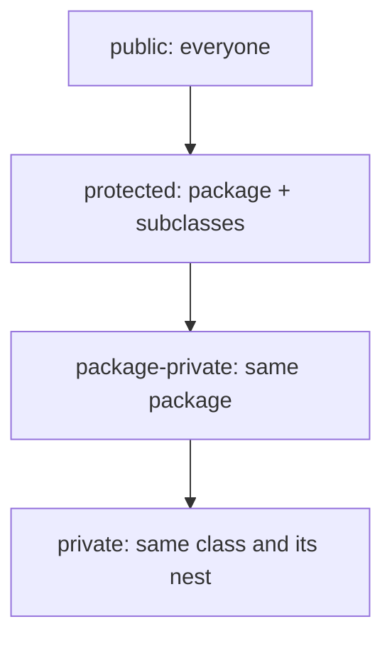

# A.2 Encapsulation and Access Control

> **Goal:** Use access modifiers, immutability and defensive copying to protect invariants, and know what reflection and modules can and cannot break.

**Level:** refresher plus depth on defensive copying, `protected` rules and the module/reflection boundary.
**Verified on:** OpenJDK 21.0.12. Every output below was produced by running the code.

## Contents

1. [Why encapsulation](#1-why-encapsulation)
2. [The four access levels](#2-the-four-access-levels)
3. [The `protected` surprise](#3-the-protected-surprise)
4. [Immutability and defensive copies](#4-immutability-and-defensive-copies)
5. [Does `private` really protect?](#5-does-private-really-protect)
6. [Design rules](#6-design-rules)
7. [Common gotchas](#7-common-gotchas)
8. [Interview questions](#8-interview-questions)

---

## 1. Why encapsulation

**Intuition.** A vending machine exposes a coin slot and buttons, not the cash box. Because only those entry points exist, the machine can guarantee that stock and money stay consistent. A class does the same: it hides its representation so that every change goes through code that enforces the rules (invariants).

Benefits you can name: invariants stay true, internals can change without breaking callers, and the public surface is small enough to test and document.

## 2. The four access levels

| Modifier | Same class | Same package | Subclass in other package | Anywhere |
|---|---|---|---|---|
| `private` | yes | no | no | no |
| (package-private, no keyword) | yes | yes | no | no |
| `protected` | yes | yes | yes (with a rule, section 3) | no |
| `public` | yes | yes | yes | yes |



A *nest* (Java 11, JEP 181) is a top-level class and all classes nested in it; they can reach each other's `private` members directly. Chapter B.12 shows how this is compiled.

The compiler enforces these levels:

```java
class Account {
    private int balance = 100;
}

public class PrivateAccess {
    public static void main(String[] args) {
        Account account = new Account();
        System.out.println(account.balance);      // another top-level class: private is not visible
    }
}
```

Real `javac` output:

```text
ce/PrivateAccess.java:8: error: balance has private access in Account
        System.out.println(account.balance);      // another top-level class: private is not visible
                                  ^
1 error
```

Top-level classes can only be `public` or package-private. Members of an interface are implicitly `public`.

## 3. The `protected` surprise

`protected` grants package access *plus* access for subclasses, but a subclass in another package may use the member only **through a reference of its own type (or a subtype)**, not through a reference of the superclass type. And package-private members of the superclass are invisible to a subclass in another package.

```java
// ce/p1/Base.java
package p1;

public class Base {
    protected void hook() { }
    void packagePrivate() { }
}
```

```java
// ce/p2/Sub.java
package p2;

import p1.Base;

public class Sub extends Base {
    void ok(Sub other) {
        other.hook();              // OK: through a reference of the subclass type
        this.hook();               // OK
    }

    void bad(Base other) {
        other.hook();              // ERROR: Base reference from a different package
    }

    void bad2() {
        packagePrivate();          // ERROR: package-private is invisible in another package
    }
}
```

Real `javac` output:

```text
ce/p2/Sub.java:12: error: hook() has protected access in Base
        other.hook();              // ERROR: Base reference from a different package
             ^
ce/p2/Sub.java:16: error: cannot find symbol
        packagePrivate();          // ERROR: package-private is invisible in another package
        ^
  symbol:   method packagePrivate()
  location: class Sub
2 errors
```

Because of this rule, `protected` is a poor tool for API surface: it extends the contract to every subclass, forever.

## 4. Immutability and defensive copies

A getter that returns a mutable internal object hands out the keys to the house. Copy on the way in **and** on the way out.

```java
import java.util.ArrayList;
import java.util.Arrays;
import java.util.Collections;
import java.util.List;

public class DefensiveCopies {

    // BROKEN: stores and returns the caller's array
    static final class LeakySchedule {
        private final int[] hours;
        LeakySchedule(int[] hours) { this.hours = hours; }
        int[] hours() { return hours; }
        int total() { return Arrays.stream(hours).sum(); }
    }

    // FIXED: copy on the way in, copy on the way out
    static final class SafeSchedule {
        private final int[] hours;
        SafeSchedule(int[] hours) { this.hours = hours.clone(); }
        int[] hours() { return hours.clone(); }
        int total() { return Arrays.stream(hours).sum(); }
    }

    public static void main(String[] args) {
        int[] input = {8, 8, 8};
        LeakySchedule leaky = new LeakySchedule(input);
        input[0] = 100;                                  // caller mutates after construction
        leaky.hours()[1] = 200;                          // outsider mutates internals
        System.out.println("leaky total = " + leaky.total());

        int[] input2 = {8, 8, 8};
        SafeSchedule safe = new SafeSchedule(input2);
        input2[0] = 100;
        safe.hours()[1] = 200;
        System.out.println("safe  total = " + safe.total());

        // unmodifiableList is a read-only VIEW; copyOf is an independent immutable SNAPSHOT
        List<String> source = new ArrayList<>(List.of("a", "b"));
        List<String> view = Collections.unmodifiableList(source);
        List<String> snapshot = List.copyOf(source);
        source.add("c");
        System.out.println("view     after source.add: " + view);
        System.out.println("snapshot after source.add: " + snapshot);
        try {
            view.add("x");
        } catch (UnsupportedOperationException e) {
            System.out.println("view.add(\"x\") -> UnsupportedOperationException");
        }
    }
}

// ---- Output ----
// leaky total = 308
// safe  total = 24
// view     after source.add: [a, b, c]
// snapshot after source.add: [a, b]
// view.add("x") -> UnsupportedOperationException
```

`unmodifiableList(list)` is a read-only **view**: if the original changes, so does the view. `List.copyOf(list)` (Java 10) makes an independent immutable snapshot.

Recipe for a properly immutable class:

| Step | Why |
|---|---|
| Declare the class `final` (or make constructors private) | Prevents a subclass from adding mutable state |
| Make all fields `private final` | Compiler-enforced single assignment; safe publication through final-field semantics |
| No setters | No mutation after construction |
| Defensive-copy mutable inputs and outputs | Callers keep no handle on internal state |
| Do not let `this` escape from the constructor | Another thread could see a half-built object |

Records (chapter B.8) automate most of this, but remember they are only *shallowly* immutable.

## 5. Does `private` really protect?

`private` is a compile-time and runtime-verified access rule, not a security boundary. Reflection can read private fields of your own classes via `setAccessible(true)`. What stops it for the JDK's own classes is the **module system**: since Java 16 (JEP 396) and strongly in 17 (JEP 403), the JDK's internals are not open to reflection by default.

```java
import java.lang.reflect.Field;

public class ReflectionBreaks {
    static class Secret {
        private String code = "s3cret";
    }

    public static void main(String[] args) throws Exception {
        Secret secret = new Secret();

        // 1. Private fields of YOUR OWN classes can be opened with reflection
        Field own = Secret.class.getDeclaredField("code");
        own.setAccessible(true);
        System.out.println("read private field : " + own.get(secret));
        own.set(secret, "changed");
        System.out.println("after reflective set: " + own.get(secret));

        // 2. JDK internals are protected by the module system (strong encapsulation since Java 16/17)
        try {
            Field value = String.class.getDeclaredField("value");
            value.setAccessible(true);
        } catch (RuntimeException e) {
            System.out.println(e.getClass().getName());
            System.out.println(e.getMessage().replaceAll("@[0-9a-f]+", "@<id>"));
        }
    }
}

// ---- Output ----
// read private field : s3cret
// after reflective set: changed
// java.lang.reflect.InaccessibleObjectException
// Unable to make field private final byte[] java.lang.String.value accessible: module java.base does not "opens java.lang" to unnamed module @<id>
```

The message tells you what to do if you truly must: `--add-opens java.base/java.lang=ALL-UNNAMED`. For your own code, treat `private` as a design promise, and use modules (`module-info.java`, Part 18) when you need enforced encapsulation.

## 6. Design rules

- Make everything as restrictive as possible; widen only when needed.
- Prefer composition and small public surface over `protected` hooks.
- Expose behavior (`account.withdraw(x)`), not state (`getBalance()` + `setBalance()`).
- Return immutable or copied collections; accept collections defensively.
- Never expose a mutable `static` field; `public static final List` is still mutable inside.

## 7. Common gotchas

| Gotcha | Why | Fix |
|---|---|---|
| Getter returns internal `List` or `Date`/array | Caller mutates your state | Return a copy or immutable view |
| `unmodifiableList` thought to be immutable | It is a live view of a mutable list | `List.copyOf` |
| `protected` field in a public class | Becomes API forever | Private field plus accessor |
| Subclass in another package cannot call `other.protectedMethod()` | `protected` access needs a subclass-typed reference | Call via `this` or a subclass-typed reference |
| Reflection works on my class but fails on JDK class | JDK modules do not `opens` their packages | Use public APIs; `--add-opens` only as a last resort |
| Serialization / frameworks bypass constructors | They write fields directly | Validate in `readObject` or prefer records |

## 8. Interview questions

<details>
<summary><strong>Q1. What are the four access levels and who can see what?</strong></summary>

See the table in section 2. `private`: the class (and its nest); package-private: the package; `protected`: the package plus subclasses; `public`: everyone.
</details>

<details>
<summary><strong>Q2. Why can't a subclass in another package call <code>base.hook()</code> on a <code>Base</code> reference when <code>hook()</code> is protected?</strong></summary>

The rule is that the subclass may access the protected member only through an expression whose type is the subclass (or a subtype). Otherwise any class could subclass `Base`, get an instance of an unrelated subclass and poke at its protected members. The compile-error demo shows the exact message.
</details>

<details>
<summary><strong>Q3. How do you make a class immutable?</strong></summary>

`final` class, `private final` fields, no setters, defensive copies of mutable components in and out, no `this` escape in the constructor. Or use a record plus an immutable collection in its compact constructor.
</details>

<details>
<summary><strong>Q4. Difference between <code>Collections.unmodifiableList</code> and <code>List.copyOf</code>?</strong></summary>

`unmodifiableList` wraps the original and reflects later changes to it (a view); `copyOf` creates an independent immutable snapshot and rejects `null` elements. If the argument is already an immutable list from `List.of/copyOf`, `copyOf` returns it without copying.
</details>

<details>
<summary><strong>Q5. Can reflection read a <code>private</code> field? Is <code>private</code> a security feature?</strong></summary>

Yes via `setAccessible(true)`, unless the module of the target class does not open its package to you, which is the default for JDK internals since Java 16/17. It is an encapsulation mechanism, not a security sandbox (the Security Manager, now deprecated for removal, was that).
</details>

<details>
<summary><strong>Q6. What is a nest and why did Java 11 add nestmates?</strong></summary>

A nest is a top-level class plus its nested classes. Before Java 11 the compiler generated synthetic `access$000` bridge methods so nested classes could use each other's private members; JEP 181 lets the JVM check access across nestmates directly. See chapter B.12 for bytecode proof.
</details>

<details>
<summary><strong>Q7. What is "this escape" and why does it break immutability?</strong></summary>

Publishing `this` (to a listener list, a static field, another thread) from inside a constructor lets others observe the object before construction finishes, so even `final` fields may appear unassigned unless the publication is safe (Part 11).
</details>

<details>
<summary><strong>Q8. Why prefer <code>private</code> fields with methods over public fields?</strong></summary>

You can add validation, lazy computation, logging or change the representation later without altering callers. A public field commits you to storing exactly that value forever.
</details>

<details>
<summary><strong>Q9. Are interface members public? What about fields?</strong></summary>

Methods are implicitly `public` (Java 9 allows `private` helper methods); fields are implicitly `public static final`; nested types are implicitly `public static`.
</details>

<details>
<summary><strong>Q10. What does <code>--add-opens</code> do and when is it acceptable?</strong></summary>

It opens a package of a named module to specified modules at runtime so deep reflection works. It is acceptable as a stopgap for legacy libraries; the real fix is upgrading the library or using supported APIs.
</details>

---

[Previous: A.1 Classes, Objects and Initialization](./01-classes-objects-and-initialization.md) · [Part index](../README.md) · Next: [A.3 Inheritance and Polymorphism](./03-inheritance-and-polymorphism.md)