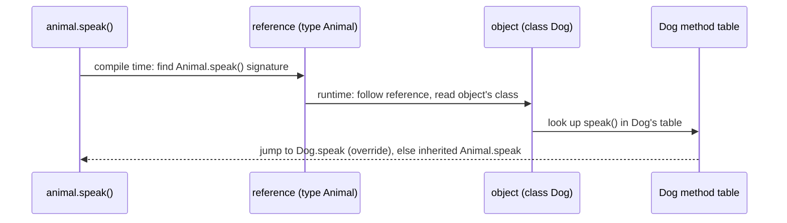

# A.3 Inheritance and Polymorphism

> **Goal:** Understand how method dispatch really works (virtual versus static binding), what is and is not inherited, and when inheritance is the wrong tool.

**Level:** refresher with bytecode-level detail.
**Verified on:** OpenJDK 21.0.12. Every output below was produced by running the code.

## Contents

1. [What inheritance gives you](#1-what-inheritance-gives-you)
2. [Overriding versus overloading versus hiding](#2-overriding-versus-overloading-versus-hiding)
3. [Dynamic dispatch step by step](#3-dynamic-dispatch-step-by-step)
4. [The five invoke instructions](#4-the-five-invoke-instructions)
5. [Casting and `instanceof`](#5-casting-and-instanceof)
6. [Array covariance](#6-array-covariance)
7. [`final` and what cannot be inherited](#7-final-and-what-cannot-be-inherited)
8. [Fragile base class: inheritance is a coupling](#8-fragile-base-class-inheritance-is-a-coupling)
9. [Rules for overriding](#9-rules-for-overriding)
10. [Common gotchas](#10-common-gotchas)
11. [Interview questions](#11-interview-questions)

---

## 1. What inheritance gives you

**Intuition.** Inheritance is an "is-a" contract: a `Dog` can be used wherever an `Animal` is expected. Two things come together: *code reuse* (the subclass gets the parent's members) and *subtyping* (the subclass can stand in for the parent). Subtyping is the valuable part; reuse alone is better done with composition (chapter C.1).

Java has **single class inheritance** (one superclass) but a class may implement many interfaces. This avoids state conflicts from multiple parents while still allowing multiple types.

## 2. Overriding versus overloading versus hiding

| | Overriding | Overloading | Hiding |
|---|---|---|---|
| Applies to | instance methods | any methods in a class hierarchy | static methods and **all fields** |
| Signature | same name, same parameter types | same name, different parameters | same name |
| Resolved | at **runtime** by the object's class | at **compile time** by static argument types | at compile time by the reference type |
| Annotation | use `@Override` | none | none |

```java
public class DispatchDemo {

    static class Animal {
        String name = "Animal.name (field)";
        static String kind() { return "Animal.kind (static)"; }
        String speak() { return "..."; }
        String describe() { return "I say " + speak(); }      // speak() is a virtual call
        private String secret() { return "Animal.secret"; }
        String reveal() { return secret(); }                  // private methods are NOT virtual
    }

    static class Dog extends Animal {
        String name = "Dog.name (field)";                     // hides, does not override
        static String kind() { return "Dog.kind (static)"; }  // hides, does not override
        @Override String speak() { return "Woof"; }
        private String secret() { return "Dog.secret"; }      // unrelated method, not an override
    }

    static class Printer {
        String print(Animal a) { return "print(Animal)"; }
        String print(Dog d) { return "print(Dog)"; }
    }

    public static void main(String[] args) {
        Animal a = new Dog();                                 // static type Animal, runtime type Dog

        System.out.println("a.speak()        = " + a.speak());          // runtime type decides
        System.out.println("a.describe()     = " + a.describe());       // inherited method, virtual inner call
        System.out.println("a.name           = " + a.name);             // static type decides (fields)
        System.out.println("((Dog) a).name   = " + ((Dog) a).name);
        System.out.println("Animal.kind()    = " + Animal.kind());
        System.out.println("Dog.kind()       = " + Dog.kind());
        System.out.println("a.reveal()       = " + a.reveal());         // private: bound to Animal

        Printer p = new Printer();
        System.out.println("p.print(a)       = " + p.print(a));         // overloads: STATIC type decides
        System.out.println("p.print((Dog) a) = " + p.print((Dog) a));
    }
}

// ---- Output ----
// a.speak()        = Woof
// a.describe()     = I say Woof
// a.name           = Animal.name (field)
// ((Dog) a).name   = Dog.name (field)
// Animal.kind()    = Animal.kind (static)
// Dog.kind()       = Dog.kind (static)
// a.reveal()       = Animal.secret
// p.print(a)       = print(Animal)
// p.print((Dog) a) = print(Dog)
```

Notice what the output proves: the method called follows the **object** (virtual dispatch), while a hidden field or static method follows the **declared type of the reference**, and an overload is picked by the **static type** of the argument. Private methods are never virtual.

## 3. Dynamic dispatch step by step



The JVM keeps a per-class *vtable*: an array of method entry points where an override replaces the same slot as the parent's method. A virtual call is "read class pointer, index into table, jump", which the JIT can often skip entirely by devirtualizing and inlining when it knows only one implementation is loaded (Part 10 and 16).

```text
Animal vtable          Dog vtable
[0] toString  -------> [0] toString (inherited)
[1] speak     -------> [1] Dog.speak   <- override replaces the slot
```

## 4. The five invoke instructions

The compiled bytecode tells you which kind of call each site is:

| Instruction | Used for |
|---|---|
| `invokevirtual` | normal instance method call (and, since Java 11, calls to private nestmate methods) |
| `invokeinterface` | call through an interface type |
| `invokespecial` | constructors, `super.method()` calls (and private methods before Java 11) |
| `invokestatic` | static methods |
| `invokedynamic` | lambdas, string concatenation, record `toString/equals/hashCode` |

```java
import java.util.List;

public class InvokeKinds {
    static class Base {
        void hello() { }
    }

    static class Sub extends Base {
        @Override void hello() { super.hello(); }       // super call: invokespecial
        private void helper() { }
        static void util() { }

        void demo(List<String> list, Base base) {
            helper();                                    // private
            util();                                      // static
            list.size();                                 // interface method
            base.hello();                                // ordinary virtual call
            new StringBuilder();                         // constructor
        }
    }

    public static void main(String[] args) { }
}

// ---- Output ----
//
```

Real bytecode from `javap`:

```text
$ javac -Xlint:-options -d out/a a/InvokeKinds.java && javap -c -p 'out/a/InvokeKinds$Sub.class' | grep -E "^  [a-z]|invoke"
       1: invokespecial #1                  // Method InvokeKinds$Base."<init>":()V
  void hello();
       1: invokespecial #7                  // Method InvokeKinds$Base.hello:()V
  private void helper();
  static void util();
  void demo(java.util.List<java.lang.String>, InvokeKinds$Base);
       1: invokevirtual #10                 // Method helper:()V
       4: invokestatic  #15                 // Method util:()V
       8: invokeinterface #18,  1           // InterfaceMethod java/util/List.size:()I
      15: invokevirtual #7                  // Method InvokeKinds$Base.hello:()V
      22: invokespecial #26                 // Method java/lang/StringBuilder."<init>":()V
```

Read the listing as: the constructor and `super.hello()` use `invokespecial`; the call to the private `helper()` is `invokevirtual` (Java 11+ nestmates); `util()` is `invokestatic`; `List.size()` is `invokeinterface`; an ordinary call on a `Base` reference is `invokevirtual`; and `new StringBuilder()` is again an `invokespecial` constructor call.

## 5. Casting and `instanceof`

An upcast (`Animal a = dog`) is always safe and implicit. A downcast needs a runtime check and may throw `ClassCastException`. Since Java 16, pattern matching for `instanceof` combines the test and the cast:

```text
// illustrative, not executed here
if (shape instanceof Circle c && c.radius() > 10) {   // c is only in scope where the test is true
    ...
}
```

Design smell: a long `if instanceof` chain usually wants polymorphism, or, for closed hierarchies, a sealed type with a pattern-matching `switch` (chapter B.9).

## 6. Array covariance

Arrays are covariant (`Integer[]` is-a `Object[]`), which is unsound; the JVM keeps the element type at runtime and checks every store. Generics, in contrast, are invariant and checked at compile time.

```java
import java.util.ArrayList;
import java.util.List;

public class ArrayCovariance {
    public static void main(String[] args) {
        // Arrays are covariant: String[] IS-A Object[] ... checked at RUNTIME
        Object[] objects = new String[1];
        try {
            objects[0] = Integer.valueOf(1);
        } catch (ArrayStoreException e) {
            System.out.println("ArrayStoreException: " + e.getMessage());
        }

        // Generics are invariant: the same mistake is a COMPILE error
        // List<Object> list = new ArrayList<String>();   // error: incompatible types

        // Downcasts are checked at runtime too
        Object o = Integer.valueOf(7);
        try {
            String s = (String) o;
        } catch (ClassCastException e) {
            System.out.println(e.getMessage());
        }

        // instanceof guards the cast (pattern variable since Java 16)
        if (o instanceof Integer i && i > 5) {
            System.out.println("pattern matched, i + 1 = " + (i + 1));
        }
        System.out.println("null instanceof Object: " + (null instanceof Object));
    }
}

// ---- Output ----
// ArrayStoreException: java.lang.Integer
// class java.lang.Integer cannot be cast to class java.lang.String (java.lang.Integer and java.lang.String are in module java.base of loader 'bootstrap')
// pattern matched, i + 1 = 8
// null instanceof Object: false
```

| | Arrays | Generic collections |
|---|---|---|
| Variance | covariant | invariant (use wildcards) |
| Element type at runtime | kept (reified) | erased |
| Wrong store detected | at runtime, `ArrayStoreException` | at compile time |

## 7. `final` and what cannot be inherited

`final` on a class forbids subclassing (`String`, `Integer`), on a method forbids overriding, on a variable forbids reassignment. Constructors, static members (they are hidden, not overridden) and private members are not inherited.

```java
public class ExtendFinal {
    static final class Sealed { }
    static class Attempt extends Sealed { }           // ERROR: cannot inherit from final class

    public static void main(String[] args) { }
}
```

Real `javac` output:

```text
ce/ExtendFinal.java:3: error: cannot inherit from final Sealed
    static class Attempt extends Sealed { }           // ERROR: cannot inherit from final class
                                 ^
1 error
```

```java
public class StaticNotInherited {
    interface Util { static String help() { return "help"; } }
    static class Impl implements Util { }

    public static void main(String[] args) {
        System.out.println(Util.help());       // OK: call through the interface name
        System.out.println(Impl.help());       // ERROR: static interface methods are not inherited
    }
}
```

Real `javac` output:

```text
ce/StaticNotInherited.java:7: error: cannot find symbol
        System.out.println(Impl.help());       // ERROR: static interface methods are not inherited
                               ^
  symbol:   method help()
  location: class Impl
1 error
```

## 8. Fragile base class: inheritance is a coupling

A subclass depends on **how** the parent works internally, not only on what it promises. If the parent changes an implementation detail, the child can silently break.

```java
import java.util.Collection;
import java.util.HashSet;
import java.util.List;

public class FragileBaseClass {

    // A HashSet that counts how many elements were ever added
    static class InstrumentedHashSet<E> extends HashSet<E> {
        private int addCount = 0;

        @Override public boolean add(E e) {
            addCount++;
            return super.add(e);
        }

        @Override public boolean addAll(Collection<? extends E> c) {
            addCount += c.size();
            return super.addAll(c);          // HashSet's addAll calls this.add(...) for each element!
        }

        int addCount() { return addCount; }
    }

    public static void main(String[] args) {
        InstrumentedHashSet<String> set = new InstrumentedHashSet<>();
        set.addAll(List.of("Snap", "Crackle", "Pop"));
        System.out.println("elements added = 3, addCount = " + set.addCount());
    }
}

// ---- Output ----
// elements added = 3, addCount = 6
```

`addAll` in `HashSet`'s parent calls `add` for each element, so counting both double counts (the output shows 6 for 3 elements). This is why Effective Java says "design and document for inheritance or else prohibit it". Prefer composition (C.1) or make the class `final`/`sealed`.

## 9. Rules for overriding

| Rule | Detail |
|---|---|
| Same name and parameter types | otherwise it is an overload (use `@Override` to catch mistakes) |
| Return type | same, or a **subtype** (covariant return) |
| Access | same or **wider** (never narrower) |
| Checked exceptions | may throw fewer or narrower ones, never broader new checked ones |
| `static`/`private`/`final` | cannot be overridden |
| `super.method()` | calls the parent version |

## 10. Common gotchas

| Gotcha | Why | Fix |
|---|---|---|
| Method with typo "overrides" nothing | different signature is a new method | Always write `@Override` |
| Field accessed through parent reference returns parent's field | fields are hidden, not overridden | Use accessor methods; avoid same-named fields |
| `static` method call looks polymorphic | it is bound to the reference type | Call it via the class name |
| Overload picked "wrong" | chosen from static types | Cast, or give methods different names |
| Subclass breaks after parent update | fragile base class | Prefer composition; document self-use |
| `ArrayStoreException` | array covariance | Prefer `List<T>`; avoid mixing array types |

## 11. Interview questions

<details>
<summary><strong>Q1. Explain how Java decides which method to run for <code>a.speak()</code>.</strong></summary>

At compile time the compiler checks that `speak()` exists on the static type of `a` and records its signature. At run time the JVM reads the object's actual class and uses its method table to find the most specific implementation (virtual dispatch). Fields, static methods and private methods are not part of that mechanism.
</details>

<details>
<summary><strong>Q2. Overriding versus overloading - when is each resolved?</strong></summary>

Overriding at run time by the receiver's class; overloading at compile time by the static types of the arguments. The `DispatchDemo` output shows an overload selected by the declared type even though the object is a subclass.
</details>

<details>
<summary><strong>Q3. Can you override a static method? A private method? A field?</strong></summary>

No to all three. A same-named static method or field in a subclass hides the parent's; a same-named method in a subclass that parent declared `private` is a brand new method (see puzzle Q3 in chapter C.4).
</details>

<details>
<summary><strong>Q4. What is a covariant return type?</strong></summary>

An override may declare a more specific return type, e.g. `Animal create()` overridden as `Dog create()`. The compiler generates a bridge method with the original signature so the JVM's descriptor-based dispatch still works (chapter B.11).
</details>

<details>
<summary><strong>Q5. Which <code>invoke</code> bytecode does a call to a private method use?</strong></summary>

Before Java 11, `invokespecial`; since Java 11 (nestmates) calls to private methods in the same nest compile to `invokevirtual`/`invokeinterface` (the JVM still doesn't let private methods be overridden). Check with `javap -c`.
</details>

<details>
<summary><strong>Q6. Why does Java not allow multiple class inheritance?</strong></summary>

State and implementation conflicts (the diamond problem) and constructor-chaining ambiguity. Multiple interface inheritance is allowed because interfaces have no instance state; default-method conflicts must be resolved explicitly (chapter A.4).
</details>

<details>
<summary><strong>Q7. What is the fragile base class problem?</strong></summary>

A subclass relies on the parent's implementation details (such as `addAll` calling `add`); when the parent changes, the subclass breaks even though the parent honoured its documented contract. Mitigations: composition, `final` classes, documented self-use, sealed hierarchies.
</details>

<details>
<summary><strong>Q8. Why are arrays covariant and is that a problem?</strong></summary>

It dates from Java 1.0, before generics, so `Arrays.sort(Object[])` could accept any array. It is unsound, so the JVM checks every store (`ArrayStoreException`). Generic collections are invariant to prevent the issue at compile time.
</details>

<details>
<summary><strong>Q9. What does <code>@Override</code> do?</strong></summary>

It asks the compiler to verify that the method really overrides or implements a supertype method; it has source retention and no runtime effect. It turns typos and signature drift into compile errors.
</details>

<details>
<summary><strong>Q10. What is the Liskov Substitution Principle in one sentence?</strong></summary>

Code written for the base type must keep working, with the same promises, when given any subtype; see the Rectangle/Square demo in chapter C.2.
</details>

<details>
<summary><strong>Q11. Can an overriding method throw a broader exception?</strong></summary>

Not a broader checked exception. It may throw none, fewer, or narrower checked ones, plus any unchecked exceptions.
</details>

<details>
<summary><strong>Q12. What does <code>super</code> refer to in a static context or in a lambda?</strong></summary>

There is no <code>super</code> in static context. In a lambda <code>this</code> and <code>super</code> refer to the enclosing instance, unlike an anonymous class where <code>this</code> is the anonymous object (chapter B.6).
</details>

---

[Previous: A.2 Encapsulation and Access Control](./02-encapsulation-and-access-control.md) · [Part index](../README.md) · Next: [A.4 Abstraction, Abstract Classes and Interfaces](./04-abstraction-abstract-classes-and-interfaces.md)