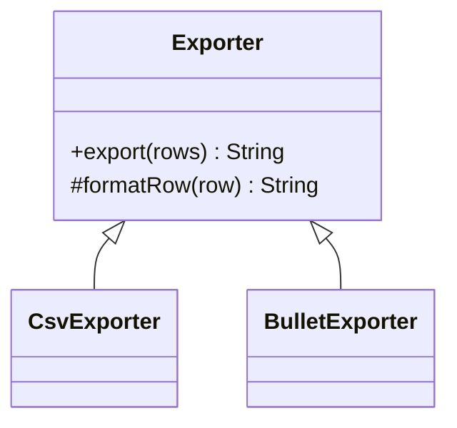
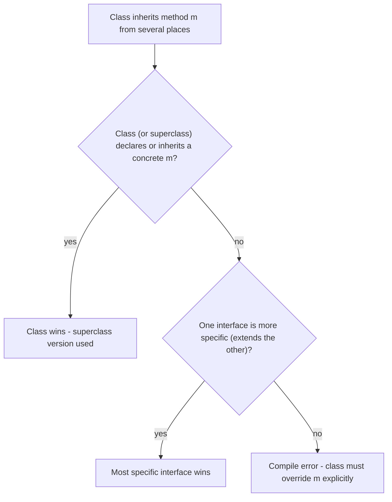

# A.4 Abstraction, Abstract Classes and Interfaces

> **Goal:** Choose correctly between abstract classes and interfaces, and master default methods, the diamond problem and interface evolution.

**Level:** refresher plus Java 8+ interface features.
**Verified on:** OpenJDK 21.0.12. Every output below was produced by running the code.

## Contents

1. [Abstraction in one idea](#1-abstraction-in-one-idea)
2. [Abstract classes](#2-abstract-classes)
3. [The template method pattern](#3-the-template-method-pattern)
4. [Interfaces: contract without state](#4-interfaces-contract-without-state)
5. [Default, static and private interface methods](#5-default-static-and-private-interface-methods)
6. [The diamond problem and resolution rules](#6-the-diamond-problem-and-resolution-rules)
7. [Evolving an interface safely](#7-evolving-an-interface-safely)
8. [Abstract class or interface?](#8-abstract-class-or-interface)
9. [Common gotchas](#9-common-gotchas)
10. [Interview questions](#10-interview-questions)

---

## 1. Abstraction in one idea

**Intuition.** You drive a car using a steering wheel and pedals; you do not need to know the engine. Abstraction exposes *what* something does and hides *how*. In Java two tools express it: an **abstract class** (a partially built parent) and an **interface** (a pure capability contract).

## 2. Abstract classes

An `abstract` class cannot be instantiated; it may have `abstract` methods (no body), concrete methods, fields, constructors and any access level. It exists to be extended.

```java
public class AbstractNew {
    static abstract class Shape { abstract double area(); }

    public static void main(String[] args) {
        Shape s = new Shape();                 // ERROR: abstract classes cannot be instantiated
    }
}
```

Real `javac` output:

```text
ce/AbstractNew.java:5: error: Shape is abstract; cannot be instantiated
        Shape s = new Shape();                 // ERROR: abstract classes cannot be instantiated
                  ^
1 error
```

Use an abstract class when subclasses are one family sharing **state or a constructor** and you want to provide partial behaviour. Constructors in an abstract class run when a concrete subclass is created, so they can initialize shared fields.

## 3. The template method pattern

The abstract class fixes the algorithm skeleton in a `final` method and leaves the varying steps abstract (or hooks) for subclasses.

```java
import java.util.List;

public class TemplateMethod {

    // Abstract class: shared state + constructor + a fixed algorithm with customizable steps
    static abstract class Exporter {
        private final String title;
        private int rowsWritten;                                   // state: interfaces cannot have instance state

        protected Exporter(String title) {
            this.title = title;
            System.out.println("  Exporter constructor for \"" + title + "\"");
        }

        // The TEMPLATE METHOD: final so subclasses cannot break the sequence
        public final String export(List<String> rows) {
            StringBuilder out = new StringBuilder();
            out.append(header(title)).append('\n');
            for (String row : rows) {
                out.append(formatRow(row)).append('\n');
                rowsWritten++;
            }
            out.append(footer(rowsWritten));
            return out.toString();
        }

        protected abstract String formatRow(String row);          // must implement
        protected String header(String title) { return "== " + title + " =="; }   // hook with default
        protected String footer(int rows) { return "(" + rows + " rows)"; }       // hook with default
    }

    static class CsvExporter extends Exporter {
        CsvExporter() { super("csv"); }
        @Override protected String formatRow(String row) { return String.join(",", row.split(" ")); }
    }

    static class BulletExporter extends Exporter {
        BulletExporter() { super("bullets"); }
        @Override protected String formatRow(String row) { return "* " + row; }
        @Override protected String footer(int rows) { return "total: " + rows; }
    }

    public static void main(String[] args) {
        List<String> data = List.of("asha 30", "ravi 41");
        System.out.println(new CsvExporter().export(data));
        System.out.println("----");
        System.out.println(new BulletExporter().export(data));
    }
}

// ---- Output ----
//   Exporter constructor for "csv"
// == csv ==
// asha,30
// ravi,41
// (2 rows)
// ----
//   Exporter constructor for "bullets"
// == bullets ==
// * asha 30
// * ravi 41
// total: 2
```



Mark the template method `final` so subclasses cannot break the sequence; keep hook methods `protected`.

## 4. Interfaces: contract without state

An interface declares what a type can do. A class can implement many interfaces. Fields are implicitly `public static final` constants; there is no instance state. This makes interfaces the right tool for **capabilities across unrelated classes** (`Comparable`, `Runnable`, `AutoCloseable`).

| Feature | Abstract class | Interface |
|---|---|---|
| Instance fields | yes | no (constants only) |
| Constructors | yes | no |
| Method bodies | yes | `default`, `static`, `private` only |
| Multiple inheritance | no (one superclass) | yes (many interfaces) |
| Access of members | any | public (private helpers since Java 9) |
| Can extend | one class | many interfaces |
| Lambda target | no | yes, if functional |

## 5. Default, static and private interface methods

| Kind | Since | Purpose |
|---|---|---|
| `default` | Java 8 | Add a method to an interface without breaking implementors |
| `static` | Java 8 | Utility methods that belong to the interface (`Comparator.comparing`) |
| `private` / `private static` | Java 9 | Share code between default methods |

A default method can call the abstract methods of the interface, so it adds behaviour on top of the contract (for example `Comparator.reversed()`).

A default method may **not** override `equals`, `hashCode` or `toString`, because a class always inherits those from `Object` and "class wins":

```java
public class DefaultEquals {
    interface Shape {
        default boolean equals(Object other) { return true; }   // ERROR: Object's methods are off limits
    }
    public static void main(String[] args) { }
}
```

Real `javac` output:

```text
ce/DefaultEquals.java:3: error: default method equals in interface Shape overrides a member of java.lang.Object
        default boolean equals(Object other) { return true; }   // ERROR: Object's methods are off limits
                        ^
1 error
```

## 6. The diamond problem and resolution rules

When a class inherits the same default method from two interfaces, which wins? Java applies three rules in order:



```java
public class DiamondDemo {

    interface Flyer   { default String move() { return "fly"; } }
    interface Swimmer { default String move() { return "swim"; } }

    // Conflict: unrelated defaults with the same signature -> the class MUST override
    static class Duck implements Flyer, Swimmer {
        @Override public String move() {
            return Flyer.super.move() + " and " + Swimmer.super.move();
        }
    }

    // Rule 1: a method from a CLASS always beats an interface default
    static class Walker { public String move() { return "walk"; } }
    static class Robot extends Walker implements Flyer { }

    // Rule 2: the MORE SPECIFIC interface wins
    interface Animal { default String sound() { return "generic sound"; } }
    interface Dog extends Animal { @Override default String sound() { return "woof"; } }
    static class Puppy implements Animal, Dog { }

    // Rule 3: an abstract redeclaration forces implementers to decide
    interface Quiet extends Animal { @Override String sound();  }
    static class Mouse implements Quiet { public String sound() { return "squeak"; } }

    public static void main(String[] args) {
        System.out.println("Duck   : " + new Duck().move());
        System.out.println("Robot  : " + new Robot().move() + "   (class method wins over Flyer default)");
        System.out.println("Puppy  : " + new Puppy().sound() + "   (Dog is more specific than Animal)");
        System.out.println("Mouse  : " + new Mouse().sound());
    }
}

// ---- Output ----
// Duck   : fly and swim
// Robot  : walk   (class method wins over Flyer default)
// Puppy  : woof   (Dog is more specific than Animal)
// Mouse  : squeak
```

If two unrelated interfaces both provide a default, the compiler forces you to resolve it:

```java
interface Flyer   { default String move() { return "fly"; } }
interface Swimmer { default String move() { return "swim"; } }

public class DiamondConflict implements Flyer, Swimmer {   // ERROR: which move()?
    public static void main(String[] args) { }
}
```

Real `javac` output:

```text
ce/DiamondConflict.java:4: error: types Flyer and Swimmer are incompatible;
public class DiamondConflict implements Flyer, Swimmer {   // ERROR: which move()?
       ^
  class DiamondConflict inherits unrelated defaults for move() from types Flyer and Swimmer
1 error
```

Resolve by overriding and picking one explicitly with `Flyer.super.move()`.

## 7. Evolving an interface safely

Before Java 8, adding a method to a published interface broke every implementor. Default methods allow evolution, but with limits:

```java
import java.util.ArrayList;
import java.util.List;

public class InterfaceEvolution {

    interface Greeter {
        String PREFIX = "Hello, ";                       // implicitly public static final

        String name();                                   // abstract

        default String greet() {                         // Java 8: added later without breaking implementers
            return PREFIX + decorate(name());
        }

        static Greeter of(String name) {                 // Java 8: static factory on the interface
            return () -> name;                           // Greeter has ONE abstract method: lambda-friendly
        }

        private String decorate(String s) {              // Java 9: private helper shared by defaults
            return "*" + s + "*";
        }
    }

    // Written "before" greet() existed; still compiles because greet() has a default
    static class OldImpl implements Greeter {
        @Override public String name() { return "legacy"; }
    }

    // The JDK itself evolved this way: List.sort / Iterable.forEach were added as defaults in Java 8
    public static void main(String[] args) {
        System.out.println(new OldImpl().greet());
        System.out.println(Greeter.of("lambda").greet());
        System.out.println("constant via interface: " + Greeter.PREFIX.trim());

        List<Integer> numbers = new ArrayList<>(List.of(3, 1, 2));
        numbers.sort(null);                              // default method List.sort (natural order)
        numbers.forEach(n -> System.out.print(n + " ")); // default method Iterable.forEach
        System.out.println();
    }
}

// ---- Output ----
// Hello, *legacy*
// Hello, *lambda*
// constant via interface: Hello,
// 1 2 3
```

Evolution rules: adding a `default` method is source- and binary-compatible, unless an implementor already has a clashing method with a weaker access level or a conflicting default. Adding an `abstract` method is a breaking change. Removing or changing signatures breaks binary compatibility.

## 8. Abstract class or interface?

| Question | Answer points to |
|---|---|
| Do implementors share fields or a constructor? | abstract class |
| Is it a capability that unrelated classes can have? | interface |
| Will lambdas implement it? | interface (functional) |
| Need to inherit from several sources? | interfaces |
| Do you need to evolve a public API without breaking users? | interface with defaults |
| Hierarchy closed and known? | sealed interface (chapter B.9) |

A good default: **program to an interface, share code through composition or an optional abstract skeleton class** (like `AbstractList` implementing `List`).

## 9. Common gotchas

| Gotcha | Why | Fix |
|---|---|---|
| Two interfaces with same default compile fails | ambiguous inheritance | Override and delegate with `X.super.m()` |
| Default method cannot call instance state | interfaces have no fields | Call abstract methods instead |
| Constants in interfaces pollute implementors ("constant interface") | they become inherited names | Use a final utility class or enum |
| Abstract class with only abstract methods | is really an interface | Use an interface |
| Calling an abstract-class constructor's overridable method | same hazard as chapter A.1 | Avoid |
| Static interface methods are not inherited | they belong to the interface | Call `Iface.m()` |

## 10. Interview questions

<details>
<summary><strong>Q1. Abstract class versus interface - how do you choose?</strong></summary>

Interface for a capability or contract that unrelated types may implement; abstract class when subclasses are one family sharing state, constructor logic, or protected helpers. Since Java 8 the behavioural gap has narrowed, but only abstract classes can hold instance state.
</details>

<details>
<summary><strong>Q2. Why were default methods introduced?</strong></summary>

To evolve interfaces without breaking existing implementors, motivated by adding `stream()`, `forEach` and `Comparator.reversed()` to the Collections API in Java 8.
</details>

<details>
<summary><strong>Q3. State the three resolution rules for conflicting default methods.</strong></summary>

1) A method from a class (including superclass) beats any interface default. 2) Otherwise the most specific interface (one that overrides the other) wins. 3) Otherwise it is a compile error and you must override, optionally calling `Iface.super.method()`.
</details>

<details>
<summary><strong>Q4. Can an interface have a constructor? An instance field?</strong></summary>

No constructor; fields are always `public static final` constants. Default methods can use `this` only through the interface's abstract and default methods.
</details>

<details>
<summary><strong>Q5. Can an abstract class implement an interface without implementing its methods?</strong></summary>

Yes; the concrete subclass must implement the remaining abstract methods.
</details>

<details>
<summary><strong>Q6. Can an abstract class have a constructor? What is it for?</strong></summary>

Yes. It cannot be called with `new` directly but runs through `super(...)` when a subclass is created, initializing shared fields.
</details>

<details>
<summary><strong>Q7. What is the template method pattern and which JDK classes use it?</strong></summary>

A final method defines the algorithm skeleton and calls overridable steps. `AbstractList.add/indexOf` built over `get/size`, `InputStream.read(byte[])` built over `read()`, and `HttpServlet.service` are examples.
</details>

<details>
<summary><strong>Q8. Can you declare a method both <code>abstract</code> and <code>private</code>, <code>final</code> or <code>static</code>?</strong></summary>

No, each combination contradicts itself: abstract needs overriding, while private, final, static prevent it.
</details>

<details>
<summary><strong>Q9. What is a marker interface and when is it better than an annotation?</strong></summary>

An interface with no members (`Serializable`, `RandomAccess`) that gives a type-level tag usable with `instanceof` and in method signatures. Prefer it when you want compile-time type checking of the tag; prefer annotations when you need parameters or tagging non-type elements.
</details>

<details>
<summary><strong>Q10. What is binary compatibility when adding a method to an interface?</strong></summary>

Adding a default method keeps already-compiled implementors loadable. Adding an abstract one makes old implementors throw <code>AbstractMethodError</code> when the missing method is called, and break at recompile.
</details>

<details>
<summary><strong>Q11. Why can't a default method override <code>toString</code>?</strong></summary>

Every class has `Object` as a superclass, and "class wins": the inherited `Object.toString` would always take precedence, so the default would be dead code. The compiler therefore rejects it.
</details>

---

[Previous: A.3 Inheritance and Polymorphism](./03-inheritance-and-polymorphism.md) · [Part index](../README.md) · Next: [A.5 The Object Contract: equals, hashCode, toString, clone](./05-object-contract-equals-hashcode-tostring-clone.md)