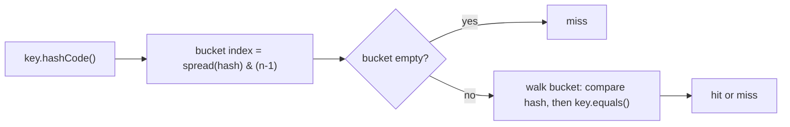

# A.5 The Object Contract: equals, hashCode, toString, clone

> **Goal:** Write `equals`, `hashCode` and `toString` that obey their contracts, understand why hash-based collections break otherwise, and know why `clone()` is avoided.

**Level:** refresher with the failure modes interviewers love.
**Verified on:** OpenJDK 21.0.12. Every output below was produced by running the code.

## Contents

1. [Every class inherits `Object`](#1-every-class-inherits-object)
2. [The `equals` contract](#2-the-equals-contract)
3. [How `equals` goes wrong](#3-how-equals-goes-wrong)
4. [A correct `equals` and `hashCode`](#4-a-correct-equals-and-hashcode)
5. [How a `HashMap` uses them](#5-how-a-hashmap-uses-them)
6. [`toString`](#6-tostring)
7. [`clone`: why it is broken](#7-clone-why-it-is-broken)
8. [Records and the contract](#8-records-and-the-contract)
9. [Common gotchas](#9-common-gotchas)
10. [Interview questions](#10-interview-questions)

---

## 1. Every class inherits `Object`

| Method | Default behaviour | Override when |
|---|---|---|
| `equals(Object)` | reference identity (`==`) | the class has **value** semantics |
| `hashCode()` | identity-based number | you override `equals` (always together) |
| `toString()` | `ClassName@hex` | always for debuggability and logs |
| `clone()` | protected, shallow field copy, needs `Cloneable` | almost never; use copy constructors |
| `finalize()` | deprecated for removal (Java 18) | never; use `Cleaner` / try-with-resources |
| `getClass()` | final, runtime class | n/a |

## 2. The `equals` contract

For non-null references:

| Property | Meaning |
|---|---|
| Reflexive | `x.equals(x)` is true |
| Symmetric | `x.equals(y)` iff `y.equals(x)` |
| Transitive | `x.equals(y)` and `y.equals(z)` imply `x.equals(z)` |
| Consistent | repeated calls give the same answer while nothing changes |
| Non-null | `x.equals(null)` is false |
| Hash link | `x.equals(y)` implies `x.hashCode() == y.hashCode()` |

## 3. How `equals` goes wrong

Mixing subclasses and `instanceof`, or adding a field in a subclass, breaks symmetry and transitivity. Run it:

```java
import java.util.List;
import java.util.Objects;

public class BrokenEquals {

    // 1. SYMMETRY violation: tries to interoperate with String
    static final class CaseInsensitiveString {
        private final String s;
        CaseInsensitiveString(String s) { this.s = Objects.requireNonNull(s); }
        @Override public boolean equals(Object o) {
            if (o instanceof CaseInsensitiveString cis) return s.equalsIgnoreCase(cis.s);
            if (o instanceof String str) return s.equalsIgnoreCase(str);      // BROKEN: String.equals knows nothing of us
            return false;
        }
        @Override public int hashCode() { return s.toLowerCase().hashCode(); }
    }

    // 2. TRANSITIVITY violation: a subclass adds a value component
    static class Point {
        final int x, y;
        Point(int x, int y) { this.x = x; this.y = y; }
        @Override public boolean equals(Object o) {
            return o instanceof Point p && p.x == x && p.y == y;
        }
        @Override public int hashCode() { return Objects.hash(x, y); }
    }

    static class ColorPoint extends Point {
        final String color;
        ColorPoint(int x, int y, String color) { super(x, y); this.color = color; }
        @Override public boolean equals(Object o) {
            if (!(o instanceof Point)) return false;
            if (!(o instanceof ColorPoint cp)) return o.equals(this);        // ignore color when compared to a plain Point
            return super.equals(o) && cp.color.equals(color);
        }
        @Override public int hashCode() { return 31 * super.hashCode() + color.hashCode(); }
    }

    // 3. getClass()-based equals keeps the contract but breaks substitutability
    static class StrictPoint {
        final int x, y;
        StrictPoint(int x, int y) { this.x = x; this.y = y; }
        @Override public boolean equals(Object o) {
            if (o == null || o.getClass() != getClass()) return false;
            StrictPoint p = (StrictPoint) o;
            return p.x == x && p.y == y;
        }
        @Override public int hashCode() { return Objects.hash(x, y); }
    }

    public static void main(String[] args) {
        // 1
        CaseInsensitiveString cis = new CaseInsensitiveString("Polish");
        String s = "polish";
        System.out.println("cis.equals(s)       = " + cis.equals(s));
        System.out.println("s.equals(cis)       = " + s.equals(cis) + "     <- asymmetric!");
        System.out.println("List.of(cis).contains(s) = " + List.of(cis).contains(s));
        System.out.println("List.of(s).contains(cis) = " + List.of(s).contains(cis));

        // 2
        ColorPoint red = new ColorPoint(1, 2, "red");
        Point plain = new Point(1, 2);
        ColorPoint blue = new ColorPoint(1, 2, "blue");
        System.out.println("red.equals(plain)   = " + red.equals(plain));
        System.out.println("plain.equals(blue)  = " + plain.equals(blue));
        System.out.println("red.equals(blue)    = " + red.equals(blue) + "    <- transitivity broken");

        // 3
        StrictPoint p1 = new StrictPoint(1, 2);
        StrictPoint anonymousSubclass = new StrictPoint(1, 2) { };
        System.out.println("p1.equals(subclass instance with same x,y) = " + p1.equals(anonymousSubclass)
                + "   <- Liskov violated");
    }
}

// ---- Output ----
// cis.equals(s)       = true
// s.equals(cis)       = false     <- asymmetric!
// List.of(cis).contains(s) = false
// List.of(s).contains(cis) = true
// red.equals(plain)   = true
// plain.equals(blue)  = true
// red.equals(blue)    = false    <- transitivity broken
// p1.equals(subclass instance with same x,y) = false   <- Liskov violated
```

Two lessons from the output:

1. **Symmetry broke** because one side used `instanceof` and the other compared a field. Notice `List.contains` even gives different answers depending on which object is in the list.
2. Switching to `getClass() ==` fixes symmetry but **violates Liskov**: an instance of a subclass with equal data is no longer equal to the parent. There is no way to extend an instantiable class and add an equality-relevant field without violating the contract. Use **composition** (hold the other object as a field) or make the class `final`.

## 4. A correct `equals` and `hashCode`

Recipe: `final` class (or records), compare the fields that define the value, and compute the hash from the **same** fields.

```java
import java.util.HashMap;
import java.util.HashSet;
import java.util.Map;
import java.util.Objects;
import java.util.Set;

public class CorrectEquals {

    // A correct value class: final, equals + hashCode over the same fields, readable toString
    static final class Money {
        private final String currency;
        private final long minorUnits;

        Money(String currency, long minorUnits) {
            this.currency = Objects.requireNonNull(currency);
            this.minorUnits = minorUnits;
        }

        @Override public boolean equals(Object o) {
            if (this == o) return true;                                   // fast path (reflexive)
            if (!(o instanceof Money other)) return false;                // also handles null
            return minorUnits == other.minorUnits && currency.equals(other.currency);
        }

        @Override public int hashCode() { return Objects.hash(currency, minorUnits); }

        @Override public String toString() { return currency + " " + minorUnits / 100 + "." + String.format("%02d", minorUnits % 100); }
    }

    // equals() WITHOUT hashCode(): violates the contract
    static final class NoHash {
        final int id;
        NoHash(int id) { this.id = id; }
        @Override public boolean equals(Object o) { return o instanceof NoHash n && n.id == id; }
    }

    // A mutable key: hash depends on a field that changes
    static final class MutableKey {
        int id;
        MutableKey(int id) { this.id = id; }
        @Override public boolean equals(Object o) { return o instanceof MutableKey k && k.id == id; }
        @Override public int hashCode() { return Integer.hashCode(id); }
    }

    static final class Plain { }

    public static void main(String[] args) {
        Money a = new Money("INR", 12_550);
        Money b = new Money("INR", 12_550);
        System.out.println("a = " + a);
        System.out.println("a.equals(b)          = " + a.equals(b));
        System.out.println("a.hashCode()==b's    = " + (a.hashCode() == b.hashCode()));
        System.out.println("a.equals(null)       = " + a.equals(null));
        System.out.println("a.equals(\"INR\")      = " + a.equals("INR"));
        Set<Money> set = new HashSet<>(Set.of(a));
        System.out.println("set.contains(b)      = " + set.contains(b));

        Set<NoHash> broken = new HashSet<>();
        broken.add(new NoHash(1));
        System.out.println("equals without hashCode -> contains(new NoHash(1)) = " + broken.contains(new NoHash(1)));

        MutableKey key = new MutableKey(1);
        Map<MutableKey, String> map = new HashMap<>();
        map.put(key, "value");
        key.id = 2;                                                       // mutate AFTER insertion
        System.out.println("after mutating the key: get(key) = " + map.get(key)
                + ", get(new MutableKey(1)) = " + map.get(new MutableKey(1))
                + ", size = " + map.size());

        System.out.println("default toString starts with \"CorrectEquals$Plain@\": "
                + new Plain().toString().startsWith("CorrectEquals$Plain@"));
    }
}

// ---- Output ----
// a = INR 125.50
// a.equals(b)          = true
// a.hashCode()==b's    = true
// a.equals(null)       = false
// a.equals("INR")      = false
// set.contains(b)      = true
// equals without hashCode -> contains(new NoHash(1)) = false
// after mutating the key: get(key) = null, get(new MutableKey(1)) = null, size = 1
// default toString starts with "CorrectEquals$Plain@": true
```

```text
// illustrative, mirrors CorrectEquals above
@Override public boolean equals(Object o) {
    if (this == o) return true;                          // fast path
    if (!(o instanceof Money m)) return false;           // handles null and wrong types (Java 16 pattern)
    return cents == m.cents && currency.equals(m.currency);
}
@Override public int hashCode() { return Objects.hash(cents, currency); }
```

Rules of thumb: compare `float`/`double` with `Double.compare`, arrays with `Arrays.equals`, and nullable fields with `Objects.equals`. Never base equality on a mutable field if the object is used as a hash key.

## 5. How a `HashMap` uses them



The `equals` check only happens **inside the bucket the hash chose**. So:

| Situation | Result |
|---|---|
| `equals` overridden, `hashCode` not | equal objects usually land in different buckets, `contains` is false (the demo shows `NoHash`) |
| `hashCode` constant | correct but every key collides, O(n) lookups (O(log n) for `Comparable` keys in a treeified bucket) |
| Key mutated after insertion | its hash changed; the entry is lost in the wrong bucket (the demo shows `get(key) = null` with `size = 1`) |

Collections internals in detail are in Part 9.

## 6. `toString`

Return a concise, human-readable description of the state (excluding secrets such as passwords or card numbers). The default prints `ClassName@hash`, useless in logs. Prefer records or `String.format`/text blocks for readability; never put expensive or side-effecting work in it.

## 7. `clone`: why it is broken

`Cloneable` is a marker interface with no `clone` method; `Object.clone()` is `protected` and does a shallow field-by-field copy, bypassing constructors. Problems: shared mutable state, `final` fields cannot be re-assigned, checked `CloneNotSupportedException`, and subclasses must cooperate by calling `super.clone()`.

```java
import java.util.ArrayList;
import java.util.Arrays;
import java.util.List;

public class CloneDemo {

    // Shallow clone via Object.clone()
    static class Team implements Cloneable {
        String name;
        int[] scores;
        List<String> members;

        Team(String name, int[] scores, List<String> members) {
            this.name = name; this.scores = scores; this.members = members;
        }

        @Override public Team clone() {
            try {
                return (Team) super.clone();                  // copies fields bit-for-bit: references are shared
            } catch (CloneNotSupportedException e) {
                throw new AssertionError(e);
            }
        }
    }

    // Deep-ish clone: copy the mutable parts yourself
    static class DeepTeam extends Team {
        DeepTeam(String name, int[] scores, List<String> members) { super(name, scores, members); }
        @Override public DeepTeam clone() {
            DeepTeam copy = (DeepTeam) super.clone();
            copy.scores = scores.clone();
            copy.members = new ArrayList<>(members);
            return copy;
        }
    }

    // The usual recommendation: a copy constructor (or static factory), no Cloneable needed
    static final class Snapshot {
        final String name;
        final int[] scores;
        Snapshot(Snapshot other) {
            this.name = other.name;
            this.scores = other.scores.clone();
        }
        Snapshot(String name, int[] scores) { this.name = name; this.scores = scores; }
    }

    static class NotCloneable {
        Object tryClone() throws CloneNotSupportedException { return super.clone(); }
    }

    public static void main(String[] args) throws Exception {
        Team original = new Team("blue", new int[]{1, 2}, new ArrayList<>(List.of("asha")));
        Team shallow = original.clone();
        original.scores[0] = 99;
        original.members.add("ravi");
        original.name = "red";                                // Strings are immutable: safe to share
        System.out.println("shallow: name=" + shallow.name + " scores=" + Arrays.toString(shallow.scores)
                + " members=" + shallow.members + "   <- shares array and list");

        DeepTeam deepOriginal = new DeepTeam("blue", new int[]{1, 2}, new ArrayList<>(List.of("asha")));
        DeepTeam deep = deepOriginal.clone();
        deepOriginal.scores[0] = 99;
        deepOriginal.members.add("ravi");
        System.out.println("deep   : name=" + deep.name + " scores=" + Arrays.toString(deep.scores)
                + " members=" + deep.members);

        Snapshot s1 = new Snapshot("x", new int[]{5});
        Snapshot s2 = new Snapshot(s1);
        s1.scores[0] = 6;
        System.out.println("copy constructor: " + Arrays.toString(s2.scores));

        int[] array = {1, 2, 3};
        int[] arrayClone = array.clone();                     // arrays have a proper public clone()
        arrayClone[0] = 100;
        System.out.println("array clone is independent: " + Arrays.toString(array));

        try {
            new NotCloneable().tryClone();
        } catch (CloneNotSupportedException e) {
            System.out.println("Object.clone() without Cloneable -> CloneNotSupportedException: " + e.getMessage());
        }
    }
}

// ---- Output ----
// shallow: name=blue scores=[99, 2] members=[asha, ravi]   <- shares array and list
// deep   : name=blue scores=[1, 2] members=[asha]
// copy constructor: [5]
// array clone is independent: [1, 2, 3]
// Object.clone() without Cloneable -> CloneNotSupportedException: CloneDemo$NotCloneable
```

| Technique | Verdict |
|---|---|
| `Object.clone()` on your class | avoid |
| Copy constructor / static copy factory | preferred |
| `array.clone()` | fine (arrays override it as public, shallow) |
| `List.copyOf`, `new ArrayList<>(other)` | idiomatic for collections |
| Serialization copy | slow and fragile |

## 8. Records and the contract

A record (chapter B.8) generates `equals`, `hashCode` and `toString` from its components, satisfying the contract automatically. The caveat: component equality uses each component's own `equals`, so an array component compares by reference.

## 9. Common gotchas

| Gotcha | Why | Fix |
|---|---|---|
| `equals(Foo)` instead of `equals(Object)` | an overload, not an override | `@Override` |
| `equals` without `hashCode` | breaks hash-based collections | override both, same fields |
| Mutable key in `HashMap`/`HashSet` | hash changes after insert | immutable keys |
| `==` on `String`/boxed values | identity not value (Part 1) | `equals` |
| `getClass()` vs `instanceof` | symmetry vs substitutability | `final` class or composition |
| `equals` using `float ==` | NaN and -0.0 pitfalls | `Double.compare` |
| `toString` exposing secrets | ends up in logs | omit or mask |

## 10. Interview questions

<details>
<summary><strong>Q1. State the equals/hashCode contract.</strong></summary>

`equals` is reflexive, symmetric, transitive, consistent and false for `null`; and equal objects must have equal hash codes (unequal objects may share a hash, but spreading them improves performance).
</details>

<details>
<summary><strong>Q2. What happens in a HashMap if you override equals but not hashCode?</strong></summary>

Equal keys have different identity hashes, so they usually go to different buckets; `get` and `contains` fail to find an existing logically-equal key, and duplicates can be stored. The demo output printed `false`.
</details>

<details>
<summary><strong>Q3. What happens if the hash code is overridden but equals is not?</strong></summary>

Equal-hash objects go to the same bucket but `equals` is still identity, so lookups succeed only for the same instance. It is legal but defeats value semantics.
</details>

<details>
<summary><strong>Q4. Is <code>hashCode</code> required to be unique?</strong></summary>

No. It must be consistent with `equals`; collisions are allowed. A good hash distributes values to keep buckets short.
</details>

<details>
<summary><strong>Q5. <code>instanceof</code> or <code>getClass()</code> in <code>equals</code>?</strong></summary>

`instanceof` respects substitutability but is only safe when the equality semantics are fixed by a `final` class or a supertype's contract. `getClass()` is symmetric but makes subclasses never equal to the parent, which violates Liskov. Best: make the class final or a record.
</details>

<details>
<summary><strong>Q6. Why does mutating a key inside a HashSet cause trouble?</strong></summary>

The entry is stored in the bucket of the old hash; after mutation lookups compute a new hash and look in a different bucket, so the entry is unreachable but still counted in `size()`.
</details>

<details>
<summary><strong>Q7. How would you implement <code>hashCode</code> for a class with three fields?</strong></summary>

`Objects.hash(a, b, c)` is simplest (allocates an array); hand-written `31 * (31 * a + b) + c` style avoids the allocation. Records generate one for you. IDE-generated code is acceptable if it uses exactly the fields used in `equals`.
</details>

<details>
<summary><strong>Q8. Why is <code>clone()</code> considered broken?</strong></summary>

It bypasses constructors, is shallow by default, requires the marker interface `Cloneable` that doesn't declare `clone`, interacts badly with `final` fields, and forces subclasses to follow a fragile protocol. Use copy constructors or factories.
</details>

<details>
<summary><strong>Q9. What does <code>Object.toString()</code> print by default?</strong></summary>

<code>getClass().getName() + "@" + Integer.toHexString(hashCode())</code>.
</details>

<details>
<summary><strong>Q10. What is the difference between shallow and deep copy? Show it.</strong></summary>

A shallow copy duplicates the object but shares referenced objects; a deep copy duplicates the whole object graph. The `CloneDemo` output shows a shallow clone sharing its array and list while the deep copy has independent ones.
</details>

<details>
<summary><strong>Q11. How do record <code>equals</code> and <code>hashCode</code> work?</strong></summary>

They are derived from all components via an <code>invokedynamic</code> bootstrap (<code>ObjectMethods</code>), using each component's own <code>equals</code>/<code>hashCode</code>. Arrays inside a record compare by reference.
</details>

<details>
<summary><strong>Q12. Why is <code>finalize()</code> discouraged?</strong></summary>

It is unpredictable, can resurrect objects, slows GC, and is deprecated for removal since Java 18. Use try-with-resources, <code>java.lang.ref.Cleaner</code> for safety nets, and explicit <code>close()</code>.
</details>

---

[Previous: A.4 Abstraction, Abstract Classes and Interfaces](./04-abstraction-abstract-classes-and-interfaces.md) · [Part index](../README.md) · Next: [B.1 Class Types: Taxonomy and Decision Guide](../B-all-class-types/01-class-types-taxonomy-and-decision-guide.md)