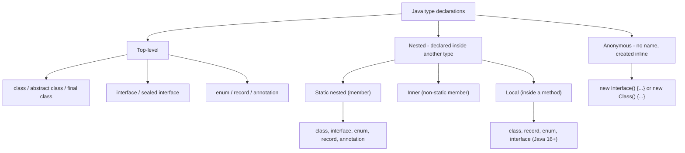
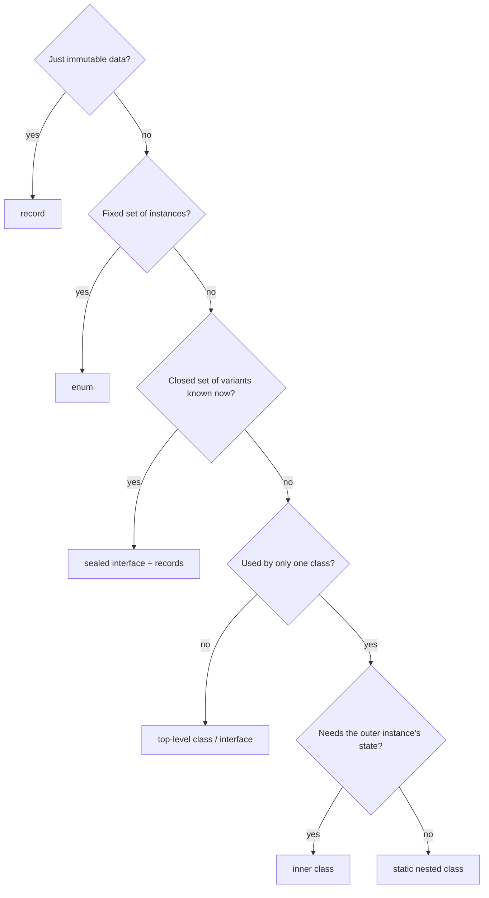

# B.1 Class Types: Taxonomy and Decision Guide

> **Goal:** See every kind of class and type declaration Java offers, how each is named and compiled, and how to pick the right one.

**Level:** map of the territory. Chapters B.2 to B.12 dive into each kind.
**Verified on:** OpenJDK 21.0.12. Every output below was produced by running the code.

## Contents

1. [The map](#1-the-map)
2. [Proof: every kind, listed by reflection](#2-proof-every-kind-listed-by-reflection)
3. [Where each kind may be declared](#3-where-each-kind-may-be-declared)
4. [Naming in `.class` files](#4-naming-in-class-files)
5. [Decision guide](#5-decision-guide)
6. [Modifiers cheat sheet](#6-modifiers-cheat-sheet)
7. [Common gotchas](#7-common-gotchas)
8. [Interview questions](#8-interview-questions)

---

## 1. The map

**Intuition.** Think of Java types like rooms of a house. Some rooms stand on their own (top-level), some are built inside other rooms (nested), and some are temporary pop-up tents with no name (anonymous). Each has its own rules about whom it can see and what it costs.



| Kind | Chapter | Has outer instance? | Typical use |
|---|---|---|---|
| Top-level class | B.2 | no | normal domain types |
| `final` / `abstract` class | B.2 | no | closed or skeleton types |
| Static nested | B.3 | no | builders, nodes, helpers tied to one class |
| Inner (member) | B.4 | **yes** | iterators and views over the outer's state |
| Local | B.5 | maybe (if in instance method) | one-off helper inside a method |
| Anonymous | B.6 | maybe | one-shot implementation, callbacks |
| Enum | B.7 | no | fixed set of constants with behaviour |
| Record | B.8 | no | immutable data carrier |
| Sealed class/interface | B.9 | no | closed hierarchies |
| Interface / annotation type | B.10 | no | contracts and metadata |
| Generic class, arrays, primitives, lambdas | B.11 | no | parametrized and special types |

## 2. Proof: every kind, listed by reflection

```java
import java.lang.reflect.Modifier;

public class ClassKinds {
    interface NestedInterface { }
    enum NestedEnum { A }
    record NestedRecord(int x) { }
    @interface NestedAnnotation { }
    static class StaticNested { }
    class Inner {
        static int counter = 0;                          // static members in inner classes: allowed since Java 16
    }

    static String kindOf(Class<?> c) {
        if (c.isPrimitive()) return "primitive";
        if (c.isArray()) return "array";
        if (c.isAnnotation()) return "annotation";
        if (c.isInterface()) return "interface";
        if (c.isEnum()) return "enum";
        if (c.isRecord()) return "record";
        return "class";
    }

    static String placeOf(Class<?> c) {
        if (c.isAnonymousClass()) return "anonymous";
        if (c.isLocalClass()) return "local";
        if (c.isMemberClass()) return Modifier.isStatic(c.getModifiers()) ? "static member" : "inner member";
        return "top-level / other";
    }

    static void describe(Class<?> c) {
        System.out.printf("%-30s %-11s %-18s simpleName=\"%s\"%n", c.getName(), kindOf(c), placeOf(c), c.getSimpleName());
    }

    public static void main(String[] args) {
        class Local { }
        record LocalRecord(int y) { }
        enum LocalEnum { B }
        interface LocalInterface { }
        Object anonymous = new Object() { };

        describe(ClassKinds.class);
        describe(NestedInterface.class);
        describe(NestedEnum.class);
        describe(NestedRecord.class);
        describe(NestedAnnotation.class);
        describe(StaticNested.class);
        describe(Inner.class);
        describe(Local.class);
        describe(LocalRecord.class);
        describe(LocalEnum.class);
        describe(LocalInterface.class);
        describe(anonymous.getClass());
        describe(int[].class);
        describe(int.class);

        Runnable lambda = () -> { };
        System.out.println("lambda: isSynthetic=" + lambda.getClass().isSynthetic()
                + ", isHidden=" + lambda.getClass().isHidden()
                + ", isAnonymousClass=" + lambda.getClass().isAnonymousClass());
    }
}

// ---- Output ----
// ClassKinds                     class       top-level / other  simpleName="ClassKinds"
// ClassKinds$NestedInterface     interface   static member      simpleName="NestedInterface"
// ClassKinds$NestedEnum          enum        static member      simpleName="NestedEnum"
// ClassKinds$NestedRecord        record      static member      simpleName="NestedRecord"
// ClassKinds$NestedAnnotation    annotation  static member      simpleName="NestedAnnotation"
// ClassKinds$StaticNested        class       static member      simpleName="StaticNested"
// ClassKinds$Inner               class       inner member       simpleName="Inner"
// ClassKinds$1Local              class       local              simpleName="Local"
// ClassKinds$1LocalRecord        record      local              simpleName="LocalRecord"
// ClassKinds$1LocalEnum          enum        local              simpleName="LocalEnum"
// ClassKinds$1LocalInterface     interface   local              simpleName="LocalInterface"
// ClassKinds$1                   class       anonymous          simpleName=""
// [I                             array       top-level / other  simpleName="int[]"
// int                            primitive   top-level / other  simpleName="int"
// lambda: isSynthetic=true, isHidden=true, isAnonymousClass=false
```

Read the three columns: the binary name (what the compiler gave it), the kind, and where it lives. Observe that:

- Nested types use `Outer$Nested` names; local types add a number (`Outer$1Local`); anonymous types are numbered (`Outer$1`).
- An array class is named `[I` (`int[]`), and primitives have `Class` objects too.
- A lambda is **not** an anonymous class: it is a hidden synthetic class generated at runtime (`isHidden=true`).

## 3. Where each kind may be declared

| Declaration | Top level | Inside a class | Inside a method |
|---|---|---|---|
| class | yes | yes (static or inner) | yes (local) |
| interface | yes | yes (implicitly static) | yes since Java 16 (local) |
| enum | yes | yes (implicitly static) | yes since Java 16 (local) |
| record | yes (Java 16) | yes (implicitly static) | yes (local) |
| annotation type | yes | yes | **no** |

## 4. Naming in `.class` files

```text
Outer.java  ->  Outer.class
                Outer$Nested.class      (static nested or inner member)
                Outer$1Local.class      (local class named Local, first one)
                Outer$1.class           (first anonymous class)
                Outer$Inner$Deeper.class
```

The JVM has no concept of "nested class": every one is a separate top-level class file, tied to its siblings by `InnerClasses`, `NestHost` and `NestMembers` attributes. Chapter B.12 shows the bytecode.

## 5. Decision guide



Quick answers:

| Situation | Choose |
|---|---|
| Pass behaviour to a method | lambda; if it needs state or several methods, anonymous/local class |
| Iterator over your own collection | inner class (or static nested with explicit reference) |
| Builder for an immutable class | static nested `Builder` |
| Helper used inside one method | local class or record |
| Constants with behaviour | enum with constant-specific bodies |
| Algebraic data type | sealed interface + records |

## 6. Modifiers cheat sheet

| Modifier | On classes | Meaning |
|---|---|---|
| `abstract` | yes | cannot be instantiated |
| `final` | yes | cannot be subclassed |
| `sealed` / `non-sealed` | yes | restricts / reopens subclassing (Java 17) |
| `static` | nested only | no outer instance |
| `strictfp` | redundant since 17 | all FP strict by default (JEP 306) |
| `private`/`protected` | nested only | access of the nested type |

## 7. Common gotchas

| Gotcha | Why | Fix |
|---|---|---|
| Nested class leaks memory | non-static inner keeps a hidden `this$0` | make it `static` unless it needs the outer |
| `new Inner()` fails from static `main` | needs an outer instance | `outer.new Inner()` or make it static |
| "Anonymous class" for a lambda | lambdas are different (no new `this`, hidden class) | know the differences (B.6) |
| Local interface/enum/record "not allowed" | before Java 16 | use Java 16+ |
| Annotation inside a method | not permitted | declare at class level |

## 8. Interview questions

<details>
<summary><strong>Q1. List all kinds of nested classes in Java.</strong></summary>

Static nested, inner (non-static member), local, and anonymous. Nested interfaces, enums, records and annotations are always implicitly static members.
</details>

<details>
<summary><strong>Q2. How does the JVM see a nested class?</strong></summary>

As an ordinary separate class (<code>Outer$Inner</code>); the nesting is source-level plus metadata attributes (<code>InnerClasses</code>, <code>NestHost</code>, <code>NestMembers</code>).
</details>

<details>
<summary><strong>Q3. When would you use a local class instead of a lambda?</strong></summary>

When you need several methods, fields, a name for recursion, or multiple instances; lambdas implement exactly one functional method.
</details>

<details>
<summary><strong>Q4. Why can records, enums and interfaces nested in a class be used without an outer instance?</strong></summary>

They are implicitly `static`, so they have no hidden outer reference.
</details>

<details>
<summary><strong>Q5. What is the binary name of the second anonymous class inside <code>Foo</code>?</strong></summary>

<code>Foo$2</code>; anonymous classes are numbered in textual order within the top-level class.
</details>

<details>
<summary><strong>Q6. Can a nested class have the same name as its enclosing class?</strong></summary>

No; a nested class cannot have the same simple name as any enclosing class.
</details>

<details>
<summary><strong>Q7. Is a lambda an instance of an anonymous class?</strong></summary>

No. The compiler desugars the body into a private (synthetic) method and an <code>invokedynamic</code> call site creates, at run time, a hidden class implementing the functional interface. The demo shows <code>isAnonymousClass=false</code>, <code>isHidden=true</code>.
</details>

<details>
<summary><strong>Q8. What decides between a static nested class and an inner class?</strong></summary>

Whether instances need the enclosing instance's state. If not, prefer static: smaller objects, no accidental references that prevent garbage collection.
</details>

<details>
<summary><strong>Q9. Which type declarations can you put inside a method?</strong></summary>

Classes, records, enums and interfaces (Java 16+, JEP 395 relaxed the rules). Not annotation types.
</details>

---

[Previous: A.5 The Object Contract](../A-foundations/05-object-contract-equals-hashcode-tostring-clone.md) · [Part index](../README.md) · Next: [B.2 Top-level, Final and Abstract Classes](./02-top-level-final-and-abstract-classes.md)