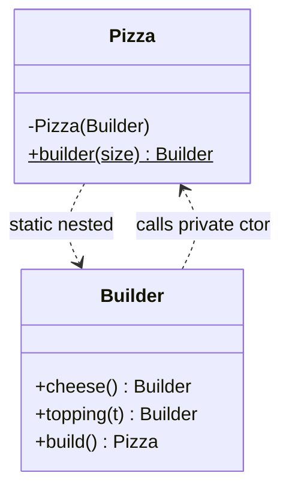

# B.3 Static Nested Classes

> **Goal:** Know when to nest a class statically, what it can and cannot access, and why it should be your default kind of nested class.

**Level:** refresher with compilation detail.
**Verified on:** OpenJDK 21.0.12. Every output below was produced by running the code.

## Contents

1. [What it is](#1-what-it-is)
2. [Why nest at all](#2-why-nest-at-all)
3. [Example: Builder and linked-stack Node](#3-example-builder-and-linked-stack-node)
4. [Static nested versus inner, proven](#4-static-nested-versus-inner-proven)
5. [Access rules](#5-access-rules)
6. [Nested interfaces, enums and records are static](#6-nested-interfaces-enums-and-records-are-static)
7. [Common gotchas](#7-common-gotchas)
8. [Interview questions](#8-interview-questions)

---

## 1. What it is

**Intuition.** A static nested class is a normal class that happens to live in another class's namespace. It is like a department's own tool shed on the company grounds: it uses the company's address and may borrow from the company's private storage rooms, but it does not belong to any one employee.

It has **no hidden reference** to an enclosing instance. It can read the outer class's `private static` members directly, and the outer class can read its private members too.

## 2. Why nest at all

| Reason | Example |
|---|---|
| Strong grouping: used only by one class | `LinkedStack.Node` |
| Access to private members without widening visibility | `Pizza.Builder` calls the private constructor |
| Cleaner namespace | `Map.Entry`, `AbstractMap.SimpleEntry` |
| Hiding implementation | `private static class Node<T>` |

## 3. Example: Builder and linked-stack Node

```java
import java.lang.reflect.Field;
import java.util.Arrays;
import java.util.NoSuchElementException;

public class StaticNested {

    // Classic use 1: a Builder lives next to the class it builds and may touch its private constructor
    static final class Pizza {
        private final String size;
        private final boolean cheese;
        private final int toppings;

        private Pizza(Builder b) { size = b.size; cheese = b.cheese; toppings = b.toppings; }

        @Override public String toString() { return size + " pizza, cheese=" + cheese + ", toppings=" + toppings; }

        static Builder builder(String size) { return new Builder(size); }

        static final class Builder {                         // static nested: needs no Pizza instance
            private final String size;
            private boolean cheese;
            private int toppings;
            private Builder(String size) { this.size = size; }
            Builder cheese(boolean c) { this.cheese = c; return this; }
            Builder toppings(int t) { this.toppings = t; return this; }
            Pizza build() { return new Pizza(this); }        // outer's private constructor: allowed
        }
    }

    // Classic use 2: an implementation detail that must NOT keep the outer instance alive
    static final class LinkedStack<T> {
        private static final class Node<T> {                 // static: no hidden reference to the stack
            final T value; final Node<T> next;
            Node(T value, Node<T> next) { this.value = value; this.next = next; }
        }
        private Node<T> head;
        private int size;

        void push(T v) { head = new Node<>(v, head); size++; }
        T pop() {
            if (head == null) throw new NoSuchElementException("empty");
            T v = head.value; head = head.next; size--; return v;
        }
        int size() { return size; }
    }

    // The difference at the bytecode/reflection level
    private int outerState = 7;
    class InnerUsingOuter { int read() { return outerState; } }
    static class NestedStatic { int read() { return 1; } }

    static String fields(Class<?> c) {
        return Arrays.stream(c.getDeclaredFields())
                .map(f -> f.getName() + (f.isSynthetic() ? " (synthetic)" : ""))
                .toList().toString();
    }

    public static void main(String[] args) {
        System.out.println(Pizza.builder("large").cheese(true).toppings(3).build());

        LinkedStack<String> stack = new LinkedStack<>();
        stack.push("a"); stack.push("b");
        System.out.println("pop=" + stack.pop() + ", size=" + stack.size());

        System.out.println("instantiate a static nested class: new StaticNested.NestedStatic() -> "
                + new StaticNested.NestedStatic().read());
        StaticNested outer = new StaticNested();
        System.out.println("instantiate an inner class needs an outer: outer.new InnerUsingOuter() -> "
                + outer.new InnerUsingOuter().read());

        System.out.println("fields of NestedStatic     : " + fields(NestedStatic.class));
        System.out.println("fields of InnerUsingOuter  : " + fields(InnerUsingOuter.class));
    }
}

// ---- Output ----
// large pizza, cheese=true, toppings=3
// pop=b, size=1
// instantiate a static nested class: new StaticNested.NestedStatic() -> 1
// instantiate an inner class needs an outer: outer.new InnerUsingOuter() -> 7
// fields of NestedStatic     : []
// fields of InnerUsingOuter  : [this$0 (synthetic)]
```

The `Builder` accesses `Pizza`'s private constructor; `Pizza` accesses the builder's private fields. The `Node` class is `private static final` so no outside code can see it.



## 4. Static nested versus inner, proven

The output above includes the reflective proof: the static nested class has **no** synthetic fields; the inner class has `this$0`, the hidden reference to its outer instance.

| | Static nested | Inner (chapter B.4) |
|---|---|---|
| Needs an outer instance to create | no: `new Outer.Nested()` | yes: `outer.new Inner()` |
| Hidden `this$0` field | no | yes (unless javac 18+ proves it unused) |
| Can read outer instance fields | only via an explicit reference | directly |
| Can declare static members | yes | yes since Java 16 |
| Memory-leak risk | none from nesting | keeps the outer alive |

## 5. Access rules

```text
Outer
 |-- private static int counter    <-- Nested can read/write this directly
 |-- private int field             <-- Nested needs an Outer reference: outer.field
 '-- static class Nested
       |-- private int secret      <-- Outer can read via nested.secret
```

All members of a nest (top-level class plus all nested classes) can access each other's private members. Since Java 11 this is checked directly by the JVM via nestmates (chapter B.12); older compilers generated `access$000` bridges.

## 6. Nested interfaces, enums and records are static

A member `interface`, `enum`, `record` or annotation inside a class is implicitly `static`. Writing `static` is allowed but redundant. This is why a record can be instantiated without an outer object.

## 7. Common gotchas

| Gotcha | Why | Fix |
|---|---|---|
| Used inner class when static was enough | accidental `this$0` retention | add `static` |
| `Nested` cannot read `outer.field` directly | no outer instance | pass the outer in, or use inner |
| Generic outer type parameter not visible | static nested has its own scope | declare its own `<T>` |
| Serialization of non-static inner | tries to serialize outer too | use static nested |
| Name clash with import | nested names are qualified `Outer.Nested` | import it or qualify |

## 8. Interview questions

<details>
<summary><strong>Q1. Difference between a static nested class and an inner class?</strong></summary>

A static nested class has no enclosing instance and is created with `new Outer.Nested()`; an inner class holds `this$0` and needs `outer.new Inner()`. The reflection demo shows only the inner class has the synthetic field.
</details>

<details>
<summary><strong>Q2. Can a static nested class access the outer class's private members?</strong></summary>

Yes, static ones directly and instance ones through a reference. Private access is granted to the whole nest.
</details>

<details>
<summary><strong>Q3. Give JDK examples of static nested classes.</strong></summary>

<code>Map.Entry</code> (nested interface), <code>AbstractMap.SimpleEntry</code>, <code>HashMap.Node</code>, <code>Character.UnicodeBlock</code>, <code>ProcessBuilder.Redirect</code>.
</details>

<details>
<summary><strong>Q4. Why is the Builder pattern usually a static nested class?</strong></summary>

It is tied to one class, needs access to its private constructor, but must exist before the object does, so it cannot depend on an instance.
</details>

<details>
<summary><strong>Q5. Can a static nested class extend the outer class?</strong></summary>

Yes, legally (the JDK's <code>HashMap.TreeNode</code> extends <code>LinkedHashMap.Entry</code>). It is used for tight coupling of related implementation types.
</details>

<details>
<summary><strong>Q6. Does making a nested class static change its bytecode name?</strong></summary>

No: still <code>Outer$Nested</code>. Only the presence of the outer-reference field and constructor parameter changes.
</details>

<details>
<summary><strong>Q7. Can a static nested class be instantiated outside the outer class?</strong></summary>

Yes if its access level allows it: <code>new Outer.Nested()</code>. A <code>private</code> nested class is only visible within the nest.
</details>

---

[Previous: B.2 Top-level, Final and Abstract Classes](./02-top-level-final-and-abstract-classes.md) · [Part index](../README.md) · Next: [B.4 Inner (Member) Classes](./04-inner-member-classes.md)