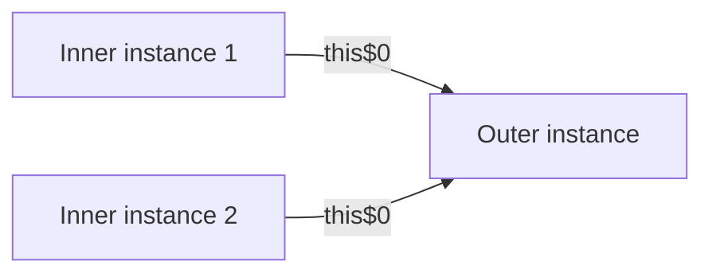

# B.4 Inner (Member) Classes

> **Goal:** Understand non-static inner classes: the hidden outer reference, the odd `outer.new` syntax, shadowing rules, and the memory-leak trap.

**Level:** deep dive; this is where most nested-class interview questions live.
**Verified on:** OpenJDK 21.0.12. Every output below was produced by running the code.

## Contents

1. [What an inner class is](#1-what-an-inner-class-is)
2. [Creating one](#2-creating-one)
3. [Reaching the outer instance and shadowing](#3-reaching-the-outer-instance-and-shadowing)
4. [The classic use: an iterator](#4-the-classic-use-an-iterator)
5. [Inheriting from an inner class](#5-inheriting-from-an-inner-class)
6. [The memory-leak trap](#6-the-memory-leak-trap)
7. [Static members in inner classes](#7-static-members-in-inner-classes)
8. [Common gotchas](#8-common-gotchas)
9. [Interview questions](#9-interview-questions)

---

## 1. What an inner class is

**Intuition.** An inner class instance is like a remote control that belongs to one particular TV. It cannot exist without its TV, it can press that TV's private buttons, and as long as you hold the remote, the TV cannot be thrown away.

Technically: a non-static member class. Every instance carries an implicit reference to an instance of the enclosing class (the compiler adds a field `this$0` and an extra constructor parameter).



## 2. Creating one

From inside an instance method of the outer class, `new Inner()` just works (it uses `this`). From elsewhere you need an explicit outer: `outer.new Inner()`.

## 3. Reaching the outer instance and shadowing

Inner code can read and write outer fields directly, even private ones. When names collide, the innermost declaration wins, and you reach the others with qualified `this`.

```java
import java.lang.reflect.Field;
import java.util.Iterator;
import java.util.NoSuchElementException;

public class InnerClasses {

    private final String label;
    private int x = 1;
    private final int[] bigData = new int[1000];

    InnerClasses(String label) { this.label = label; }

    // 1. An inner (non-static) class is bound to an enclosing INSTANCE
    class Inner {
        int x = 2;
        void show(int x) {
            System.out.println("param x=" + x + ", this.x=" + this.x + ", InnerClasses.this.x=" + InnerClasses.this.x);
        }
        String outerLabel() { return label; }                // reads the outer's private field directly
        int outerDataLength() { return bigData.length; }
    }

    // 2. The standard reason inner classes exist: an iterator that needs the collection's internals
    static class Bag<T> implements Iterable<T> {
        private final Object[] items;
        Bag(Object... items) { this.items = items; }

        @Override public Iterator<T> iterator() {
            return new BagIterator();
        }

        private class BagIterator implements Iterator<T> {   // uses Bag.this.items and the type parameter T
            private int index = 0;
            @Override public boolean hasNext() { return index < items.length; }
            @SuppressWarnings("unchecked")
            @Override public T next() {
                if (!hasNext()) throw new NoSuchElementException();
                return (T) items[index++];
            }
        }
    }

    // 3. Inheriting from an inner class: the subclass constructor must supply the enclosing instance
    static class Special extends InnerClasses.Inner {
        Special(InnerClasses outer) {
            outer.super();                                   // qualified superclass constructor invocation
        }
    }

    public static void main(String[] args) throws Exception {
        InnerClasses outer = new InnerClasses("outer-1");
        InnerClasses.Inner inner = outer.new Inner();         // note the syntax
        inner.show(3);
        System.out.println("outerLabel = " + inner.outerLabel());

        for (String s : new Bag<String>("a", "b", "c")) System.out.print(s + " ");
        System.out.println();

        System.out.println("Special sees outer label: " + new Special(outer).outerLabel());

        // The hidden link: an inner instance keeps the outer instance reachable (a classic memory leak)
        Field link = InnerClasses.Inner.class.getDeclaredField("this$0");
        link.setAccessible(true);
        System.out.println("inner.this$0 == outer ? " + (link.get(inner) == outer));
        System.out.println("so holding 'inner' keeps outer and its " + outer.bigData.length + "-int array alive");
    }
}

// ---- Output ----
// param x=3, this.x=2, InnerClasses.this.x=1
// outerLabel = outer-1
// a b c
// Special sees outer label: outer-1
// inner.this$0 == outer ? true
// so holding 'inner' keeps outer and its 1000-int array alive
```

The first output line is the shadowing rule: `param x`, `this.x` and `InnerClasses.this.x` are three different variables. Also note the last lines: `inner.this$0 == outer` is true, so **holding an inner instance keeps the outer alive**.

| Expression | Refers to |
|---|---|
| `x` | the nearest enclosing declaration (parameter, then inner field, then outer field) |
| `this.x` | field of the inner instance |
| `Outer.this.x` | field of the enclosing instance |
| `outer.new Inner()` | creates an inner bound to `outer` |

## 4. The classic use: an iterator

An iterator needs the collection's private structure and cannot exist without a collection. An inner class expresses exactly that (see `Bag.iterator()` in the code above). `ArrayList.Itr` and `HashMap.HashIterator` are built this way.

```text
Bag object
 |-- private items[]
 '-- iterator() returns -> Bag.Itr (inner) --this$0--> same Bag
```

## 5. Inheriting from an inner class

A subclass of an inner class, written outside the outer class, must supply an enclosing instance to the superclass constructor: `outer.super();`. The demo contains this rare syntax and shows it working.

## 6. The memory-leak trap

If a long-lived object (cache, listener list, static field, thread) holds an inner-class instance, the whole outer object and everything it references stays reachable. The demo's last line shows the outer's 1000-int array being kept alive.

Rule: **make nested classes `static` unless they truly need the outer instance.** Since javac 18, an inner class that never uses `this$0` does not even keep the field, but do not rely on that for design.

## 7. Static members in inner classes

Before Java 16 an inner class could declare only `static final` constants. Since Java 16 (JEP 395, together with records), inner classes may declare static fields, methods and nested types, which is why records can be declared inside inner classes.

## 8. Common gotchas

| Gotcha | Why | Fix |
|---|---|---|
| `new Inner()` in `static main` fails | no enclosing instance | `new Outer().new Inner()` or make `Inner` static |
| Memory leak via listener/callback | `this$0` keeps outer reachable | static nested or lambda without capture |
| Serializing an inner object serializes the outer | field `this$0` is part of state | static nested class |
| Name shadowing confusion | three levels of `x` | use `this.x` and `Outer.this.x` explicitly |
| Generic outer `Outer<T>.Inner` needs qualified type | inner uses the outer's `T` | write `Outer<String>.Inner` |
| Subclassing an inner class outside the outer | needs enclosing instance | `outer.super()` |

## 9. Interview questions

<details>
<summary><strong>Q1. What is the hidden field <code>this$0</code>?</strong></summary>

The compiler-generated reference to the enclosing instance, set through an extra constructor parameter. Reflection shows it as a synthetic field (<code>fields of InnerUsingOuter: [this$0 (synthetic)]</code> in chapter B.3).
</details>

<details>
<summary><strong>Q2. How do you instantiate an inner class from outside?</strong></summary>

<code>Outer outer = new Outer(); Outer.Inner in = outer.new Inner();</code>
</details>

<details>
<summary><strong>Q3. How do inner classes cause memory leaks?</strong></summary>

Anything holding the inner object transitively holds the outer instance. Typical sources are listeners, caches, handlers and thread targets. Fix with static nested classes and explicit weak references.
</details>

<details>
<summary><strong>Q4. How do you access the outer instance when names are shadowed?</strong></summary>

<code>OuterName.this.member</code>.
</details>

<details>
<summary><strong>Q5. Can an inner class have static methods?</strong></summary>

Since Java 16, yes. Earlier, only compile-time constant static fields.
</details>

<details>
<summary><strong>Q6. Are inner classes useful for iterators? Why?</strong></summary>

Yes: they need access to the private structure of one specific collection instance, and their lifecycle is bound to it.
</details>

<details>
<summary><strong>Q7. What does the compiler generate for an inner class constructor?</strong></summary>

A constructor taking the outer instance as the first parameter; it assigns <code>this$0</code> and (in older compilers) null-checks it before calling <code>super()</code>. Chapter B.12 shows <code>javap</code> output.
</details>

<details>
<summary><strong>Q8. Can an interface or enum declared inside an inner class be non-static?</strong></summary>

No. Nested interfaces, enums and records are always static, even inside an inner class (allowed since Java 16).
</details>

<details>
<summary><strong>Q9. What is the difference between inner-class `this` and outer `this`?</strong></summary>

<code>this</code> is the inner instance; <code>Outer.this</code> is the instance it is bound to. They are different objects.
</details>

---

[Previous: B.3 Static Nested Classes](./03-static-nested-classes.md) · [Part index](../README.md) · Next: [B.5 Local Classes](./05-local-classes.md)