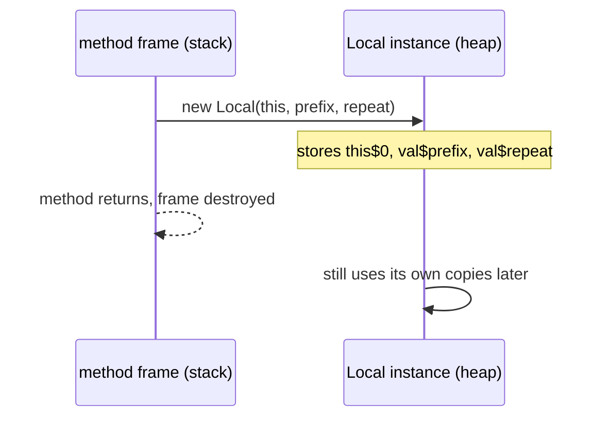

# B.5 Local Classes

> **Goal:** Use classes, records, enums and interfaces declared inside methods, and understand how variable capture really works.

**Level:** deep dive with bytecode-level capture mechanics.
**Verified on:** OpenJDK 21.0.12. Every output below was produced by running the code.

## Contents

1. [What a local class is](#1-what-a-local-class-is)
2. [Capture: how local variables get in](#2-capture-how-local-variables-get-in)
3. [Why captured variables must be effectively final](#3-why-captured-variables-must-be-effectively-final)
4. [Local records, enums and interfaces (Java 16)](#4-local-records-enums-and-interfaces-java-16)
5. [Local class versus lambda versus anonymous class](#5-local-class-versus-lambda-versus-anonymous-class)
6. [Common gotchas](#6-common-gotchas)
7. [Interview questions](#7-interview-questions)

---

## 1. What a local class is

**Intuition.** A local class is a tool you build on the workbench for one job and put away. It has a name (so you can create several, or refer to it recursively), but its scope ends with the enclosing block.

It can be declared in a method, constructor, initializer or block; it cannot have an access modifier or be `static`; it may be `final` or `abstract`.

## 2. Capture: how local variables get in

A local class can use the enclosing method's **local variables and parameters**, and, if declared in an instance context, the enclosing instance. The class outlives the method call, but the local variable lives on the stack, so the compiler **copies the value** into a synthetic field of the class.

```java
import java.lang.reflect.Field;
import java.util.ArrayList;
import java.util.Arrays;
import java.util.List;

public class LocalClasses {

    private final String owner = String.valueOf("LocalClasses-instance");   // not a constant expression

    List<String> run(String prefix, int repeat) {
        // A local class: declared inside a method body, visible only there
        class Formatter {
            private int calls;                               // it may have its own state
            String format(String s) {
                calls++;
                return prefix + ":" + s.repeat(repeat) + "#" + calls + "@" + owner;   // captures prefix, repeat and this
            }
        }

        Formatter f = new Formatter();
        List<String> out = new ArrayList<>();
        out.add(f.format("a"));
        out.add(f.format("b"));

        // Which hidden fields did the compiler add? (captured variables become val$... fields)
        out.add(Arrays.stream(Formatter.class.getDeclaredFields())
                .map(Field::getName).sorted().toList().toString());
        return out;
    }

    static void statics() {
        // Java 16: records, enums and interfaces can also be local (they are implicitly static, so they capture nothing)
        record Range(int lo, int hi) {
            int length() { return hi - lo; }
        }
        enum Mode { FAST, SAFE }
        interface Scorer { int score(Range r); }

        Scorer scorer = r -> r.length() * 10;
        System.out.println("local record + enum + interface: " + scorer.score(new Range(2, 7)) + ", " + Mode.SAFE);
    }

    public static void main(String[] args) {
        new LocalClasses().run("P", 2).forEach(System.out::println);
        statics();

        // Captured locals must be effectively final: the class gets a COPY, so later changes could not be seen
        int copy = 10;
        class Reader { int read() { return copy; } }
        System.out.println("captured value: " + new Reader().read());
    }
}

// ---- Output ----
// P:aa#1@LocalClasses-instance
// P:bb#2@LocalClasses-instance
// [calls, this$0, val$prefix, val$repeat]
// local record + enum + interface: 50, SAFE
// captured value: 10
```

The reflection line is the proof: the class has fields `calls` (its own), `this$0` (the enclosing instance) and `val$prefix`, `val$repeat` (copies of the captured locals).



## 3. Why captured variables must be effectively final

Because the class holds a **copy**, a later change to the variable would make the copy stale, with confusing semantics. Java forbids it: the variable must be `final` or *effectively final* (never reassigned, Java 8).

```java
public class CaptureMutation {
    public static void main(String[] args) {
        int counter = 0;
        Runnable r = new Runnable() {
            public void run() {
                System.out.println(counter);    // reads a captured local
            }
        };
        counter++;                              // ERROR: the captured variable is modified afterwards
        r.run();
    }
}
```

Real `javac` output:

```text
ce/CaptureMutation.java:6: error: local variables referenced from an inner class must be final or effectively final
                System.out.println(counter);    // reads a captured local
                                   ^
1 error
```

If you need mutable shared state, capture a reference to a mutable holder (`AtomicInteger`, a one-element array, a field of an object) and mutate that. Be careful with threads: this shares state without synchronization.

## 4. Local records, enums and interfaces (Java 16)

Local records are a favourite for throwaway tuples in stream pipelines. Local records, enums and interfaces are implicitly `static`, so they **cannot capture** the enclosing method's variables.

| Local kind | Captures locals? | Implicit modifier |
|---|---|---|
| class | yes | none |
| record | no | static |
| enum | no | static |
| interface | no | static |

## 5. Local class versus lambda versus anonymous class

| | Local class | Anonymous class | Lambda |
|---|---|---|---|
| Has a name | yes | no | no |
| Can implement many methods / abstract class | yes | yes | no (functional interface only) |
| Can have fields and constructors | yes | fields yes, constructor no | no |
| `this` means | itself | itself | enclosing object |
| Reuse several instances | yes | no | via variable |
| Compiles to | `Outer$1Local` | `Outer$1` | hidden class + private synthetic method |

## 6. Common gotchas

| Gotcha | Why | Fix |
|---|---|---|
| "local variables referenced from an inner class must be final or effectively final" | captured by copy | holder object / `AtomicX` / redesign |
| Local class in static method cannot reach instance fields | no enclosing instance | move to an instance method or pass the data |
| Captured big object lives as long as the local-class instance | the copy is a strong reference | capture only what you need |
| Local record cannot use method parameters | implicitly static | pass them as component values |
| Too many local classes hurting readability | method becomes huge | extract to a private nested class |

## 7. Interview questions

<details>
<summary><strong>Q1. What can a local class capture?</strong></summary>

Effectively final locals and parameters of the enclosing method, plus the enclosing instance (`this`) when declared in an instance context. The captured values are stored in synthetic <code>val$name</code> fields.
</details>

<details>
<summary><strong>Q2. Why must captured variables be effectively final?</strong></summary>

The class gets a copy; allowing reassignment would let the copy and original diverge (and for concurrency, the local lives on one thread's stack). The compiler rejects mutation with a clear error (shown above).
</details>

<details>
<summary><strong>Q3. Can a local class be static or have an access modifier?</strong></summary>

No. Its scope is the block, so access modifiers make no sense; local records/enums/interfaces are implicitly static.
</details>

<details>
<summary><strong>Q4. How does a local class differ from an anonymous class?</strong></summary>

It has a name, can be instantiated multiple times, may have explicit constructors, and can be referenced recursively.
</details>

<details>
<summary><strong>Q5. Can a local class capture a variable that is declared after the class?</strong></summary>

No: the variable must be in scope (declared before the class body) and definitely assigned before the class body.
</details>

<details>
<summary><strong>Q6. Is a local record able to access the enclosing method's variables?</strong></summary>

No; it is implicitly static. Pass the values as components.
</details>

<details>
<summary><strong>Q7. How is a local class named in the bytecode?</strong></summary>

<code>Outer$1Local</code>: the outer name, a digit counting duplicates of the same simple name, then the simple name.
</details>

<details>
<summary><strong>Q8. Why does effectively-final not apply to fields?</strong></summary>

Fields are read through the enclosing instance reference, not copied, so the class always sees the current value.
</details>

---

[Previous: B.4 Inner (Member) Classes](./04-inner-member-classes.md) · [Part index](../README.md) · Next: [B.6 Anonymous Classes](./06-anonymous-classes.md)