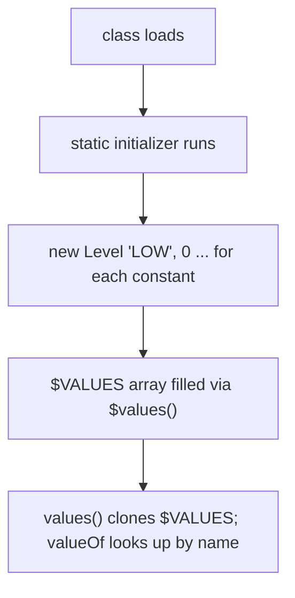

# B.7 Enums in Depth

> **Goal:** Treat enums as the full classes they are: constructors, fields, constant-specific bodies, `EnumMap`/`EnumSet`, and what the compiler generates.

**Level:** deep dive.
**Verified on:** OpenJDK 21.0.12. Every output below was produced by running the code.

## Contents

1. [What an enum really is](#1-what-an-enum-really-is)
2. [Fields, constructors, methods and constant bodies](#2-fields-constructors-methods-and-constant-bodies)
3. [What the compiler generates](#3-what-the-compiler-generates)
4. [`EnumMap` and `EnumSet`](#4-enummap-and-enumset)
5. [Enums implementing interfaces; the strategy enum](#5-enums-implementing-interfaces-the-strategy-enum)
6. [Static initialization trap](#6-static-initialization-trap)
7. [Enums and `switch`](#7-enums-and-switch)
8. [Serialization, singletons, and limits](#8-serialization-singletons-and-limits)
9. [Common gotchas](#9-common-gotchas)
10. [Interview questions](#10-interview-questions)

---

## 1. What an enum really is

**Intuition.** An enum is a class whose instances are all created up front, named, and fixed. `Level.HIGH` is not an integer; it is the one and only `Level` object called `HIGH`. That is why enums can carry data, behave polymorphically, and be compared with `==`.

Every enum implicitly extends `java.lang.Enum<E>` (so it cannot extend anything else, but it can implement interfaces), is implicitly `final` unless a constant has a body, and has a private constructor.

## 2. Fields, constructors, methods and constant bodies

```java
import java.util.Arrays;
import java.util.EnumMap;
import java.util.EnumSet;
import java.util.Map;

public class EnumDeep {

    // Constants with fields, a constructor, and constant-specific class bodies
    enum Operation {
        PLUS("+") {
            @Override int apply(int a, int b) { return a + b; }
        },
        TIMES("*") {
            @Override int apply(int a, int b) { return a * b; }
        };

        private final String symbol;
        Operation(String symbol) { this.symbol = symbol; }       // enum constructors are implicitly private
        abstract int apply(int a, int b);
        String symbol() { return symbol; }
    }

    enum Level {
        LOW, MEDIUM, HIGH;
        Level next() { return values()[(ordinal() + 1) % values().length]; }
        @Override public String toString() { return name().charAt(0) + name().substring(1).toLowerCase(); }
    }

    interface Priced { int cents(); }

    enum Coffee implements Priced {                              // enums can implement interfaces
        ESPRESSO(250), LATTE(400);
        private final int cents;
        Coffee(int cents) { this.cents = cents; }
        @Override public int cents() { return cents; }
    }

    enum Day { MON, TUE, WED, THU, FRI, SAT, SUN }

    public static void main(String[] args) {
        // The basics
        System.out.println("values()            = " + Arrays.toString(Level.values()));
        System.out.println("valueOf(\"HIGH\")     = " + Level.valueOf("HIGH") + " (name=" + Level.HIGH.name() + ")");
        System.out.println("ordinal / compareTo = " + Level.MEDIUM.ordinal() + " / " + Level.LOW.compareTo(Level.HIGH));
        System.out.println("HIGH.next()         = " + Level.HIGH.next());
        try {
            Level.valueOf("high");
        } catch (IllegalArgumentException e) {
            System.out.println("valueOf(\"high\")     -> " + e.getMessage());
        }
        System.out.println("values() returns a fresh copy each call: " + (Level.values() != Level.values()));

        // Constant-specific bodies
        for (Operation op : Operation.values()) {
            System.out.println(op + " " + op.symbol() + " -> " + op.apply(6, 7)
                    + "   class=" + op.getClass().getName() + ", declaringClass=" + op.getDeclaringClass().getSimpleName());
        }
        System.out.println("PLUS.getClass().isEnum() = " + Operation.PLUS.getClass().isEnum()
                + ", Operation.class.isEnum() = " + Operation.class.isEnum());

        // Interface + switch
        Coffee c = Coffee.LATTE;
        String note = switch (c) {
            case ESPRESSO -> "short";
            case LATTE -> "milky";
        };
        System.out.println(c + " costs " + c.cents() + " cents and is " + note);

        // EnumMap / EnumSet: array- and bit-vector-backed, always in ordinal order
        Map<Day, String> plan = new EnumMap<>(Day.class);
        plan.put(Day.FRI, "release");
        plan.put(Day.MON, "planning");
        System.out.println("EnumMap (ordinal order) = " + plan);
        EnumSet<Day> weekend = EnumSet.of(Day.SAT, Day.SUN);
        System.out.println("weekend          = " + weekend);
        System.out.println("complementOf     = " + EnumSet.complementOf(weekend));
        System.out.println("range(TUE, THU)  = " + EnumSet.range(Day.TUE, Day.THU));

        // == is the right comparison; identity is guaranteed
        System.out.println("valueOf(\"MON\") == Day.MON : " + (Day.valueOf("MON") == Day.MON));
    }
}

// ---- Output ----
// values()            = [Low, Medium, High]
// valueOf("HIGH")     = High (name=HIGH)
// ordinal / compareTo = 1 / -2
// HIGH.next()         = Low
// valueOf("high")     -> No enum constant EnumDeep.Level.high
// values() returns a fresh copy each call: true
// PLUS + -> 13   class=EnumDeep$Operation$1, declaringClass=Operation
// TIMES * -> 42   class=EnumDeep$Operation$2, declaringClass=Operation
// PLUS.getClass().isEnum() = false, Operation.class.isEnum() = true
// LATTE costs 400 cents and is milky
// EnumMap (ordinal order) = {MON=planning, FRI=release}
// weekend          = [SAT, SUN]
// complementOf     = [MON, TUE, WED, THU, FRI]
// range(TUE, THU)  = [TUE, WED, THU]
// valueOf("MON") == Day.MON : true
```

Observations from the output:

- `valueOf("high")` fails with `No enum constant ...`: lookup is exact and case-sensitive.
- `values()` returns a **fresh copy** every call (arrays are mutable), so cache it if called in a hot path.
- `ordinal()` is the declaration index; `compareTo` is ordinal difference. Never persist ordinals: reordering constants changes them.
- `PLUS` has a **constant-specific class body**; its class is `EnumDeep$Operation$1` while `getDeclaringClass()` is still `Operation`. That is why `PLUS.getClass().isEnum()` is false but `Operation.class.isEnum()` is true.

## 3. What the compiler generates

```text
$ javac -Xlint:-options -d out/b b/EnumDeep.java && javap -p 'out/b/EnumDeep$Level.class'
Compiled from "EnumDeep.java"
final class EnumDeep$Level extends java.lang.Enum<EnumDeep$Level> {
  public static final EnumDeep$Level LOW;
  public static final EnumDeep$Level MEDIUM;
  public static final EnumDeep$Level HIGH;
  private static final EnumDeep$Level[] $VALUES;
  public static EnumDeep$Level[] values();
  public static EnumDeep$Level valueOf(java.lang.String);
  private EnumDeep$Level();
  EnumDeep$Level next();
  public java.lang.String toString();
  private static EnumDeep$Level[] $values();
  static {};
}
```



The constructor you wrote with no parameters really also receives the constant's name and ordinal (passed to `Enum`'s protected constructor); `javap` shows the source-level signature. All constants are created once, in the class's static initializer, in declaration order.

## 4. `EnumMap` and `EnumSet`

| Collection | Representation | Why use it |
|---|---|---|
| `EnumMap<K,V>` | array indexed by ordinal | faster and smaller than `HashMap`; iterates in declaration order |
| `EnumSet<E>` | bit vector (one `long` for up to 64 constants) | set operations are single bit instructions |

Both appear in the demo (`weekend`, `complementOf`, `range`). Prefer them over `Set<Enum>` and `Map<Enum, ...>`.

## 5. Enums implementing interfaces; the strategy enum

An enum can implement an interface and give each constant its own behaviour. This is the type-safe replacement for `switch` on a type code (see `Operation` above). If you need *extensible* sets of implementations, use an interface with enum implementations as the standard ones, because an enum itself cannot be extended.

## 6. Static initialization trap

Constants are constructed before the enum's other static fields are initialized, so a constructor cannot use a static field of its enum (except compile-time constants):

```java
import java.util.ArrayList;
import java.util.List;

public class EnumStaticInit {
    enum Color {
        RED, GREEN;

        private static final List<Color> ALL = new ArrayList<>();

        Color() {
            ALL.add(this);          // ERROR: the static field is not initialized yet when constants are constructed
        }
    }

    public static void main(String[] args) { }
}
```

Real `javac` output:

```text
ce/EnumStaticInit.java:11: error: illegal reference to static field from initializer
            ALL.add(this);          // ERROR: the static field is not initialized yet when constants are constructed
            ^
1 error
```

Fix: populate such a registry in a `static {}` block *after* the constants, using `values()`.

## 7. Enums and `switch`

A `switch` on an enum may omit `default` only in switch **expressions** (the compiler checks exhaustiveness); a `switch` statement over an enum is not forced to be exhaustive until you use pattern matching features (Java 21). Adding a constant later makes expression switches fail to compile, which is exactly what you want.

## 8. Serialization, singletons, and limits

- Serialization preserves identity: deserialization returns the existing constant, so `==` still works.
- Reflection cannot create new enum instances ("Cannot reflectively create enum objects", seen in chapter B.2).
- `clone()` throws; finalize is final; `equals`/`hashCode` are identity-based.
- You cannot `new` an enum or extend it.

## 9. Common gotchas

| Gotcha | Why | Fix |
|---|---|---|
| Persisting `ordinal()` in a DB | reordering corrupts data | persist `name()` or an explicit code field |
| `valueOf` throws `IllegalArgumentException` | no match | catch it or build a lookup map |
| `values()` allocation in a loop | clone each call | cache in a static final field |
| Static field used in constructor | init order | static block after constants |
| `toString()` overridden then used for lookups | `valueOf` uses `name()` | keep `name()` for identity |
| Switch statement over enum misses a new constant silently | not exhaustive | use switch expression |

## 10. Interview questions

<details>
<summary><strong>Q1. Can an enum extend a class or be extended?</strong></summary>

No to both; it already extends `java.lang.Enum`, and enums are final (constants with bodies are anonymous subclasses). It can implement interfaces.
</details>

<details>
<summary><strong>Q2. Why is an enum a good singleton?</strong></summary>

The JVM guarantees one instance per constant, thread-safe creation, protection against reflection and serialization duplicates.
</details>

<details>
<summary><strong>Q3. How are enum constants compared?</strong></summary>

With <code>==</code>; they are unique objects. <code>equals</code> is identity as well and <code>==</code> is null-safe and type-checked at compile time.
</details>

<details>
<summary><strong>Q4. What are constant-specific class bodies?</strong></summary>

A constant followed by <code>{ ... }</code> that overrides methods of the enum, creating an anonymous subclass (<code>EnumDeep$Operation$1</code> in the demo). Used with an abstract method to force each constant to implement it.
</details>

<details>
<summary><strong>Q5. Why use <code>EnumMap</code> instead of <code>HashMap</code>?</strong></summary>

Array storage by ordinal: no hashing, no collisions, compact, ordered by declaration, null-key forbidden.
</details>

<details>
<summary><strong>Q6. What does the compiler generate for an enum?</strong></summary>

A final class extending <code>Enum</code>, <code>public static final</code> fields for each constant, a <code>$VALUES</code> array, <code>values()</code>, <code>valueOf(String)</code>, a private constructor and a static initializer (visible in the <code>javap</code> listing).
</details>

<details>
<summary><strong>Q7. Is it safe to use <code>ordinal()</code>?</strong></summary>

Only for in-memory indexing in structures like <code>EnumMap</code>. Not for persistence or protocols.
</details>

<details>
<summary><strong>Q8. Can an enum have a constructor with arguments? Can it be public?</strong></summary>

Arguments yes (<code>PLUS("+")</code>); public/protected no, only private or package-private (effectively private).
</details>

<details>
<summary><strong>Q9. How do you look up an enum constant by a field safely?</strong></summary>

Build a static <code>Map&lt;Code, E&gt;</code> in a static block after the constants and expose <code>fromCode</code> returning <code>Optional</code>.
</details>

<details>
<summary><strong>Q10. Why can't an enum constructor access a static field?</strong></summary>

Constants are constructed first in the static initializer, so other static fields are not yet initialized; the compiler rejects the reference (error shown above).
</details>

---

[Previous: B.6 Anonymous Classes](./06-anonymous-classes.md) · [Part index](../README.md) · Next: [B.8 Records in Depth](./08-records-in-depth.md)