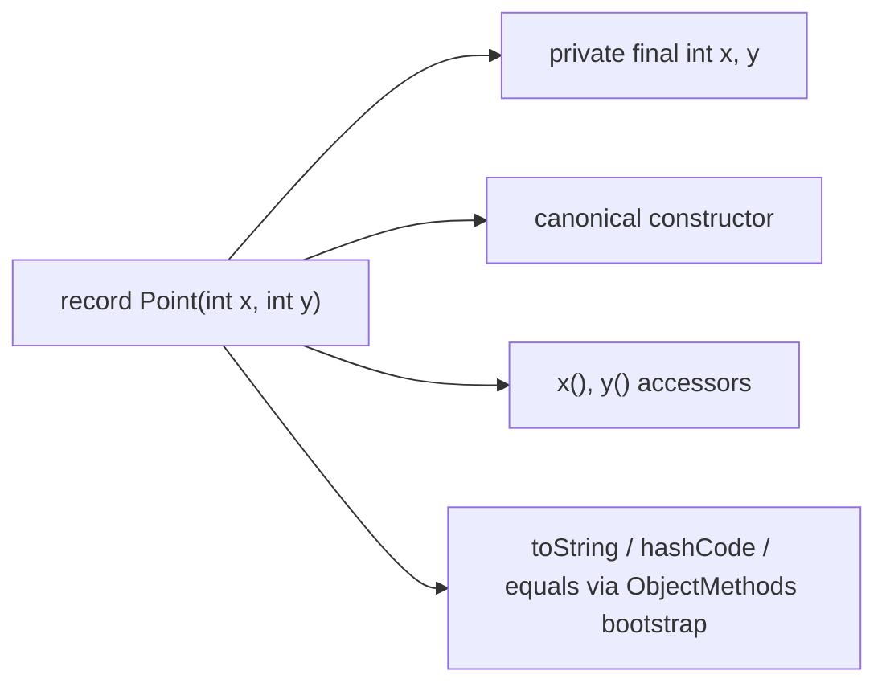

# B.8 Records in Depth

> **Goal:** Use records (Java 16) correctly: compact constructors, validation, shallow immutability, generated members, and where records are the wrong tool.

**Level:** deep dive.
**Verified on:** OpenJDK 21.0.12. Every output below was produced by running the code.

## Contents

1. [What a record is](#1-what-a-record-is)
2. [Constructors: canonical, compact, additional](#2-constructors-canonical-compact-additional)
3. [Validation and normalization](#3-validation-and-normalization)
4. [Shallow immutability](#4-shallow-immutability)
5. [Generated members and the bytecode](#5-generated-members-and-the-bytecode)
6. [What records can and cannot do](#6-what-records-can-and-cannot-do)
7. [Records with generics, interfaces, and local records](#7-records-with-generics-interfaces-and-local-records)
8. [Records versus Lombok, POJOs and classes](#8-records-versus-lombok-pojos-and-classes)
9. [Common gotchas](#9-common-gotchas)
10. [Interview questions](#10-interview-questions)

---

## 1. What a record is

**Intuition.** A record is a named tuple: you declare *what the data is* and the compiler writes the boilerplate (constructor, accessors, `equals`, `hashCode`, `toString`). Records are *transparent carriers*: the state is the API.

History: preview in 14 and 15, final in **Java 16** (JEP 395). Record patterns for deconstruction arrived in Java 21 (JEP 440).

## 2. Constructors: canonical, compact, additional

| Form | Syntax | Use |
|---|---|---|
| Implicit canonical | none written | plain data |
| Compact canonical | `Range { ... }` (no parameter list) | validate/normalize; fields assigned automatically at the end |
| Explicit canonical | `Range(int lo, int hi) { this.lo = lo; ... }` | must assign every field itself |
| Additional | `Range() { this(0, 0); }` | convenience; must delegate to another constructor |

## 3. Validation and normalization

```java
import java.lang.reflect.RecordComponent;
import java.util.Arrays;
import java.util.List;
import java.util.Locale;

public class RecordsDeep {

    // The shortest record: gives you a canonical constructor, accessors, equals, hashCode and toString
    record Point(int x, int y) { }

    // COMPACT canonical constructor: validate / normalize, then the fields are assigned for you
    record Range(int lo, int hi) {
        Range {
            if (lo > hi) throw new IllegalArgumentException("lo > hi: " + lo + " > " + hi);
        }
        int length() { return hi - lo; }                         // ordinary instance method
    }

    record Email(String value) {
        Email {
            value = value.strip().toLowerCase(Locale.ROOT);      // reassign the parameter: normalization
            if (!value.contains("@")) throw new IllegalArgumentException("not an email: " + value);
        }
    }

    // Records are SHALLOWLY immutable: copy mutable components yourself
    record Team(String name, List<String> members) {
        Team { members = List.copyOf(members); }
    }

    // Arrays inside records: equals compares array REFERENCES
    record Poly(int[] coefficients) { }

    // Explicit canonical constructor, custom accessor, extra constructor, static factory, static field
    record Temperature(double celsius) implements Comparable<Temperature> {
        static final Temperature FREEZING = new Temperature(0);
        Temperature(double celsius) { this.celsius = celsius; }  // explicit canonical form: must assign every field
        Temperature() { this(20.0); }                            // other constructors must delegate to the canonical one
        static Temperature ofFahrenheit(double f) { return new Temperature((f - 32) * 5 / 9); }
        @Override public double celsius() { return Math.round(celsius * 10) / 10.0; }   // accessor override
        @Override public int compareTo(Temperature o) { return Double.compare(celsius, o.celsius); }
    }

    record Pair<A, B>(A first, B second) {
        static <T> Pair<T, T> twin(T value) { return new Pair<>(value, value); }
    }

    public static void main(String[] args) {
        Point p = new Point(1, 2);
        System.out.println("toString     : " + p);
        System.out.println("accessors    : " + p.x() + ", " + p.y());
        System.out.println("equals       : " + p.equals(new Point(1, 2)) + ", hashCodes equal: "
                + (p.hashCode() == new Point(1, 2).hashCode()));
        System.out.println("superclass   : " + Point.class.getSuperclass().getName()
                + ", isRecord=" + Point.class.isRecord() + ", final=" + java.lang.reflect.Modifier.isFinal(Point.class.getModifiers()));

        System.out.println("Range length : " + new Range(3, 10).length());
        try { new Range(5, 1); } catch (IllegalArgumentException e) { System.out.println("validation   : " + e.getMessage()); }

        System.out.println("normalized   : " + new Email("  Asha@Example.COM "));
        System.out.println("Email equals : " + new Email("A@b.com").equals(new Email(" a@B.com")));

        List<String> mutable = new java.util.ArrayList<>(List.of("asha"));
        Team team = new Team("core", mutable);
        mutable.add("intruder");
        System.out.println("defensive copy: " + team);

        int[] shared = {1, 2};
        System.out.println("Poly same contents, different arrays equal? " + new Poly(new int[]{1, 2}).equals(new Poly(new int[]{1, 2})));
        System.out.println("Poly same array instance equal?            " + new Poly(shared).equals(new Poly(shared)));

        System.out.println("Temperature  : " + new Temperature() + ", 100F = " + Temperature.ofFahrenheit(100).celsius()
                + " C, FREEZING.compareTo(5C) = " + Temperature.FREEZING.compareTo(new Temperature(5)));
        System.out.println("generic twin : " + Pair.twin("x"));

        System.out.println("components   : " + Arrays.stream(Range.class.getRecordComponents())
                .map(RecordComponent::getName).toList());

        // A local record is perfect for a throwaway grouping
        record Stat(String word, int count) { }
        System.out.println("local record : " + new Stat("java", 3));
    }
}

// ---- Output ----
// toString     : Point[x=1, y=2]
// accessors    : 1, 2
// equals       : true, hashCodes equal: true
// superclass   : java.lang.Record, isRecord=true, final=true
// Range length : 7
// validation   : lo > hi: 5 > 1
// normalized   : Email[value=asha@example.com]
// Email equals : true
// defensive copy: Team[name=core, members=[asha]]
// Poly same contents, different arrays equal? false
// Poly same array instance equal?            true
// Temperature  : Temperature[celsius=20.0], 100F = 37.8 C, FREEZING.compareTo(5C) = -1
// generic twin : Pair[first=x, second=x]
// components   : [lo, hi]
// local record : Stat[word=java, count=3]
```

In a compact constructor you can reassign the **parameters** (`value = value.strip()`) and the compiler then assigns them to the fields. Throw exceptions for invalid input. Do not assign `this.field` in a compact constructor: it is a compile error.

## 4. Shallow immutability

Fields are `final`, but a component of mutable type can still change inside. The `Team` record above copies its list with `List.copyOf` in the compact constructor, so mutating the original list afterward does not leak in (`defensive copy` line). The `Poly(int[])` lines show the array pitfall: `equals` compares array references, so two records with equal-content arrays are not equal.

| Component type | Immutable? | Fix |
|---|---|---|
| `int`, `String`, other records | yes | none |
| `List`, `Map`, `Date` | no | `List.copyOf` etc. in the compact constructor |
| arrays | no, and `equals` by reference | use `List<Integer>` or override `equals`/`hashCode`/`toString` |

## 5. Generated members and the bytecode

```text
$ javac -Xlint:-options -d out/b b/RecordsDeep.java && javap -p -c 'out/b/RecordsDeep$Point.class' | grep -E "^  [A-Za-z]|invokedynamic|^final class"
final class RecordsDeep$Point extends java.lang.Record {
  private final int x;
  private final int y;
  RecordsDeep$Point(int, int);
  public final java.lang.String toString();
       1: invokedynamic #16,  0             // InvokeDynamic #0:toString:(LRecordsDeep$Point;)Ljava/lang/String;
  public final int hashCode();
       1: invokedynamic #20,  0             // InvokeDynamic #0:hashCode:(LRecordsDeep$Point;)I
  public final boolean equals(java.lang.Object);
       2: invokedynamic #24,  0             // InvokeDynamic #0:equals:(LRecordsDeep$Point;Ljava/lang/Object;)Z
  public int x();
  public int y();
```

The class is `final`, extends `java.lang.Record`, has `private final` fields, a canonical constructor, accessors named like the components (not `getX`), and `toString`, `hashCode`, `equals` implemented through **`invokedynamic`** that bootstraps `java.lang.runtime.ObjectMethods`. That choice avoids generating long bytecode in every record and lets the JVM optimize later.



## 6. What records can and cannot do

| Can | Cannot |
|---|---|
| Implement interfaces | Extend a class (always extends `Record`) |
| Declare static fields and methods | Declare instance fields beyond components |
| Have extra constructors and methods | Be `abstract`; be extended (they are `final`) |
| Be generic, nested, local | Have a non-canonical constructor that skips `this(...)` delegation |
| Override accessors, `toString`, `equals`, `hashCode` | Use setters (fields are final) |
| Carry annotations on components | Have an instance initializer block |

An overridden accessor must be `public` and keep the same return type (see `Temperature.celsius()`).

## 7. Records with generics, interfaces, and local records

`record Pair<A,B>(A first, B second)` works like any generic class (see `Pair.twin` above). A local record, such as `Stat` in `main`, is ideal for grouping values inside one stream pipeline. Records pair naturally with sealed interfaces to model data (chapters B.9 and C.3).

## 8. Records versus Lombok, POJOs and classes

| | Record | Classic POJO | Lombok `@Value` |
|---|---|---|---|
| Boilerplate | none | lots | annotation |
| Mutability | shallowly immutable | any | immutable |
| Inheritance | none | yes | optional |
| Framework support | Jackson 2.12+, Spring, JPA embeddables (not entities) | universal | universal |
| Best for | DTOs, value objects, tuples, sealed variants | entities, mutable beans | legacy code |

## 9. Common gotchas

| Gotcha | Why | Fix |
|---|---|---|
| Mutable component leaks state | shallow immutability | copy in compact constructor |
| Array component equals is by reference | arrays do not override `equals` | use `List`, or custom `equals` |
| JPA entity as record | needs no-arg constructor and mutable fields | use a normal class |
| Accessor named `getX()` expected | record accessors are `x()` | use `x()` |
| Assigning `this.x` in compact constructor | compile error | assign the parameter |
| Serialization of records | uses canonical constructor, not field writes | good: validations run |
| Changing a public record's components | binary and source breaking change | treat as API |

## 10. Interview questions

<details>
<summary><strong>Q1. What does the compiler generate for a record?</strong></summary>

Private final fields, a canonical constructor, accessor methods, and `equals`, `hashCode`, `toString`. Everything except the fields and constructor can be overridden.
</details>

<details>
<summary><strong>Q2. What is a compact constructor?</strong></summary>

A constructor declared without a parameter list inside a record, used for validation/normalization; the compiler appends the field assignments from the (possibly reassigned) parameters.
</details>

<details>
<summary><strong>Q3. Are records immutable?</strong></summary>

Shallowly: the fields are final, but referenced objects can mutate. Copy mutable components defensively.
</details>

<details>
<summary><strong>Q4. Can a record extend a class or implement an interface?</strong></summary>

Implement yes, extend no (it implicitly extends `java.lang.Record`).
</details>

<details>
<summary><strong>Q5. How are record <code>equals</code>/<code>hashCode</code>/<code>toString</code> implemented?</strong></summary>

Through an <code>invokedynamic</code> call to the <code>ObjectMethods</code> bootstrap, using the components in declaration order (see the <code>javap</code> listing).
</details>

<details>
<summary><strong>Q6. Can a record have instance fields besides its components?</strong></summary>

No. Static fields are fine.
</details>

<details>
<summary><strong>Q7. When would you not use a record?</strong></summary>

When you need mutability, inheritance, hidden state or lazy fields, JPA entities, or when the representation should not be the API.
</details>

<details>
<summary><strong>Q8. How do records interact with Jackson and serialization?</strong></summary>

Java serialization calls the canonical constructor on deserialization (so validation runs); Jackson 2.12+ supports records directly. Deserialization can't bypass your compact-constructor checks.
</details>

<details>
<summary><strong>Q9. Can you declare a record inside a method?</strong></summary>

Yes; local records are implicitly static, so they cannot capture local variables.
</details>

<details>
<summary><strong>Q10. What are record patterns?</strong></summary>

Java 21 patterns that deconstruct a record in <code>instanceof</code> and <code>switch</code>, e.g. <code>case Rect(double w, double h) -&gt; w * h</code>, nestable (chapter C.3).
</details>

---

[Previous: B.7 Enums in Depth](./07-enums-in-depth.md) · [Part index](../README.md) · Next: [B.9 Sealed Classes and Interfaces](./09-sealed-classes-and-interfaces.md)