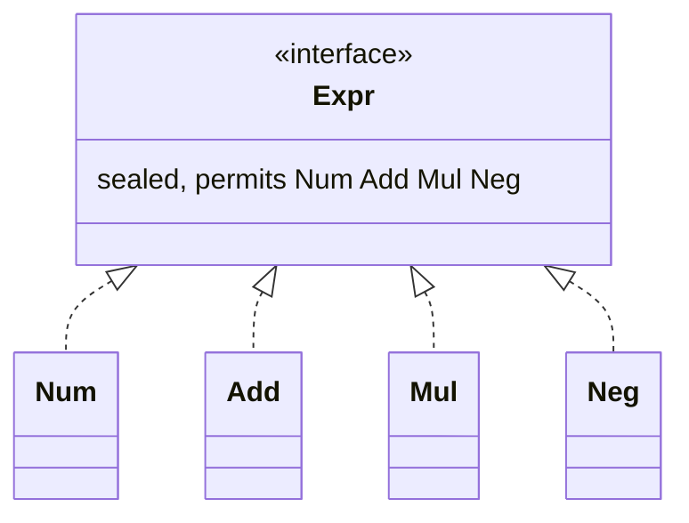

# B.9 Sealed Classes and Interfaces

> **Goal:** Model closed hierarchies with `sealed`, understand the `permits`/`final`/`sealed`/`non-sealed` rules, and get exhaustive `switch` without `default`.

**Level:** deep dive.
**Verified on:** OpenJDK 21.0.12. Every output below was produced by running the code.

## Contents

1. [The problem sealed solves](#1-the-problem-sealed-solves)
2. [Syntax and rules](#2-syntax-and-rules)
3. [Exhaustive switch](#3-exhaustive-switch)
4. [Sealed versus enum versus final](#4-sealed-versus-enum-versus-final)
5. [Compiler errors you will meet](#5-compiler-errors-you-will-meet)
6. [Reflection and design guidance](#6-reflection-and-design-guidance)
7. [Common gotchas](#7-common-gotchas)
8. [Interview questions](#8-interview-questions)

---

## 1. The problem sealed solves

**Intuition.** A normal interface is an open door: anyone anywhere can implement it. Sometimes you want a guest list: "an expression is a number, a sum, a product or a negation, and nothing else". `sealed` lets the author fix that list, so the compiler (and the reader) can reason about all cases.

History: preview in 15 and 16, final in **Java 17** (JEP 409). Pattern matching `switch` that exploits it is final in **Java 21**.

## 2. Syntax and rules

```text
sealed interface Expr permits Num, Add { }
final class Num implements Expr { }              // ends the branch
sealed class Add implements Expr permits ... { } // narrows further
non-sealed class Open implements Expr { }        // re-opens the branch
```

| Rule | Detail |
|---|---|
| `permits` list | optional if all permitted subclasses are in the same compilation unit (inferred) |
| Location | permitted subtypes must be in the same module (or same package when unnamed) |
| Each permitted subtype must be | `final`, `sealed` or `non-sealed` (records and enums are implicitly final) |
| Each permitted subtype must | directly extend or implement the sealed type |
| Works with | classes (including abstract) and interfaces |

```java
import java.lang.reflect.Modifier;
import java.util.Arrays;

public class SealedDemo {

    // A closed algebraic data type: exactly these four kinds of Expr exist
    sealed interface Expr permits Num, Add, Mul, Neg { }
    record Num(int value) implements Expr { }
    record Add(Expr left, Expr right) implements Expr { }
    record Mul(Expr left, Expr right) implements Expr { }
    record Neg(Expr operand) implements Expr { }

    // The switch needs NO default branch: the compiler knows the hierarchy is closed
    static int eval(Expr e) {
        return switch (e) {
            case Num n -> n.value();
            case Add a -> eval(a.left()) + eval(a.right());
            case Mul m -> eval(m.left()) * eval(m.right());
            case Neg n -> -eval(n.operand());
        };
    }

    static String show(Expr e) {
        return switch (e) {
            case Num n -> String.valueOf(n.value());
            case Add a -> "(" + show(a.left()) + " + " + show(a.right()) + ")";
            case Mul m -> show(m.left()) + " * " + show(m.right());
            case Neg n -> "-" + show(n.operand());
        };
    }

    // The three ways a permitted subclass must continue the hierarchy
    sealed static abstract class Vehicle permits Car, Truck, Bike { }
    static final class Car extends Vehicle { }                         // final: the branch ends here
    static sealed class Truck extends Vehicle permits PickUp { }       // sealed: a smaller closed set below
    static final class PickUp extends Truck { }
    static non-sealed class Bike extends Vehicle { }                   // non-sealed: open for anyone again
    static class EBike extends Bike { }                                // allowed because Bike is non-sealed

    static String modifiersOf(Class<?> c) {
        String m = Modifier.toString(c.getModifiers());
        if (c.isSealed()) m += " sealed";
        return m.trim();
    }

    public static void main(String[] args) {
        Expr e = new Add(new Num(2), new Mul(new Num(3), new Neg(new Num(4))));
        System.out.println(show(e) + " = " + eval(e));

        System.out.println("Expr.isSealed()        = " + Expr.class.isSealed());
        System.out.println("Expr permitted         = " + Arrays.stream(Expr.class.getPermittedSubclasses())
                .map(Class::getSimpleName).toList());
        System.out.println("Vehicle permitted      = " + Arrays.stream(Vehicle.class.getPermittedSubclasses())
                .map(c -> c.getSimpleName() + "[" + modifiersOf(c) + "]").toList());
        System.out.println("EBike.getSuperclass()  = " + EBike.class.getSuperclass().getSimpleName());
    }
}

// ---- Output ----
// (2 + 3 * -4) = -10
// Expr.isSealed()        = true
// Expr permitted         = [Num, Add, Mul, Neg]
// Vehicle permitted      = [Car[static final], Truck[static sealed], Bike[static]]
// EBike.getSuperclass()  = Bike
```

The `Vehicle` part shows all three continuations: `Car` is `final`, `Truck` is `sealed` with its own `permits`, `Bike` is `non-sealed` so `EBike` may extend it freely. (`non-sealed` has no `Modifier` flag; reflection tells you with `isSealed()`.)



## 3. Exhaustive switch

Because the compiler knows every permitted subtype, a `switch` over a sealed type needs no `default`, and adding a new subtype makes every non-exhaustive switch **fail to compile**:

```java
public class NonExhaustive {
    sealed interface Shape permits Circle, Square { }
    record Circle(double r) implements Shape { }
    record Square(double side) implements Shape { }

    static double area(Shape s) {
        return switch (s) {
            case Circle c -> Math.PI * c.r() * c.r();
            // ERROR: no case for Square, and no default
        };
    }

    public static void main(String[] args) { }
}
```

Real `javac` output:

```text
ce/NonExhaustive.java:7: error: the switch expression does not cover all possible input values
        return switch (s) {
               ^
1 error
```

This is the main payoff: new cases cannot be forgotten silently. The visitor pattern solves the same problem with more ceremony; sealed + pattern matching is its modern replacement for closed data.

## 4. Sealed versus enum versus final

| | Enum | Sealed hierarchy | Final class | Open interface |
|---|---|---|---|---|
| Number of instances | fixed | unlimited | unlimited | unlimited |
| Number of types | one | fixed list | one | unlimited |
| Per-case data | same shape | each variant has its own fields | n/a | n/a |
| Exhaustive switch | yes | yes | n/a | no (needs `default`) |

## 5. Compiler errors you will meet

```java
public class SealedViolation {
    sealed interface Shape permits Circle { }
    record Circle(double r) implements Shape { }
    record Square(double side) implements Shape { }     // ERROR: Square is not listed in permits

    public static void main(String[] args) { }
}
```

Real `javac` output:

```text
ce/SealedViolation.java:4: error: class is not allowed to extend sealed class: Shape (as it is not listed in its 'permits' clause)
    record Square(double side) implements Shape { }     // ERROR: Square is not listed in permits
    ^
1 error
```

```java
public class SealedModifier {
    sealed interface Shape permits Circle { }
    static class Circle implements Shape { }            // ERROR: must be final, sealed or non-sealed

    public static void main(String[] args) { }
}
```

Real `javac` output:

```text
ce/SealedModifier.java:3: error: sealed, non-sealed or final modifiers expected
    static class Circle implements Shape { }            // ERROR: must be final, sealed or non-sealed
           ^
1 error
```

## 6. Reflection and design guidance

`Class.isSealed()` and `getPermittedSubclasses()` (Java 17) expose the list (see the demo). Design notes:

- Prefer **sealed interface + records** for algebraic data types (results, commands, AST nodes).
- Make a sealed class `abstract` or a sealed interface if the root itself should not be instantiated.
- Sealing is a closed-world assumption: libraries that expect third parties to extend should not seal.
- Sealing changes binary compatibility: adding a permitted subtype breaks old exhaustive switches by design.

## 7. Common gotchas

| Gotcha | Why | Fix |
|---|---|---|
| "sealed, non-sealed or final modifiers expected" | permitted subclass must pick one | add `final`/`sealed`/`non-sealed` |
| Subclass not in `permits` | list is closed | add it to `permits` |
| Subclass in another module/package | same-module restriction | move it or modularize |
| Exhaustive switch still wants `default` | hierarchy has a `non-sealed` branch | that branch is open |
| Mocking sealed types | cannot subclass | test through real implementations |
| Serialization/proxy frameworks | may subclass dynamically | check framework support |

## 8. Interview questions

<details>
<summary><strong>Q1. What does <code>sealed</code> do and why was it added?</strong></summary>

Restricts which classes may extend a class or implement an interface, giving library authors control over hierarchies and the compiler enough information for exhaustive pattern matching.
</details>

<details>
<summary><strong>Q2. What modifiers must permitted subclasses have?</strong></summary>

<code>final</code>, <code>sealed</code> or <code>non-sealed</code>. Records and enums are implicitly final.
</details>

<details>
<summary><strong>Q3. Where must permitted subclasses live?</strong></summary>

Same module; in the unnamed module, the same package. If they are in the same source file, <code>permits</code> may be omitted.
</details>

<details>
<summary><strong>Q4. How does sealed relate to switch expressions?</strong></summary>

A pattern-matching switch over a sealed type is exhaustive when it covers every permitted subtype; no <code>default</code> is needed. The compiler errors (see above) when a case is missing.
</details>

<details>
<summary><strong>Q5. Sealed versus enum - when each?</strong></summary>

Enum for a fixed set of constants of the same shape; sealed hierarchy for a fixed set of types with different data.
</details>

<details>
<summary><strong>Q6. What does <code>non-sealed</code> mean?</strong></summary>

The permitted subclass re-opens its branch so anyone may extend it again.
</details>

<details>
<summary><strong>Q7. Can a sealed interface be implemented by a record? An enum?</strong></summary>

Yes, both; they are implicitly final so satisfy the rule automatically.
</details>

<details>
<summary><strong>Q8. How can you discover permitted subclasses at runtime?</strong></summary>

<code>Class.getPermittedSubclasses()</code> and <code>isSealed()</code> (Java 17).
</details>

<details>
<summary><strong>Q9. How does sealed compare to the visitor pattern?</strong></summary>

Both support adding operations over a closed set of types. Sealed + pattern switch is shorter, checked by the compiler, and doesn't need <code>accept</code> methods on every node.
</details>

---

[Previous: B.8 Records in Depth](./08-records-in-depth.md) · [Part index](../README.md) · Next: [B.10 Interfaces and Annotation Types in Depth](./10-interfaces-and-annotation-types-in-depth.md)