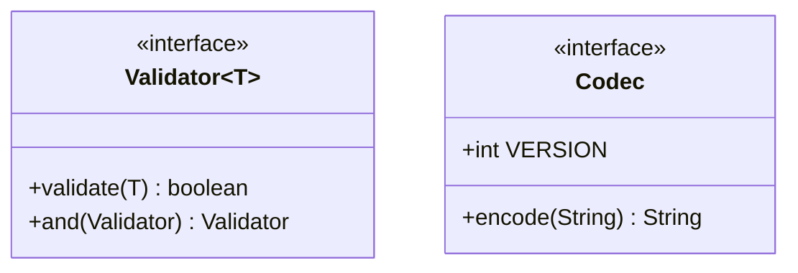

# B.10 Interfaces and Annotation Types in Depth

> **Goal:** Go beyond "an interface is a contract": functional interfaces, marker interfaces, nested members, generic interfaces, and how annotation types are declared, retained and read.

**Level:** deep dive. Chapter A.4 covered abstract class versus interface and default methods; this chapter covers the rest of the interface toolbox and annotations.
**Verified on:** OpenJDK 21.0.12. Every output below was produced by running the code.

## Contents

1. [Interface members at a glance](#1-interface-members-at-a-glance)
2. [Functional interfaces](#2-functional-interfaces)
3. [Marker interfaces, constants, nested types, generics](#3-marker-interfaces-constants-nested-types-generics)
4. [Annotation types](#4-annotation-types)
5. [Retention, target, inherited, repeatable](#5-retention-target-inherited-repeatable)
6. [Reading annotations at runtime](#6-reading-annotations-at-runtime)
7. [Common gotchas](#7-common-gotchas)
8. [Interview questions](#8-interview-questions)

---

## 1. Interface members at a glance

| Member | Implicit modifiers | Since |
|---|---|---|
| Field | `public static final` | 1.0 |
| Abstract method | `public abstract` | 1.0 |
| Nested class / interface / enum / record | `public static` | 1.1 |
| `default` method | `public` | 8 |
| `static` method | `public` (not inherited) | 8 |
| `private` / `private static` method | private | 9 |

## 2. Functional interfaces

**Intuition.** A functional interface is a "one-slot socket": exactly one abstract method, so a lambda or method reference can plug into it. `@FunctionalInterface` is optional documentation that makes the compiler enforce the single-method rule.

Methods that match `Object`'s public methods (like `equals`) do not count as abstract, which is why `Comparator` has both `compare` and `equals` yet is functional.

```java
import java.util.function.Function;

public class InterfaceFeatures {

    // A functional interface: exactly ONE abstract method (Object's methods do not count)
    @FunctionalInterface
    interface Validator<T> {
        boolean validate(T value);                                       // the single abstract method
        boolean equals(Object other);                                    // public Object method: NOT abstract for this purpose

        default Validator<T> and(Validator<? super T> other) {          // default methods compose behaviour
            return v -> validate(v) && other.validate(v);
        }
        default Validator<T> negate() { return v -> !validate(v); }
        static <T> Validator<T> not(Validator<T> v) { return v.negate(); }
    }

    // A marker interface: no members, just a type-level tag that tools and code can test with instanceof
    interface Auditable { }
    static class Order implements Auditable { }
    static class Draft { }

    // An interface can nest types and hold constants
    interface Codec {
        int VERSION = 3;                                                 // public static final
        enum Mode { STRICT, LENIENT }                                    // nested types are implicitly public static
        record Header(int version, Mode mode) { }
        String encode(String s);
    }

    // Generic interface with a bounded type parameter
    interface Repository<T, ID extends Comparable<ID>> {
        T find(ID id);
    }

    public static void main(String[] args) {
        Validator<String> notEmpty = s -> !s.isEmpty();
        Validator<String> shortText = s -> s.length() < 6;
        Validator<String> both = notEmpty.and(shortText);
        System.out.println("both.validate(\"abc\")     = " + both.validate("abc"));
        System.out.println("both.validate(\"abcdefg\") = " + both.validate("abcdefg"));
        System.out.println("both.validate(\"\")        = " + both.validate(""));
        System.out.println("negated                  = " + Validator.not(notEmpty).validate(""));

        for (Object o : new Object[]{new Order(), new Draft()}) {
            System.out.println(o.getClass().getSimpleName() + " auditable? " + (o instanceof Auditable));
        }

        Codec upper = String::toUpperCase;                               // Codec has one abstract method too
        System.out.println(upper.encode("v" + Codec.VERSION) + " " + new Codec.Header(Codec.VERSION, Codec.Mode.STRICT));

        Repository<String, Integer> repo = id -> "user-" + id;
        System.out.println(repo.find(7));

        // Existing JDK functional interfaces already cover most needs
        Function<Integer, Integer> twice = x -> x * 2;
        System.out.println(twice.andThen(x -> x + 1).apply(5));
    }
}

// ---- Output ----
// both.validate("abc")     = true
// both.validate("abcdefg") = false
// both.validate("")        = false
// negated                  = true
// Order auditable? true
// Draft auditable? false
// V3 Header[version=3, mode=STRICT]
// user-7
// 11
```

If you break the rule, the compiler tells you:

```java
public class NotFunctional {
    @FunctionalInterface
    interface TwoMethods {                 // ERROR: two abstract methods
        void a();
        void b();
    }

    public static void main(String[] args) { }
}
```

Real `javac` output:

```text
ce/NotFunctional.java:2: error: Unexpected @FunctionalInterface annotation
    @FunctionalInterface
    ^
  TwoMethods is not a functional interface
    multiple non-overriding abstract methods found in interface TwoMethods
1 error
```

Keep the JDK's `java.util.function` types (`Function`, `Predicate`, `Supplier`, `Consumer`, `UnaryOperator`, `BiFunction`) in mind before writing your own; Part 3 covers them thoroughly.

## 3. Marker interfaces, constants, nested types, generics

- **Marker interface**: no members, tags a type (`Serializable`, `RandomAccess`). Test with `instanceof`; the demo tags `Order` but not `Draft`.
- **Constants**: allowed, but avoid the "constant interface" antipattern (implementors inherit the names).
- **Nested types**: `Codec.Mode` and `Codec.Header` live with the contract they belong to.
- **Generic interface with bounds**: `Repository<T, ID extends Comparable<ID>>` constrains the key type.



## 4. Annotation types

An annotation type is declared with `@interface`; it is a special interface whose members are annotation **elements** (methods with no parameters). Allowed element types: primitives, `String`, `Class`, enums, other annotations, and one-dimensional arrays of those. Elements may have `default` values; others are required at each use.

## 5. Retention, target, inherited, repeatable

| Meta-annotation | Controls | Values |
|---|---|---|
| `@Retention` | how long it lives | `SOURCE` (compiler only), `CLASS` (in `.class`, default, invisible at runtime), `RUNTIME` (reflection) |
| `@Target` | where it can be placed | `TYPE`, `METHOD`, `FIELD`, `PARAMETER`, `CONSTRUCTOR`, `TYPE_USE`, `RECORD_COMPONENT`, ... |
| `@Inherited` | subclasses see it | class-level annotations only |
| `@Repeatable` | may appear several times | needs a container annotation |
| `@Documented` | appears in Javadoc | |


Wrong placement is a compile error:

```java
import java.lang.annotation.ElementType;
import java.lang.annotation.Target;

public class WrongTarget {
    @Target(ElementType.METHOD)
    @interface OnlyForMethods { }

    @OnlyForMethods                         // ERROR: placed on a field
    int field;

    public static void main(String[] args) { }
}
```

Real `javac` output:

```text
ce/WrongTarget.java:8: error: annotation interface not applicable to this kind of declaration
    @OnlyForMethods                         // ERROR: placed on a field
    ^
1 error
```

## 6. Reading annotations at runtime

```java
import java.lang.annotation.Documented;
import java.lang.annotation.ElementType;
import java.lang.annotation.Inherited;
import java.lang.annotation.Repeatable;
import java.lang.annotation.Retention;
import java.lang.annotation.RetentionPolicy;
import java.lang.annotation.Target;
import java.lang.reflect.Method;
import java.util.Arrays;

public class AnnotationsDemo {

    enum Severity { LOW, HIGH }

    // An annotation TYPE. Elements: primitives, String, Class, enums, annotations, and arrays of those
    @Retention(RetentionPolicy.RUNTIME)                                  // visible to reflection
    @Target({ElementType.TYPE, ElementType.METHOD})                      // where it may be placed
    @Documented
    @Inherited                                                           // subclasses inherit it (class-level only)
    @interface Audit {
        String owner();                                                  // required
        Severity severity() default Severity.LOW;                        // optional
        String[] tags() default {};
    }

    @Retention(RetentionPolicy.CLASS)                                    // stored in the .class file, NOT visible at runtime
    @interface InClassFile { }

    @Retention(RetentionPolicy.SOURCE)                                   // discarded by the compiler (like @Override)
    @interface Gone { }

    @Retention(RetentionPolicy.RUNTIME)
    @Repeatable(Roles.class)
    @interface Role { String value(); }

    @Retention(RetentionPolicy.RUNTIME)
    @interface Roles { Role[] value(); }                                 // the container annotation

    @Audit(owner = "payments", severity = Severity.HIGH, tags = {"pci", "money"})
    @InClassFile @Gone
    static class PaymentService {
        @Audit(owner = "payments-team")
        @Role("admin") @Role("auditor")
        public void refund() { }
        @Deprecated public void legacy() { }
    }

    static class CardService extends PaymentService { }

    public static void main(String[] args) throws Exception {
        Audit onClass = PaymentService.class.getAnnotation(Audit.class);
        System.out.println("class  : owner=" + onClass.owner() + ", severity=" + onClass.severity()
                + ", tags=" + Arrays.toString(onClass.tags()));

        Method refund = PaymentService.class.getMethod("refund");
        Audit onMethod = refund.getAnnotation(Audit.class);
        System.out.println("method : owner=" + onMethod.owner() + ", severity (default)=" + onMethod.severity()
                + ", tags (default)=" + Arrays.toString(onMethod.tags()));

        System.out.println("repeatable roles: " + Arrays.stream(refund.getAnnotationsByType(Role.class))
                .map(Role::value).toList());
        System.out.println("container present on the method? " + (refund.getAnnotation(Roles.class) != null));

        System.out.println("visible at runtime on PaymentService: " + Arrays.stream(PaymentService.class.getAnnotations())
                .map(a -> a.annotationType().getSimpleName()).sorted().toList());

        System.out.println("@Inherited: CardService has Audit? " + (CardService.class.getAnnotation(Audit.class) != null));
        System.out.println("@Deprecated visible: " + (PaymentService.class.getMethod("legacy").isAnnotationPresent(Deprecated.class)));
        System.out.println("an annotation type is an interface: " + Audit.class.isInterface()
                + ", isAnnotation=" + Audit.class.isAnnotation());
    }
}

// ---- Output ----
// class  : owner=payments, severity=HIGH, tags=[pci, money]
// method : owner=payments-team, severity (default)=LOW, tags (default)=[]
// repeatable roles: [admin, auditor]
// container present on the method? true
// visible at runtime on PaymentService: [Audit]
// @Inherited: CardService has Audit? true
// @Deprecated visible: true
// an annotation type is an interface: true, isAnnotation=true
```

Points shown by the output:

- Defaults apply when an element is omitted (`severity (default)=LOW`).
- `@Repeatable` stores repeated annotations inside the container; `getAnnotationsByType` hides that difference, `getAnnotation(Roles.class)` shows it.
- Only `RUNTIME` annotations appear in `getAnnotations()`; `CLASS` and `SOURCE` ones are absent.
- `@Inherited` works on classes only (`CardService` inherits `Audit`).
- An annotation type is an interface; the runtime object you receive is a JDK dynamic proxy implementing it.

This is the mechanism behind Spring, JPA, JUnit and Jackson annotations (Part 14 covers building your own processors).

## 7. Common gotchas

| Gotcha | Why | Fix |
|---|---|---|
| Annotation not visible at runtime | default retention is `CLASS` | `@Retention(RUNTIME)` |
| `@Inherited` on a method annotation does nothing | applies to classes only | read via the overridden method |
| "Unexpected @FunctionalInterface" | not exactly one abstract method | fix the interface |
| Default method clash | two defaults with same signature | override with `X.super.m()` |
| Annotation element of type `Object` | not allowed | use `String`, enum, `Class`... |
| `null` as annotation value | not allowed | use `""` or a sentinel default |
| Interface constants shadowing | implementors inherit names | put constants in a class/enum |

## 8. Interview questions

<details>
<summary><strong>Q1. What makes an interface functional?</strong></summary>

Exactly one abstract method, not counting `Object`'s public methods; default and static methods do not count. The annotation is optional but checked by the compiler.
</details>

<details>
<summary><strong>Q2. Why does <code>Comparator</code> count as functional despite declaring <code>equals</code>?</strong></summary>

`equals(Object)` matches a public method of `Object`, so every implementation already has it.
</details>

<details>
<summary><strong>Q3. What are the three retention policies?</strong></summary>

SOURCE (discarded after compilation), CLASS (stored in `.class` but not available through reflection; the default), RUNTIME (available via reflection).
</details>

<details>
<summary><strong>Q4. How do repeatable annotations work?</strong></summary>

The repeatable annotation is annotated with `@Repeatable(Container.class)`; when repeated, the compiler wraps the instances in the container annotation. `getAnnotationsByType` unwraps them.
</details>

<details>
<summary><strong>Q5. What types can annotation elements have?</strong></summary>

Primitives, String, Class, enum, annotation, and one-dimensional arrays of these.
</details>

<details>
<summary><strong>Q6. What does <code>@Inherited</code> do?</strong></summary>

Lets a subclass see a class-level annotation from its superclass via reflection (not interfaces, not methods).
</details>

<details>
<summary><strong>Q7. What is a marker interface and how does it compare with an annotation?</strong></summary>

An empty interface tagging a type; it gives compile-time typing (a parameter can require it) while annotations carry data and tag any element.
</details>

<details>
<summary><strong>Q8. Can an interface have a private method? Why?</strong></summary>

Yes, since Java 9, to share code between default methods without exposing it.
</details>

<details>
<summary><strong>Q9. What object do you get when you call <code>getAnnotation</code>?</strong></summary>

A dynamic proxy instance implementing the annotation interface, with element values supplied from the class file.
</details>

<details>
<summary><strong>Q10. Why avoid "constant interfaces"?</strong></summary>

Implementing the interface just to use its constants leaks them into the implementor's API and namespace; use a final holder class or an enum.
</details>

---

[Previous: B.9 Sealed Classes and Interfaces](./09-sealed-classes-and-interfaces.md) · [Part index](../README.md) · Next: [B.11 Generic Classes and Special Classes](./11-generic-classes-and-special-classes.md)