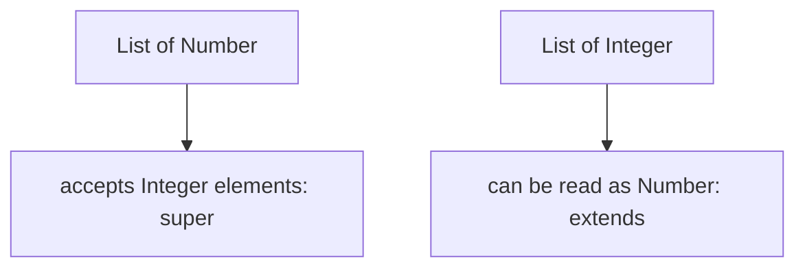

# B.11 Generic Classes and Special Classes

> **Goal:** Understand generic classes and erasure well enough for design and interviews, and meet the "special" classes: `Class` objects, arrays, primitives, bridge methods and lambdas' hidden classes.

**Level:** deep dive; Part 14 covers generics, reflection and annotations in full.
**Verified on:** OpenJDK 21.0.12. Every output below was produced by running the code.

## Contents

1. [Generic classes in a page](#1-generic-classes-in-a-page)
2. [Bounds and wildcards (PECS)](#2-bounds-and-wildcards-pecs)
3. [Erasure and heap pollution](#3-erasure-and-heap-pollution)
4. [Special classes: `Class`, primitives and arrays](#4-special-classes-class-primitives-and-arrays)
5. [Bridge methods and covariant returns](#5-bridge-methods-and-covariant-returns)
6. [Hidden classes behind lambdas](#6-hidden-classes-behind-lambdas)
7. [Common gotchas](#7-common-gotchas)
8. [Interview questions](#8-interview-questions)

---

## 1. Generic classes in a page

**Intuition.** `Box<T>` is a labelled box: the label (`T`) is decided when you buy the box (`Box<String>`), and the compiler stops you from putting the wrong thing inside. The checks happen at compile time; at run time all boxes are the same box (erasure).

```java
import java.util.ArrayList;
import java.util.List;

public class GenericClasses {

    // A generic class: T is a placeholder for a type chosen by the user
    static class Box<T> {
        private T value;
        Box(T value) { this.value = value; }
        T get() { return value; }
        void set(T value) { this.value = value; }
        <R> Box<R> map(java.util.function.Function<? super T, ? extends R> f) {   // generic METHOD with its own type parameter
            return new Box<>(f.apply(value));
        }
    }

    static class Pair<K, V> {
        final K key; final V value;
        Pair(K key, V value) { this.key = key; this.value = value; }
        @Override public String toString() { return key + "=" + value; }
    }

    // Bounded type parameter: T must be comparable with itself (or a supertype)
    static <T extends Comparable<? super T>> T max(List<? extends T> items) {
        T best = items.get(0);
        for (T item : items) if (item.compareTo(best) > 0) best = item;
        return best;
    }

    // Wildcards: producer extends, consumer super (PECS)
    static double sum(List<? extends Number> numbers) {
        double total = 0;
        for (Number n : numbers) total += n.doubleValue();
        return total;
    }

    static void fill(List<? super Integer> sink) {
        for (int i = 0; i < 3; i++) sink.add(i);
    }

    @SuppressWarnings({"rawtypes", "unchecked"})
    static void pollute() {
        List<String> strings = new ArrayList<>();
        List raw = strings;                      // raw type: generics checking is switched off
        raw.add(42);                             // compiles (with an unchecked warning), heap is now polluted
        try {
            String s = strings.get(0);           // the compiler inserted a cast to String here
        } catch (ClassCastException e) {
            System.out.println("heap pollution surfaces later: " + e.getMessage());
        }
    }

    public static void main(String[] args) {
        Box<String> box = new Box<>("hello");              // diamond: type arguments inferred
        Box<Integer> length = box.map(String::length);
        System.out.println(box.get() + " -> " + length.get());

        System.out.println(new Pair<>("id", 7));
        System.out.println("max = " + max(List.of(3, 9, 4)) + ", " + max(List.of("pear", "apple", "zebra")));
        System.out.println("sum = " + sum(List.of(1, 2.5, 3L)));

        List<Number> sink = new ArrayList<>();
        fill(sink);
        System.out.println("sink = " + sink);

        // Erasure: at runtime the type arguments are gone
        System.out.println("List<String> and List<Integer> share one class: "
                + (new ArrayList<String>().getClass() == new ArrayList<Integer>().getClass()));
        pollute();
    }
}

// ---- Output ----
// hello -> 5
// id=7
// max = 9, zebra
// sum = 6.5
// sink = [0, 1, 2]
// List<String> and List<Integer> share one class: true
// heap pollution surfaces later: class java.lang.Integer cannot be cast to class java.lang.String (java.lang.Integer and java.lang.String are in module java.base of loader 'bootstrap')
```

| Concept | Example |
|---|---|
| Generic class | `class Box<T>` |
| Generic method with its own parameter | `<R> Box<R> map(...)` |
| Diamond (Java 7) | `new Box<>("x")` infers the type |
| Bounded type | `<T extends Comparable<? super T>>` |
| Several parameters | `Pair<K, V>` |

## 2. Bounds and wildcards (PECS)

**Producer Extends, Consumer Super.** A `List<? extends Number>` can be *read* as `Number` but not added to; a `List<? super Integer>` can be *added to* with integers but only read as `Object`.

| Type | Read gives | Write allows |
|---|---|---|
| `List<? extends Number>` | `Number` | nothing (except `null`) |
| `List<? super Integer>` | `Object` | `Integer` |
| `List<?>` | `Object` | nothing |
| `List<T>` | `T` | `T` |

In the demo, `sum` takes a producer (`? extends Number`) and `fill` takes a consumer (`? super Integer`); `fill` accepted a `List<Number>`.



## 3. Erasure and heap pollution

Generics were added in Java 5 without changing the JVM: the compiler checks types, inserts casts, and **erases** the type arguments. So `List<String>` and `List<Integer>` have the same runtime class (the demo prints `true`).

Consequences:

| Not possible | Because |
|---|---|
| `new T()`, `new T[10]` | `T` unknown at run time |
| `x instanceof List<String>` | type argument erased |
| overloads `f(List<String>)` and `f(List<Integer>)` | same erasure |
| primitive type arguments (`List<int>`) | erasure to `Object`; use `Integer` or specialised streams |

Raw types switch checking off. The last demo line shows **heap pollution**: an `Integer` smuggled into a `List<String>` fails not at the `add`, but later at the compiler-inserted cast, far from the real bug. Never use raw types in new code.

## 4. Special classes: `Class`, primitives and arrays

```java
import java.lang.reflect.Method;
import java.util.Arrays;

public class SpecialClasses {

    static class Money implements Comparable<Money> {
        final long cents;
        Money(long cents) { this.cents = cents; }
        @Override public int compareTo(Money o) { return Long.compare(cents, o.cents); }
    }

    public static void main(String[] args) throws Exception {
        // 1. Class objects: one per type, including primitives and arrays
        System.out.println("String.class.getName()      = " + String.class.getName());
        System.out.println("int.class.getName()         = " + int.class.getName());
        System.out.println("int[].class.getName()       = " + int[].class.getName());
        System.out.println("String[][].class.getName()  = " + String[][].class.getName());
        System.out.println("int[].class.getSimpleName() = " + int[].class.getSimpleName());
        System.out.println("int.class == Integer.TYPE   = " + (int.class == Integer.TYPE) + ", int.class == Integer.class? " + (int.class == Integer.class));

        // 2. Three ways to get a Class
        Class<?> a = "text".getClass();
        Class<?> b = String.class;
        Class<?> c = Class.forName("java.lang.String");
        System.out.println("getClass() == .class == forName: " + (a == b && b == c));

        // 3. The top of the hierarchy
        System.out.println("Object.class.getSuperclass()   = " + Object.class.getSuperclass());
        System.out.println("Runnable.class.getSuperclass() = " + Runnable.class.getSuperclass());
        System.out.println("int[].class.getSuperclass()    = " + int[].class.getSuperclass().getSimpleName());
        System.out.println("array interfaces               = " + Arrays.stream(int[].class.getInterfaces()).map(Class::getSimpleName).toList());

        // 4. Bridge methods: generated so that generic overrides work after erasure
        Method[] methods = Money.class.getDeclaredMethods();
        Arrays.sort(methods, java.util.Comparator.comparing(Method::getName)
                .thenComparing(m -> m.getParameterTypes()[0].getSimpleName()));
        for (Method m : methods) {
            System.out.println("Money." + m.getName() + "(" + m.getParameterTypes()[0].getSimpleName() + ")"
                    + "  bridge=" + m.isBridge() + " synthetic=" + m.isSynthetic());
        }

        // 5. Lambdas are backed by hidden classes (Java 15+): not findable by name
        Runnable r = () -> { };
        Class<?> lambdaClass = r.getClass();
        System.out.println("lambda class hidden=" + lambdaClass.isHidden() + ", synthetic=" + lambdaClass.isSynthetic()
                + ", name contains $$Lambda: " + lambdaClass.getName().contains("$$Lambda"));
        try {
            Class.forName(lambdaClass.getName());
        } catch (ClassNotFoundException e) {
            System.out.println("Class.forName(lambda class name) -> ClassNotFoundException");
        }
    }
}

// ---- Output ----
// String.class.getName()      = java.lang.String
// int.class.getName()         = int
// int[].class.getName()       = [I
// String[][].class.getName()  = [[Ljava.lang.String;
// int[].class.getSimpleName() = int[]
// int.class == Integer.TYPE   = true, int.class == Integer.class? false
// getClass() == .class == forName: true
// Object.class.getSuperclass()   = null
// Runnable.class.getSuperclass() = null
// int[].class.getSuperclass()    = Object
// array interfaces               = [Cloneable, Serializable]
// Money.compareTo(Money)  bridge=false synthetic=false
// Money.compareTo(Object)  bridge=true synthetic=true
// lambda class hidden=true, synthetic=true, name contains $$Lambda: true
// Class.forName(lambda class name) -> ClassNotFoundException
```

Takeaways from the first lines:

- Every type, including primitives and arrays, has a `Class` object. `int.class` is **not** `Integer.class`.
- Array class names use JVM descriptors: `[I`, `[[Ljava.lang.String;`.
- `Object.class` and interfaces have `null` as superclass; arrays extend `Object` and implement `Cloneable` and `Serializable`.
- `getClass()`, `X.class` and `Class.forName` return the same object for a loaded class in one class loader.

## 5. Bridge methods and covariant returns

`Money implements Comparable<Money>` declares `compareTo(Money)`, but after erasure the interface method is `compareTo(Object)`. The compiler adds a **synthetic bridge** `compareTo(Object)` that casts and delegates; the output lists both, with `bridge=true synthetic=true` on the generated one. Covariant return types (`Dog create()` overriding `Animal create()`) use the same mechanism.

```text
caller: Comparable.compareTo(Object)  -->  bridge compareTo(Object)  -- cast -->  compareTo(Money)
```

## 6. Hidden classes behind lambdas

A lambda's implementation class is generated at run time through `invokedynamic` and `LambdaMetafactory`, defined as a **hidden class** (Java 15, JEP 371), meaning it cannot be found by name; the demo's `Class.forName(lambdaClassName)` throws `ClassNotFoundException`. Part 3 explains the lifecycle.

## 7. Common gotchas

| Gotcha | Why | Fix |
|---|---|---|
| `List<Object>` is not a supertype of `List<String>` | generics are invariant | `List<? extends Object>` or `List<?>` |
| Unchecked warning ignored | possible heap pollution | fix the cause; `@SuppressWarnings` narrowly |
| `T[] arr = new T[n]` | erasure | `(T[]) new Object[n]` with care, or `List<T>` |
| Method clash after erasure | same erased signature | rename |
| `instanceof` with generics | erased | `instanceof List<?>` |
| Static member using class type parameter | static has no instance type | declare method-level `<T>` |
| Overusing wildcards in return types | hurts callers | wildcards in parameters only |

## 8. Interview questions

<details>
<summary><strong>Q1. What is type erasure?</strong></summary>

The compiler removes type arguments after checking, replacing type variables with their bounds (or `Object`) and inserting casts. At run time `List<String>` is just `List`. Chosen for backward compatibility.
</details>

<details>
<summary><strong>Q2. Why can't you create a generic array or instantiate <code>T</code>?</strong></summary>

The JVM needs the exact class at creation, and `T` is erased. Pass a `Class<T>` or a factory (`Supplier<T>`) instead.
</details>

<details>
<summary><strong>Q3. Explain PECS.</strong></summary>

Use `? extends T` when the collection produces values you read; `? super T` when it consumes values you write. Example: `Collections.copy(List<? super T> dest, List<? extends T> src)`.
</details>

<details>
<summary><strong>Q4. What is a bridge method?</strong></summary>

A synthetic method the compiler generates so generic overrides and covariant returns still match the erased signature the JVM uses for dispatch (the output shows <code>compareTo(Object)</code> with <code>bridge=true</code>).
</details>

<details>
<summary><strong>Q5. What is heap pollution?</strong></summary>

A variable of a parameterized type holds an object of a different type, caused by raw types or unchecked casts; it surfaces as <code>ClassCastException</code> at a later, unrelated line.
</details>

<details>
<summary><strong>Q6. Why are generics invariant while arrays are covariant?</strong></summary>

With erased generics, covariance would be unsound and undetectable at runtime; Java chose compile-time safety. Wildcards give controlled variance.
</details>

<details>
<summary><strong>Q7. Can a generic class have static members using <code>T</code>?</strong></summary>

No: the type parameter belongs to instances. Static generic methods declare their own type parameters.
</details>

<details>
<summary><strong>Q8. What is the difference between <code>int.class</code> and <code>Integer.class</code>?</strong></summary>

<code>int.class</code> (also <code>Integer.TYPE</code>) represents the primitive; <code>Integer.class</code> the wrapper class. They are different objects (shown in the output).
</details>

<details>
<summary><strong>Q9. Can you find a lambda's class by name?</strong></summary>

No: it is a hidden class generated at run time (<code>isHidden()</code> is true) so <code>Class.forName</code> fails.
</details>

<details>
<summary><strong>Q10. What does <code>&lt;T extends Comparable&lt;? super T&gt;&gt;</code> mean?</strong></summary>

T must be comparable to itself or a supertype of itself, so `java.sql.Timestamp` (comparable to `Date`) also qualifies. It is the standard bound for `Collections.max/sort`.
</details>

---

[Previous: B.10 Interfaces and Annotation Types in Depth](./10-interfaces-and-annotation-types-in-depth.md) · [Part index](../README.md) · Next: [B.12 How Nested Classes Compile](./12-how-nested-classes-compile.md)