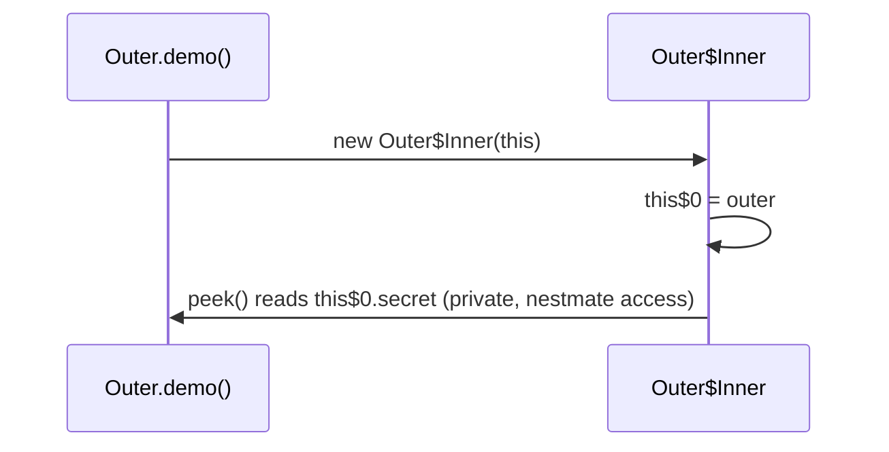

# B.12 How Nested Classes Compile

> **Goal:** See with `javap` what the compiler does with nested, inner, local and anonymous classes and lambdas: separate class files, hidden outer references, captured values, nestmates.

**Level:** under the hood. This chapter explains the mechanics behind chapters B.3 to B.6.
**Verified on:** OpenJDK 21.0.12. Every output below was produced by running the code.

## Contents

1. [The test program](#1-the-test-program)
2. [One class file per class](#2-one-class-file-per-class)
3. [The inner class: `this$0` and the constructor](#3-the-inner-class-this0-and-the-constructor)
4. [Nest attributes (Java 11)](#4-nest-attributes-java-11)
5. [Lambdas: `invokedynamic`, not a class file](#5-lambdas-invokedynamic-not-a-class-file)
6. [Before Java 11: `access$000` bridges](#6-before-java-11-access000-bridges)
7. [Common gotchas](#7-common-gotchas)
8. [Interview questions](#8-interview-questions)

---

## 1. The test program

```java
public class CompileTarget {
    public static void main(String[] args) {
        Outer o = new Outer();
        System.out.println(o.demo());
    }
}

class Outer {
    private int secret = 42;
    private static int counter = 0;

    class Inner {                       // inner (member) class: holds a hidden reference to Outer
        int peek() { return secret; }
    }

    static class Nested {               // static nested: no outer reference
        int next() { return ++counter; }
    }

    String demo() {
        int base = 10;                  // effectively final local, captured below
        class Local {
            int plus(int x) { return base + x; }
        }
        Runnable anon = new Runnable() {
            @Override public void run() { counter += base; }
        };
        anon.run();
        java.util.function.IntUnaryOperator lam = x -> x + base;
        return new Inner().peek() + " " + new Nested().next() + " " + new Local().plus(1) + " " + lam.applyAsInt(5);
    }
}

// ---- Output ----
// 42 11 11 15
```

`Outer` contains an inner class, a static nested class, a local class capturing `base`, an anonymous `Runnable` and a lambda, plus private members that the nested classes touch.

## 2. One class file per class

```text
$ rm -rf out/b12 && javac -Xlint:-options -d out/b12 b/CompileTarget.java && ls out/b12
CompileTarget.class
Outer$1.class
Outer$1Local.class
Outer$Inner.class
Outer$Nested.class
Outer.class
```

```text
Outer.class          the top-level class
Outer$Inner.class    inner member class
Outer$Nested.class   static nested class
Outer$1Local.class   local class "Local"
Outer$1.class        anonymous Runnable
(no file)            the lambda
```

The JVM has no nested classes; the compiler flattens them and records the relationship in attributes.

## 3. The inner class: `this$0` and the constructor

```text
$ javap -p 'out/b12/Outer$Inner.class'
Compiled from "CompileTarget.java"
class Outer$Inner {
  final Outer this$0;
  Outer$Inner(Outer);
  int peek();
}
```

The inner class has `final Outer this$0` and a constructor that **takes the outer instance**: `Inner(Outer)`. `new Inner()` inside `demo()` compiles to `new Outer$Inner(this)`. The static nested class has neither (see its `javap` yourself with `javap -p 'out/b12/Outer$Nested.class'`).



Captured locals work the same way: the local and anonymous classes receive `val$base` through their constructors (chapter B.5 proved this with reflection).

## 4. Nest attributes (Java 11)

Private access between classes in one source file was a problem: the JVM only lets a class touch its **own** private members. Before Java 11 the compiler generated synthetic accessors (section 6). JEP 181 added two class-file attributes: `NestHost` in each member and `NestMembers` in the host, so the JVM treats them as one nest and allows private access directly.

```text
$ javap -v out/b12/Outer.class | grep -A4 -E "^NestMembers"
NestMembers:
  Outer$Nested
  Outer$Inner
  Outer$1
  Outer$1Local
```

```text
$ javap -v 'out/b12/Outer$Inner.class' | grep -E "^NestHost"
NestHost: class Outer
```

Side effect: private method calls between nestmates now use `invokevirtual`/`invokeinterface` instead of `invokespecial`, and reflection has `Class.getNestHost()`, `getNestMembers()` and `isNestmateOf`.

## 5. Lambdas: `invokedynamic`, not a class file

The lambda body becomes a private synthetic static method (`lambda$demo$0`, static because it captures no `this`; the captured `base` is passed as an argument) and the creation site becomes an `invokedynamic` instruction.

```text
$ javap -p -c out/b12/Outer.class | grep -E "lambda|invokedynamic"
      20: invokedynamic #23,  0             // InvokeDynamic #0:applyAsInt:(I)Ljava/util/function/IntUnaryOperator;
      67: invokedynamic #53,  0             // InvokeDynamic #1:makeConcatWithConstants:(IIII)Ljava/lang/String;
  private static int lambda$demo$0(int, int);
```

At first execution the JVM runs the bootstrap method (`LambdaMetafactory`), which spins a hidden class implementing `IntUnaryOperator` that calls `lambda$demo$0`. Later calls reuse the linked call site. The string concatenation uses `invokedynamic` (`makeConcatWithConstants`) since Java 9 as well.

| Construct | Class file? | Mechanism |
|---|---|---|
| Inner, nested, local, anonymous | yes, one each | ordinary class with attributes |
| Lambda / method reference | no | private synthetic method + `invokedynamic` + runtime hidden class |
| Record `toString/equals/hashCode` | no extra | `invokedynamic` + `ObjectMethods` |
| String `+` (Java 9+) | no | `invokedynamic` + `StringConcatFactory` |

## 6. Before Java 11: `access$000` bridges

Compile the same source for Java 8 (`--release 8`) and the compiler must emit synthetic accessors for private members touched across classes:

```text
$ rm -rf out/b12r8; mkdir -p out/b12r8; javac --release 8 -Xlint:-options -d out/b12r8 b/CompileTarget.java 2>/dev/null; javap -p out/b12r8/Outer.class
Compiled from "CompileTarget.java"
class Outer {
  private int secret;
  private static int counter;
  Outer();
  java.lang.String demo();
  private static int lambda$demo$0(int, int);
  static int access$000(Outer);
  static int access$104();
  static int access$112(int);
  static {};
}
```

The `static int access$000(Outer)` and `access$104()` / `access$112(int)` methods are the bridges for reading `secret` and incrementing `counter`. They also widen the apparent surface of the class, which is one reason for the nestmate change.

## 7. Common gotchas

| Gotcha | Why | Fix |
|---|---|---|
| Stack traces show `Outer$1` or `lambda$main$0` | compiler-generated names | name important classes; read the line numbers |
| Renaming/reordering anonymous classes changes `Outer$N` names | numbered in textual order | do not rely on binary names (serialization!) |
| Serializing anonymous/inner/lambda objects | names and captured outer unstable | avoid; use named static classes |
| Proguard/shrinkers drop `InnerClasses` metadata | `getSimpleName()` changes | keep attributes when reflecting |
| Reflection on nested private members in old JDKs | needed `access$` methods | upgrade; nestmates fix it |
| Assuming a lambda is `Outer$1` | it is a hidden class | `javap` shows no file |

## 8. Interview questions

<details>
<summary><strong>Q1. How does the compiler implement inner classes?</strong></summary>

As separate top-level class files named <code>Outer$Inner</code>, with a synthetic field <code>this$0</code> for the outer instance, an extra constructor parameter, and <code>InnerClasses</code>/<code>NestHost</code> attributes.
</details>

<details>
<summary><strong>Q2. How does a local or anonymous class see local variables?</strong></summary>

Copies are passed to its constructor and stored in synthetic <code>val$name</code> fields; that is why they must be effectively final.
</details>

<details>
<summary><strong>Q3. What problem did nestmates (JEP 181) solve?</strong></summary>

Private access among nested classes previously required compiler-generated <code>access$NNN</code> bridge methods. Nest attributes let the JVM permit it directly, and private calls can use <code>invokevirtual</code>.
</details>

<details>
<summary><strong>Q4. How is a lambda compiled?</strong></summary>

The body becomes a private synthetic method; the expression becomes an <code>invokedynamic</code> call site bootstrapped by <code>LambdaMetafactory</code>, which creates a hidden class at run time. No <code>.class</code> file exists for it.
</details>

<details>
<summary><strong>Q5. Why does a lambda not create a new <code>this</code> scope?</strong></summary>

Its body is just a method of the enclosing class (instance method if it uses <code>this</code>, static otherwise).
</details>

<details>
<summary><strong>Q6. What are synthetic members?</strong></summary>

Members generated by the compiler (flag <code>ACC_SYNTHETIC</code>): <code>this$0</code>, <code>val$x</code>, <code>access$000</code>, bridge methods, <code>lambda$...</code>. Reflection marks them with <code>isSynthetic()</code>.
</details>

<details>
<summary><strong>Q7. Can the JVM tell whether a class is nested?</strong></summary>

Only via the <code>InnerClasses</code>/<code>EnclosingMethod</code> attributes, which reflection (<code>getEnclosingClass</code>, <code>getSimpleName</code>) uses; execution itself treats every class as top-level.
</details>

<details>
<summary><strong>Q8. How do you inspect compiled output yourself?</strong></summary>

<code>javap -p -c -v Class</code> to see members, bytecode and attributes. <code>javap -p</code> includes private members.
</details>

---

[Previous: B.11 Generic Classes and Special Classes](./11-generic-classes-and-special-classes.md) · [Part index](../README.md) · Next: [C.1 Composition, Delegation and Inheritance Trade-offs](../C-design-and-practice/01-composition-delegation-and-inheritance-tradeoffs.md)