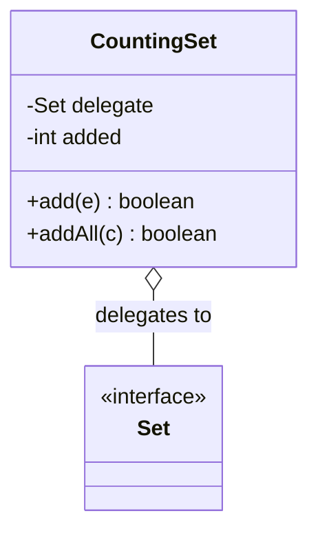
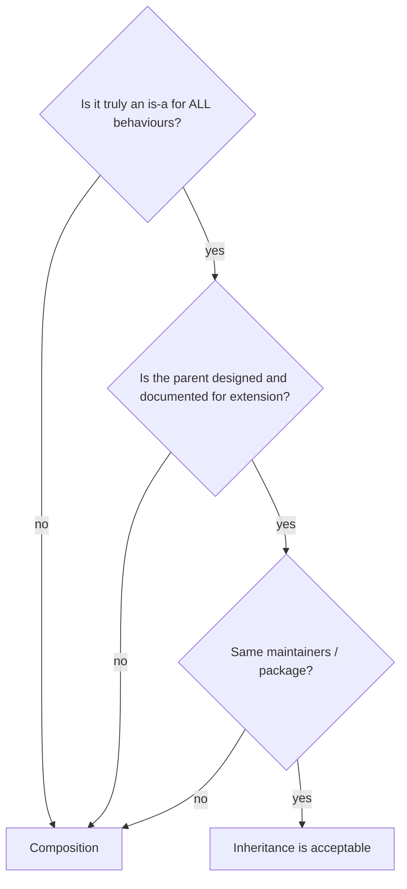

# C.1 Composition, Delegation and Inheritance Trade-offs

> **Goal:** Decide between inheritance and composition with evidence, and implement delegation cleanly.

**Level:** design judgment; the single most common OOP design interview topic.
**Verified on:** OpenJDK 21.0.12. Every output below was produced by running the code.

## Contents

1. [Is-a versus has-a](#1-is-a-versus-has-a)
2. [Inheritance breaks encapsulation: a demonstration](#2-inheritance-breaks-encapsulation-a-demonstration)
3. [The composition fix: wrapper plus delegation](#3-the-composition-fix-wrapper-plus-delegation)
4. [Composition enables runtime flexibility](#4-composition-enables-runtime-flexibility)
5. [When inheritance is right](#5-when-inheritance-is-right)
6. [Decision checklist](#6-decision-checklist)
7. [Common gotchas](#7-common-gotchas)
8. [Interview questions](#8-interview-questions)

---

## 1. Is-a versus has-a

**Intuition.** A `Car` *is a* `Vehicle` (inheritance), but a `Car` *has an* `Engine` (composition). Inheritance ties you to the parent's design at compile time forever; composition lets you swap parts. The rule of thumb from *Effective Java*: **favor composition over inheritance** unless a true is-a relationship exists *and* the parent was designed for extension.

| | Inheritance | Composition |
|---|---|---|
| Coupling | tight (to parent's internals) | loose (to its public API) |
| Binding time | compile time | run time (swap the part) |
| Reuse | automatic, all-or-nothing | explicit, pick what you need |
| Access to parent's `protected` | yes | no |
| Testing | harder (parent is part of the class) | easier (inject fakes) |
| Subtyping | yes | only via interface you implement |

## 2. Inheritance breaks encapsulation: a demonstration

We want a set that counts how many elements were ever added. By extending `HashSet`:

```java
import java.util.*;

public class Composition {

    // INHERITANCE: depends on HashSet's internal call pattern (addAll calls add)
    static class BrokenCountingSet<E> extends HashSet<E> {
        int added = 0;
        @Override public boolean add(E e) { added++; return super.add(e); }
        @Override public boolean addAll(Collection<? extends E> c) { added += c.size(); return super.addAll(c); }
    }

    // COMPOSITION + DELEGATION: wrap a Set, forward calls, add behaviour
    static class CountingSet<E> implements Iterable<E> {
        private final Set<E> delegate;                 // has-a, not is-a
        private int added = 0;
        CountingSet(Set<E> delegate) { this.delegate = delegate; }
        boolean add(E e) { added++; return delegate.add(e); }
        boolean addAll(Collection<? extends E> c) { boolean changed = false; for (E e : c) changed |= add(e); return changed; }
        int added() { return added; }
        int size() { return delegate.size(); }
        @Override public Iterator<E> iterator() { return delegate.iterator(); }
    }

    // Swapping the strategy at runtime is trivial with composition
    interface Notifier { String send(String msg); }
    static class Alerts {
        private Notifier notifier;
        Alerts(Notifier n) { this.notifier = n; }
        void use(Notifier n) { this.notifier = n; }
        String fire(String m) { return notifier.send(m); }
    }

    public static void main(String[] args) {
        BrokenCountingSet<String> broken = new BrokenCountingSet<>();
        broken.addAll(List.of("a", "b", "c"));
        System.out.println("inheritance : added=" + broken.added + " (expected 3), size=" + broken.size());

        CountingSet<String> good = new CountingSet<>(new HashSet<>());
        good.addAll(List.of("a", "b", "c"));
        System.out.println("composition : added=" + good.added() + ", size=" + good.size());

        Alerts alerts = new Alerts(m -> "EMAIL: " + m);
        System.out.println(alerts.fire("disk full"));
        alerts.use(m -> "SMS: " + m);
        System.out.println(alerts.fire("disk full"));
    }
}

// ---- Output ----
// inheritance : added=6 (expected 3), size=3
// composition : added=3, size=3
// EMAIL: disk full
// SMS: disk full
```

The first output line is the bug: `added=6` for three elements. `HashSet.addAll` (inherited from `AbstractCollection`) calls `add` for every element, so the override counts each element twice. A subclass silently depends on a parent's **self-use**, which is not part of its documented contract and may change between JDK releases.

## 3. The composition fix: wrapper plus delegation

`CountingSet` holds a `Set` and forwards calls. It uses only the public API, so it works with any `Set` and survives parent changes.



To make the wrapper usable *as* a `Set`, implement `Set<E>` and forward every method (the **decorator**/**forwarding class** pattern; Guava's `ForwardingSet` and `java.util.Collections` wrappers do this). IDEs can generate delegating methods.

## 4. Composition enables runtime flexibility

The `Alerts` class in the demo gets its `Notifier` injected and can switch it with `use(...)`: email, then SMS. With inheritance (`EmailAlerts extends Alerts`) the choice would be frozen into the type. This is the **strategy pattern**, and it is also how dependency injection works.

## 5. When inheritance is right

- A genuine, stable is-a relationship (`ArrayList` is a `List` and `AbstractList` is designed for extension).
- The parent **documents** how overridable methods are used (self-use) and keeps that contract.
- Same package or module, same maintainers (you control both sides).
- Closed hierarchies: `sealed` types make the subtypes part of the design (chapter B.9).
- Template methods in frameworks built for it (chapter A.4).

## 6. Decision checklist



## 7. Common gotchas

| Gotcha | Why | Fix |
|---|---|---|
| Extending a collection to add behaviour | parent self-use | wrap it |
| Inheriting just to reuse a method | wrong relationship | delegate to a collaborator |
| Deep hierarchies | every level adds coupling | flatten, use interfaces + composition |
| Forwarding class forgets a method | silent behaviour gap | implement the interface fully, test it |
| Wrapper breaks `equals` symmetry | wrapped and unwrapped compared | document, or do not override |
| Overriding a method that parent calls in its constructor | see A.1 | avoid |

## 8. Interview questions

<details>
<summary><strong>Q1. Why favor composition over inheritance?</strong></summary>

Inheritance exposes you to the parent's implementation details and changes (fragile base class), freezes the relationship at compile time and makes testing harder. Composition depends only on public APIs and allows run-time substitution.
</details>

<details>
<summary><strong>Q2. Show a concrete way inheritance goes wrong.</strong></summary>

The counting <code>HashSet</code> subclass: <code>addAll</code> calls <code>add</code>, so overriding both counts every element twice (the demo printed 6 for 3 elements).
</details>

<details>
<summary><strong>Q3. What is delegation?</strong></summary>

An object handles a request by forwarding it to another object it holds. Combined with an interface it gives the decorator and strategy patterns.
</details>

<details>
<summary><strong>Q4. Is inheritance ever the right choice?</strong></summary>

Yes: true is-a with a parent designed for extension, template methods, sealed hierarchies, and framework base classes.
</details>

<details>
<summary><strong>Q5. How do you keep a wrapper substitutable for the wrapped type?</strong></summary>

Implement the same interface and forward all methods. Default methods help in modern Java.
</details>

<details>
<summary><strong>Q6. How does composition support testing?</strong></summary>

Dependencies are injected through constructors, so tests substitute fakes or mocks without subclassing.
</details>

<details>
<summary><strong>Q7. What is the "self-use" problem?</strong></summary>

When a class's public method calls another overridable public method of the same class; subclasses that override both can double-handle. Document self-use or avoid it.
</details>

<details>
<summary><strong>Q8. Composition versus aggregation?</strong></summary>

Both are has-a. In UML composition implies ownership and shared lifecycle; aggregation does not. In Java code the distinction is conceptual.
</details>

---

[Previous: B.12 How Nested Classes Compile](../B-all-class-types/12-how-nested-classes-compile.md) · [Part index](../README.md) · Next: [C.2 SOLID with Java Code](./02-solid-with-java-code.md)