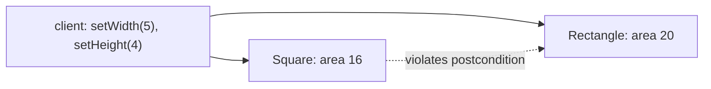

# C.2 SOLID with Java Code

> **Goal:** Apply the five SOLID principles with runnable Java, and see exactly what a Liskov violation looks like.

**Level:** design judgment with working code.
**Verified on:** OpenJDK 21.0.12. Every output below was produced by running the code.

## Contents

1. [Why principles at all](#1-why-principles-at-all)
2. [S, O, I, D in one program](#2-s-o-i-d-in-one-program)
3. [O: open/closed](#3-o-openclosed)
4. [L: Liskov substitution](#4-l-liskov-substitution)
5. [I: interface segregation](#5-i-interface-segregation)
6. [D: dependency inversion](#6-d-dependency-inversion)
7. [The principles in one table](#7-the-principles-in-one-table)
8. [Common gotchas](#8-common-gotchas)
9. [Interview questions](#9-interview-questions)

---

## 1. Why principles at all

**Intuition.** SOLID rules are guardrails that keep change cheap: a change to one requirement should touch one place, not ten. They are heuristics, not laws; applying them blindly yields needless indirection.

## 2. S, O, I, D in one program

```java
import java.util.*;

public class SolidDemo {

    // S: each class has one reason to change
    record Order(String id, double amount) { }
    static class PriceCalculator { double total(List<Order> orders) { return orders.stream().mapToDouble(Order::amount).sum(); } }
    static class OrderPrinter { String print(Order o) { return o.id() + ":" + o.amount(); } }

    // O: open for extension (new discount = new class), closed for modification
    interface Discount { double apply(double amount); }
    static class NoDiscount implements Discount { public double apply(double a) { return a; } }
    static class Percent implements Discount {
        private final double pct; Percent(double pct) { this.pct = pct; }
        public double apply(double a) { return a * (1 - pct / 100); }
    }

    // I: small role interfaces instead of one fat one
    interface Readable { String read(); }
    interface Writable { void write(String s); }
    static class Buffer implements Readable, Writable {
        private String data = "";
        public String read() { return data; }
        public void write(String s) { data += s; }
    }
    static class ReadOnlyView implements Readable {
        private final Readable source; ReadOnlyView(Readable s) { source = s; }
        public String read() { return source.read(); }
    }

    // D: high-level policy depends on an abstraction, the detail is injected
    interface Clock { long now(); }
    static class Service {
        private final Clock clock;
        Service(Clock clock) { this.clock = clock; }
        String stamp(String msg) { return clock.now() + ":" + msg; }
    }

    public static void main(String[] args) {
        List<Order> orders = List.of(new Order("A", 100), new Order("B", 50));
        System.out.println("S: total=" + new PriceCalculator().total(orders) + ", " + new OrderPrinter().print(orders.get(0)));

        for (Discount d : List.of(new NoDiscount(), new Percent(10), (Discount) a -> a - 5)) {
            System.out.println("O: " + d.apply(200));
        }

        Buffer b = new Buffer();
        b.write("hi");
        System.out.println("I: " + new ReadOnlyView(b).read());

        System.out.println("D: " + new Service(() -> 1700000000L).stamp("started"));   // deterministic fake clock
    }
}

// ---- Output ----
// S: total=150.0, A:100.0
// O: 200.0
// O: 180.0
// O: 195.0
// I: hi
// D: 1700000000:started
```

| Letter | Principle | What the code above shows |
|---|---|---|
| S | A class has one reason to change | `PriceCalculator` (maths) and `OrderPrinter` (formatting) are separate |
| O | Open for extension, closed for modification | new discounts are new classes or lambdas; `Discount` consumers never change |
| I | Prefer small interfaces | `Readable` and `Writable`; `ReadOnlyView` needs only the first |
| D | Depend on abstractions | `Service` receives a `Clock`; tests inject a fixed one |

## 3. O: open/closed

The usual enemy is a growing `if/else` or `switch` on a type code. Replace with polymorphism (an interface per behaviour) or, for closed data, sealed types with pattern-matching switch (C.3). Do not abstract before there is a second variant: premature OCP is over-engineering.

## 4. L: Liskov substitution

**Rule.** If `S` is a subtype of `T`, code written for `T` must keep working, with the same promises, when given an `S`. Subtypes may not strengthen preconditions, weaken postconditions, throw new broad exceptions or break invariants.

```java
public class LiskovDemo {

    static class Rectangle {
        protected int w, h;
        void setWidth(int w) { this.w = w; }
        void setHeight(int h) { this.h = h; }
        int area() { return w * h; }
    }

    // "A square IS-A rectangle" in maths, but not in behaviour
    static class Square extends Rectangle {
        @Override void setWidth(int w) { this.w = w; this.h = w; }
        @Override void setHeight(int h) { this.w = h; this.h = h; }
    }

    // Client code written against the base contract: after these calls area must be 5*4
    static int stretch(Rectangle r) {
        r.setWidth(5);
        r.setHeight(4);
        return r.area();
    }

    // Fix: model the real abstraction instead
    sealed interface Shape permits Rect, Sq { int area(); }
    record Rect(int w, int h) implements Shape { public int area() { return w * h; } }
    record Sq(int side) implements Shape { public int area() { return side * side; } }

    public static void main(String[] args) {
        System.out.println("Rectangle: " + stretch(new Rectangle()) + " (expected 20)");
        System.out.println("Square   : " + stretch(new Square()) + " (expected 20)  <- LSP violated");
        System.out.println(new Rect(5, 4).area() + " " + new Sq(4).area());
    }
}

// ---- Output ----
// Rectangle: 20 (expected 20)
// Square   : 16 (expected 20)  <- LSP violated
// 20 16
```

A square "is a" rectangle in geometry, but `Square.setWidth` silently changes the height, so client code that sets width 5 and height 4 expects area 20 and gets 16. The inheritance modelled the shape, not the **behaviour contract**. Fix by modelling what the types really share (`Shape.area()`), as the sealed `Shape` at the end of the demo does, or make shapes immutable.



Other LSP smells: a subclass that throws `UnsupportedOperationException` (`List.of(...).add`), overrides with empty bodies, or needs `instanceof` checks in callers.

## 5. I: interface segregation

Clients should not depend on methods they do not use. A fat `Repository` with 20 methods forces fakes to implement all of them; split by role. Java's own example: `Readable`/`Appendable`/`Closeable` instead of one giant I/O type. Default methods tempt toward fat interfaces; resist.

## 6. D: dependency inversion

High-level policy should not depend on low-level detail; both depend on an abstraction. The practical form: **constructor injection** of interfaces. `Service` never calls `System.currentTimeMillis()`; it asks a `Clock`. The demo injects a deterministic lambda, which is exactly why unit tests become easy. (The JDK has `java.time.Clock` for this purpose.)

## 7. The principles in one table

| Principle | Smell it prevents | Typical refactoring |
|---|---|---|
| SRP | "God" class, ripple changes | extract class |
| OCP | long `switch` on type | polymorphism / sealed + switch |
| LSP | subclass breaks callers | composition, narrower hierarchy |
| ISP | fakes with many empty methods | split interface |
| DIP | hard-wired singletons, untestable code | inject interfaces |

## 8. Common gotchas

| Gotcha | Why | Fix |
|---|---|---|
| Interface per class "for DIP" | indirection without benefit | abstract at real variation points |
| SRP taken to one-method classes | fragmentation | group by reason to change |
| `UnsupportedOperationException` in subtype | LSP violation | different interface |
| OCP via inheritance hooks | fragile base class | strategy objects |
| Static singletons everywhere | blocks DIP | inject |
| Using SOLID as a style cudgel | dogma | justify by change cost |

## 9. Interview questions

<details>
<summary><strong>Q1. Explain Liskov substitution with an example.</strong></summary>

Rectangle/Square: code that sets width and height independently breaks when given a Square because the subtype changes behaviour (the demo printed 16 instead of 20). A subtype must honour the supertype's contract.
</details>

<details>
<summary><strong>Q2. How do you apply open/closed in Java?</strong></summary>

Program to interfaces; add behaviour with new implementations or lambdas instead of editing existing branches; use sealed types with exhaustive switch for closed sets.
</details>

<details>
<summary><strong>Q3. What does "single responsibility" mean precisely?</strong></summary>

A module should have one reason to change, i.e. be accountable to one actor/stakeholder, not "do one thing".
</details>

<details>
<summary><strong>Q4. Dependency inversion versus dependency injection?</strong></summary>

DIP is the principle (depend on abstractions); DI is a technique (pass dependencies in) to achieve it; IoC containers automate DI.
</details>

<details>
<summary><strong>Q5. Which JDK class violates LSP and why?</strong></summary>

<code>Collections.unmodifiableList</code> and <code>List.of</code> implement <code>List</code> but throw <code>UnsupportedOperationException</code> on mutation; also the old <code>Stack extends Vector</code> exposes methods that break stack semantics.
</details>

<details>
<summary><strong>Q6. How does interface segregation relate to default methods?</strong></summary>

Defaults can hide a fat interface, but implementors and callers still see all the methods; split by role instead.
</details>

<details>
<summary><strong>Q7. Can SOLID be overdone?</strong></summary>

Yes: speculative abstractions, one-implementation interfaces and tiny classes raise cognitive cost; apply when variation or change is real.
</details>

<details>
<summary><strong>Q8. How do records and sealed types support OCP/LSP?</strong></summary>

They make data variants explicit and exhaustively checkable, so adding a variant forces updates where behaviour switches on it.
</details>

---

[Previous: C.1 Composition, Delegation and Inheritance Trade-offs](./01-composition-delegation-and-inheritance-tradeoffs.md) · [Part index](../README.md) · Next: [C.3 OOP with Modern Java](./03-oop-with-modern-java.md)