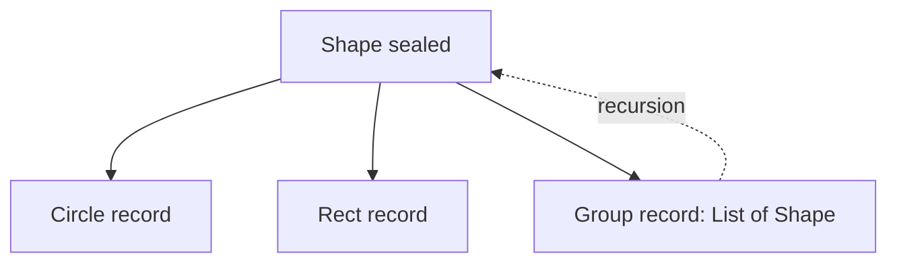

# C.3 OOP with Modern Java

> **Goal:** Combine records, sealed types, pattern-matching `switch` and record patterns into a data-oriented style that replaces many classic OOP patterns.

**Level:** applied; requires Java 21 for everything in this chapter (record patterns and `switch` patterns are final in 21).
**Verified on:** OpenJDK 21.0.12. Every output below was produced by running the code.

## Contents

1. [Two styles of modelling](#1-two-styles-of-modelling)
2. [Sealed + records + switch](#2-sealed--records--switch)
3. [Guards with `when`](#3-guards-with-when)
4. [Errors as values: a sealed `Result`](#4-errors-as-values-a-sealed-result)
5. [Nested record patterns](#5-nested-record-patterns)
6. [When to use objects, when data](#6-when-to-use-objects-when-data)
7. [Version map](#7-version-map)
8. [Common gotchas](#8-common-gotchas)
9. [Interview questions](#9-interview-questions)

---

## 1. Two styles of modelling

**Intuition.** Classic OOP puts behaviour **inside** objects (each `Shape` knows its area). Data-oriented programming keeps data in transparent records and puts behaviour in **functions that pattern-match** over them. Choose by what changes more often:

| | Behaviour in objects (polymorphism) | Behaviour in functions (pattern matching) |
|---|---|---|
| Adding a new **type** | easy (new class) | hard (update every switch; compiler tells you) |
| Adding a new **operation** | hard (touch every class) | easy (new function) |
| Hierarchy | open | closed (`sealed`) |
| Encapsulation | hides state | state is the API |

## 2. Sealed + records + switch

```java
import java.util.*;

public class ModernOop {

    sealed interface Shape permits Circle, Rect, Group { }
    record Circle(double r) implements Shape { }
    record Rect(double w, double h) implements Shape { }
    record Group(List<Shape> children) implements Shape { Group { children = List.copyOf(children); } }

    static double area(Shape s) {
        return switch (s) {
            case Circle c -> Math.PI * c.r() * c.r();
            case Rect(double w, double h) -> w * h;             // record pattern: deconstruct
            case Group(var kids) -> kids.stream().mapToDouble(ModernOop::area).sum();
        };
    }

    static String classify(Shape s) {
        return switch (s) {
            case Circle c when c.r() > 10 -> "big circle";      // guard
            case Circle c -> "circle";
            case Rect(double w, double h) when w == h -> "square";
            case Rect r -> "rectangle";
            case Group(var kids) when kids.isEmpty() -> "empty group";
            case Group g -> "group of " + g.children().size();
        };
    }

    // Generic sealed result type: errors as values
    sealed interface Result<T> permits Ok, Err { }
    record Ok<T>(T value) implements Result<T> { }
    record Err<T>(String message) implements Result<T> { }

    static Result<Integer> parse(String s) {
        try { return new Ok<>(Integer.parseInt(s)); }
        catch (NumberFormatException e) { return new Err<>("bad number: " + s); }
    }

    static String render(Result<Integer> r) {
        return switch (r) {
            case Ok<Integer>(var v) -> "ok " + (v * 2);
            case Err<Integer>(var m) -> "error " + m;
        };
    }

    // Nested record pattern
    record Line(Rect from, Rect to) { }
    static String nested(Object o) {
        if (o instanceof Line(Rect(var w1, var h1), Rect(var w2, var h2))) return "line " + (w1 * h1 + w2 * h2);
        return "other";
    }

    public static void main(String[] args) {
        Shape g = new Group(List.of(new Rect(2, 3), new Circle(1), new Group(List.of())));
        System.out.printf("area = %.3f%n", area(g));
        for (Shape s : List.of(new Circle(11), new Circle(1), new Rect(2, 2), new Rect(2, 3), new Group(List.of()), g)) {
            System.out.println(classify(s));
        }
        System.out.println(render(parse("21")) + ", " + render(parse("x")));
        System.out.println(nested(new Line(new Rect(1, 2), new Rect(3, 4))) + ", " + nested("x"));
    }
}

// ---- Output ----
// area = 9.142
// big circle
// circle
// square
// rectangle
// empty group
// group of 3
// ok 42, error bad number: x
// line 14.0, other
```

`area` is a pattern `switch` over a sealed interface: no `default`, and a missing case is a compile error (chapter B.9). `case Rect(double w, double h)` is a **record pattern** that deconstructs the record into its components.



## 3. Guards with `when`

`case Circle c when c.r() > 10` refines a pattern with a boolean condition. Order matters: the compiler rejects a case that is dominated by an earlier, more general one. Put guarded cases first.

## 4. Errors as values: a sealed `Result`

`Result<T>` is a sealed interface with `Ok<T>` and `Err<T>` records. `parse` returns one instead of throwing; `render` handles both exhaustively. Use this for expected failures in a pipeline; keep exceptions for exceptional ones.

## 5. Nested record patterns

`o instanceof Line(Rect(var w1, var h1), Rect(var w2, var h2))` tests the type, then extracts four values in one expression. `var` in patterns infers the component types. Nested patterns replace chains of `instanceof` + casts + accessor calls.

## 6. When to use objects, when data

| Use records + sealed + switch for | Use classic objects for |
|---|---|
| ASTs, protocol messages, events, commands | entities with identity and lifecycle |
| API DTOs, results, tuples | services and components with dependencies |
| Closed sets of cases | open extension by third parties (plugins) |
| Functions over many shapes | encapsulating invariants over mutable state |

## 7. Version map

| Feature | Preview | Final |
|---|---|---|
| Records | 14, 15 | **16** |
| Pattern matching `instanceof` | 14, 15 | **16** |
| Sealed classes | 15, 16 | **17** |
| Pattern matching `switch` | 17 to 20 | **21** |
| Record patterns | 19, 20 | **21** |
| Unnamed patterns `_` | 21 (preview) | **22** |
| Primitive patterns in `switch` | 23 (preview) | still preview in later releases; see Part 8 |

Unnamed patterns (`case Rect(_, _)`) and anything later cannot be run on the Java 21 used here, so they are not demonstrated in this chapter.

## 8. Common gotchas

| Gotcha | Why | Fix |
|---|---|---|
| "dominated case label" | general pattern before specific | reorder: specific first |
| Switch still demands `default` | type is not sealed (or has `non-sealed`) | seal it |
| `null` selector | `switch` throws `NullPointerException` unless `case null` | add `case null` (Java 21) |
| Record pattern with wrong arity | must match components | check the declaration |
| Pattern switch on a generic sealed type | requires care with type arguments | `case Ok<Integer>(var v)` as in the demo |
| Recursion on deep structures | stack overflow | iterate or use trampolines |
| Records exposing mutable lists | shallow immutability | `List.copyOf` in compact constructor |

## 9. Interview questions

<details>
<summary><strong>Q1. How do sealed types and pattern matching replace the visitor pattern?</strong></summary>

A sealed hierarchy lets the compiler verify that a `switch` covers every variant, so operations are added as plain functions with no `accept` methods; adding a variant breaks non-exhaustive switches at compile time.
</details>

<details>
<summary><strong>Q2. What is a record pattern?</strong></summary>

A pattern that matches a record and binds its components, usable in <code>instanceof</code> and <code>switch</code>, nestable (Java 21).
</details>

<details>
<summary><strong>Q3. What does the <code>when</code> clause do and why does ordering matter?</strong></summary>

It adds a boolean guard to a case. A later case that an earlier unguarded case already covers is unreachable, so the compiler reports it as dominated.
</details>

<details>
<summary><strong>Q4. How does a pattern switch treat <code>null</code>?</strong></summary>

It throws <code>NullPointerException</code> unless there is a <code>case null</code> (optionally <code>case null, default</code>).
</details>

<details>
<summary><strong>Q5. Why use a sealed <code>Result</code> instead of exceptions?</strong></summary>

Failures become part of the type, callers must handle them, and control flow is explicit and cheap. Use exceptions for unexpected conditions and for APIs that already throw.
</details>

<details>
<summary><strong>Q6. Expression problem: which style is better for adding operations? For adding types?</strong></summary>

Pattern matching over sealed data makes new operations easy; polymorphic objects make new types easy.
</details>

<details>
<summary><strong>Q7. Can you pattern-match on a generic record?</strong></summary>

Yes, with type arguments inferred or written: <code>case Ok&lt;Integer&gt;(var v)</code>; unchecked casts are rejected.
</details>

<details>
<summary><strong>Q8. How is a switch expression different from a switch statement?</strong></summary>

It yields a value, uses arrow (`->`) cases with no fall-through, and must be exhaustive.
</details>

---

[Previous: C.2 SOLID with Java Code](./02-solid-with-java-code.md) · [Part index](../README.md) · Next: [C.4 OOP Puzzles and Gotchas](./04-oop-puzzles-and-gotchas.md)