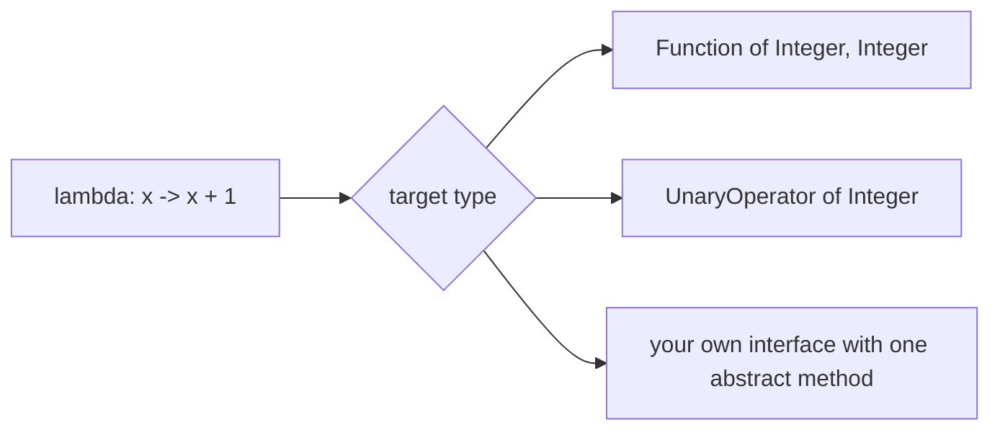
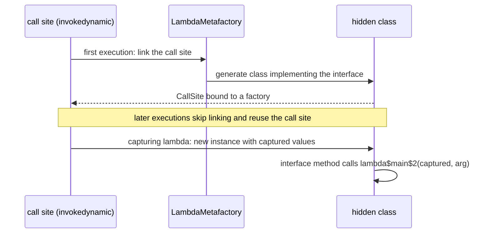

# 3.1 Lambdas and Functional Interfaces

> **Goal:** Understand lambdas and method references as a language feature and as bytecode, master the `java.util.function` toolbox, and avoid the classic lambda traps.

**Level:** Java 8 core. You have used lambdas daily; this chapter covers target typing, capture, `this`, compilation and the interview traps.
**Verified on:** OpenJDK 21.0.12. Examples use only the Java 8 language level unless a version tag says otherwise. Every output below was produced by running the code.

## Contents

1. [Why Java 8 added lambdas](#1-why-java-8-added-lambdas)
2. [Syntax and target typing](#2-syntax-and-target-typing)
3. [Method references: four kinds](#3-method-references-four-kinds)
4. [The `java.util.function` toolbox](#4-the-javautilfunction-toolbox)
5. [Composition](#5-composition)
6. [Capture and effectively final](#6-capture-and-effectively-final)
7. [`this` in a lambda versus an anonymous class](#7-this-in-a-lambda-versus-an-anonymous-class)
8. [How a lambda is compiled](#8-how-a-lambda-is-compiled)
9. [Checked exceptions and lambdas](#9-checked-exceptions-and-lambdas)
10. [Overload ambiguity and other traps](#10-overload-ambiguity-and-other-traps)
11. [Common gotchas](#11-common-gotchas)
12. [Interview questions](#12-interview-questions)

---

## 1. Why Java 8 added lambdas

**Intuition.** Before Java 8, passing behaviour meant writing a whole anonymous class just to hand over one method. A lambda is the same idea with the ceremony removed: *a function you can pass around like a value*. It made the Streams API (Part 4) practical, because pipelines are built from many tiny functions.

Java did **not** add a new "function type". A lambda is always an instance of a **functional interface** (an interface with exactly one abstract method, chapter B.10). That keeps the JVM and the type system unchanged.



## 2. Syntax and target typing

```java
import java.util.*;
import java.util.function.*;

public class LambdaBasics {
    record Person(String name, int age) { }

    interface TriFunction<A, B, C, R> { R apply(A a, B b, C c); }      // your own functional interface

    public static void main(String[] args) {
        // 1. Syntax forms: all of these are the same idea, "a function value"
        Function<Integer, Integer> a = (Integer x) -> { return x + 1; };   // full form
        Function<Integer, Integer> b = x -> x + 1;                         // inferred type, expression body
        BiFunction<Integer, Integer, Integer> add = (x, y) -> x + y;
        Supplier<String> hello = () -> "hello";
        Runnable noop = () -> { };
        System.out.println(a.apply(1) + " " + b.apply(1) + " " + add.apply(2, 3) + " " + hello.get());

        // 2. The same lambda text means different things for different target types
        Callable3 c = () -> "as Callable3";
        Supplier<String> s = () -> "as Supplier";
        System.out.println(c.call() + ", " + s.get());

        // 3. Four kinds of method reference
        Function<String, Integer> parse = Integer::parseInt;               // static
        String prefix = "id-";
        Function<String, String> addPrefix = prefix::concat;               // bound instance (receiver fixed)
        Function<String, String> upper = String::toUpperCase;              // unbound instance (first arg is receiver)
        Supplier<List<String>> make = ArrayList::new;                      // constructor
        System.out.println(parse.apply("41") + 1 + " " + addPrefix.apply("7") + " " + upper.apply("abc") + " " + make.get());

        // 4. The core java.util.function shapes
        Predicate<String> empty = String::isEmpty;
        UnaryOperator<String> trim = String::trim;
        BinaryOperator<Integer> max = BinaryOperator.maxBy(Comparator.naturalOrder());
        Consumer<String> print = x -> System.out.println("consumed " + x);
        IntBinaryOperator mul = (x, y) -> x * y;                           // primitive specialisation: no boxing
        print.accept(trim.apply("  padded ") + "/" + empty.negate().test("") + "/" + max.apply(3, 9) + "/" + mul.applyAsInt(6, 7));

        // 5. Composition
        Function<Integer, Integer> plus1 = x -> x + 1, times2 = x -> x * 2;
        System.out.println("andThen=" + plus1.andThen(times2).apply(5) + ", compose=" + plus1.compose(times2).apply(5));
        Predicate<Integer> even = x -> x % 2 == 0, big = x -> x > 10;
        System.out.println("even&&big(12)=" + even.and(big).test(12) + ", even||big(7)=" + even.or(big).test(7));

        // 6. Comparators built from lambdas
        List<Person> people = new ArrayList<>(List.of(new Person("Asha", 30), new Person("Ravi", 25), new Person("Asha", 22)));
        people.sort(Comparator.comparing(Person::name).thenComparing(Person::age, Comparator.reverseOrder()));
        System.out.println(people);

        // 7. Capture: lambdas capture values of effectively final locals
        int base = 100;
        IntUnaryOperator addBase = x -> x + base;
        System.out.println(addBase.applyAsInt(5));

        // 8. Currying and your own 3-argument interface
        Function<Integer, Function<Integer, Integer>> curriedAdd = x -> y -> x + y;
        TriFunction<Integer, Integer, Integer, Integer> sum3 = (x, y, z) -> x + y + z;
        System.out.println(curriedAdd.apply(3).apply(4) + " " + sum3.apply(1, 2, 3));

        // 9. Laziness with Supplier
        System.out.println(orElseDefault(null, () -> { System.out.println("  computing default"); return "default"; }));
        System.out.println(orElseDefault("given", () -> { System.out.println("  never printed"); return "default"; }));
    }

    interface Callable3 { String call(); }

    static String orElseDefault(String value, Supplier<String> fallback) {
        return value != null ? value : fallback.get();
    }
}

// ---- Output ----
// 2 2 5 hello
// as Callable3, as Supplier
// 42 id-7 ABC []
// consumed padded/false/9/42
// andThen=12, compose=11
// even&&big(12)=true, even||big(7)=false
// [Person[name=Asha, age=30], Person[name=Asha, age=22], Person[name=Ravi, age=25]]
// 105
// 7 6
//   computing default
// default
// given
```

| Form | Example | Notes |
|---|---|---|
| Full | `(Integer x) -> { return x + 1; }` | explicit types, block body |
| Inferred | `x -> x + 1` | one parameter needs no parentheses |
| Multi-parameter | `(x, y) -> x + y` | |
| No parameters | `() -> "hello"` | |
| Block body | `x -> { ...; return v; }` | needs `return` for non-void |

**Target typing.** A lambda has no type of its own; the compiler infers it from where it is used (an assignment, a method argument, a return). The second block of output shows the *same* text `() -> "..."` becoming a `Callable3` or a `Supplier<String>` depending on the target. This is why `Object o = () -> 1;` and `var v = () -> 1;` are compile errors:

```java
public class LambdaNoTarget {
    public static void main(String[] args) {
        Object o = () -> "no functional interface here";   // ERROR: target type must be a functional interface
        var v = () -> 1;                                   // ERROR: var needs an initializer with a standalone type
    }
}
```

Real `javac` output:

```text
ce3/LambdaNoTarget.java:3: error: incompatible types: Object is not a functional interface
        Object o = () -> "no functional interface here";   // ERROR: target type must be a functional interface
                   ^
ce3/LambdaNoTarget.java:4: error: cannot infer type for local variable v
        var v = () -> 1;                                   // ERROR: var needs an initializer with a standalone type
            ^
  (lambda expression needs an explicit target-type)
2 errors
```

## 3. Method references: four kinds

A method reference is shorthand for a lambda that only calls an existing method.

| Kind | Syntax | Equivalent lambda |
|---|---|---|
| Static method | `Integer::parseInt` | `s -> Integer.parseInt(s)` |
| Bound instance (receiver fixed now) | `prefix::concat` | `s -> prefix.concat(s)` |
| Unbound instance (receiver is the first argument) | `String::toUpperCase` | `s -> s.toUpperCase()` |
| Constructor | `ArrayList::new` | `() -> new ArrayList<>()` |

The demo uses all four. Pick method references when they read more clearly; use a lambda when you would need to bend the argument order.

## 4. The `java.util.function` toolbox

Learn the shapes, not 43 names. Every interface is one of a few shapes, specialised for primitives to avoid boxing.

| Shape | Interface | Method | Example |
|---|---|---|---|
| T -> R | `Function<T,R>` | `apply` | `String::length` |
| T -> boolean | `Predicate<T>` | `test` | `String::isEmpty` |
| () -> T | `Supplier<T>` | `get` | `ArrayList::new` |
| T -> void | `Consumer<T>` | `accept` | `System.out::println` |
| T -> T | `UnaryOperator<T>` | `apply` | `String::trim` |
| (T,T) -> T | `BinaryOperator<T>` | `apply` | `Integer::sum` |
| (T,U) -> R | `BiFunction<T,U,R>` | `apply` | `(a, b) -> a + b` |
| primitive forms | `IntFunction`, `ToIntFunction`, `IntPredicate`, `IntBinaryOperator`... | `applyAsInt` etc. | `(x, y) -> x * y` |

Use the primitive specialisations (`IntUnaryOperator`, `ToLongFunction`) in hot paths: `Function<Integer,Integer>` boxes every value.

## 5. Composition

`Function`, `Predicate` and `Comparator` are designed to be combined:

| Method | Meaning |
|---|---|
| `f.andThen(g)` | run `f`, then `g`: `g(f(x))` |
| `f.compose(g)` | run `g`, then `f`: `f(g(x))` |
| `p.and(q)`, `p.or(q)`, `p.negate()` | boolean combinations; `and`/`or` short-circuit |
| `Comparator.comparing(key)` | compare by a key extractor |
| `.thenComparing(...)`, `.reversed()` | tie-breakers and reversal |

The output lines `andThen=12, compose=11` show the order difference, and the sorted `Person` list shows `thenComparing(Person::age, Comparator.reverseOrder())` breaking the tie on name.

## 6. Capture and effectively final

A lambda may use locals of the enclosing method only if they are `final` or *effectively final* (never reassigned). The reason is the same as for local classes (chapter B.5): the lambda gets a **copy**.

```java
public class LambdaMutate {
    public static void main(String[] args) {
        int count = 0;
        Runnable r = () -> count++;       // ERROR: count is not effectively final
        r.run();
    }
}
```

Real `javac` output:

```text
ce3/LambdaMutate.java:4: error: local variables referenced from a lambda expression must be final or effectively final
        Runnable r = () -> count++;       // ERROR: count is not effectively final
                           ^
1 error
```

If you really need mutable state, capture a holder (`AtomicInteger`, `int[1]`) and mutate that; be careful with threads. In `LambdaThis` the `counterBroken()` method does exactly that. Instance and static **fields** are not copied (they are read through `this` or the class), so lambdas can freely read and write them.

## 7. `this` in a lambda versus an anonymous class

```java
import java.util.function.*;

public class LambdaThis {
    private final String name = "outer-instance";

    void run() {
        Runnable anon = new Runnable() {
            private final String name = "anonymous-instance";
            @Override public void run() { System.out.println("anonymous: this.name=" + this.name + ", outer=" + LambdaThis.this.name); }
        };
        Runnable lambda = () -> System.out.println("lambda   : this.name=" + this.name);
        anon.run();
        lambda.run();
    }

    static Supplier<Integer> counterBroken() {
        int[] box = {0};                                  // workaround: mutate a holder, the reference is effectively final
        return () -> ++box[0];
    }

    // recursion needs a name: use a field or a local class, not a local lambda variable
    static final Function<Integer, Integer> FACT = n -> n <= 1 ? 1 : n * LambdaThis.FACT.apply(n - 1);

    public static void main(String[] args) throws Exception {
        new LambdaThis().run();

        Supplier<Integer> counter = counterBroken();
        System.out.println(counter.get() + " " + counter.get() + " " + counter.get());
        System.out.println("5! = " + FACT.apply(5));

        // Overload ambiguity: Runnable vs Callable both fit a block lambda that returns nothing/something
        submit(() -> { System.out.println("  ran as Runnable (no return value)"); });
        submit(() -> { return "  ran as Callable (returns a value)"; });
        submit(() -> "expression lambda, value-compatible: Callable wins");

        // Non-capturing lambdas are cached per call site on HotSpot (implementation detail, not a language guarantee)
        Runnable[] seen = new Runnable[2];
        for (int i = 0; i < 2; i++) seen[i] = () -> { };
        System.out.println("same non-capturing instance reused: " + (seen[0] == seen[1]));
        Runnable[] cap = new Runnable[2];
        for (int i = 0; i < 2; i++) { int j = i; cap[i] = () -> System.out.print(j); }
        System.out.println("capturing lambdas are new each time: " + (cap[0] != cap[1]));
    }

    static void submit(Runnable r) { r.run(); }
    static void submit(java.util.concurrent.Callable<?> c) throws Exception { System.out.println(c.call()); }
}

// ---- Output ----
// anonymous: this.name=anonymous-instance, outer=outer-instance
// lambda   : this.name=outer-instance
// 1 2 3
// 5! = 120
//   ran as Runnable (no return value)
//   ran as Callable (returns a value)
// expression lambda, value-compatible: Callable wins
// same non-capturing instance reused: true
// capturing lambdas are new each time: true
```

The first two lines are the key difference: inside an anonymous class `this` is the anonymous object; inside a lambda `this` is the **enclosing** object, because a lambda body is just code in the enclosing method with no new scope. A lambda also cannot redeclare a local variable name from the enclosing scope, while an anonymous class body can shadow it.

## 8. How a lambda is compiled

A lambda is not an anonymous class. The compiler turns the body into a private synthetic method and the creation site into an `invokedynamic` instruction.

```text
$ rm -rf out/d1 && javac -Xlint:-options -d out/d1 d/LambdaCompile.java && javap -p out/d1/LambdaCompile.class | grep lambda
  private static int lambda$main$2(int, int);
  private static int lambda$capturesNothing$1(int);
  private int lambda$capturesThis$0(int);
```

```text
$ javap -p -c out/d1/LambdaCompile.class | grep -E "invokedynamic"
       1: invokedynamic #13,  0             // InvokeDynamic #0:applyAsInt:(LLambdaCompile;)Ljava/util/function/IntUnaryOperator;
       0: invokedynamic #17,  0             // InvokeDynamic #1:applyAsInt:()Ljava/util/function/IntUnaryOperator;
       1: invokedynamic #20,  0             // InvokeDynamic #2:get:(LLambdaCompile;)Ljava/util/function/Supplier;
       3: invokedynamic #24,  0             // InvokeDynamic #3:applyAsInt:(I)Ljava/util/function/IntUnaryOperator;
      35: invokedynamic #42,  0             // InvokeDynamic #4:makeConcatWithConstants:(II)Ljava/lang/String;
```

```text
$ javap -v out/d1/LambdaCompile.class | grep -E "MethodHandle .*(LambdaCompile\.|Object\.)"
   #69 = MethodHandle       5:#70         // REF_invokeVirtual LambdaCompile.lambda$capturesThis$0:(I)I
   #72 = MethodHandle       6:#73         // REF_invokeStatic LambdaCompile.lambda$capturesNothing$1:(I)I
   #77 = MethodHandle       5:#78         // REF_invokeVirtual java/lang/Object.toString:()Ljava/lang/String;
   #83 = MethodHandle       6:#84         // REF_invokeStatic LambdaCompile.lambda$main$2:(II)I
```

Reading it:

- `lambda$capturesThis$0` is an **instance** method because the body uses `field` (it needs `this`).
- `lambda$capturesNothing$1` is **static**: no captured state.
- `lambda$main$2(int, int)` is static and takes the captured `local` as an extra first parameter.
- `this::toString` has no synthetic method; the call site points straight at `Object.toString` (`REF_invokeVirtual`).



Consequences you can measure or state in an interview:

| Fact | Evidence |
|---|---|
| No `LambdaCompile$1.class` is generated | the lambda is created at run time as a hidden class |
| Non-capturing lambdas are typically one shared instance per call site | the demo printed `reused: true` (HotSpot behaviour, not a language guarantee) |
| Capturing lambdas allocate a new object each evaluation | the demo printed `new each time: true` |
| Stack traces show `lambda$main$0` frames | the synthetic method names above |
| Same bytecode contract from Java 8 | compiled with `--release 8` it still uses `invokedynamic` (class file version 52) |

## 9. Checked exceptions and lambdas

The standard functional interfaces do not declare `throws`, so a lambda body cannot let a checked exception escape:

```java
import java.io.IOException;
import java.util.List;

public class LambdaChecked {
    static String load(String n) throws IOException { return n; }

    public static void main(String[] args) {
        List.of("a").forEach(n -> load(n));   // ERROR: unreported checked exception
    }
}
```

Real `javac` output:

```text
ce3/LambdaChecked.java:8: error: unreported exception IOException; must be caught or declared to be thrown
        List.of("a").forEach(n -> load(n));   // ERROR: unreported checked exception
                                      ^
1 error
```

The usual fix is a small adapter that wraps checked exceptions once, so call sites stay clean:

```java
import java.io.IOException;
import java.util.List;
import java.util.function.Function;

public class CheckedLambda {
    @FunctionalInterface
    interface ThrowingFunction<T, R, E extends Exception> { R apply(T t) throws E; }

    // Adapter: converts a throwing function to a standard Function by wrapping the checked exception
    static <T, R> Function<T, R> unchecked(ThrowingFunction<T, R, ? extends Exception> f) {
        return t -> {
            try { return f.apply(t); }
            catch (RuntimeException e) { throw e; }
            catch (Exception e) { throw new RuntimeException(e); }
        };
    }

    static String load(String name) throws IOException {
        if (name.startsWith("missing")) throw new IOException("no such resource: " + name);
        return "content of " + name;
    }

    public static void main(String[] args) {
        // Function<String,String> f = CheckedLambda::load;   // does not compile: load throws IOException
        Function<String, String> f = unchecked(CheckedLambda::load);
        System.out.println(List.of("a.txt", "b.txt").stream().map(f).toList());
        try {
            f.apply("missing.txt");
        } catch (RuntimeException e) {
            System.out.println("wrapped: " + e.getClass().getSimpleName() + " <- cause " + e.getCause());
        }
    }
}

// ---- Output ----
// [content of a.txt, content of b.txt]
// wrapped: RuntimeException <- cause java.io.IOException: no such resource: missing.txt
```

For anything with real recovery logic, catch and handle inside the lambda or use a loop instead of a stream.

## 10. Overload ambiguity and other traps

`LambdaThis` also shows overload resolution with lambdas: a block lambda that returns nothing fits `Runnable`; one that returns a value fits `Callable`. An expression lambda like `() -> "x"` is value-compatible and (because it can also be void-compatible only if the expression is a statement expression) is resolved to `Callable`. When both interfaces genuinely fit (for example `() -> foo()` where `foo` returns a value), the call is ambiguous and you must cast or use a named variable. Prefer different method names (`submitRunnable`, `submitCallable`) over overloading on functional interfaces.

## 11. Common gotchas

| Gotcha | Why | Fix |
|---|---|---|
| "local variables referenced from a lambda must be final or effectively final" | captured by copy | holder object, or restructure |
| Unreported checked exception in lambda | `Function.apply` declares none | wrapper adapter or try/catch inside |
| Recursive lambda does not compile as a local variable | the variable is not definitely assigned inside its own initializer | use a field, or a helper method |
| `this` is not the lambda | lambdas have no own scope | use an anonymous class if you need one |
| Boxing in hot loops | `Function<Integer,Integer>` | `IntUnaryOperator` and friends |
| Overloads taking different functional interfaces | ambiguity | rename methods |
| Lambdas hold references to `this` | memory retention, like inner classes | use static methods or avoid capturing |
| Debugging stack traces | synthetic frames `lambda$x$0` | name the logic with method references |

## 12. Interview questions

<details>
<summary><strong>Q1. What is a lambda expression and what is its type?</strong></summary>

An anonymous function. It has no type of its own; its type is the functional interface it is assigned or passed to (target typing). The same lambda text can implement different interfaces.
</details>

<details>
<summary><strong>Q2. What is a functional interface?</strong></summary>

An interface with exactly one abstract method (default, static and `Object`-matching methods do not count). `@FunctionalInterface` asks the compiler to enforce it.
</details>

<details>
<summary><strong>Q3. Difference between a lambda and an anonymous class?</strong></summary>

`this` (enclosing object versus the anonymous object), scope (a lambda introduces no new scope or shadowing), ability to hold state and implement several methods or extend classes (anonymous only), and compilation (hidden class created via `invokedynamic` versus a real `.class` file).
</details>

<details>
<summary><strong>Q4. Why must captured local variables be effectively final?</strong></summary>

The lambda receives a copy of the value; allowing later mutation would make the copy and the original diverge, and the local lives on one thread's stack while the lambda may run on another. Fields are not copied, so they are not restricted.
</details>

<details>
<summary><strong>Q5. How does the JVM implement lambdas?</strong></summary>

The compiler emits a private synthetic method with the body and an `invokedynamic` instruction. On first execution `LambdaMetafactory` generates a hidden class implementing the interface and binds the call site. Benefits: no class file per lambda, flexibility to change the strategy without recompiling, and the JIT can inline through the call site.
</details>

<details>
<summary><strong>Q6. Are non-capturing lambdas allocated every time?</strong></summary>

On HotSpot a non-capturing lambda evaluates to a single cached instance per call site (the demo prints `true`), while capturing lambdas need a new instance to hold the captured values. This is an implementation detail; do not depend on identity.
</details>

<details>
<summary><strong>Q7. Name the four kinds of method reference.</strong></summary>

Static (`Integer::parseInt`), bound instance (`prefix::concat`), unbound instance (`String::toUpperCase`), constructor (`ArrayList::new`).
</details>

<details>
<summary><strong>Q8. What is the difference between <code>Function.andThen</code> and <code>compose</code>?</strong></summary>

<code>f.andThen(g)</code> computes <code>g(f(x))</code>; <code>f.compose(g)</code> computes <code>f(g(x))</code>. The demo printed 12 and 11 for the same two functions.
</details>

<details>
<summary><strong>Q9. How do you handle checked exceptions in a lambda?</strong></summary>

Catch inside the lambda and handle or wrap in an unchecked exception; or use a custom functional interface that declares <code>throws</code> plus an adapter that converts it to a standard one. Do not hide failures by swallowing them.
</details>

<details>
<summary><strong>Q10. Why can't you write a recursive lambda as a local variable?</strong></summary>

The variable is not yet definitely assigned inside its own initializer. Use an instance/static field (as the factorial demo does), a method reference to a regular method, or a local class.
</details>

<details>
<summary><strong>Q11. What is currying and how do you express it with lambdas?</strong></summary>

Turning a multi-argument function into a chain of single-argument functions: <code>Function&lt;Integer, Function&lt;Integer, Integer&gt;&gt; add = x -&gt; y -&gt; x + y;</code>. Useful for partial application.
</details>

<details>
<summary><strong>Q12. When would you use <code>Supplier</code> instead of passing a value?</strong></summary>

When the value is expensive or has side effects and may not be needed: laziness. The demo's <code>orElseDefault</code> only evaluates the fallback when the value is null; the same idea underlies <code>Optional.orElseGet</code> and lazy logging.
</details>

<details>
<summary><strong>Q13. What are primitive specialisations for and which ones exist?</strong></summary>

They avoid boxing: <code>IntFunction</code>, <code>ToIntFunction</code>, <code>IntPredicate</code>, <code>IntUnaryOperator</code>, <code>IntBinaryOperator</code> and the Long/Double equivalents. They matter in tight loops and with primitive streams.
</details>

<details>
<summary><strong>Q14. A call <code>submit(() -> foo())</code> is ambiguous between <code>Runnable</code> and <code>Callable</code>. Why and how do you fix it?</strong></summary>

If <code>foo()</code> returns a value, the lambda is both void-compatible (a method call is a valid statement) and value-compatible, so both overloads fit. Cast the lambda, assign it to a typed variable, or rename the methods.
</details>

---

[Previous: C.4 OOP Puzzles and Gotchas](../02-oop-deep-dive/C-design-and-practice/04-oop-puzzles-and-gotchas.md) · [Part index](./README.md) · Next: [3.2 Optional and Default Methods](./02-optional-and-default-methods.md)