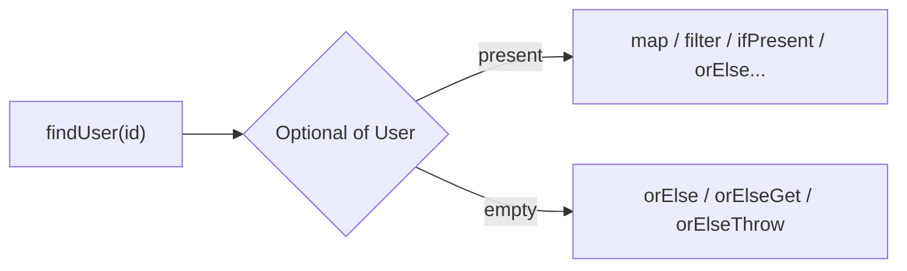

# 3.2 Optional and Default Methods

> **Goal:** Use `Optional` as it was intended, know the Java 8 collection API additions delivered through default methods, and avoid the well-known anti-patterns.

**Level:** Java 8 core with later-version additions tagged.
**Verified on:** OpenJDK 21.0.12. Every output below was produced by running the code.

## Contents

1. [The problem: `null`](#1-the-problem-null)
2. [Optional: creation and transformation](#2-optional-creation-and-transformation)
3. [`orElse` versus `orElseGet`](#3-orelse-versus-orelseget)
4. [Getting the value out](#4-getting-the-value-out)
5. [What later versions added](#5-what-later-versions-added)
6. [Optional anti-patterns](#6-optional-anti-patterns)
7. [Default methods: how Java 8 evolved the collections](#7-default-methods-how-java-8-evolved-the-collections)
8. [The `Map` toolbox](#8-the-map-toolbox)
9. [Common gotchas](#9-common-gotchas)
10. [Interview questions](#10-interview-questions)

---

## 1. The problem: `null`

**Intuition.** A method returning `User` that sometimes returns `null` is a trap: the signature does not warn the caller, and the failure appears later as a `NullPointerException` far from the cause. `Optional<T>` is a *container that is either full or empty*, placed in the return type so the caller is forced to think about absence.

Scope rule from the JDK authors: `Optional` is for **return values** of methods where "no result" is a normal outcome. It is not designed for fields, parameters or collections elements.



## 2. Optional: creation and transformation

```java
import java.util.*;
import java.util.stream.Stream;

public class OptionalDemo {
    record User(String name, Address address) { }
    record Address(String city) { }

    static Optional<User> findUser(int id) {
        return id == 1 ? Optional.of(new User("asha", new Address("Pune")))
             : id == 2 ? Optional.of(new User("ravi", null))
             : Optional.empty();
    }

    static String expensiveDefault() { System.out.println("  (expensiveDefault called)"); return "unknown"; }

    public static void main(String[] args) {
        // 1. Creating
        Optional<String> some = Optional.of("x");
        Optional<String> none = Optional.empty();
        Optional<String> maybe = Optional.ofNullable(null);
        System.out.println(some + " " + none + " " + maybe);
        try { Optional.of(null); } catch (NullPointerException e) { System.out.println("Optional.of(null) -> NullPointerException"); }

        // 2. Transforming: map / flatMap / filter replace nested null checks
        for (int id : new int[]{1, 2, 3}) {
            String city = findUser(id)
                    .map(User::address)          // null result becomes empty
                    .map(Address::city)
                    .filter(c -> c.length() > 2)
                    .orElse("no city");
            System.out.println("user " + id + " -> " + city);
        }
        Optional<Optional<String>> nested = Optional.of("v").map(v -> Optional.of(v + "!"));
        System.out.println("map with Optional-returning fn gives nesting: " + nested + ", flatMap flattens: " + Optional.of("v").flatMap(v -> Optional.of(v + "!")));

        // 3. orElse is EAGER, orElseGet is LAZY
        System.out.println("orElse on present value:");
        String r1 = some.orElse(expensiveDefault());
        System.out.println("orElseGet on present value:");
        String r2 = some.orElseGet(OptionalDemo::expensiveDefault);
        System.out.println(r1 + " " + r2);

        // 4. Getting the value out
        try { none.get(); } catch (NoSuchElementException e) { System.out.println("get() on empty: " + e.getMessage()); }
        try { none.orElseThrow(() -> new IllegalStateException("user not found")); } catch (IllegalStateException e) { System.out.println(e.getMessage()); }
        some.ifPresent(v -> System.out.println("ifPresent: " + v));

        // 5. Later additions (version tags matter in interviews)
        none.ifPresentOrElse(v -> System.out.println("present"), () -> System.out.println("9+: ifPresentOrElse ran the empty branch"));
        System.out.println("9+: or() -> " + none.or(() -> Optional.of("fallback")).get());
        System.out.println("9+: stream() -> " + Stream.of(some, none, Optional.of("y")).flatMap(Optional::stream).toList());
        System.out.println("10+: orElseThrow() -> " + some.orElseThrow());
        System.out.println("11+: isEmpty() -> " + none.isEmpty());

        // 6. Primitive specialisations avoid boxing
        OptionalInt max = java.util.stream.IntStream.of(3, 9, 4).max();
        System.out.println("OptionalInt max=" + max.getAsInt() + ", empty=" + java.util.stream.IntStream.empty().max());

        // 7. Optional is not Serializable and not meant for fields; its equals is value-based
        System.out.println("equals: " + Optional.of("a").equals(Optional.of("a")) + ", Serializable: " + java.io.Serializable.class.isAssignableFrom(Optional.class));
    }
}

// ---- Output ----
// Optional[x] Optional.empty Optional.empty
// Optional.of(null) -> NullPointerException
// user 1 -> Pune
// user 2 -> no city
// user 3 -> no city
// map with Optional-returning fn gives nesting: Optional[Optional[v!]], flatMap flattens: Optional[v!]
// orElse on present value:
//   (expensiveDefault called)
// orElseGet on present value:
// x x
// get() on empty: No value present
// user not found
// ifPresent: x
// 9+: ifPresentOrElse ran the empty branch
// 9+: or() -> fallback
// 9+: stream() -> [x, y]
// 10+: orElseThrow() -> x
// 11+: isEmpty() -> true
// OptionalInt max=9, empty=OptionalInt.empty
// equals: true, Serializable: false
```

| Factory | Behaviour |
|---|---|
| `Optional.of(v)` | `v` must be non-null, otherwise `NullPointerException` immediately |
| `Optional.ofNullable(v)` | empty if `v` is null |
| `Optional.empty()` | the empty instance |

Transformations replace nested `if (x != null)` chains:

| Method | Use | Rule |
|---|---|---|
| `map(f)` | transform the value | a `null` result becomes empty |
| `flatMap(f)` | `f` itself returns an `Optional` | avoids `Optional<Optional<T>>` (shown in the output) |
| `filter(p)` | keep only if the predicate holds | empty stays empty |

The `user 1 / 2 / 3` lines show the pipeline: user 1 reaches a city, user 2 has `address == null` (the `map` turns it into empty), user 3 does not exist.

## 3. `orElse` versus `orElseGet`

`orElse(x)` evaluates `x` **eagerly**, even when the Optional is present. `orElseGet(supplier)` calls the supplier only when needed. In the output, `orElse` printed `(expensiveDefault called)` although the value was present; `orElseGet` printed nothing. Rule: if the default is anything other than a constant or a cheap field, use `orElseGet`.

## 4. Getting the value out

| Method | On empty | Use |
|---|---|---|
| `get()` | throws `NoSuchElementException` | avoid; same risk as `null` |
| `orElse(v)` | returns `v` | cheap default |
| `orElseGet(s)` | calls `s` | expensive default |
| `orElseThrow(supplier)` | throws your exception | "must exist" lookups |
| `ifPresent(c)` | does nothing | side effect on a present value |

## 5. What later versions added

| Method | Since | Purpose |
|---|---|---|
| `ifPresentOrElse(consumer, runnable)` | 9 | both branches without `if` |
| `or(supplier)` | 9 | alternative Optional when empty |
| `stream()` | 9 | 0 or 1 element stream; `flatMap(Optional::stream)` drops empties |
| `orElseThrow()` | 10 | no-argument form, preferred over `get()` |
| `isEmpty()` | 11 | readable negation of `isPresent()` |

The demo tags each with its version. `OptionalInt`, `OptionalLong` and `OptionalDouble` exist to avoid boxing (Java 8).

## 6. Optional anti-patterns

| Anti-pattern | Why it is wrong | Better |
|---|---|---|
| `if (opt.isPresent()) { opt.get() }` | just a verbose null check | `map`, `ifPresent`, `orElse...` |
| `Optional` as a field | not `Serializable` (demo prints `false`), extra allocation | nullable field with a getter that returns `Optional` |
| `Optional` as a method parameter | forces callers to wrap | overload, or accept a nullable |
| `Optional<List<T>>` | an empty list already means "nothing" | return an empty collection |
| `Optional.get()` without a check | defeats the purpose | `orElseThrow()` |
| Returning `null` from a method that returns `Optional` | the worst of both | return `Optional.empty()` |
| Using it in hot loops | allocation per call | plain null checks inside implementation |

`Optional` is a *value-based* class: do not synchronise on it or rely on identity; `equals` compares the contents.

## 7. Default methods: how Java 8 evolved the collections

Streams, `forEach` and friends could not be added to `Collection` without breaking every implementation in the world. **Default methods** (chapter A.4) solved that: the interface supplies a body that implementors inherit.

```java
import java.util.*;
import java.util.stream.*;

public class DefaultMethodsJdk {
    public static void main(String[] args) throws Exception {
        // Which of these exist ONLY because default methods were added in Java 8?
        for (String m : new String[]{"stream", "forEach", "removeIf", "spliterator"}) {
            var method = Arrays.stream(Collection.class.getMethods()).filter(x -> x.getName().equals(m)).findFirst().orElseThrow();
            System.out.println("Collection." + m + " isDefault=" + method.isDefault());
        }
        System.out.println("Iterable.forEach isDefault=" + Iterable.class.getMethod("forEach", java.util.function.Consumer.class).isDefault());
        System.out.println("List.sort isDefault=" + List.class.getMethod("sort", Comparator.class).isDefault());
        System.out.println("Map.merge isDefault=" + Map.class.getMethod("merge", Object.class, Object.class, java.util.function.BiFunction.class).isDefault());
        System.out.println("Comparator.reversed isDefault=" + Comparator.class.getMethod("reversed").isDefault());
    }
}

// ---- Output ----
// Collection.stream isDefault=true
// Collection.forEach isDefault=true
// Collection.removeIf isDefault=true
// Collection.spliterator isDefault=true
// Iterable.forEach isDefault=true
// List.sort isDefault=true
// Map.merge isDefault=true
// Comparator.reversed isDefault=true
```

Everything marked `isDefault=true` was added to an existing interface in Java 8 without breaking implementors. Classic examples: `Iterable.forEach`, `Collection.stream/removeIf`, `List.sort/replaceAll`, `Map.getOrDefault/merge/compute*`, `Comparator.reversed/thenComparing`.

## 8. The `Map` toolbox

```java
import java.util.*;
import java.util.function.*;

public class MapDefaults {
    public static void main(String[] args) {
        Map<String, Integer> stock = new TreeMap<>();

        // getOrDefault: no null check needed
        System.out.println("getOrDefault: " + stock.getOrDefault("apple", 0));

        // putIfAbsent returns the previous value (null if it was absent)
        System.out.println("putIfAbsent #1: " + stock.putIfAbsent("apple", 5) + ", #2: " + stock.putIfAbsent("apple", 99) + " -> " + stock);

        // computeIfAbsent: the grouping idiom
        Map<Integer, List<String>> byLength = new TreeMap<>();
        for (String w : List.of("pear", "fig", "plum", "kiwi", "date"))
            byLength.computeIfAbsent(w.length(), k -> new ArrayList<>()).add(w);
        System.out.println("grouped: " + byLength);

        // merge: the counting idiom
        Map<Character, Integer> freq = new TreeMap<>();
        for (char c : "banana".toCharArray()) freq.merge(c, 1, Integer::sum);
        System.out.println("merge counts: " + freq);

        // compute / computeIfPresent
        stock.compute("apple", (k, v) -> v == null ? 1 : v + 10);
        stock.computeIfPresent("pear", (k, v) -> v + 1);        // absent: nothing happens
        System.out.println("compute: " + stock);

        // returning null from the function REMOVES the entry
        stock.computeIfPresent("apple", (k, v) -> null);
        System.out.println("null result removes: " + stock);

        // replaceAll / forEach / removeIf on collections
        List<Integer> nums = new ArrayList<>(List.of(1, 2, 3, 4, 5, 6));
        nums.replaceAll(n -> n * n);
        nums.removeIf(n -> n % 2 == 0);
        nums.forEach(n -> System.out.print(n + " "));
        System.out.println();
        nums.sort(Comparator.reverseOrder());
        System.out.println("sorted desc: " + nums);

        // Pitfall: computeIfAbsent must not modify the same HashMap from inside the function
        Map<Integer, Long> memo = new HashMap<>();
        try {
            fib(20, memo);
            System.out.println("fib(20) memoised without error");
        } catch (ConcurrentModificationException e) {
            System.out.println("recursive computeIfAbsent on HashMap -> ConcurrentModificationException");
        }
    }

    static long fib(int n, Map<Integer, Long> memo) {
        if (n < 2) return n;
        return memo.computeIfAbsent(n, k -> fib(k - 1, memo) + fib(k - 2, memo));
    }
}

// ---- Output ----
// getOrDefault: 0
// putIfAbsent #1: null, #2: 5 -> {apple=5}
// grouped: {3=[fig], 4=[pear, plum, kiwi, date]}
// merge counts: {a=3, b=1, n=2}
// compute: {apple=15}
// null result removes: {}
// 1 9 25
// sorted desc: [25, 9, 1]
// recursive computeIfAbsent on HashMap -> ConcurrentModificationException
```

| Idiom | Code | What it replaces |
|---|---|---|
| Default read | `map.getOrDefault(k, 0)` | `get` then null check |
| Grouping | `map.computeIfAbsent(k, x -> new ArrayList<>()).add(v)` | check, put, get |
| Counting | `map.merge(c, 1, Integer::sum)` | check, get, put |
| Conditional update | `computeIfPresent(k, fn)` | `containsKey` then update |
| Remove via function | return `null` from `compute*` / `merge` | explicit `remove` |
| Bulk transform | `list.replaceAll(fn)`, `list.removeIf(p)` | iterator loops |

Two traps shown above: `putIfAbsent` returns the **previous** value (null when it inserted), and `computeIfAbsent` on a `HashMap` must not modify the map from inside the function: the recursive Fibonacci memo throws `ConcurrentModificationException`. `ConcurrentHashMap.computeIfAbsent` has the related rule that the function must be short and must not touch the same map.

## 9. Common gotchas

| Gotcha | Why | Fix |
|---|---|---|
| `orElse(expensiveCall())` runs the call every time | eager argument | `orElseGet` |
| `Optional.of(maybeNull)` throws | `of` rejects null | `ofNullable` |
| `map` returning an `Optional` gives nesting | `map` wraps | `flatMap` |
| `Optional` field breaks serialization | not `Serializable` | store the raw value |
| Recursive `computeIfAbsent` on `HashMap` | modifies map during compute | separate lookup, or `ConcurrentHashMap` care |
| `merge` with `null` value argument | throws `NullPointerException` | never pass null values |
| `putIfAbsent` result misread | returns old value | use `computeIfAbsent` when you want the value |
| Using `get()` after `isPresent()` everywhere | verbose null checks | functional style |

## 10. Interview questions

<details>
<summary><strong>Q1. What is <code>Optional</code> and why was it added?</strong></summary>

A container that may or may not hold a non-null value, designed as a return type to make absence explicit and chainable (<code>map</code>, <code>filter</code>, <code>orElse...</code>) instead of returning <code>null</code>.
</details>

<details>
<summary><strong>Q2. <code>orElse</code> versus <code>orElseGet</code>?</strong></summary>

<code>orElse</code> evaluates its argument always; <code>orElseGet</code> calls the supplier only when empty. The demo printed the side-effect line only for <code>orElse</code>.
</details>

<details>
<summary><strong>Q3. <code>map</code> versus <code>flatMap</code> on Optional?</strong></summary>

<code>map</code> wraps the function result in an Optional (so an Optional-returning function gives <code>Optional&lt;Optional&lt;T&gt;&gt;</code>); <code>flatMap</code> expects the function to return an Optional and does not re-wrap.
</details>

<details>
<summary><strong>Q4. Should you use Optional for fields and parameters?</strong></summary>

No: it is not serializable, adds allocation and burdens callers. Use it for return values.
</details>

<details>
<summary><strong>Q5. What does <code>Optional.of(null)</code> do?</strong></summary>

Throws <code>NullPointerException</code>; use <code>ofNullable</code> when null is possible.
</details>

<details>
<summary><strong>Q6. How do you convert a stream of Optionals to the present values?</strong></summary>

Java 9+: <code>flatMap(Optional::stream)</code>. Java 8: <code>filter(Optional::isPresent).map(Optional::get)</code>.
</details>

<details>
<summary><strong>Q7. Why is <code>get()</code> discouraged?</strong></summary>

It throws when empty, recreating the NPE problem. <code>orElseThrow()</code> (Java 10) says the same thing explicitly.
</details>

<details>
<summary><strong>Q8. Why were default methods added?</strong></summary>

To evolve interfaces (notably <code>Collection.stream</code>, <code>Iterable.forEach</code>, <code>Comparator</code> combinators) without breaking existing implementations.
</details>

<details>
<summary><strong>Q9. How would you count word frequencies with the Java 8 Map API?</strong></summary>

<code>freq.merge(word, 1, Integer::sum)</code>; for grouping lists, <code>computeIfAbsent(key, k -&gt; new ArrayList&lt;&gt;()).add(value)</code>.
</details>

<details>
<summary><strong>Q10. What does returning <code>null</code> from the function given to <code>compute</code> do?</strong></summary>

It removes the mapping (the demo's <code>null result removes</code> line).
</details>

<details>
<summary><strong>Q11. Why does a recursive memoised Fibonacci with <code>HashMap.computeIfAbsent</code> fail?</strong></summary>

The mapping function modifies the same map during the compute, which <code>HashMap</code> detects and reports with <code>ConcurrentModificationException</code> (Java 9+). Compute outside the lambda or use an explicit get/put.
</details>

<details>
<summary><strong>Q12. What is <code>OptionalInt</code> for?</strong></summary>

Avoids boxing for primitive streams (<code>IntStream.max()</code> returns <code>OptionalInt</code>).
</details>

---

[Previous: 3.1 Lambdas and Functional Interfaces](./01-lambdas-and-functional-interfaces.md) · [Part index](./README.md) · Next: [3.3 CompletableFuture Basics](./03-completablefuture-basics.md)