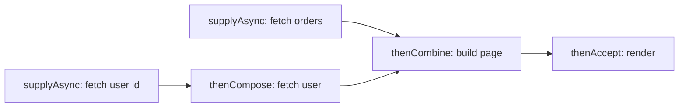
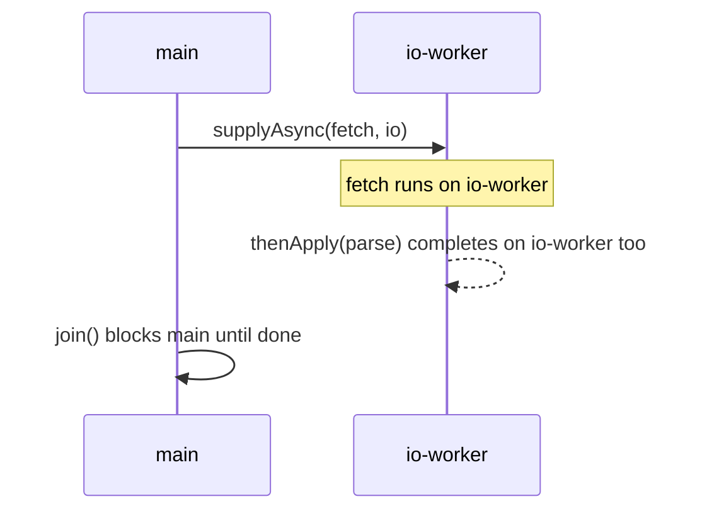

# 3.3 CompletableFuture Basics

> **Goal:** Compose asynchronous work without blocking, understand which thread runs each stage, and handle errors and timeouts correctly.

**Level:** Java 8 core, with Java 9+ additions tagged. Part 12 goes deeper into executors and the Fork/Join pool.
**Verified on:** OpenJDK 21.0.12. Every output below was produced by running the code.

## Contents

1. [From `Future` to `CompletableFuture`](#1-from-future-to-completablefuture)
2. [Creating and chaining](#2-creating-and-chaining)
3. [`thenApply`, `thenCompose`, `thenCombine`](#3-thenapply-thencompose-thencombine)
4. [Which thread runs my stage?](#4-which-thread-runs-my-stage)
5. [Error handling](#5-error-handling)
6. [Timeouts and cancellation](#6-timeouts-and-cancellation)
7. [The default executor trap](#7-the-default-executor-trap)
8. [Cheat sheet](#8-cheat-sheet)
9. [Common gotchas](#9-common-gotchas)
10. [Interview questions](#10-interview-questions)

---

## 1. From `Future` to `CompletableFuture`

**Intuition.** A plain `Future` is a claim ticket: you can only wait (`get()` blocks) or poll. A `CompletableFuture` is a ticket that also lets you say *"when this is ready, do that next"*, so you build a pipeline of stages that run when their inputs finish, without a thread sitting blocked in between.

| | `Future` (Java 5) | `CompletableFuture` (Java 8) |
|---|---|---|
| Get result | `get()` blocks | `join()`, `get()`, or callbacks |
| Chain next step | no | `thenApply`, `thenCompose`, ... |
| Combine two | manual | `thenCombine`, `allOf`, `anyOf` |
| Complete by hand | no | `complete`, `completeExceptionally` |
| Error handling | exception from `get()` | `exceptionally`, `handle`, `whenComplete` |



## 2. Creating and chaining

```java
import java.util.List;
import java.util.concurrent.*;

public class CfBasics {
    static ExecutorService pool(String name) {
        return Executors.newSingleThreadExecutor(r -> { Thread t = new Thread(r, name); t.setDaemon(true); return t; });
    }

    static String thread() { return Thread.currentThread().getName(); }

    public static void main(String[] args) throws Exception {
        ExecutorService io = pool("io-worker");

        // 1. supplyAsync runs on an executor; the result is a promise you chain on
        CompletableFuture<String> f = CompletableFuture.supplyAsync(() -> "run on " + thread(), io);
        System.out.println(f.join());

        // 2. thenApply (map), thenAccept (consume), thenRun (no input)
        CompletableFuture<Integer> len = CompletableFuture.supplyAsync(() -> "hello", io).thenApply(String::length);
        System.out.println("thenApply -> " + len.join());

        // 3. thenCompose (flatMap) for dependent async calls, thenCombine for independent ones
        CompletableFuture<Integer> userId = CompletableFuture.supplyAsync(() -> 42, io);
        CompletableFuture<String> userName = userId.thenCompose(id -> CompletableFuture.supplyAsync(() -> "user#" + id, io));
        CompletableFuture<String> orders = CompletableFuture.supplyAsync(() -> "3 orders", io);
        System.out.println("thenCompose+thenCombine -> " + userName.thenCombine(orders, (n, o) -> n + " has " + o).join());
        CompletableFuture<CompletableFuture<Integer>> nestedBad = userId.thenApply(id -> CompletableFuture.supplyAsync(() -> id + 1, io));
        System.out.println("thenApply with an async fn nests futures: " + nestedBad.join().getClass().getSimpleName());

        // 4. allOf / anyOf
        List<CompletableFuture<Integer>> parts = List.of(1, 2, 3).stream()
                .map(n -> CompletableFuture.supplyAsync(() -> n * 10, io)).toList();
        CompletableFuture.allOf(parts.toArray(new CompletableFuture[0])).join();
        System.out.println("allOf -> " + parts.stream().map(CompletableFuture::join).toList());

        // 5. Manual completion: a CompletableFuture is also a promise you can fulfil yourself
        CompletableFuture<String> manual = new CompletableFuture<>();
        System.out.println("isDone before=" + manual.isDone());
        manual.complete("set by hand");
        System.out.println("isDone after=" + manual.isDone() + ", value=" + manual.join());

        // 6. Which thread runs the continuation?
        CompletableFuture<String> done = CompletableFuture.completedFuture("x");
        System.out.println("thenApply on completed future runs on caller: " + done.thenApply(v -> thread()).join());
        System.out.println("thenApplyAsync with executor runs on pool    : " + done.thenApplyAsync(v -> thread(), io).join());
        io.shutdown();
    }
}

// ---- Output ----
// run on io-worker
// thenApply -> 5
// thenCompose+thenCombine -> user#42 has 3 orders
// thenApply with an async fn nests futures: CompletableFuture
// allOf -> [10, 20, 30]
// isDone before=false
// isDone after=true, value=set by hand
// thenApply on completed future runs on caller: main
// thenApplyAsync with executor runs on pool    : io-worker
```

Ways to start a pipeline:

| Factory | Meaning |
|---|---|
| `supplyAsync(supplier[, executor])` | run code that returns a value |
| `runAsync(runnable[, executor])` | run code with no result |
| `completedFuture(v)` | already finished |
| `new CompletableFuture<>()` | a promise you complete yourself |

## 3. `thenApply`, `thenCompose`, `thenCombine`

| Method | Analogy | Function shape | Use |
|---|---|---|---|
| `thenApply(f)` | `map` | `T -> U` | synchronous transformation |
| `thenCompose(f)` | `flatMap` | `T -> CompletableFuture<U>` | next step is itself async and depends on this result |
| `thenCombine(other, f)` | zip | `(T, U) -> V` | two independent futures |
| `thenAccept(c)` | forEach | `T -> void` | terminal consumer |
| `thenRun(r)` | | `() -> void` | run after, ignore the result |
| `allOf(f1, f2, ...)` | | | wait for all (returns `Void`) |
| `anyOf(f1, f2, ...)` | | | first one to finish |

The demo's `nestedBad` shows what happens if you use `thenApply` with an async function: you get a `CompletableFuture<CompletableFuture<Integer>>`. Use `thenCompose`.

## 4. Which thread runs my stage?

This is the most misunderstood part.

| Variant | Runs the function on |
|---|---|
| `thenApply(f)` | the thread that **completed** the previous stage, or the **caller** if it was already complete |
| `thenApplyAsync(f)` | the default async executor (common pool) |
| `thenApplyAsync(f, executor)` | the executor you pass |

The last two lines of the demo prove it: on an already-completed future `thenApply` ran on `main`, and `thenApplyAsync(..., io)` ran on `io-worker`. Because a non-async stage may run on a latency-critical thread (a Netty event loop, a request thread), pass an executor for any non-trivial work.



## 5. Error handling

```java
import java.util.concurrent.*;

public class CfErrors {
    static int risky(int x) {
        if (x < 0) throw new IllegalArgumentException("negative: " + x);
        return x * 2;
    }

    public static void main(String[] args) throws Exception {
        CompletableFuture<Integer> bad = CompletableFuture.supplyAsync(() -> risky(-1));

        // 1. join() throws CompletionException; get() throws ExecutionException; both wrap the cause
        try { bad.join(); } catch (CompletionException e) { System.out.println("join -> " + e.getClass().getSimpleName() + " / cause: " + e.getCause()); }
        try { bad.get(); } catch (ExecutionException e) { System.out.println("get  -> " + e.getClass().getSimpleName() + " / cause: " + e.getCause()); }

        // 2. exceptionally: recover with a value
        System.out.println("exceptionally -> " + bad.exceptionally(ex -> -999).join());

        // 3. handle: sees both result and error, always runs
        System.out.println("handle(ok)  -> " + CompletableFuture.supplyAsync(() -> risky(4)).handle((v, ex) -> ex == null ? "value " + v : "error").join());
        System.out.println("handle(bad) -> " + bad.handle((v, ex) -> ex == null ? "value " + v : "error " + ex.getClass().getSimpleName() + " wrapping " + ex.getCause().getClass().getSimpleName()).join());

        // 4. whenComplete observes but does not change the outcome
        CompletableFuture<Integer> observed = bad.whenComplete((v, ex) -> System.out.println("whenComplete saw: " + (ex == null ? v : ex.getClass().getSimpleName())));
        try { observed.join(); } catch (CompletionException e) { System.out.println("outcome unchanged: still fails with " + e.getCause().getClass().getSimpleName()); }

        // 5. Errors propagate down the chain, skipping thenApply stages
        CompletableFuture<String> chain = CompletableFuture.supplyAsync(() -> risky(-2))
                .thenApply(v -> { System.out.println("never printed"); return "x"; })
                .exceptionally(ex -> "recovered at the end: " + ex.getCause().getMessage());
        System.out.println(chain.join());

        // 6. completeExceptionally for manual failure
        CompletableFuture<String> manual = new CompletableFuture<>();
        manual.completeExceptionally(new IllegalStateException("cancelled upstream"));
        System.out.println("isCompletedExceptionally=" + manual.isCompletedExceptionally());

        // 7. Timeouts (Java 9+): orTimeout and completeOnTimeout; Java 8 had none
        CompletableFuture<String> slow = new CompletableFuture<>();
        System.out.println("completeOnTimeout -> " + slow.completeOnTimeout("fallback", 50, TimeUnit.MILLISECONDS).join());
        CompletableFuture<String> slow2 = new CompletableFuture<String>().orTimeout(50, TimeUnit.MILLISECONDS);
        try { slow2.join(); } catch (CompletionException e) { System.out.println("orTimeout -> " + e.getCause().getClass().getSimpleName()); }
    }
}

// ---- Output ----
// join -> CompletionException / cause: java.lang.IllegalArgumentException: negative: -1
// get  -> ExecutionException / cause: java.lang.IllegalArgumentException: negative: -1
// exceptionally -> -999
// handle(ok)  -> value 8
// handle(bad) -> error CompletionException wrapping IllegalArgumentException
// whenComplete saw: CompletionException
// outcome unchanged: still fails with IllegalArgumentException
// recovered at the end: negative: -2
// isCompletedExceptionally=true
// completeOnTimeout -> fallback
// orTimeout -> TimeoutException
```

| Method | Sees | Result |
|---|---|---|
| `exceptionally(fn)` | the error only | recovery value; skipped on success |
| `handle((v, ex) -> ...)` | value **and** error (one is null) | always runs; can change outcome |
| `whenComplete((v, ex) -> ...)` | both | **observe only**, outcome unchanged |

Key facts from the output:

- `join()` throws an **unchecked** `CompletionException`; `get()` throws a **checked** `ExecutionException`. In both, the real exception is `getCause()`.
- Inside `handle`/`whenComplete` the exception you receive is typically a `CompletionException` **wrapping** the original (the demo prints `CompletionException wrapping IllegalArgumentException`); a future failed directly with `completeExceptionally(ex)` hands you `ex` itself. Unwrap with `getCause()` when you need the original type.
- An error skips all `thenApply` stages until a stage that handles errors, exactly like an exception unwinding a stack.

## 6. Timeouts and cancellation

Java 8 had no timeout support on `CompletableFuture`. Java 9 added `orTimeout(time, unit)` (fails with `TimeoutException`) and `completeOnTimeout(value, time, unit)` (completes with a fallback), both used in the demo. In Java 8 you needed a scheduler that completes the future exceptionally.

**Cancellation does not stop work.** `cancel(true)` marks the future cancelled, but a `CompletableFuture` is not wired to the running task:

```java
import java.util.concurrent.*;

public class CfPitfalls {
    public static void main(String[] args) throws Exception {
        // Fire and forget loses errors silently
        CompletableFuture<Void> lost = CompletableFuture.runAsync(() -> { throw new IllegalStateException("nobody looks at me"); });
        try { lost.join(); } catch (CompletionException e) { System.out.println("error only visible if you join/handle it: " + e.getCause().getMessage()); }

        // Cancelling a CompletableFuture does NOT interrupt the running task
        CountDownLatch started = new CountDownLatch(1);
        CountDownLatch finish = new CountDownLatch(1);
        CompletableFuture<String> job = CompletableFuture.supplyAsync(() -> {
            started.countDown();
            try { finish.await(); } catch (InterruptedException e) { return "interrupted"; }
            return "task ran to completion anyway";
        });
        started.await();
        System.out.println("cancel returned " + job.cancel(true) + ", isCancelled=" + job.isCancelled());
        finish.countDown();
        Thread.sleep(100);
        System.out.println("the cancelled future reports done=" + job.isDone() + " but the task body was not interrupted");
    }
}

// ---- Output ----
// error only visible if you join/handle it: nobody looks at me
// cancel returned true, isCancelled=true
// the cancelled future reports done=true but the task body was not interrupted
```

The task body kept running to completion. To make work cancellable, share a flag or use structured concurrency (Parts 7 and 8; Part 12 for executors).

## 7. The default executor trap

If you do not pass an executor, async stages run on `ForkJoinPool.commonPool()`. That pool is small (about CPU count minus one), shared by the whole JVM (parallel streams use it too), and its threads are meant for short, CPU-bound tasks. Blocking calls (JDBC, HTTP, `Thread.sleep`) inside it can starve everything else. Also, when the machine has very few cores, `CompletableFuture` may fall back to creating a new thread per async task. Both behaviours depend on the hardware, so do not rely on them.

Rule: **always pass a dedicated executor for blocking I/O**, sized for the downstream resource, and shut it down at application stop.

## 8. Cheat sheet

```text
start:    supplyAsync / runAsync / completedFuture
transform thenApply          (sync map)
chain     thenCompose        (async flatMap)
merge     thenCombine, allOf, anyOf
errors    exceptionally, handle, whenComplete
wait      join (unchecked), get (checked)
time      orTimeout, completeOnTimeout   (Java 9+)
threads   *Async(fn, executor) to choose the thread
```

## 9. Common gotchas

| Gotcha | Why | Fix |
|---|---|---|
| Blocking inside the common pool | starves other users | custom executor |
| Fire and forget swallows errors | nobody joins the future | end every chain with `handle`/`exceptionally`/log |
| `thenApply` with async function nests futures | wrong operator | `thenCompose` |
| Calling `join()` inside a stage | blocks a pool thread, can deadlock | compose instead |
| `cancel(true)` does not interrupt | not linked to the task | cooperative cancellation flag |
| Exception type surprises | `CompletionException` wrapping | unwrap `getCause()` |
| `allOf` returns `CompletableFuture<Void>` | no results | collect the individual futures' results after it completes |
| Context lost on other threads | `ThreadLocal`, MDC not propagated | pass context explicitly or wrap executors |

## 10. Interview questions

<details>
<summary><strong>Q1. What does <code>CompletableFuture</code> add over <code>Future</code>?</strong></summary>

Non-blocking composition (<code>thenApply</code>, <code>thenCompose</code>, <code>thenCombine</code>), manual completion, error-handling stages, and combinators like <code>allOf/anyOf</code>.
</details>

<details>
<summary><strong>Q2. <code>thenApply</code> versus <code>thenCompose</code>?</strong></summary>

<code>thenApply</code> is <code>map</code>: the function returns a plain value. <code>thenCompose</code> is <code>flatMap</code>: the function returns another <code>CompletableFuture</code>, which is flattened. Using <code>thenApply</code> for async functions gives a nested future.
</details>

<details>
<summary><strong>Q3. <code>thenApply</code> versus <code>thenApplyAsync</code>?</strong></summary>

<code>thenApply</code> runs on whichever thread completes the previous stage (or the caller if already complete); <code>thenApplyAsync</code> submits it to an executor (common pool by default).
</details>

<details>
<summary><strong>Q4. What is the default executor and what is wrong with it?</strong></summary>

<code>ForkJoinPool.commonPool()</code>: small, shared JVM-wide, designed for CPU-bound short tasks. Blocking tasks can exhaust it.
</details>

<details>
<summary><strong>Q5. <code>exceptionally</code> versus <code>handle</code> versus <code>whenComplete</code>?</strong></summary>

<code>exceptionally</code> only runs on failure and provides a recovery value; <code>handle</code> runs always and can transform either outcome; <code>whenComplete</code> runs always but only observes, the original outcome is preserved.
</details>

<details>
<summary><strong>Q6. <code>join()</code> versus <code>get()</code>?</strong></summary>

Both block. <code>join</code> throws unchecked <code>CompletionException</code>; <code>get</code> throws checked <code>ExecutionException</code> and <code>InterruptedException</code> (and has a timed overload).
</details>

<details>
<summary><strong>Q7. How do you run three independent calls in parallel and wait for all?</strong></summary>

Start each with <code>supplyAsync(..., executor)</code>, then <code>allOf(f1, f2, f3).join()</code> and read each future's <code>join()</code>, as in the <code>allOf</code> demo.
</details>

<details>
<summary><strong>Q8. How do you add a timeout in Java 8 versus 9+?</strong></summary>

Java 9+: <code>orTimeout</code> / <code>completeOnTimeout</code>. Java 8: schedule a task on a <code>ScheduledExecutorService</code> that completes the future exceptionally and combine with <code>applyToEither</code>.
</details>

<details>
<summary><strong>Q9. Does <code>cancel(true)</code> interrupt the running task?</strong></summary>

No. It completes the future with <code>CancellationException</code>, but the supplier already running keeps going (the demo shows it ran to completion).
</details>

<details>
<summary><strong>Q10. How do exceptions propagate in a chain?</strong></summary>

A failed stage completes its dependents exceptionally (wrapped in <code>CompletionException</code>), skipping value-processing stages until an error-handling stage recovers.
</details>

<details>
<summary><strong>Q11. Can you complete a CompletableFuture from outside? When is that useful?</strong></summary>

Yes with <code>complete</code>/<code>completeExceptionally</code>. It adapts callback-based APIs (a callback completes the promise) and is useful in tests.
</details>

<details>
<summary><strong>Q12. Why is calling <code>join()</code> inside a stage dangerous?</strong></summary>

It blocks a pool thread waiting for another task that may need that same pool, which can starve or deadlock the pool. Use <code>thenCompose</code> instead.
</details>

---

[Previous: 3.2 Optional and Default Methods](./02-optional-and-default-methods.md) · [Part index](./README.md) · Next: [3.4 The Date-Time API](./04-date-time-api.md)