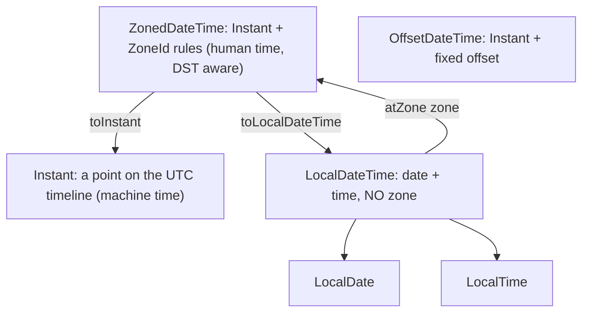

# 3.4 The Date-Time API (`java.time`)

> **Goal:** Pick the right `java.time` type for every question, handle time zones and daylight saving correctly, and know exactly why the legacy `Date`/`Calendar` classes are avoided.

**Level:** Java 8 core. Part 15 revisits formatting and parsing edge cases.
**Verified on:** OpenJDK 21.0.12. Every output below was produced by running the code (all dates are fixed so the output is reproducible).

## Contents

1. [Why a new API](#1-why-a-new-api)
2. [The type map](#2-the-type-map)
3. [Immutability and arithmetic](#3-immutability-and-arithmetic)
4. [`Duration` versus `Period`](#4-duration-versus-period)
5. [Formatting and parsing](#5-formatting-and-parsing)
6. [Time zones, offsets and daylight saving](#6-time-zones-offsets-and-daylight-saving)
7. [Testable time with `Clock`](#7-testable-time-with-clock)
8. [Legacy interop and legacy pitfalls](#8-legacy-interop-and-legacy-pitfalls)
9. [Which type for which job](#9-which-type-for-which-job)
10. [Common gotchas](#10-common-gotchas)
11. [Interview questions](#11-interview-questions)

---

## 1. Why a new API

`java.util.Date` and `Calendar` (JDK 1.0/1.1) have well-known flaws: mutable, zero-based months, years counted from 1900, a `Date` that is really an instant yet prints a zone, a non-thread-safe `SimpleDateFormat`, no types for "date without time". `java.time` (JSR-310, Java 8, based on Joda-Time ideas) fixes all of that: **immutable, thread-safe, explicit types for each concept, fluent**.

## 2. The type map

**Intuition.** Ask which question you are answering. "What day is my birthday?" needs no clock or zone. "When did the payment happen?" needs an exact point on the timeline. "When is the meeting in Tokyo?" needs a zone with its daylight rules.



| Type | Holds | Example use |
|---|---|---|
| `Instant` | seconds + nanos since the epoch | event timestamps, storage, logs |
| `LocalDate` | year-month-day | birthday, due date |
| `LocalTime` | hour-minute-second | opening hours |
| `LocalDateTime` | date + time, no zone | "next Tuesday 09:30" before you know where |
| `ZonedDateTime` | date-time + `ZoneId` | meetings, scheduling across DST |
| `OffsetDateTime` | date-time + fixed offset | APIs, database columns with offset |
| `ZoneId` / `ZoneOffset` | region rules / fixed offset | `Asia/Kolkata` / `+05:30` |
| `Duration` | amount of time (seconds, nanos) | timeouts, elapsed time |
| `Period` | years-months-days | "3 months from now" |
| `Year`, `YearMonth`, `MonthDay`, `DayOfWeek`, `Month` | partial values | credit card expiry (`YearMonth`) |

## 3. Immutability and arithmetic

```java
import java.time.*;
import java.time.format.DateTimeFormatter;
import java.time.temporal.ChronoUnit;
import java.time.temporal.TemporalAdjusters;

public class DateTimeBasics {
    public static void main(String[] args) {
        // 1. The types: each answers a different question
        LocalDate date = LocalDate.of(2024, 1, 31);                  // a calendar date, no time, no zone
        LocalTime time = LocalTime.of(9, 30);                        // wall-clock time
        LocalDateTime ldt = LocalDateTime.of(date, time);            // date + time, still NO zone: not a point on the timeline
        ZonedDateTime zdt = ldt.atZone(ZoneId.of("Asia/Kolkata"));   // an exact instant with rules of a region
        Instant instant = zdt.toInstant();                           // the machine timeline (UTC)
        System.out.println(date + " | " + time + " | " + ldt + " | " + zdt + " | " + instant);

        // 2. Immutable: every operation returns a NEW object
        LocalDate plus = date.plusMonths(1);
        System.out.println("Jan 31 + 1 month = " + plus + " (clamped to month end); original unchanged: " + date);

        // 3. Duration (time-based) versus Period (date-based)
        Duration d = Duration.between(LocalTime.of(9, 0), LocalTime.of(17, 45));
        Period p = Period.between(LocalDate.of(2020, 2, 29), LocalDate.of(2024, 4, 1));
        System.out.println("Duration: " + d + " = " + d.toMinutes() + " min; Period: " + p + "; days between: " + ChronoUnit.DAYS.between(LocalDate.of(2020, 2, 29), LocalDate.of(2024, 4, 1)));

        // 4. Adjusters and queries
        System.out.println("next Monday after 2024-01-31 : " + date.with(TemporalAdjusters.next(DayOfWeek.MONDAY)));
        System.out.println("last day of that month       : " + date.with(TemporalAdjusters.lastDayOfMonth()) + ", leap year? " + date.isLeapYear());
        System.out.println("day of week / of year        : " + date.getDayOfWeek() + " / " + date.getDayOfYear());

        // 5. Formatting and parsing (DateTimeFormatter is thread-safe, unlike SimpleDateFormat)
        DateTimeFormatter f = DateTimeFormatter.ofPattern("dd MMM uuuu, HH:mm", java.util.Locale.ENGLISH);
        String text = ldt.format(f);
        System.out.println(text + " -> parsed back equal: " + LocalDateTime.parse(text, f).equals(ldt));
        System.out.println("ISO: " + DateTimeFormatter.ISO_LOCAL_DATE.format(date) + ", ISO instant: " + DateTimeFormatter.ISO_INSTANT.format(instant));
        try { LocalDate.of(2023, 2, 29); } catch (DateTimeException e) { System.out.println("invalid date: " + e.getMessage()); }

        // 6. Same instant, different zones
        Instant fixed = Instant.parse("2024-06-15T12:00:00Z");
        for (String z : new String[]{"UTC", "Asia/Kolkata", "America/New_York", "Asia/Tokyo"})
            System.out.println(String.format("%-17s %s", z, fixed.atZone(ZoneId.of(z)).toLocalDateTime()));

        // 7. Testable time: inject a Clock instead of calling now()
        Clock clock = Clock.fixed(Instant.parse("2024-03-01T10:00:00Z"), ZoneOffset.UTC);
        System.out.println("fixed clock now: " + LocalDateTime.now(clock) + ", today: " + LocalDate.now(clock));

        // 8. Interop with legacy java.util.Date
        java.util.Date legacy = java.util.Date.from(fixed);
        System.out.println("Date -> Instant round trip equal: " + legacy.toInstant().equals(fixed));
    }
}

// ---- Output ----
// 2024-01-31 | 09:30 | 2024-01-31T09:30 | 2024-01-31T09:30+05:30[Asia/Kolkata] | 2024-01-31T04:00:00Z
// Jan 31 + 1 month = 2024-02-29 (clamped to month end); original unchanged: 2024-01-31
// Duration: PT8H45M = 525 min; Period: P4Y1M3D; days between: 1493
// next Monday after 2024-01-31 : 2024-02-05
// last day of that month       : 2024-01-31, leap year? true
// day of week / of year        : WEDNESDAY / 31
// 31 Jan 2024, 09:30 -> parsed back equal: true
// ISO: 2024-01-31, ISO instant: 2024-01-31T04:00:00Z
// invalid date: Invalid date 'February 29' as '2023' is not a leap year
// UTC               2024-06-15T12:00
// Asia/Kolkata      2024-06-15T17:30
// America/New_York  2024-06-15T08:00
// Asia/Tokyo        2024-06-15T21:00
// fixed clock now: 2024-03-01T10:00, today: 2024-03-01
// Date -> Instant round trip equal: true
```

Observe in the output:

- **Every operation returns a new object**; `date` is unchanged after `plusMonths`.
- `Jan 31 + 1 month` is Feb 29 (2024 is a leap year): the day is clamped to the month's end instead of overflowing like `Calendar` would.
- `LocalDateTime` with no zone is *not* a moment in time; `atZone` makes it one. `Asia/Kolkata` at 09:30 is `04:00Z`.
- Invalid dates fail fast (`Invalid date 'February 29' as '2023' is not a leap year`).
- `TemporalAdjusters` give readable calendar logic (next Monday, last day of month).

## 4. `Duration` versus `Period`

| | `Duration` | `Period` |
|---|---|---|
| Unit | seconds and nanoseconds (time-based) | years, months, days (date-based) |
| "1 day" means | exactly 24 hours | one calendar day (may be 23 or 25 hours across DST) |
| Between | `Instant`, `LocalTime`, `LocalDateTime` | `LocalDate` |
| Example | `PT8H45M` | `P4Y1M3D` |

The output shows both: `Duration` of 525 minutes between 09:00 and 17:45, and a `Period` of `P4Y1M3D` between two dates, while `ChronoUnit.DAYS.between` gives the total day count (1493). **Do not compare** a `Period` with a day count: months have different lengths.

## 5. Formatting and parsing

`DateTimeFormatter` is immutable and thread-safe, unlike `SimpleDateFormat`. Key points:

- Use predefined ISO formatters for machine formats (`ISO_LOCAL_DATE`, `ISO_INSTANT`).
- Pattern letters: `uuuu` (proleptic year, safe) versus `yyyy` (year of era), `MM` month, `mm` minute, `HH` 24-hour, `hh` 12-hour with `a`. Always give a `Locale` for text such as `MMM`.
- Parsing is strict by default: bad input throws `DateTimeParseException`.

## 6. Time zones, offsets and daylight saving

```java
import java.time.*;
import java.time.format.DateTimeFormatter;

public class DateTimeZones {
    public static void main(String[] args) {
        ZoneId london = ZoneId.of("Europe/London");

        // Spring forward: 2024-03-31 01:00 -> 02:00 in London, so 01:30 does not exist
        LocalDateTime gap = LocalDateTime.of(2024, 3, 31, 1, 30);
        System.out.println("gap     01:30 becomes " + gap.atZone(london));

        // Fall back: 2024-10-27 02:00 -> 01:00, so 01:30 happens twice
        LocalDateTime overlap = LocalDateTime.of(2024, 10, 27, 1, 30);
        ZonedDateTime first = overlap.atZone(london);
        System.out.println("overlap 01:30 earlier offset (default) " + first + ", later offset " + first.withLaterOffsetAtOverlap());

        // Arithmetic: plusHours works on the timeline, plusDays on the calendar
        ZonedDateTime before = ZonedDateTime.of(2024, 3, 30, 12, 0, 0, 0, london);
        System.out.println("12:00 + 1 day   = " + before.plusDays(1));
        System.out.println("12:00 + 24 hours = " + before.plusHours(24));
        System.out.println("hours between those two: " + Duration.between(before, before.plusDays(1)).toHours());

        // Offsets are NOT zones
        OffsetDateTime odt = OffsetDateTime.of(2024, 7, 1, 12, 0, 0, 0, ZoneOffset.ofHoursMinutes(5, 30));
        System.out.println("fixed offset: " + odt + " (no daylight rules)");

        // Always store instants/UTC, convert at the edges
        Instant stored = before.toInstant();
        System.out.println("stored UTC instant: " + stored + " | shown in Tokyo: " + stored.atZone(ZoneId.of("Asia/Tokyo")).format(DateTimeFormatter.ofPattern("yyyy-MM-dd HH:mm z")));
    }
}

// ---- Output ----
// gap     01:30 becomes 2024-03-31T02:30+01:00[Europe/London]
// overlap 01:30 earlier offset (default) 2024-10-27T01:30+01:00[Europe/London], later offset 2024-10-27T01:30Z[Europe/London]
// 12:00 + 1 day   = 2024-03-31T12:00+01:00[Europe/London]
// 12:00 + 24 hours = 2024-03-31T13:00+01:00[Europe/London]
// hours between those two: 23
// fixed offset: 2024-07-01T12:00+05:30 (no daylight rules)
// stored UTC instant: 2024-03-30T12:00:00Z | shown in Tokyo: 2024-03-30 21:00 JST
```

What the output teaches:

| Situation | Behaviour |
|---|---|
| **Gap** (spring forward, 01:30 does not exist) | `atZone` shifts the time forward by the gap length: `01:30` becomes `02:30+01:00` |
| **Overlap** (fall back, 01:30 happens twice) | the earlier offset is chosen by default; `withLaterOffsetAtOverlap()` picks the second |
| `plusDays(1)` | calendar arithmetic: same wall-clock time next day |
| `plusHours(24)` | timeline arithmetic: exactly 24 hours later, so the wall clock changed |
| `Duration.between` across the change | 23 hours for "the next day" |
| `ZoneOffset` | fixed offset, no daylight rules; not a region |

Best practice: **store `Instant` (or UTC) and a zone ID separately if the zone matters; convert to a zone only at the edges** (UI, reports). Use `ZoneId` region names, never fixed abbreviations like `IST`.

## 7. Testable time with `Clock`

`LocalDateTime.now()` reads the system clock, which makes tests flaky. Pass a `Clock` (a dependency, chapter C.2) and use `now(clock)`. In the demo, `Clock.fixed(...)` pins time so the output is stable. Production code uses `Clock.systemUTC()` or `Clock.system(zone)`.

## 8. Legacy interop and legacy pitfalls

| Convert | Code |
|---|---|
| `Date` to `Instant` | `date.toInstant()` |
| `Instant` to `Date` | `Date.from(instant)` |
| `Calendar` to `ZonedDateTime` | `calendar.toInstant().atZone(zone)` (or `GregorianCalendar.toZonedDateTime()`) |
| `java.sql.Date` / `Timestamp` | `toLocalDate()`, `toInstant()` / `Timestamp.from(instant)` |

```java
import java.text.SimpleDateFormat;
import java.util.*;

public class LegacyDatePitfalls {
    @SuppressWarnings("deprecation")
    public static void main(String[] args) throws Exception {
        // 1. Months are zero-based, years offset from 1900
        Date d = new Date(124, 0, 31);
        System.out.println("new Date(124, 0, 31) is January 31 of year " + (d.getYear() + 1900) + ", getMonth()=" + d.getMonth());

        // 2. Date is mutable
        Calendar cal = new GregorianCalendar(2024, Calendar.JANUARY, 31);
        Calendar alias = cal;
        alias.add(Calendar.MONTH, 1);
        System.out.println("Calendar mutated through an alias: month index now " + cal.get(Calendar.MONTH));

        // 3. Lenient parsing silently accepts nonsense
        SimpleDateFormat lenient = new SimpleDateFormat("yyyy-MM-dd");
        lenient.setTimeZone(TimeZone.getTimeZone("UTC"));
        System.out.println("lenient '2023-02-30' parses to " + lenient.parse("2023-02-30").toInstant());
    }
}

// ---- Output ----
// new Date(124, 0, 31) is January 31 of year 2024, getMonth()=0
// Calendar mutated through an alias: month index now 1
// lenient '2023-02-30' parses to 2023-03-02T00:00:00Z
```

The three lines show: zero-based months with 1900-based years, mutable `Calendar` changed through an alias, and `SimpleDateFormat` in default **lenient** mode silently turning `2023-02-30` into March 2. `SimpleDateFormat` is also not thread-safe: sharing one instance across threads corrupts results. Prefer `DateTimeFormatter` and convert at the boundary only when an old API forces it.

## 9. Which type for which job

| Need | Use |
|---|---|
| Timestamp of an event | `Instant` (store UTC) |
| Birthday, holiday, due date | `LocalDate` |
| Recurring time of day | `LocalTime` |
| Future appointment in a city | `ZonedDateTime` (zone matters for DST changes) |
| API payload with offset | `OffsetDateTime` |
| Elapsed time, timeout | `Duration` |
| "Add 2 months" | `Period` / `plusMonths` |
| Credit card expiry | `YearMonth` |
| Measuring performance | `System.nanoTime()` (monotonic), not wall-clock time |

## 10. Common gotchas

| Gotcha | Why | Fix |
|---|---|---|
| `LocalDateTime` stored as "the time of the event" | has no zone, ambiguous | `Instant` or `ZonedDateTime` |
| `yyyy` vs `uuuu` vs `YYYY` | `YYYY` is week-based year; wrong around New Year | `uuuu` for the calendar year |
| `plusDays` vs `plusHours(24)` across DST | calendar versus timeline | choose deliberately |
| `ZoneId.of("IST")` | ambiguous abbreviation | `Asia/Kolkata` |
| `now()` in business logic | untestable | inject `Clock` |
| Expecting `Period.between` days to equal total days | `Period` splits into Y/M/D | use `ChronoUnit.DAYS.between` |
| Lenient legacy parsing | `SimpleDateFormat` | strict `DateTimeFormatter` |
| Timezone database outdated | rules change by law | keep the JDK patched or update tzdata |
| `Date.toString()` shows the JVM zone | misleading | format explicitly |

## 11. Interview questions

<details>
<summary><strong>Q1. What is wrong with <code>java.util.Date</code> and <code>Calendar</code>?</strong></summary>

Mutable (not thread-safe), confusing design (zero-based months, 1900-based years, a Date that is an instant with a misleading <code>toString</code>), non-thread-safe <code>SimpleDateFormat</code>, lenient parsing, no types for date-only or time-only.
</details>

<details>
<summary><strong>Q2. Instant versus LocalDateTime versus ZonedDateTime?</strong></summary>

<code>Instant</code>: a point on the UTC timeline. <code>LocalDateTime</code>: date and time without any zone (not a moment). <code>ZonedDateTime</code>: a local date-time plus a region zone with DST rules, which identifies an instant.
</details>

<details>
<summary><strong>Q3. Duration versus Period?</strong></summary>

<code>Duration</code> is an exact time amount (seconds, nanos); <code>Period</code> is calendar-based (Y/M/D), so "1 day" can vary in hours across DST.
</details>

<details>
<summary><strong>Q4. How do you store a timestamp in a database or an API?</strong></summary>

As UTC: <code>Instant</code> (or <code>OffsetDateTime</code> with offset zero), ISO-8601 text or epoch millis. Store the user's zone ID separately if you need to show local times.
</details>

<details>
<summary><strong>Q5. What happens when you create a local time that falls in a DST gap or overlap?</strong></summary>

Gap: the time is moved forward by the length of the gap (01:30 became 02:30). Overlap: the earlier offset is used by default; <code>withLaterOffsetAtOverlap()</code> selects the later.
</details>

<details>
<summary><strong>Q6. Is <code>DateTimeFormatter</code> thread-safe?</strong></summary>

Yes, it is immutable, unlike <code>SimpleDateFormat</code>. Share a constant instance.
</details>

<details>
<summary><strong>Q7. What does <code>LocalDate.of(2024,1,31).plusMonths(1)</code> return?</strong></summary>

<code>2024-02-29</code>: the day-of-month is clamped to the last valid day.
</details>

<details>
<summary><strong>Q8. How do you make time-dependent code testable?</strong></summary>

Inject a <code>java.time.Clock</code> and call <code>Instant.now(clock)</code> / <code>LocalDate.now(clock)</code>; tests use <code>Clock.fixed</code> or <code>Clock.offset</code>.
</details>

<details>
<summary><strong>Q9. How do you convert between <code>Date</code> and <code>java.time</code>?</strong></summary>

<code>date.toInstant()</code> and <code>Date.from(instant)</code>; then add a zone with <code>atZone</code> to reach <code>ZonedDateTime</code>/<code>LocalDateTime</code>.
</details>

<details>
<summary><strong>Q10. What is the difference between <code>yyyy</code> and <code>uuuu</code> in a pattern?</strong></summary>

<code>yyyy</code> is year-of-era (needs an era to be unambiguous, strict parsing may complain); <code>uuuu</code> is the proleptic year. Also beware <code>YYYY</code> (week-based year), which gives wrong results around 31 December.
</details>

<details>
<summary><strong>Q11. Which clock do you use to measure elapsed time in a program?</strong></summary>

<code>System.nanoTime()</code>, which is monotonic; wall-clock time (<code>Instant.now()</code>) can jump when the system clock is adjusted.
</details>

<details>
<summary><strong>Q12. When do you need <code>ZonedDateTime</code> rather than <code>OffsetDateTime</code>?</strong></summary>

When future calendar arithmetic must follow a region's DST rules (a recurring 09:00 meeting in London). A fixed offset cannot know about rule changes.
</details>

---

[Previous: 3.3 CompletableFuture Basics](./03-completablefuture-basics.md) · [Part index](./README.md) · Next: [3.5 Java 8 JVM and Library Changes](./05-java8-jvm-changes.md)