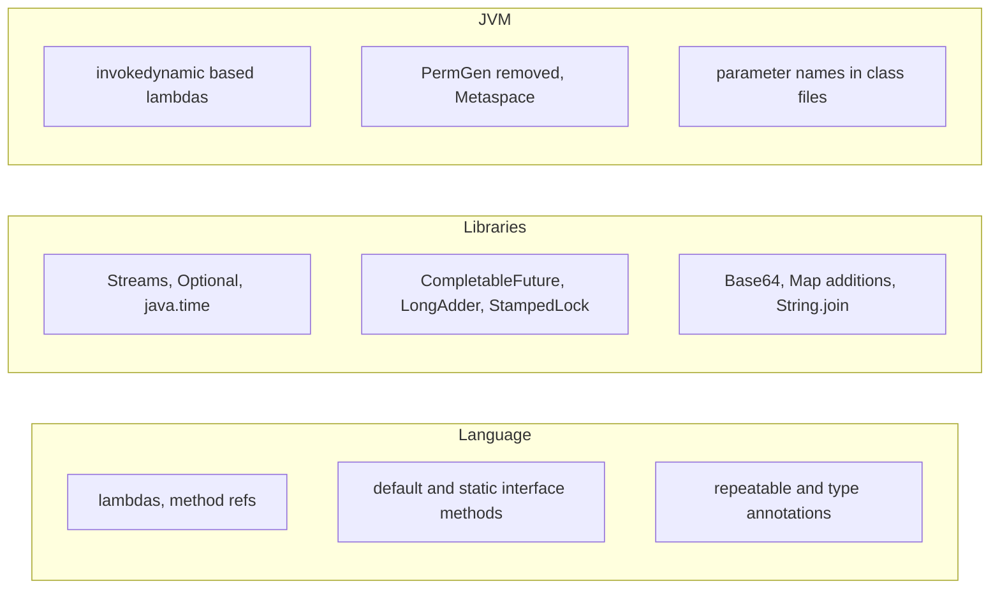
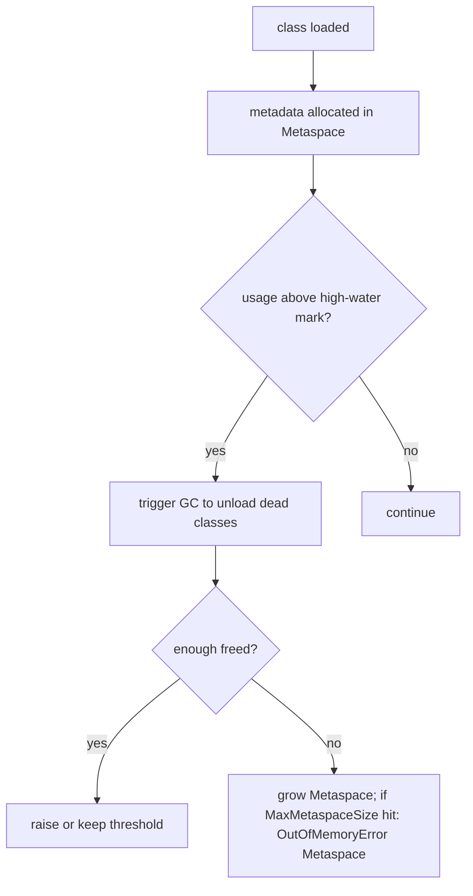
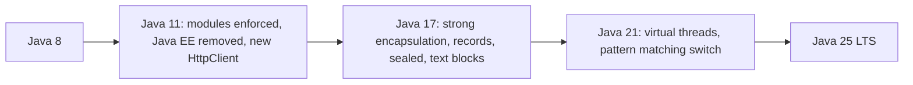

# 3.5 Java 8 JVM and Library Changes

> **Goal:** Know what Java 8 changed below the language (PermGen to Metaspace, `invokedynamic` for lambdas, parameter names) and the library additions you meet in older codebases, so you can reason about migrating beyond Java 8.

**Level:** Java 8 under the hood. Part 10 covers the JVM in depth; Part 13 covers GC.
**Verified on:** OpenJDK 21.0.12 (the behaviours shown are the modern descendants of the Java 8 features; the Java 8 runtime itself is not installed here, so statements about it are labelled).
Every output below was produced by running the code.

## Contents

1. [The big picture](#1-the-big-picture)
2. [PermGen replaced by Metaspace](#2-permgen-replaced-by-metaspace)
3. [Compiler and class-file changes](#3-compiler-and-class-file-changes)
4. [Library additions that are not lambdas](#4-library-additions-that-are-not-lambdas)
5. [Concurrency additions](#5-concurrency-additions)
6. [Collections internals changed in Java 8](#6-collections-internals-changed-in-java-8)
7. [Things removed or deprecated later](#7-things-removed-or-deprecated-later)
8. [Migrating from Java 8](#8-migrating-from-java-8)
9. [Common gotchas](#9-common-gotchas)
10. [Interview questions](#10-interview-questions)

---

## 1. The big picture



| Area | Java 8 change | Chapter |
|---|---|---|
| Language | lambdas, method references, default/static interface methods, repeatable and type annotations | 3.1, A.4, B.10 |
| Libraries | Streams (Part 4), Optional, `java.time`, `CompletableFuture`, `Base64` | 3.2 to 3.5 |
| JVM | `invokedynamic` lambdas, **Metaspace**, `-parameters`, G1 string deduplication (8u20) | this chapter |

## 2. PermGen replaced by Metaspace

**Intuition.** Class metadata (class structures, method bytecode, constant pools) used to live in a fixed-size region of the Java heap called PermGen. Its size had to be guessed in advance with `-XX:MaxPermSize`, and getting it wrong gave the infamous `OutOfMemoryError: PermGen space`, especially in app servers that reload applications. Java 8 (JEP 122) removed PermGen and moved class metadata to **Metaspace** in native memory, which grows on demand.

| | PermGen (Java 7 and earlier) | Metaspace (Java 8+) |
|---|---|---|
| Location | Java heap region | native (off-heap) memory |
| Default limit | fixed (e.g. 64 to 82 MB) | unlimited (bounded by the OS) |
| Sizing flag | `-XX:PermSize`, `-XX:MaxPermSize` | `-XX:MetaspaceSize`, `-XX:MaxMetaspaceSize` |
| Collected by | full GC | class unloading when loaders die; metaspace thresholds trigger GC |
| Error | `OutOfMemoryError: PermGen space` | `OutOfMemoryError: Metaspace` (only if you set a max or the OS runs out) |
| Interned strings | in PermGen (before 7) | moved to the heap in Java 7 |

The old flags are gone. On the Java 21 used here:

```text
$ java -XX:MaxPermSize=64m -version 2>&1 | head -2
Unrecognized VM option 'MaxPermSize=64m'
Error: Could not create the Java Virtual Machine.
```

(Java 8 itself printed a warning that the option was ignored; later releases reject it outright. Remove these flags when migrating.) The modern flags and their defaults:

```text
$ java -XX:+PrintFlagsFinal -version 2>/dev/null | grep -E "MetaspaceSize|CompressedClassSpaceSize" | awk '{print $2, $3, $4}'
CompressedClassSpaceSize = 1073741824
MaxMetaspaceSize = 18446744073709551615
MetaspaceSize = 22020096
```

`MaxMetaspaceSize` is the maximum `size_t` value, which means "no limit". `MetaspaceSize` is the **initial high-water mark** that triggers the first metaspace-driven GC, not a reservation. In production set `-XX:MaxMetaspaceSize` to catch class-loader leaks early (a leak then fails fast instead of slowly eating native memory).



Compressed class space (`CompressedClassSpaceSize`, 1 GB reserved by default) holds the compressed class pointers part of the metadata when compressed class pointers are on.

## 3. Compiler and class-file changes

### Lambdas use `invokedynamic`

Covered in 3.1: no class file per lambda, a hidden class generated on first use.

### Method parameter names (JEP 118)

By default `javac` throws parameter names away, so reflection sees `arg0, arg1`. Since Java 8 you can keep them with `javac -parameters`, which frameworks (Spring, Jackson parameter-names module) use to bind request parameters or constructor arguments by name.

```text
$ javac -Xlint:-options -d out/pn1 d/ParamNames.java && java -cp out/pn1 ParamNames
[arg0(synthetic name), arg1(synthetic name), arg2(synthetic name)]
```

```text
$ javac -parameters -Xlint:-options -d out/pn2 d/ParamNames.java && java -cp out/pn2 ParamNames
[fromAccount, toAccount, cents]
```

Records (Java 16) always keep their component names, one reason they work well with serialization frameworks.

### Targeting an older release

`javac --release 8` compiles against the Java 8 API and class-file version 52 even when run on a newer JDK (unlike `-source/-target`, which still lets you call newer APIs by accident):

```text
$ rm -rf out/r8 && javac --release 8 -Xlint:-options -d out/r8 d/LambdaCompile.java && javap -v out/r8/LambdaCompile.class | grep "major version"
  major version: 52
```

```text
$ javap -v out/d1/LambdaCompile.class | grep "major version"
  major version: 65
```

Class-file major versions map to Java versions: 52 is Java 8, 55 is 11, 61 is 17, 65 is 21.

### Annotations

| Feature | Detail |
|---|---|
| Repeatable annotations (JEP 120) | `@Repeatable` containers, demonstrated in chapter B.10 |
| Type annotations (JEP 104) | annotations on any type use: `List<@NonNull String>`; used by checker frameworks |

## 4. Library additions that are not lambdas

```java
import java.nio.charset.StandardCharsets;
import java.util.*;
import java.util.concurrent.atomic.LongAdder;
import java.util.concurrent.locks.StampedLock;

public class Java8Library {
    static class Point {
        private double x, y;
        private final StampedLock lock = new StampedLock();
        void move(double dx, double dy) {
            long stamp = lock.writeLock();
            try { x += dx; y += dy; } finally { lock.unlockWrite(stamp); }
        }
        double distanceFromOrigin() {
            long stamp = lock.tryOptimisticRead();           // no lock taken, just a version stamp
            double cx = x, cy = y;
            if (!lock.validate(stamp)) {                      // a writer intervened: fall back to a real read lock
                stamp = lock.readLock();
                try { cx = x; cy = y; } finally { lock.unlockRead(stamp); }
            }
            return Math.hypot(cx, cy);
        }
    }

    public static void main(String[] args) throws Exception {
        // Base64 (java.util.Base64, new in 8)
        String enc = Base64.getEncoder().encodeToString("hello java 8".getBytes(StandardCharsets.UTF_8));
        System.out.println(enc + " -> " + new String(Base64.getDecoder().decode(enc), StandardCharsets.UTF_8));
        System.out.println("url-safe, no padding: " + Base64.getUrlEncoder().withoutPadding().encodeToString(new byte[]{(byte) 0xfb, (byte) 0xff}));

        // String.join, Arrays.parallelPrefix, Arrays.parallelSort
        System.out.println(String.join("-", "a", "b", "c") + " | " + String.join("/", List.of("x", "y")));
        int[] nums = {1, 2, 3, 4, 5};
        Arrays.parallelPrefix(nums, Integer::sum);
        System.out.println("running totals: " + Arrays.toString(nums));
        int[] unsorted = {5, 3, 9, 1};
        Arrays.parallelSort(unsorted);
        System.out.println("parallelSort: " + Arrays.toString(unsorted));

        // LongAdder: striped counter for high contention
        LongAdder adder = new LongAdder();
        Thread[] ts = new Thread[4];
        for (int i = 0; i < ts.length; i++) { ts[i] = new Thread(() -> { for (int n = 0; n < 10000; n++) adder.increment(); }); ts[i].start(); }
        for (Thread t : ts) t.join();
        System.out.println("LongAdder total: " + adder.sum());

        // StampedLock optimistic read
        Point p = new Point();
        p.move(3, 4);
        System.out.println("distance: " + p.distanceFromOrigin());

        // Integer helpers added in 8
        System.out.println("Integer.sum=" + Integer.sum(2, 3) + ", Integer.max=" + Integer.max(2, 3) + ", Long.hashCode(5L)=" + Long.hashCode(5L)
                + ", unsigned: " + Integer.toUnsignedString(-1) + ", divideUnsigned=" + Integer.divideUnsigned(-1, 2));
        try { Math.addExact(Integer.MAX_VALUE, 1); } catch (ArithmeticException e) { System.out.println("Math.addExact: " + e.getMessage()); }
        System.out.println("Math.floorMod(-7, 3)=" + Math.floorMod(-7, 3) + " vs -7 % 3 = " + (-7 % 3));
    }
}

// ---- Output ----
// aGVsbG8gamF2YSA4 -> hello java 8
// url-safe, no padding: -_8
// a-b-c | x/y
// running totals: [1, 3, 6, 10, 15]
// parallelSort: [1, 3, 5, 9]
// LongAdder total: 40000
// distance: 5.0
// Integer.sum=5, Integer.max=3, Long.hashCode(5L)=5, unsigned: 4294967295, divideUnsigned=2147483647
// Math.addExact: integer overflow
// Math.floorMod(-7, 3)=2 vs -7 % 3 = -1
```

| Addition | Purpose |
|---|---|
| `java.util.Base64` | standard, URL-safe and MIME encoders/decoders (replaces sun.misc and commons-codec) |
| `String.join` | join with a delimiter |
| `Arrays.parallelPrefix/parallelSort/parallelSetAll` | parallel array operations on the common pool |
| `Integer.sum/max/min`, `Long.hashCode`, unsigned helpers | method references for reductions, unsigned arithmetic |
| `Math.addExact/multiplyExact/toIntExact/floorMod` | overflow-detecting arithmetic and true modulo |
| `Files.lines`, `Files.list`, `Files.walk` | lazy stream-returning I/O (close them, Part 15) |
| `StringJoiner` | builder-style joining with prefix/suffix |

`Math.floorMod(-7, 3)` is 2 while `-7 % 3` is -1: the remainder operator keeps the sign of the dividend.

## 5. Concurrency additions

| Class | Why it exists |
|---|---|
| `CompletableFuture` | composable async tasks (3.3) |
| `LongAdder`, `DoubleAdder`, `LongAccumulator` | striped counters: under contention they beat `AtomicLong` because threads update separate cells and the total is summed on read |
| `StampedLock` | read/write lock with an **optimistic read** mode: read without locking, then validate that no write happened (demo above); not reentrant |
| `ConcurrentHashMap` rewrite | lock striping replaced by CAS plus per-bin synchronization; new bulk operations (`forEach`, `reduce`, `search`) and `newKeySet()` |
| `ForkJoinPool.commonPool()` | shared pool used by parallel streams and async stages |

Details and the memory-model reasoning are in Parts 11 and 12.

## 6. Collections internals changed in Java 8

- `HashMap` buckets with many collisions convert from linked lists to balanced trees (treeification, threshold 8) so worst-case lookup is O(log n) instead of O(n).
- The `HashMap` hash spreading function was simplified to `h ^ (h >>> 16)`.
- `Collections` and `ArrayList` got default-method APIs (3.2).

These are expanded with diagrams in Part 9.

## 7. Things removed or deprecated later

| Item | Fate |
|---|---|
| `Nashorn` JavaScript engine (new in 8) | deprecated in 11, **removed in 15** |
| JavaFX bundled with the JDK | removed from the JDK in 11 (separate OpenJFX) |
| `sun.misc.BASE64Encoder`, `sun.misc.Unsafe` use | internal; `Base64` replaces the former, `Unsafe` is being phased out |
| Java EE modules (`javax.xml.bind`, `javax.annotation`, CORBA...) | removed in 11 |
| Applets | Applet API deprecated for removal in 17; Web Start removed in 11 |
| `finalize()` | deprecated for removal in 18 |
| Security Manager | deprecated for removal in 17 |

## 8. Migrating from Java 8



Practical checklist:

1. Build with `--release 8` first on a newer JDK to find API/tool problems without changing semantics.
2. Remove obsolete JVM flags (`MaxPermSize`, `PrintGCDetails` style flags change to unified logging `-Xlog:gc*` in 9).
3. Add dependencies for removed Java EE modules (JAXB, `javax.annotation`).
4. Expect `InaccessibleObjectException`/illegal-access failures from libraries doing deep reflection; upgrade libraries (chapter A.2 demonstrated the error).
5. Check container awareness: JVMs before 8u191 ignored cgroup limits; newer ones size heap from the container limit.
6. Re-test GC behaviour: Java 8 defaulted to the Parallel collector, later versions default to G1 on server-class machines (Part 13).
7. Move to the next LTS (11, 17, 21) in steps; Parts 5 to 8 list the changes per LTS.

## 9. Common gotchas

| Gotcha | Why | Fix |
|---|---|---|
| `-XX:MaxPermSize` makes the JVM refuse to start | option removed | delete it |
| Metaspace "leak" on redeploys | class loaders retained by threads, drivers, caches | find GC roots (Part 10), set `MaxMetaspaceSize` |
| Parameter names show as `arg0` | `-parameters` not set | enable it in the build |
| `Arrays.parallelSort` slower for small arrays | overhead | measure; use for large data |
| `LongAdder.sum()` not atomic with updates | weakly consistent snapshot | use `AtomicLong` when you need exact atomic reads |
| `StampedLock` misused as reentrant | it is not | do not nest acquires |
| `Files.lines` leaves file open | stream must be closed | try-with-resources |
| Compile with new JDK but run on Java 8 | newer APIs / class version mismatch | `--release 8` |

## 10. Interview questions

<details>
<summary><strong>Q1. What replaced PermGen and why?</strong></summary>

Metaspace (JEP 122, Java 8). PermGen was a fixed-size heap region that was hard to size and caused `OutOfMemoryError: PermGen space`; Metaspace uses native memory and grows on demand, and class metadata is freed when class loaders become unreachable.
</details>

<details>
<summary><strong>Q2. What does <code>-XX:MaxMetaspaceSize</code> do and should you set it?</strong></summary>

It caps native memory used for class metadata; by default it is unlimited. Setting it makes class-loader leaks fail fast with <code>OutOfMemoryError: Metaspace</code> instead of consuming the machine.
</details>

<details>
<summary><strong>Q3. Where do interned strings live?</strong></summary>

In the Java heap since Java 7 (they were in PermGen before), so they can be garbage collected and sized with the heap.
</details>

<details>
<summary><strong>Q4. How are lambdas implemented at the JVM level?</strong></summary>

<code>invokedynamic</code> plus <code>LambdaMetafactory</code> generating a hidden class at run time; the body is a private synthetic method. See chapter 3.1.
</details>

<details>
<summary><strong>Q5. What does <code>javac -parameters</code> change?</strong></summary>

It stores formal parameter names in the class file so reflection (<code>Parameter.getName()</code>) returns real names instead of <code>arg0</code>. The demo shows both.
</details>

<details>
<summary><strong>Q6. <code>--release 8</code> versus <code>-source 8 -target 8</code>?</strong></summary>

<code>--release</code> also restricts the API to what Java 8 offered; <code>-source/-target</code> only set language and class-file levels, letting you accidentally call newer library methods.
</details>

<details>
<summary><strong>Q7. When is <code>LongAdder</code> better than <code>AtomicLong</code>?</strong></summary>

Under high contention with many writers: it spreads updates across cells and sums on read. For low contention or when you need the exact current value atomically, <code>AtomicLong</code> is simpler.
</details>

<details>
<summary><strong>Q8. What is an optimistic read in <code>StampedLock</code>?</strong></summary>

<code>tryOptimisticRead()</code> returns a stamp without locking; you read the data and call <code>validate(stamp)</code>; if a write occurred in between you retry with a real read lock. It improves read-heavy throughput.
</details>

<details>
<summary><strong>Q9. What changed in <code>HashMap</code> in Java 8?</strong></summary>

Treeification of long collision chains (lists become red-black trees at 8 entries when the table is big enough), a simpler hash spread, and the new default methods (<code>getOrDefault</code>, <code>merge</code>, <code>computeIfAbsent</code>).
</details>

<details>
<summary><strong>Q10. Why does <code>Math.floorMod(-7, 3)</code> differ from <code>-7 % 3</code>?</strong></summary>

<code>%</code> returns a result with the sign of the dividend (-1); <code>floorMod</code> follows the divisor and gives 2, which is what you want for circular indexes.
</details>

<details>
<summary><strong>Q11. Which Java 8 features were later removed from the JDK?</strong></summary>

Nashorn (removed in 15), JavaFX from the JDK (11), and the Java EE/CORBA modules (11). Check dependencies when you migrate.
</details>

<details>
<summary><strong>Q12. List the first things you would do to migrate a Java 8 service to a newer LTS.</strong></summary>

Compile with <code>--release 8</code> on the new JDK, drop obsolete flags, add missing Java EE dependencies, upgrade libraries that use deep reflection, move GC logging to <code>-Xlog</code>, review container memory settings and GC, then change the target level and use new features gradually.
</details>

---

[Previous: 3.4 The Date-Time API](./04-date-time-api.md) · [Part index](./README.md) · Next: [Part 4: Streams in Depth](../04-streams-in-depth/README.md)