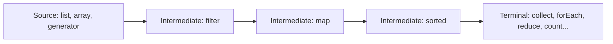
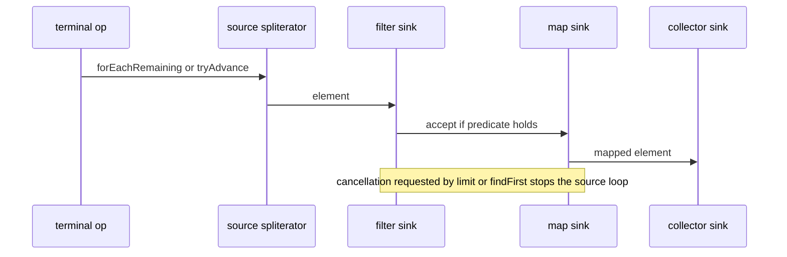

# 4.1 Stream Fundamentals and the Pipeline Model

> **Goal:** Understand what a stream really is (and is not), how a pipeline executes element by element, and the rules that make streams lazy, single-use and short-circuiting.

**Level:** the mental model every later chapter builds on. Spend time here.
**Verified on:** OpenJDK 21.0.12. Every output below was produced by running the code.

## Contents

1. [What a stream is](#1-what-a-stream-is)
2. [The three parts of a pipeline](#2-the-three-parts-of-a-pipeline)
3. [Laziness: nothing happens until the terminal operation](#3-laziness-nothing-happens-until-the-terminal-operation)
4. [Vertical processing: one element at a time](#4-vertical-processing-one-element-at-a-time)
5. [Stateless versus stateful operations](#5-stateless-versus-stateful-operations)
6. [Short-circuiting](#6-short-circuiting)
7. [Single use](#7-single-use)
8. [Source binding and non-interference](#8-source-binding-and-non-interference)
9. [Streams versus collections versus loops](#9-streams-versus-collections-versus-loops)
10. [How it works inside](#10-how-it-works-inside)
11. [Common gotchas](#11-common-gotchas)
12. [Interview questions](#12-interview-questions)

---

## 1. What a stream is

**Intuition.** A collection is a warehouse: things sit in it. A stream is a conveyor belt through a factory: items pass one by one through stations (filter, transform), and at the end something collects the output. The belt stores nothing and cannot be rewound.

Formally, a `java.util.stream.Stream<T>` is a **sequence of elements supporting aggregate operations**, with three properties:

| Property | Meaning |
|---|---|
| Not a data structure | it does not store elements; it pulls them from a source (collection, array, generator, I/O channel) |
| Functional in nature | operations produce results without modifying the source |
| Possibly unbounded | `Stream.iterate`/`generate` can be infinite; short-circuit operations make them useful |

## 2. The three parts of a pipeline



| Part | Examples | Returns |
|---|---|---|
| Source | `list.stream()`, `Stream.of`, `IntStream.range`, `Files.lines` | a `Stream` |
| Intermediate operations | `filter`, `map`, `flatMap`, `distinct`, `sorted`, `limit`, `skip`, `peek`, `takeWhile` | another `Stream` (lazy) |
| Terminal operation | `collect`, `forEach`, `reduce`, `count`, `findFirst`, `anyMatch`, `toList` | a result or side effect; starts execution |

A pipeline has exactly one source and one terminal operation.

## 3. Laziness: nothing happens until the terminal operation

```java
import java.util.*;
import java.util.stream.*;

public class S01Pipeline {
    public static void main(String[] args) {
        // 1. Nothing happens without a terminal operation (streams are LAZY)
        Stream<String> lazy = Stream.of("a", "bb", "ccc").peek(s -> System.out.println("  peek " + s));
        System.out.println("pipeline built, nothing printed yet");

        // 2. Elements flow ONE AT A TIME through the whole pipeline (vertical, not stage by stage)
        List<String> out = Stream.of("apple", "fig", "banana", "kiwi", "cherry")
                .filter(s -> { System.out.println("  filter " + s); return s.length() > 3; })
                .map(s -> { System.out.println("  map    " + s); return s.toUpperCase(); })
                .limit(2)                                                    // short-circuits: stops pulling after 2 results
                .collect(Collectors.toList());
        System.out.println("result " + out);

        // 3. A stateful operation (sorted) is a BARRIER: it must see everything first
        System.out.println("with sorted():");
        Stream.of("pear", "fig", "apple")
                .peek(s -> System.out.println("  before sorted " + s))
                .sorted()
                .peek(s -> System.out.println("  after  sorted " + s))
                .findFirst();

        // 4. A stream can be consumed once
        Stream<Integer> once = Stream.of(1, 2, 3);
        once.forEach(x -> { });
        try { once.forEach(x -> { }); } catch (IllegalStateException e) { System.out.println("reuse -> " + e.getMessage()); }
        java.util.function.Supplier<Stream<Integer>> fresh = () -> Stream.of(1, 2, 3);   // re-create from a supplier instead
        System.out.println("supplier gives a new stream each call: " + fresh.get().count() + " " + fresh.get().count());

        // 5. Source binding is LATE: the source is read when the terminal operation starts
        List<String> names = new ArrayList<>(List.of("a", "b"));
        Stream<String> s = names.stream();
        names.add("c");                                                      // before the terminal op: allowed, and visible
        System.out.println("late binding sees: " + s.toList());
        try {
            names.stream().forEach(n -> { if (n.equals("a")) names.add("d"); });   // during the terminal op: not allowed
        } catch (ConcurrentModificationException e) { System.out.println("modifying the source during traversal -> ConcurrentModificationException"); }

        // 6. Short-circuiting: how many elements were really examined?
        int[] seen = {0};
        boolean found = Stream.iterate(1, i -> i + 1).peek(i -> seen[0]++).anyMatch(i -> i * i > 50);
        System.out.println("anyMatch on an INFINITE stream -> " + found + " after examining " + seen[0] + " elements");

        // 7. close() and onClose for resource-backed streams
        try (Stream<String> res = Stream.of("x").onClose(() -> System.out.println("onClose handler ran"))) {
            res.forEach(x -> { });
        }
        System.out.println("isParallel by default: " + Stream.of(1).isParallel());
        lazy.close();
    }
}

// ---- Output ----
// pipeline built, nothing printed yet
//   filter apple
//   map    apple
//   filter fig
//   filter banana
//   map    banana
// result [APPLE, BANANA]
// with sorted():
//   before sorted pear
//   before sorted fig
//   before sorted apple
//   after  sorted apple
// reuse -> stream has already been operated upon or closed
// supplier gives a new stream each call: 3 3
// late binding sees: [a, b, c]
// modifying the source during traversal -> ConcurrentModificationException
// anyMatch on an INFINITE stream -> true after examining 8 elements
// onClose handler ran
// isParallel by default: false
```

The first printed line is `pipeline built, nothing printed yet`: building `Stream.of(...).peek(...)` executed nothing. Intermediate operations only **describe** the work. The terminal operation triggers it. Laziness enables optimisation: the framework knows the whole pipeline before it starts, so it can fuse stages, stop early, and skip work (for example `count()` on a sized source can skip the pipeline entirely, chapter 4.3).

## 4. Vertical processing: one element at a time

Look at the second block of output. The filter and map lines are interleaved per element: `filter apple`, `map apple`, `filter fig`, `filter banana`, `map banana`. Each element travels through **all stages before the next element starts** (vertical), rather than the whole list passing through `filter` and then the whole list through `map` (horizontal, like running a loop per stage).

```text
horizontal (NOT what streams do)      vertical (what streams do)
 filter: apple fig banana kiwi        apple -> filter -> map -> out
 map   : apple banana ...             fig   -> filter (rejected)
                                      banana-> filter -> map -> out
```

Why it matters: no intermediate collections are created, and `limit(2)` stops the whole pipeline after two results (kiwi and cherry were never looked at).

## 5. Stateless versus stateful operations

| | Stateless | Stateful |
|---|---|---|
| Needs other elements to process one? | no | yes |
| Examples | `filter`, `map`, `flatMap`, `peek`, `mapToInt` | `sorted`, `distinct`, `limit`, `skip` |
| Effect | element flows straight through | may buffer; `sorted` is a **barrier** |

The `sorted()` block of the output shows the barrier: all three `before sorted` lines print before the first `after sorted` line, because `sorted` must see every element before it can emit the smallest. Place stateful operations as late as possible, after filters have shrunk the data.

## 6. Short-circuiting

Some operations can finish without seeing all elements: `limit`, `findFirst`, `findAny`, `anyMatch`, `allMatch`, `noneMatch`, `takeWhile`. They make **infinite streams usable**: the demo runs `anyMatch` over `Stream.iterate(1, i -> i + 1)` and stops after 8 elements (the first square above 50 is 8x8). A pipeline with an infinite source and no short-circuiting operation never terminates.

## 7. Single use

A stream can be traversed only once. After the terminal operation it is closed, and reuse throws `IllegalStateException: stream has already been operated upon or closed` (demo). If you need to traverse twice, keep the **source** (the collection), or a `Supplier<Stream<T>>`, and create a new stream each time.

## 8. Source binding and non-interference

The source is read **when the terminal operation starts** (late binding for most collections): in the demo, adding `"c"` after creating the stream but before the terminal operation is visible. Modifying the source *during* the terminal operation breaks the **non-interference** rule and typically throws `ConcurrentModificationException`.

Behavioural parameters (your lambdas) must be:

| Rule | Why |
|---|---|
| Non-interfering | do not modify the stream's source while it is being traversed |
| Preferably stateless | results must not depend on mutable state that can change during execution, especially if parallel (chapter 4.8) |
| Free of required side effects | `peek` and `forEach` side effects are not guaranteed to run when the framework can skip the work |

## 9. Streams versus collections versus loops

| | Collection | Stream | Loop |
|---|---|---|---|
| Stores data | yes | no | n/a |
| Reusable | yes | no, single use | yes |
| Infinite | no | yes | yes |
| Evaluation | eager | lazy | explicit |
| Parallelism | manual | `parallel()` | manual |
| Best for | holding data | declarative transformations and aggregations | early exit with complex state, index logic, checked exceptions |

Streams are not always better. Chapter 4.9 shows when a plain loop is clearer.

## 10. How it works inside

Each intermediate operation wraps the previous stage in a linked structure; the pipeline is a chain of "sinks". When the terminal operation runs, the framework builds one combined function and pushes each element through the chain.



The source is an `Iterator`-like object called a **Spliterator** (chapter 4.8); the sink chain is why stages cost almost nothing per element and why no intermediate lists exist.

## 11. Common gotchas

| Gotcha | Why | Fix |
|---|---|---|
| "Nothing happens" | no terminal operation | end with `collect`/`forEach`/`toList` |
| `IllegalStateException` on reuse | single use | create a new stream |
| Infinite loop on `Stream.iterate` | no short-circuit | `limit`, `takeWhile`, `anyMatch` |
| `ConcurrentModificationException` | source modified during traversal | collect first, then modify |
| `peek` output missing | pipeline skipped (e.g. `count()` on a sized source) | do not rely on `peek` for logic |
| `sorted()` placed first on huge data | barrier over everything | filter first |
| Closing resource streams | `Files.lines` holds a file handle | try-with-resources |

## 12. Interview questions

<details>
<summary><strong>Q1. What is a stream and how does it differ from a collection?</strong></summary>

A stream is a lazy, single-use pipeline over a source, with no storage of its own; a collection is an in-memory data structure that can be traversed many times. Streams describe computation, collections hold data.
</details>

<details>
<summary><strong>Q2. What are the parts of a stream pipeline?</strong></summary>

One source, zero or more lazy intermediate operations, and one terminal operation that triggers execution.
</details>

<details>
<summary><strong>Q3. What does "lazy" mean for streams? Show it.</strong></summary>

Intermediate operations do nothing until a terminal operation runs. The demo builds a pipeline with <code>peek</code> and prints nothing; elements are only pulled when the terminal operation starts.
</details>

<details>
<summary><strong>Q4. In what order are elements processed through filter and map?</strong></summary>

Vertically: each element passes through all stages before the next element starts, so the output interleaves <code>filter</code> and <code>map</code> calls, and a <code>limit</code> can stop everything early.
</details>

<details>
<summary><strong>Q5. Which operations are stateful and why does it matter?</strong></summary>

<code>sorted</code>, <code>distinct</code>, <code>limit</code>, <code>skip</code>. <code>sorted</code> must buffer all elements (a barrier), which costs memory, prevents laziness and, in parallel, can limit speedup.
</details>

<details>
<summary><strong>Q6. Can you reuse a stream?</strong></summary>

No: <code>IllegalStateException: stream has already been operated upon or closed</code>. Re-create it from the source or from a <code>Supplier</code>.
</details>

<details>
<summary><strong>Q7. How can an infinite stream be processed safely?</strong></summary>

With short-circuiting operations (<code>limit</code>, <code>takeWhile</code>, <code>findFirst</code>, <code>anyMatch</code>), which stop pulling elements once the answer is known.
</details>

<details>
<summary><strong>Q8. What is non-interference?</strong></summary>

Behavioural parameters must not modify the stream source during execution. Violating it throws <code>ConcurrentModificationException</code> or gives undefined results.
</details>

<details>
<summary><strong>Q9. When is the source of a stream read?</strong></summary>

At the start of the terminal operation (late binding) for well-behaved sources; elements added after creating the stream but before the terminal operation are seen.
</details>

<details>
<summary><strong>Q10. Why are streams efficient even though each stage is a separate object?</strong></summary>

They fuse into a sink chain; elements are pushed through without intermediate collections, and the JIT can inline the small lambdas.
</details>

<details>
<summary><strong>Q11. Do streams always beat loops?</strong></summary>

No. Streams excel at declarative transformations; loops win for early exit with complex state, indexed logic, checked exceptions and tight hot paths on primitives.
</details>

<details>
<summary><strong>Q12. Why do you need to close some streams?</strong></summary>

Streams backed by I/O (<code>Files.lines</code>, <code>Files.walk</code>) hold resources and implement <code>AutoCloseable</code>; use try-with-resources, and register cleanup with <code>onClose</code>.
</details>

---

[Previous: 3.5 Java 8 JVM and Library Changes](../03-lts-java-8/05-java8-jvm-changes.md) · [Part index](./README.md) · Next: [4.2 Creating Streams and Primitive Streams](./02-creating-streams-and-primitive-streams.md)