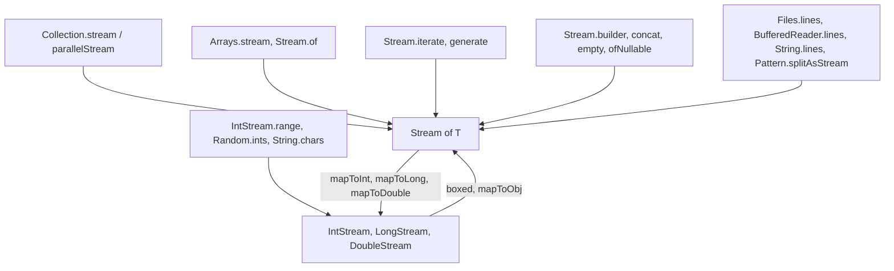

# 4.2 Creating Streams and Primitive Streams

> **Goal:** Know every common way to create a stream, and use `IntStream`, `LongStream` and `DoubleStream` to avoid boxing and to get numeric helpers for free.

**Level:** foundation; short and practical.
**Verified on:** OpenJDK 21.0.12. Every output below was produced by running the code.

## Contents

1. [The creation map](#1-the-creation-map)
2. [All the sources in one program](#2-all-the-sources-in-one-program)
3. [Infinite streams and how to bound them](#3-infinite-streams-and-how-to-bound-them)
4. [Primitive streams](#4-primitive-streams)
5. [Converting between stream kinds](#5-converting-between-stream-kinds)
6. [Pitfalls with arrays and characters](#6-pitfalls-with-arrays-and-characters)
7. [Common gotchas](#7-common-gotchas)
8. [Interview questions](#8-interview-questions)

---

## 1. The creation map



| Source | Version | Notes |
|---|---|---|
| `Collection.stream()` | 8 | late-binding to the collection |
| `Arrays.stream(arr[, from, to])` | 8 | object and primitive arrays |
| `Stream.of(a, b, c)` / `Stream.of(array)` | 8 | varargs |
| `Stream.iterate(seed, f)` | 8 | infinite |
| `Stream.iterate(seed, hasNext, next)` | 9 | finite, like a `for` loop |
| `Stream.generate(supplier)` | 8 | infinite, unordered feel |
| `Stream.ofNullable(x)` | 9 | 0 or 1 element |
| `Stream.builder()`, `Stream.concat`, `Stream.empty` | 8 | |
| `String.chars()`, `codePoints()` | 8 | `IntStream` |
| `String.lines()` | 11 | splits on `\n`, `\r`, `\r\n` |
| `Pattern.splitAsStream` | 8 | regex split without an array |
| `Files.lines/list/walk/find` | 8 | close them |
| `Random.ints/doubles` | 8 | seeded `Random` gives reproducible streams |

## 2. All the sources in one program

```java
import java.util.*;
import java.util.regex.Pattern;
import java.util.stream.*;

public class S02Creating {
    public static void main(String[] args) {
        // From values, arrays and collections
        System.out.println("Stream.of            : " + Stream.of("a", "b", "c").toList());
        System.out.println("Arrays.stream (range): " + Arrays.stream(new int[]{10, 20, 30, 40}, 1, 3).boxed().toList());
        System.out.println("collection.stream    : " + List.of(3, 1, 2).stream().sorted().toList());
        Map<String, Integer> m = new TreeMap<>(Map.of("x", 1, "y", 2));
        System.out.println("map entries          : " + m.entrySet().stream().map(e -> e.getKey() + "=" + e.getValue()).toList());
        System.out.println("empty / ofNullable   : " + Stream.empty().count() + " / " + Stream.ofNullable(null).count() + " / " + Stream.ofNullable("v").count());

        // Infinite sources MUST be bounded
        System.out.println("iterate (seed, f)    : " + Stream.iterate(1, x -> x * 2).limit(8).toList());
        System.out.println("iterate (3 args, 9+) : " + Stream.iterate(1, x -> x < 100, x -> x * 3).toList());
        int[] counter = {0};
        System.out.println("generate             : " + Stream.generate(() -> counter[0]++).limit(5).toList());
        System.out.println("fibonacci            : " + Stream.iterate(new long[]{0, 1}, f -> new long[]{f[1], f[0] + f[1]}).limit(10).map(f -> f[0]).toList());

        // Builder and concat
        Stream.Builder<String> b = Stream.builder();
        b.add("one").add("two");
        System.out.println("builder + concat     : " + Stream.concat(b.build(), Stream.of("three")).toList());

        // Text sources
        System.out.println("String.chars         : " + "hello".chars().mapToObj(c -> String.valueOf((char) c)).collect(Collectors.joining("|")));
        System.out.println("String.lines (11+)   : " + "l1\nl2\r\nl3".lines().toList());
        System.out.println("Pattern.splitAsStream: " + Pattern.compile(",\\s*").splitAsStream("a, b,c").toList());
        System.out.println("code points          : " + "a😀b".codePoints().count() + " code points, " + "a😀b".chars().count() + " chars");

        // Primitive streams
        System.out.println("range / rangeClosed  : " + IntStream.range(0, 5).boxed().toList() + " " + IntStream.rangeClosed(1, 5).sum());
        IntSummaryStatistics st = IntStream.of(4, 8, 15, 16, 23, 42).summaryStatistics();
        System.out.println("summaryStatistics    : " + st);
        System.out.println("average (OptionalDbl): " + IntStream.of(1, 2, 4).average() + " / empty: " + IntStream.empty().average());
        System.out.println("mapToObj / boxed     : " + IntStream.range(1, 4).mapToObj(i -> "#" + i).toList());
        System.out.println("asLongStream sum     : " + IntStream.of(Integer.MAX_VALUE, Integer.MAX_VALUE).asLongStream().sum() + " vs int overflow " + IntStream.of(Integer.MAX_VALUE, Integer.MAX_VALUE).sum());
        System.out.println("DoubleStream         : " + DoubleStream.of(1.5, 2.5).map(Math::ceil).sum());
        System.out.println("seeded random        : " + new Random(42).ints(5, 0, 100).boxed().toList());
        System.out.println("mapToInt + max       : " + Stream.of("aa", "b", "cccc").mapToInt(String::length).max().getAsInt());
        System.out.println("BitSet stream        : " + BitSet.valueOf(new long[]{0b101101}).stream().boxed().toList());

        // Streams of arrays (object arrays and 2D)
        String[][] grid = {{"a", "b"}, {"c"}, {}};
        System.out.println("flatten 2D array     : " + Arrays.stream(grid).flatMap(Arrays::stream).toList());
        System.out.println("Stream<int[]> trap   : " + Stream.of(new int[]{1, 2}, new int[]{3}).count() + " arrays (Stream.of(int[]) is ONE element per array)");
    }
}

// ---- Output ----
// Stream.of            : [a, b, c]
// Arrays.stream (range): [20, 30]
// collection.stream    : [1, 2, 3]
// map entries          : [x=1, y=2]
// empty / ofNullable   : 0 / 0 / 1
// iterate (seed, f)    : [1, 2, 4, 8, 16, 32, 64, 128]
// iterate (3 args, 9+) : [1, 3, 9, 27, 81]
// generate             : [0, 1, 2, 3, 4]
// fibonacci            : [0, 1, 1, 2, 3, 5, 8, 13, 21, 34]
// builder + concat     : [one, two, three]
// String.chars         : h|e|l|l|o
// String.lines (11+)   : [l1, l2, l3]
// Pattern.splitAsStream: [a, b, c]
// code points          : 3 code points, 4 chars
// range / rangeClosed  : [0, 1, 2, 3, 4] 15
// summaryStatistics    : IntSummaryStatistics{count=6, sum=108, min=4, average=18.000000, max=42}
// average (OptionalDbl): OptionalDouble[2.3333333333333335] / empty: OptionalDouble.empty
// mapToObj / boxed     : [#1, #2, #3]
// asLongStream sum     : 4294967294 vs int overflow -2
// DoubleStream         : 5.0
// seeded random        : [30, 63, 48, 84, 70]
// mapToInt + max       : 4
// BitSet stream        : [0, 2, 3, 5]
// flatten 2D array     : [a, b, c]
// Stream<int[]> trap   : 2 arrays (Stream.of(int[]) is ONE element per array)
```

Notes on selected lines:

- `Arrays.stream(array, 1, 3)` uses a half-open range: it yielded `[20, 30]`.
- `Stream.ofNullable(null).count()` is 0: use it to avoid `if (x != null)` before `flatMap`.
- `"a😀b".codePoints().count()` is 3 but `chars().count()` is 4: the emoji is two UTF-16 `char`s. Use `codePoints()` for real characters (chapter 1.3).
- Seeded `Random(42).ints(...)` is reproducible given the same JDK generation.

## 3. Infinite streams and how to bound them

| Need | Use |
|---|---|
| First N | `limit(n)` |
| While a condition holds | `takeWhile(p)` or the 3-argument `iterate` |
| First match | `filter(p).findFirst()` or `anyMatch(p)` |
| Stateful sequences (Fibonacci) | `iterate` with a small state holder (`long[]`, record) |

The Fibonacci line in the demo uses an `iterate` over `long[]{a, b}` pairs and maps to the first component. `Stream.generate(() -> counter[0]++)` mutates external state: acceptable in a demo, discouraged in production and unsafe in parallel (chapter 4.8).

## 4. Primitive streams

**Why they exist.** `Stream<Integer>` stores boxed `Integer` objects: memory per element, pointer chasing, unboxing in every operation. `IntStream` works on raw `int`s.

| Stream | Elements | Extras |
|---|---|---|
| `IntStream` | `int` | `range`, `rangeClosed`, `sum`, `average`, `max`, `summaryStatistics`, `asLongStream` |
| `LongStream` | `long` | same, for big sums |
| `DoubleStream` | `double` | `sum` uses compensated summation |

Things to remember from the demo:

- `average()` returns `OptionalDouble` because an empty stream has no average (`OptionalDouble.empty`).
- `sum()` of `int`s **overflows silently**: two `Integer.MAX_VALUE`s gave `-2`, while `asLongStream().sum()` gave `4294967294`.
- `summaryStatistics()` computes count, sum, min, max and average in **one pass**.
- `range(a, b)` excludes `b`; `rangeClosed(a, b)` includes it.

## 5. Converting between stream kinds

| From | To | Method |
|---|---|---|
| `Stream<T>` | `IntStream` | `mapToInt(ToIntFunction)` |
| `IntStream` | `Stream<Integer>` | `boxed()` |
| `IntStream` | `Stream<R>` | `mapToObj(IntFunction)` |
| `IntStream` | `LongStream`/`DoubleStream` | `asLongStream()`, `asDoubleStream()` |
| `Stream<T>` | array | `toArray(T[]::new)` |
| `IntStream` | `int[]` | `toArray()` |

Rule of thumb: stay primitive while doing arithmetic; box only at the end (`boxed().toList()`).

## 6. Pitfalls with arrays and characters

- `Stream.of(intArray)` gives a `Stream<int[]>` with **one** element, not an `IntStream`; use `Arrays.stream(intArray)` or `IntStream.of(...)`. The demo prints `2 arrays` for two `int[]` arguments.
- `"text".chars()` yields `int` code units; cast with `(char)` or use `mapToObj(c -> (char) c)`.
- A 2D array flattens with `Arrays.stream(grid).flatMap(Arrays::stream)`.

## 7. Common gotchas

| Gotcha | Why | Fix |
|---|---|---|
| `Stream.of(int[])` is one element | varargs picks the array as a single object | `Arrays.stream` / `IntStream.of` |
| Unbounded `iterate`/`generate` hangs | no limit | `limit`, `takeWhile`, or 3-arg `iterate` |
| `IntStream.sum()` overflow | silent `int` arithmetic | `asLongStream()` or `mapToLong` |
| `chars()` splits emoji | UTF-16 surrogate pairs | `codePoints()` |
| `Files.lines` not closed | file handle leak | try-with-resources |
| `Random.ints` results differ across Java generations | generator algorithms changed | do not hard-code expected values across JDKs |
| `Arrays.asList(int[])` | one-element `List<int[]>` | `Arrays.stream(arr).boxed().toList()` |

## 8. Interview questions

<details>
<summary><strong>Q1. Name five ways to create a stream.</strong></summary>

<code>collection.stream()</code>, <code>Arrays.stream</code>, <code>Stream.of</code>, <code>Stream.iterate/generate</code>, <code>IntStream.range</code>, <code>Files.lines</code>, <code>String.chars</code>, <code>Stream.builder</code>.
</details>

<details>
<summary><strong>Q2. Why have <code>IntStream</code> when <code>Stream&lt;Integer&gt;</code> exists?</strong></summary>

Avoids boxing and unboxing (memory and CPU) and adds numeric terminal operations (<code>sum</code>, <code>average</code>, <code>summaryStatistics</code>).
</details>

<details>
<summary><strong>Q3. <code>range</code> versus <code>rangeClosed</code>?</strong></summary>

<code>range(a, b)</code> excludes <code>b</code>; <code>rangeClosed(a, b)</code> includes it.
</details>

<details>
<summary><strong>Q4. What does the three-argument <code>Stream.iterate</code> give you?</strong></summary>

A finite stream like a <code>for</code> loop (seed, hasNext, next), added in Java 9: <code>iterate(1, x -&gt; x &lt; 100, x -&gt; x * 3)</code>.
</details>

<details>
<summary><strong>Q5. What does <code>IntStream.of(MAX_VALUE, MAX_VALUE).sum()</code> return?</strong></summary>

<code>-2</code> (int overflow). Use <code>asLongStream().sum()</code> or <code>mapToLong</code>.
</details>

<details>
<summary><strong>Q6. Why does <code>Stream.of(new int[]{1,2})</code> not stream the ints?</strong></summary>

<code>int[]</code> is an object, so varargs treats it as a single element of type <code>int[]</code>. Use <code>Arrays.stream(array)</code>.
</details>

<details>
<summary><strong>Q7. How do you stream the characters of a string correctly, including emoji?</strong></summary>

<code>codePoints()</code>; <code>chars()</code> yields UTF-16 code units, so supplementary characters become two values.
</details>

<details>
<summary><strong>Q8. How do you compute min, max, sum, average in a single pass?</strong></summary>

<code>summaryStatistics()</code> on a primitive stream, or <code>Collectors.summarizingInt</code>/<code>teeing</code> on an object stream.
</details>

<details>
<summary><strong>Q9. What does <code>Stream.ofNullable</code> solve?</strong></summary>

A stream of 0 or 1 elements; handy in <code>flatMap</code> to drop <code>null</code>s without a conditional.
</details>

<details>
<summary><strong>Q10. How do you create a stream of Fibonacci numbers?</strong></summary>

<code>Stream.iterate(new long[]{0,1}, f -&gt; new long[]{f[1], f[0]+f[1]}).limit(n).map(f -&gt; f[0])</code>.
</details>

---

[Previous: 4.1 Stream Fundamentals and the Pipeline Model](./01-stream-fundamentals-and-pipeline-model.md) · [Part index](./README.md) · Next: [4.3 Intermediate Operations in Depth](./03-intermediate-operations-deep.md)