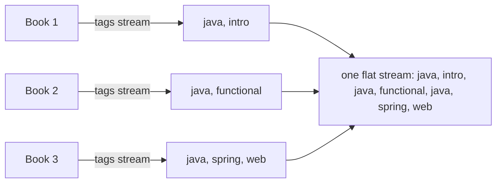
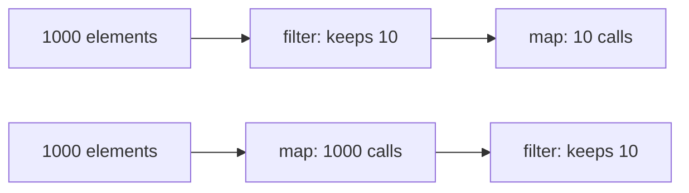

# 4.3 Intermediate Operations in Depth

> **Goal:** Master `filter`, `map`, `flatMap`, `mapMulti`, `distinct`, `sorted`, `limit`, `skip`, `takeWhile`, `dropWhile` and `peek`, including ordering rules, cost and the traps.

**Level:** core. `flatMap` is the operation interviews and real pipelines depend on most.
**Verified on:** OpenJDK 21.0.12. Every output below was produced by running the code.

## Contents

1. [Operation overview](#1-operation-overview)
2. [`filter` and `map`](#2-filter-and-map)
3. [`flatMap`: one-to-many and flattening](#3-flatmap-one-to-many-and-flattening)
4. [`mapMulti` (Java 16)](#4-mapmulti-java-16)
5. [`distinct` and `sorted`](#5-distinct-and-sorted)
6. [`limit`, `skip`, `takeWhile`, `dropWhile`](#6-limit-skip-takewhile-dropwhile)
7. [`peek` and the `count()` shortcut](#7-peek-and-the-count-shortcut)
8. [Order of operations is performance](#8-order-of-operations-is-performance)
9. [Cheat sheet](#9-cheat-sheet)
10. [Common gotchas](#10-common-gotchas)
11. [Interview questions](#11-interview-questions)

---

## 1. Operation overview

| Operation | Input to output | Stateful? | Short-circuit? | Since |
|---|---|---|---|---|
| `filter(p)` | keep matching elements | no | no | 8 |
| `map(f)` | one to one | no | no | 8 |
| `flatMap(f)` | one to zero-or-many (flatten) | no | no | 8 |
| `mapMulti(bi)` | one to zero-or-many, imperative | no | no | 16 |
| `distinct()` | remove duplicates (`equals`) | yes | no | 8 |
| `sorted([cmp])` | reorder | yes (barrier) | no | 8 |
| `limit(n)` | first n | yes | yes | 8 |
| `skip(n)` | drop first n | yes | no | 8 |
| `takeWhile(p)` | prefix while true | yes | yes | 9 |
| `dropWhile(p)` | drop prefix while true | yes | no | 9 |
| `peek(c)` | observe | no | no | 8 |
| `boxed`, `mapToObj`, `mapToInt`... | change stream kind | no | no | 8 |

## 2. `filter` and `map`

`filter` takes a `Predicate<T>`; `map` takes a `Function<T,R>`. Both are stateless and keep encounter order. Chain several `filter`s or `&&` them: the cost is nearly identical.

## 3. `flatMap`: one-to-many and flattening

**Intuition.** `map` is a 1:1 photocopier. `flatMap` is a photocopier that makes **a stack of copies for each page, then shuffles all stacks into one pile**. Each element is turned into a *stream*, and the streams are concatenated.



```java
import java.util.*;
import java.util.function.*;
import java.util.stream.*;

public class S03Intermediate {
    record Book(String title, String author, int year, List<String> tags) { }

    public static void main(String[] args) {
        List<Book> books = List.of(
                new Book("Java Basics", "Asha", 2015, List.of("java", "intro")),
                new Book("Streams", "Ravi", 2018, List.of("java", "functional")),
                new Book("Spring", "Asha", 2020, List.of("java", "spring", "web")),
                new Book("Kafka", "Meera", 2019, List.of("messaging")),
                new Book("Kotlin", "Ravi", 2020, List.of()));

        // filter / map
        System.out.println("filter+map   : " + books.stream().filter(b -> b.year() >= 2019).map(Book::title).toList());

        // map vs flatMap: one-to-many
        System.out.println("map          : " + books.stream().map(Book::tags).limit(2).toList());
        System.out.println("flatMap      : " + books.stream().flatMap(b -> b.tags().stream()).distinct().sorted().toList());
        System.out.println("flatMap pairs: " + Stream.of(1, 2, 3).flatMap(a -> Stream.of("x", "y").map(c -> a + c)).toList());

        // flatMap with Optional (drop empties) and with an empty stream
        System.out.println("flatMap opt  : " + Stream.of("1", "x", "3").map(s -> { try { return Optional.of(Integer.parseInt(s)); } catch (NumberFormatException e) { return Optional.<Integer>empty(); } }).flatMap(Optional::stream).toList());

        // mapMulti (16): imperative alternative to flatMap, avoids creating a Stream per element
        System.out.println("mapMulti     : " + Stream.of(1, 2, 3, 4).<String>mapMulti((n, sink) -> { if (n % 2 == 0) { sink.accept("even" + n); sink.accept("even" + n + "!"); } }).toList());

        // distinct uses equals/hashCode; for records that is by value
        System.out.println("distinct     : " + Stream.of(new Book("A", "x", 1, List.of()), new Book("A", "x", 1, List.of())).distinct().count());

        // sorted: natural, comparator, stability
        System.out.println("sorted       : " + books.stream().sorted(Comparator.comparing(Book::year).thenComparing(Book::title, Comparator.reverseOrder())).map(b -> b.year() + ":" + b.title()).toList());
        List<String> stable = Stream.of("bb", "a", "cc", "d").sorted(Comparator.comparingInt(String::length)).toList();
        System.out.println("stable sort  : " + stable + " (ties keep encounter order)");
        try { Stream.of(new Object(), new Object()).sorted().toList(); } catch (ClassCastException e) { System.out.println("sorted() on non-Comparable -> ClassCastException"); }

        // limit / skip / takeWhile / dropWhile
        System.out.println("skip+limit   : " + IntStream.rangeClosed(1, 10).skip(3).limit(4).boxed().toList());
        System.out.println("takeWhile    : " + Stream.of(1, 2, 3, 10, 1, 2).takeWhile(x -> x < 5).toList());
        System.out.println("dropWhile    : " + Stream.of(1, 2, 3, 10, 1, 2).dropWhile(x -> x < 5).toList());
        System.out.println("filter != takeWhile: " + Stream.of(1, 2, 3, 10, 1, 2).filter(x -> x < 5).toList());

        // peek is for debugging, and count() can skip the pipeline entirely (9+)
        List<String> trace = new ArrayList<>();
        long n = List.of(1, 2, 3).stream().peek(x -> trace.add("saw " + x)).map(x -> x * 2).count();
        System.out.println("count()      : " + n + ", peek ran " + trace.size() + " times (size known, pipeline skipped)");
        trace.clear();
        long n2 = List.of(1, 2, 3).stream().peek(x -> trace.add("saw " + x)).filter(x -> x > 0).count();
        System.out.println("with filter  : " + n2 + ", peek ran " + trace.size() + " times");

        // boxed / mapToObj conversions between primitive and object streams
        System.out.println("conversions  : " + books.stream().mapToInt(Book::year).filter(y -> y > 2018).boxed().map(String::valueOf).collect(Collectors.joining(",")));

        // order of operations changes the amount of work
        int[] work = {0};
        Stream.of("a", "bb", "ccc", "dddd").map(s -> { work[0]++; return s.toUpperCase(); }).filter(s -> s.length() > 2).toList();
        int map1 = work[0]; work[0] = 0;
        Stream.of("a", "bb", "ccc", "dddd").filter(s -> s.length() > 2).map(s -> { work[0]++; return s.toUpperCase(); }).toList();
        System.out.println("map-then-filter did " + map1 + " mappings; filter-then-map did " + work[0]);
    }
}

// ---- Output ----
// filter+map   : [Spring, Kafka, Kotlin]
// map          : [[java, intro], [java, functional]]
// flatMap      : [functional, intro, java, messaging, spring, web]
// flatMap pairs: [1x, 1y, 2x, 2y, 3x, 3y]
// flatMap opt  : [1, 3]
// mapMulti     : [even2, even2!, even4, even4!]
// distinct     : 1
// sorted       : [2015:Java Basics, 2018:Streams, 2019:Kafka, 2020:Spring, 2020:Kotlin]
// stable sort  : [a, d, bb, cc] (ties keep encounter order)
// sorted() on non-Comparable -> ClassCastException
// skip+limit   : [4, 5, 6, 7]
// takeWhile    : [1, 2, 3]
// dropWhile    : [10, 1, 2]
// filter != takeWhile: [1, 2, 3, 1, 2]
// count()      : 3, peek ran 0 times (size known, pipeline skipped)
// with filter  : 3, peek ran 3 times
// conversions  : 2020,2019,2020
// map-then-filter did 4 mappings; filter-then-map did 2
```

Read the first lines of output:

- `map` over `Book::tags` gives a stream of **lists** (`[[java, intro], [java, functional]]`); `flatMap(b -> b.tags().stream())` gives a flat stream of tags.
- `flatMap` builds pairs (a cartesian product) by returning an inner stream per element.
- `flatMap(Optional::stream)` (Java 9) drops empty `Optional`s: parse-or-skip in one line.
- An element mapped to an **empty stream** vanishes (the book with no tags contributes nothing).

Rules: the function must return a `Stream` (not a `List`, not an `Optional` before Java 9); each inner stream is closed after its contents are consumed; before Java 10 `flatMap` was not fully lazy for short-circuiting, but it is now.

## 4. `mapMulti` (Java 16)

`mapMulti((element, sink) -> ...)` lets you emit zero or more results by calling `sink.accept(...)`, without creating a small `Stream` per element. Use it when the expansion is small or conditional; use `flatMap` when you already have a stream or collection. The demo emits two strings for each even number. Note the explicit type witness `<String>mapMulti(...)`: the compiler cannot infer the output type from the lambda.

## 5. `distinct` and `sorted`

- `distinct()` uses `equals`/`hashCode`, keeps the **first** occurrence and, on ordered streams, preserves encounter order. It buffers the elements it has seen. Records dedupe by value (demo prints `1`). **Arrays do not** (identity equals).
- `sorted()` needs `Comparable` elements, otherwise `ClassCastException` (demo). `sorted(cmp)` takes a `Comparator`. The sort is **stable** for ordered streams: the demo's equal-length strings keep their input order.
- Both are barriers (chapter 4.1). Do them after `filter`, and do not call `sorted().limit(k)` when `k` is tiny and the data is huge if a heap-based selection is available (chapter 4.9).

## 6. `limit`, `skip`, `takeWhile`, `dropWhile`

| Call | Result on `[1,2,3,10,1,2]` with `x < 5` |
|---|---|
| `takeWhile(x < 5)` | `[1, 2, 3]` stops at 10 |
| `dropWhile(x < 5)` | `[10, 1, 2]` starts at 10 |
| `filter(x < 5)` | `[1, 2, 3, 1, 2]` keeps everything matching |

`takeWhile`/`dropWhile` are meaningful on **ordered** streams: on an unordered stream the result is nondeterministic. `limit` and `skip` on ordered parallel streams can be expensive because they must respect encounter order (chapter 4.8).

## 7. `peek` and the `count()` shortcut

`peek` exists for debugging. Do not use it for logic: the stream implementation may skip it. Since Java 9, `count()` on a stream whose size is known from the source (`List.stream().map(...).count()`) **does not run the pipeline**, so `peek` and `map` side effects never happen:

```text
count()      : 3, peek ran 0 times (size known, pipeline skipped)
with filter  : 3, peek ran 3 times
```

(See the real output in the program above.) A `filter` destroys the size knowledge, so the pipeline runs.

## 8. Order of operations is performance

The last line of the demo compares `map` then `filter` (4 mappings) with `filter` then `map` (2 mappings). Put cheap, selective operations first. Chapter 4.9 measures this with an expensive function.



## 9. Cheat sheet

```text
shrink early      filter, limit, takeWhile, skip
transform         map, mapToInt, flatMap, mapMulti
deduplicate       distinct   (stateful, memory)
order             sorted     (barrier, stable)
debug             peek       (not for logic)
expand to many    flatMap(x -> stream), flatMap(Optional::stream)
```

## 10. Common gotchas

| Gotcha | Why | Fix |
|---|---|---|
| `map` returns `Stream<List<T>>` | wanted flattening | `flatMap(List::stream)` |
| `flatMap` function returns `null` | treated as empty in practice, but do not rely on it | return `Stream.empty()` |
| `sorted()` on non-comparable elements | `ClassCastException` | pass a `Comparator` |
| `distinct()` on arrays or mutable objects | identity or changing hash | map to a value/record first |
| `peek` not executed | `count()` shortcut | use a terminal side effect or `map` |
| `takeWhile` on unordered source | undefined prefix | make the source ordered |
| `skip(n)` on large parallel ordered streams | slow | avoid or make unordered |
| `limit` after `sorted` on huge input | sorts everything | pre-filter; consider selection algorithms |

## 11. Interview questions

<details>
<summary><strong>Q1. <code>map</code> versus <code>flatMap</code>?</strong></summary>

<code>map</code> transforms each element to one value; <code>flatMap</code> transforms each element to a stream and concatenates all those streams into one flat stream. Use it for nested collections and one-to-many expansion.
</details>

<details>
<summary><strong>Q2. How do you flatten <code>List&lt;List&lt;Integer&gt;&gt;</code>?</strong></summary>

<code>lists.stream().flatMap(List::stream)</code>.
</details>

<details>
<summary><strong>Q3. How do you stream only the present values of a collection of Optionals?</strong></summary>

<code>stream.flatMap(Optional::stream)</code> (Java 9+); in Java 8: <code>filter(Optional::isPresent).map(Optional::get)</code>.
</details>

<details>
<summary><strong>Q4. When would you pick <code>mapMulti</code> over <code>flatMap</code>?</strong></summary>

When each element expands to a few results or conditionally, because <code>mapMulti</code> avoids allocating a stream per element; also handy when you have to emit values from imperative code (loops, recursion).
</details>

<details>
<summary><strong>Q5. Is <code>sorted</code> stable?</strong></summary>

For ordered streams, yes: equal elements keep their relative encounter order.
</details>

<details>
<summary><strong>Q6. Which intermediate operations are stateful?</strong></summary>

<code>distinct</code>, <code>sorted</code>, <code>limit</code>, <code>skip</code>, <code>takeWhile</code>, <code>dropWhile</code>. <code>sorted</code> is a full barrier.
</details>

<details>
<summary><strong>Q7. <code>takeWhile</code> versus <code>filter</code>?</strong></summary>

<code>filter</code> tests every element; <code>takeWhile</code> stops at the first failing element. On <code>[1,2,3,10,1,2]</code> with <code>x &lt; 5</code>: filter gives five elements, takeWhile gives three.
</details>

<details>
<summary><strong>Q8. Why might <code>peek</code> not print anything?</strong></summary>

Since Java 9, if the terminal operation is <code>count()</code> and the size can be computed from the source, the pipeline is skipped. Also <code>peek</code> is not executed without a terminal operation.
</details>

<details>
<summary><strong>Q9. How does <code>distinct</code> decide equality, and what is its memory cost?</strong></summary>

<code>equals</code>/<code>hashCode</code>; it keeps a set of seen elements, so memory grows with the number of distinct elements on a sequential stream.
</details>

<details>
<summary><strong>Q10. Why does order of <code>filter</code> and <code>map</code> matter?</strong></summary>

Work per element is multiplied by the number of elements reaching each stage. Filtering first reduces how many elements the expensive stages see (21 versus 3 calls in the chapter 4.9 demo).
</details>

<details>
<summary><strong>Q11. Can <code>flatMap</code> short-circuit?</strong></summary>

Since Java 10 yes, the inner stream is consumed lazily so <code>limit</code> or <code>findFirst</code> stops it; before that the inner stream was fully traversed (JDK-8075939).
</details>

---

[Previous: 4.2 Creating Streams and Primitive Streams](./02-creating-streams-and-primitive-streams.md) · [Part index](./README.md) · Next: [4.4 Terminal Operations and Reduction](./04-terminal-operations-and-reduction.md)