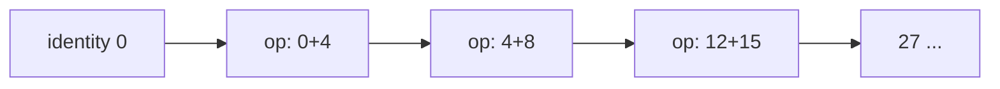

# 4.4 Terminal Operations and Reduction

> **Goal:** Know every terminal operation, understand `reduce` (all three forms) versus mutable reduction (`collect`), and know why associativity and identity matter.

**Level:** core.
**Verified on:** OpenJDK 21.0.12. Every output below was produced by running the code.

## Contents

1. [Terminal operations at a glance](#1-terminal-operations-at-a-glance)
2. [Reduction: the idea](#2-reduction-the-idea)
3. [The three forms of `reduce`](#3-the-three-forms-of-reduce)
4. [Reduction versus mutable reduction](#4-reduction-versus-mutable-reduction)
5. [Matching, finding, counting](#5-matching-finding-counting)
6. [Iterating and converting](#6-iterating-and-converting)
7. [Associativity and identity](#7-associativity-and-identity)
8. [Running everything](#8-running-everything)
9. [Common gotchas](#9-common-gotchas)
10. [Interview questions](#10-interview-questions)

---

## 1. Terminal operations at a glance

| Group | Operations | Result | Short-circuit |
|---|---|---|---|
| Reduce | `reduce`, `count`, `sum/average/max/min` (primitive), `min/max(cmp)` | one value / `Optional` | no |
| Collect | `collect(Collector)`, `toList()` (16), `toArray` | container | no |
| Match | `anyMatch`, `allMatch`, `noneMatch` | `boolean` | yes |
| Find | `findFirst`, `findAny` | `Optional` | yes |
| Iterate | `forEach`, `forEachOrdered`, `iterator`, `spliterator` | side effect | no |

Exactly one terminal operation runs per stream; it consumes and closes it.

## 2. Reduction: the idea

**Intuition.** Reduction folds many values into one by repeatedly combining two: `((((0 + 4) + 8) + 15) + 16) + ...`. The combining function is the *accumulator*; the starting value is the *identity*.



## 3. The three forms of `reduce`

| Form | Signature | Use |
|---|---|---|
| Optional | `reduce(BinaryOperator<T>)` returns `Optional<T>` | no sensible identity; empty stream gives empty |
| Identity | `reduce(T identity, BinaryOperator<T>)` returns `T` | sums, products, min/max with a sentinel |
| Three-argument | `reduce(U identity, BiFunction<U,? super T,U> accumulator, BinaryOperator<U> combiner)` | result type differs from element type (e.g. total string length) |

The combiner exists for **parallel** streams: each thread reduces its chunk with the accumulator, then the combiner merges partial results. In a sequential run it is unused but still required to be consistent.

## 4. Reduction versus mutable reduction

`reduce` creates a **new immutable value each step**. That is perfect for numbers; for strings or collections it copies repeatedly. `collect` accumulates into a **mutable container** (a `StringBuilder`, a list) and is the right tool there.

```java
import java.util.*;
import java.util.stream.*;

public class S04Terminal {
    public static void main(String[] args) {
        List<Integer> nums = List.of(4, 8, 15, 16, 23, 42);

        // reduce: three forms
        System.out.println("reduce(identity, op)       : " + nums.stream().reduce(0, Integer::sum));
        System.out.println("reduce(op) -> Optional     : " + nums.stream().reduce(Integer::max) + " / empty: " + Stream.<Integer>empty().reduce(Integer::sum));
        System.out.println("reduce(identity, acc, comb): " + Stream.of("a", "bb", "ccc").reduce(0, (len, s) -> len + s.length(), Integer::sum));

        // identity must be a TRUE identity: broken here
        System.out.println("bad identity (sequential)  : " + Stream.of(1, 2, 3).reduce(10, Integer::sum) + " (10 added once)");

        // reduce vs mutable reduction (collect)
        String viaReduce = Stream.of("a", "b", "c").reduce("", String::concat);
        String viaCollect = Stream.of("a", "b", "c").collect(StringBuilder::new, StringBuilder::append, StringBuilder::append).toString();
        System.out.println("reduce vs collect          : " + viaReduce + " " + viaCollect + " (collect avoids copying a new String per step)");

        // min / max / count / sum
        System.out.println("min/max by comparator      : " + Stream.of("pear", "fig", "banana").min(Comparator.comparingInt(String::length)).get() + " " + Stream.of("pear", "fig", "banana").max(Comparator.naturalOrder()).get());

        // match operations on EMPTY streams: a classic quiz
        System.out.println("empty: allMatch=" + Stream.<Integer>empty().allMatch(x -> x > 0) + " anyMatch=" + Stream.<Integer>empty().anyMatch(x -> x > 0) + " noneMatch=" + Stream.<Integer>empty().noneMatch(x -> x > 0));

        // findFirst vs findAny, Optional results
        System.out.println("findFirst                  : " + nums.stream().filter(x -> x > 10).findFirst().orElse(-1));
        try { Stream.of((String) null).findFirst(); } catch (NullPointerException e) { System.out.println("findFirst on a null element -> NullPointerException"); }

        // forEach vs forEachOrdered, toArray, iterator
        StringBuilder sb = new StringBuilder();
        nums.stream().forEachOrdered(x -> sb.append(x).append(' '));
        System.out.println("forEachOrdered             : " + sb.toString().trim());
        Integer[] boxed = nums.stream().toArray(Integer[]::new);
        int[] prim = nums.stream().mapToInt(Integer::intValue).toArray();
        System.out.println("toArray                    : " + boxed.length + " " + prim.length + " " + Arrays.toString(prim));
        Iterator<Integer> it = nums.stream().iterator();
        System.out.println("iterator                   : " + it.next() + " " + it.next());

        // count() shortcut and what a terminal operation does to ordering
        System.out.println("toList is unmodifiable     : " + isUnmodifiable(Stream.of(1).toList()) + " vs Collectors.toList(): " + isUnmodifiable(Stream.of(1).collect(Collectors.toList())));

        // associativity matters if the stream is ever parallel
        System.out.println("subtraction is not associative: sequential " + Stream.of(1, 2, 3, 4).reduce(0, (a, b) -> a - b) + " (a parallel run may give a different answer)");
        System.out.println("max by key                 : " + Stream.of("aa", "b", "ccc").max(Comparator.comparingInt(String::length)).get());
    }

    static boolean isUnmodifiable(List<Integer> l) {
        try { l.add(2); return false; } catch (UnsupportedOperationException e) { return true; }
    }
}

// ---- Output ----
// reduce(identity, op)       : 108
// reduce(op) -> Optional     : Optional[42] / empty: Optional.empty
// reduce(identity, acc, comb): 6
// bad identity (sequential)  : 16 (10 added once)
// reduce vs collect          : abc abc (collect avoids copying a new String per step)
// min/max by comparator      : fig pear
// empty: allMatch=true anyMatch=false noneMatch=true
// findFirst                  : 15
// findFirst on a null element -> NullPointerException
// forEachOrdered             : 4 8 15 16 23 42
// toArray                    : 6 6 [4, 8, 15, 16, 23, 42]
// iterator                   : 4 8
// toList is unmodifiable     : true vs Collectors.toList(): false
// subtraction is not associative: sequential -10 (a parallel run may give a different answer)
// max by key                 : ccc
```

The `reduce vs collect` line shows both produce `abc`, but `reduce("", String::concat)` allocates a new `String` per element while the `StringBuilder` version appends in place (quadratic versus linear). Use `Collectors.joining()` in real code.

## 5. Matching, finding, counting

- `anyMatch`, `allMatch`, `noneMatch` short-circuit. On an **empty** stream: `allMatch` is `true`, `anyMatch` is `false`, `noneMatch` is `true` (vacuous truth; the demo prints all three). A famous interview trap.
- `findFirst` respects encounter order; `findAny` may return any element and is cheaper on parallel streams. Both return `Optional`, and `findFirst` on a stream whose chosen element is `null` throws `NullPointerException` (demo).
- `count()` returns `long`; since Java 9 it may skip the pipeline when the size is known (chapter 4.3).
- `min(cmp)`/`max(cmp)` need a `Comparator` on object streams; primitive streams have no-argument versions returning `OptionalInt` etc.

## 6. Iterating and converting

| Operation | Notes |
|---|---|
| `forEach` | unordered in parallel; use for side effects only |
| `forEachOrdered` | respects encounter order even in parallel (loses some parallelism) |
| `toArray(Integer[]::new)` | typed array through a generator; `toArray()` alone gives `Object[]` |
| `iterator()` | escape hatch to use a stream with legacy loops |
| `toList()` (16) | **unmodifiable** list; allows `null` elements |
| `collect(Collectors.toList())` | modifiable `ArrayList` (no guarantee), rejects nothing |

The demo's last `toList is unmodifiable` line shows `Stream.toList()` rejects `add`, while `Collectors.toList()` returns a mutable list.

## 7. Associativity and identity

For `reduce` to give the same result sequentially and in parallel, the operation must be **associative** (`(a op b) op c == a op (b op c)`) and the identity must be neutral (`identity op x == x`).

| Operation | Associative? | Identity |
|---|---|---|
| `+`, `*`, `max`, `min`, string concat, list concat | yes | 0, 1, `MIN_VALUE`/`MAX_VALUE`, `""`, empty list |
| `-`, `/`, average of averages, `x -> x * 2 + y` | no | n/a |

The demo prints `-10` for `reduce(0, (a, b) -> a - b)` over `1,2,3,4`; a parallel run splits the work and combines partial results, which can give a different number (chapter 4.8 simulates the split deterministically). A wrong identity (10 instead of 0) gets added once **per chunk** in parallel, so the answer depends on how the work is split.

Average is a typical trap: reduce `(sum, count)` pairs, or use `Collectors.averagingInt`/`summaryStatistics`, never average partial averages.

## 8. Running everything

Remember: **nothing runs until a terminal operation**, and each pipeline runs exactly one. If you need several results from one pass use `summaryStatistics`, `Collectors.teeing` (chapter 4.5) or a custom collector.

## 9. Common gotchas

| Gotcha | Why | Fix |
|---|---|---|
| Non-associative `reduce` | parallel result differs | associative op or sequential |
| Wrong identity | added once per chunk in parallel | true neutral element |
| `reduce` building a list or string | O(n^2) copying | `collect` / `joining` |
| `findFirst()` on a null element | `Optional` cannot hold null | filter nulls, or do not stream nulls |
| `forEach` order surprises in parallel | unordered | `forEachOrdered` |
| `toList()` then `add` | unmodifiable | `new ArrayList<>(...)` or `Collectors.toList()` |
| `count()` result used with `peek` effects | pipeline skipped | do not depend on side effects |
| Assuming `allMatch` false on empty | vacuous truth | check emptiness explicitly |
| `max(Integer::compare)` on huge stream and `Optional.get()` | empty throws | `orElse` / `orElseThrow` |

## 10. Interview questions

<details>
<summary><strong>Q1. Explain the three overloads of <code>reduce</code>.</strong></summary>

(1) <code>reduce(op)</code> returns <code>Optional</code>; (2) <code>reduce(identity, op)</code> returns <code>T</code>; (3) <code>reduce(identity, accumulator, combiner)</code> returns a different result type <code>U</code>, with the combiner merging partial results in parallel.
</details>

<details>
<summary><strong>Q2. <code>reduce</code> versus <code>collect</code>?</strong></summary>

<code>reduce</code> is immutable reduction (a new value per step; ideal for numbers). <code>collect</code> is mutable reduction into a container, avoiding repeated copying and supporting parallel combination of containers.
</details>

<details>
<summary><strong>Q3. What must hold for a parallel-safe <code>reduce</code>?</strong></summary>

The accumulator and combiner are associative, stateless and non-interfering, the identity is neutral, and the combiner is compatible with the accumulator.
</details>

<details>
<summary><strong>Q4. What do <code>allMatch</code>, <code>anyMatch</code>, <code>noneMatch</code> return for an empty stream?</strong></summary>

<code>true</code>, <code>false</code>, <code>true</code>.
</details>

<details>
<summary><strong>Q5. <code>findFirst</code> versus <code>findAny</code>?</strong></summary>

<code>findFirst</code> returns the first element in encounter order (deterministic); <code>findAny</code> may return any element and is more efficient in parallel.
</details>

<details>
<summary><strong>Q6. <code>forEach</code> versus <code>forEachOrdered</code>?</strong></summary>

<code>forEach</code> makes no ordering promise for parallel streams; <code>forEachOrdered</code> processes in encounter order, at some cost to parallelism.
</details>

<details>
<summary><strong>Q7. <code>Stream.toList()</code> versus <code>Collectors.toList()</code>?</strong></summary>

<code>Stream.toList()</code> (16) returns an unmodifiable list and permits nulls; <code>Collectors.toList()</code> returns a mutable list (an <code>ArrayList</code> in practice, not guaranteed). <code>Collectors.toUnmodifiableList()</code> rejects nulls.
</details>

<details>
<summary><strong>Q8. How would you compute the average with <code>reduce</code>?</strong></summary>

Reduce to a pair (sum, count) and divide at the end, or just use <code>mapToInt(...).average()</code>. Averaging averages is wrong.
</details>

<details>
<summary><strong>Q9. Why is <code>reduce("", String::concat)</code> a bad way to join strings?</strong></summary>

It creates a new string per step (O(n^2) copying). Use <code>Collectors.joining()</code> or a <code>StringBuilder</code> collector.
</details>

<details>
<summary><strong>Q10. What happens if you call two terminal operations on one stream?</strong></summary>

The second throws <code>IllegalStateException</code> because the stream is already consumed.
</details>

<details>
<summary><strong>Q11. How do you get an <code>Integer[]</code> from a stream?</strong></summary>

<code>toArray(Integer[]::new)</code>; plain <code>toArray()</code> returns <code>Object[]</code>.
</details>

---

[Previous: 4.3 Intermediate Operations in Depth](./03-intermediate-operations-deep.md) · [Part index](./README.md) · Next: [4.5 Collectors in Depth](./05-collectors-in-depth.md)