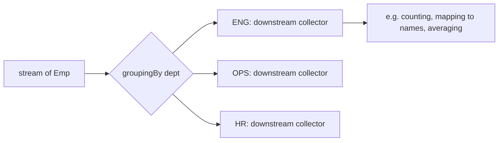
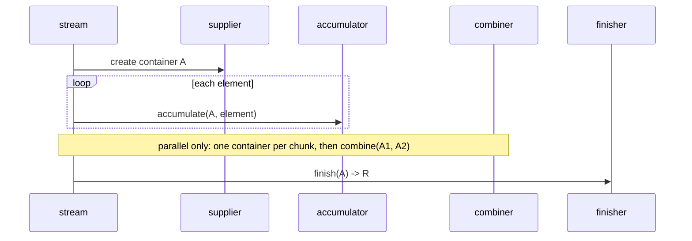

# 4.5 Collectors in Depth

> **Goal:** Use `Collectors` fluently (grouping, partitioning, mapping, teeing, joining), understand how a `Collector` works internally, and write your own.

**Level:** the most-used part of the Streams API in real code.
**Verified on:** OpenJDK 21.0.12. Every output below was produced by running the code.

## Contents

1. [What a `Collector` is](#1-what-a-collector-is)
2. [The standard toolbox](#2-the-standard-toolbox)
3. [Examples on a realistic dataset](#3-examples-on-a-realistic-dataset)
4. [`toMap` in depth](#4-tomap-in-depth)
5. [`groupingBy` and downstream collectors](#5-groupingby-and-downstream-collectors)
6. [`partitioningBy`, `teeing`, `reducing`](#6-partitioningby-teeing-reducing)
7. [How a collector works inside](#7-how-a-collector-works-inside)
8. [Writing your own collector](#8-writing-your-own-collector)
9. [Common gotchas](#9-common-gotchas)
10. [Interview questions](#10-interview-questions)

---

## 1. What a `Collector` is

**Intuition.** A collector is a recipe for turning a stream into a result: "start with an empty bowl, add each element, optionally combine bowls, then finish". Because it is a separate object, collectors **compose**: a downstream collector can be nested inside `groupingBy` to say what to do with each group.

## 2. The standard toolbox

| Goal | Collector | Since |
|---|---|---|
| To list / set / map | `toList()`, `toSet()`, `toMap(k, v[, merge[, supplier]])`, `toCollection(TreeSet::new)` | 8 |
| Unmodifiable results | `toUnmodifiableList/Set/Map` | 10 |
| Strings | `joining(sep, prefix, suffix)` | 8 |
| Group | `groupingBy(classifier[, mapFactory][, downstream])` | 8 |
| Split in two | `partitioningBy(pred[, downstream])` | 8 |
| Numbers | `counting`, `summingInt/Long/Double`, `averagingX`, `summarizingX`, `minBy`, `maxBy` | 8 |
| Transform inside a group | `mapping`, `filtering` (9), `flatMapping` (9) | 8/9 |
| Post-process | `collectingAndThen(downstream, finisher)` | 8 |
| Two results at once | `teeing(c1, c2, merger)` | 12 |
| Fold | `reducing(identity, mapper, op)` | 8 |
| Custom | `Collector.of(supplier, accumulator, combiner[, finisher], characteristics...)` | 8 |

## 3. Examples on a realistic dataset

```java
import java.util.*;
import java.util.function.*;
import java.util.stream.*;

public class S05Collectors {
    record Emp(String name, String dept, String city, int salary, int age) { }

    static final List<Emp> EMPS = List.of(
            new Emp("Asha", "ENG", "Pune", 120, 30), new Emp("Ravi", "ENG", "Mumbai", 100, 28),
            new Emp("Meera", "ENG", "Pune", 140, 41), new Emp("Kabir", "OPS", "Delhi", 70, 35),
            new Emp("Isha", "OPS", "Pune", 80, 29), new Emp("Dev", "HR", "Mumbai", 60, 50));

    public static void main(String[] args) {
        // Basic sinks
        System.out.println("toList / toSet(sorted)  : " + EMPS.stream().map(Emp::dept).distinct().toList() + " " + new TreeSet<>(EMPS.stream().map(Emp::city).collect(Collectors.toSet())));
        System.out.println("joining                 : " + EMPS.stream().map(Emp::name).collect(Collectors.joining(", ", "[", "]")));
        System.out.println("toUnmodifiableList (10+): " + EMPS.stream().map(Emp::age).collect(Collectors.toUnmodifiableList()).size());

        // toMap and its duplicate-key trap
        System.out.println("toMap                   : " + new TreeMap<>(EMPS.stream().collect(Collectors.toMap(Emp::name, Emp::salary))));
        try { EMPS.stream().collect(Collectors.toMap(Emp::dept, Emp::name)); }
        catch (IllegalStateException e) { System.out.println("toMap duplicate key    -> " + e.getMessage()); }
        System.out.println("toMap with merge        : " + new TreeMap<>(EMPS.stream().collect(Collectors.toMap(Emp::dept, Emp::salary, Integer::sum))));
        System.out.println("toMap into TreeMap      : " + EMPS.stream().collect(Collectors.toMap(Emp::dept, Emp::name, (a, b) -> a + "+" + b, TreeMap::new)));

        // groupingBy and downstream collectors
        System.out.println("groupingBy (default)    : " + new TreeMap<>(EMPS.stream().collect(Collectors.groupingBy(Emp::dept, Collectors.mapping(Emp::name, Collectors.toList())))));
        System.out.println("counting                : " + new TreeMap<>(EMPS.stream().collect(Collectors.groupingBy(Emp::city, Collectors.counting()))));
        System.out.println("summingInt / averaging  : " + new TreeMap<>(EMPS.stream().collect(Collectors.groupingBy(Emp::dept, Collectors.summingInt(Emp::salary)))) + " " + new TreeMap<>(EMPS.stream().collect(Collectors.groupingBy(Emp::dept, Collectors.averagingInt(Emp::salary)))));
        System.out.println("maxBy per group         : " + EMPS.stream().collect(Collectors.groupingBy(Emp::dept, TreeMap::new, Collectors.collectingAndThen(Collectors.maxBy(Comparator.comparingInt(Emp::salary)), o -> o.get().name()))));
        System.out.println("two-level grouping      : " + EMPS.stream().collect(Collectors.groupingBy(Emp::dept, TreeMap::new, Collectors.groupingBy(Emp::city, TreeMap::new, Collectors.counting()))));
        System.out.println("filtering (9+)          : " + EMPS.stream().collect(Collectors.groupingBy(Emp::dept, TreeMap::new, Collectors.filtering(e -> e.salary() > 90, Collectors.counting()))));
        System.out.println("  vs filter before      : " + EMPS.stream().filter(e -> e.salary() > 90).collect(Collectors.groupingBy(Emp::dept, TreeMap::new, Collectors.counting())) + "  (groups with no match vanish)");
        System.out.println("flatMapping (9+)        : " + Stream.of(List.of("a", "b"), List.of("c")).collect(Collectors.flatMapping(List::stream, Collectors.joining())));
        System.out.println("summarizingInt          : " + EMPS.stream().collect(Collectors.summarizingInt(Emp::salary)));

        // partitioningBy always has BOTH keys
        System.out.println("partitioningBy          : " + EMPS.stream().collect(Collectors.partitioningBy(e -> e.age() > 40, Collectors.mapping(Emp::name, Collectors.toList()))));
        System.out.println("partition, no match     : " + Stream.of(1, 2).collect(Collectors.partitioningBy(x -> x > 5)));

        // teeing (12+): two collectors, one pass
        System.out.println("teeing (12+)            : " + EMPS.stream().collect(Collectors.teeing(Collectors.summingInt(Emp::salary), Collectors.counting(), (sum, n) -> "avg " + sum / n)));

        // reducing and collectingAndThen
        System.out.println("reducing                : " + EMPS.stream().collect(Collectors.reducing(0, Emp::salary, Integer::sum)));
        System.out.println("collectingAndThen       : " + EMPS.stream().map(Emp::name).collect(Collectors.collectingAndThen(Collectors.toList(), Collections::unmodifiableList)).size());

        // groupingBy null key trap
        try { Stream.of("a", "b").collect(Collectors.groupingBy(s -> (String) null)); } catch (NullPointerException e) { System.out.println("groupingBy null key    -> NullPointerException: " + e.getMessage()); }
        try { Stream.of("a").collect(Collectors.toMap(s -> s, s -> (String) null)); } catch (NullPointerException e) { System.out.println("toMap null value       -> NullPointerException"); }
    }
}

// ---- Output ----
// toList / toSet(sorted)  : [ENG, OPS, HR] [Delhi, Mumbai, Pune]
// joining                 : [Asha, Ravi, Meera, Kabir, Isha, Dev]
// toUnmodifiableList (10+): 6
// toMap                   : {Asha=120, Dev=60, Isha=80, Kabir=70, Meera=140, Ravi=100}
// toMap duplicate key    -> Duplicate key ENG (attempted merging values Asha and Ravi)
// toMap with merge        : {ENG=360, HR=60, OPS=150}
// toMap into TreeMap      : {ENG=Asha+Ravi+Meera, HR=Dev, OPS=Kabir+Isha}
// groupingBy (default)    : {ENG=[Asha, Ravi, Meera], HR=[Dev], OPS=[Kabir, Isha]}
// counting                : {Delhi=1, Mumbai=2, Pune=3}
// summingInt / averaging  : {ENG=360, HR=60, OPS=150} {ENG=120.0, HR=60.0, OPS=75.0}
// maxBy per group         : {ENG=Meera, HR=Dev, OPS=Isha}
// two-level grouping      : {ENG={Mumbai=1, Pune=2}, HR={Mumbai=1}, OPS={Delhi=1, Pune=1}}
// filtering (9+)          : {ENG=3, HR=0, OPS=0}
//   vs filter before      : {ENG=3}  (groups with no match vanish)
// flatMapping (9+)        : abc
// summarizingInt          : IntSummaryStatistics{count=6, sum=570, min=60, average=95.000000, max=140}
// partitioningBy          : {false=[Asha, Ravi, Kabir, Isha], true=[Meera, Dev]}
// partition, no match     : {false=[1, 2], true=[]}
// teeing (12+)            : avg 95
// reducing                : 570
// collectingAndThen       : 6
// groupingBy null key    -> NullPointerException: element cannot be mapped to a null key
// toMap null value       -> NullPointerException
```

## 4. `toMap` in depth

| Variant | Behaviour |
|---|---|
| `toMap(k, v)` | throws `IllegalStateException: Duplicate key ...` on a duplicate key (demo prints the message with the two clashing values) |
| `toMap(k, v, merge)` | resolves duplicates with a merge function (`Integer::sum`, `(a, b) -> a`) |
| `toMap(k, v, merge, TreeMap::new)` | chooses the map type |
| null values | `NullPointerException` (demo); `HashMap` itself allows null, but `toMap` uses `merge`, which does not |

Choose the merge function deliberately: `(a, b) -> a` keeps the first, `(a, b) -> b` keeps the last, `BinaryOperator.maxBy(...)` keeps the best.

## 5. `groupingBy` and downstream collectors

`groupingBy(f)` returns `Map<K, List<T>>`. The three-argument form takes a `Supplier<Map>` (use `TreeMap::new` for sorted keys, `LinkedHashMap::new` for insertion order) and a downstream collector.



Downstream choices seen in the demo:

| Question | Downstream |
|---|---|
| How many per group? | `counting()` |
| Sum / average per group? | `summingInt`, `averagingInt` |
| Highest per group? | `collectingAndThen(maxBy(cmp), Optional::get)` |
| Names per group? | `mapping(Emp::name, toList())` |
| Sub-groups? | another `groupingBy` (two-level result `{ENG={Mumbai=1, Pune=2}, ...}`) |
| Count only matching, keep empty groups? | `filtering(pred, counting())` (the demo shows `HR=0`) |

**`filtering` versus `filter` before grouping.** `filter` first removes elements, so groups with no match disappear (`{ENG=3}`); `filtering` as a downstream collector keeps the group with an empty result (`{ENG=3, HR=0, OPS=0}`). Pick based on whether you want the empty groups.

`groupingBy` rejects a classifier that returns `null` (`element cannot be mapped to a null key`).

## 6. `partitioningBy`, `teeing`, `reducing`

- `partitioningBy(pred)` always returns **both keys** `true` and `false`, even when one list is empty (demo: `{false=[1, 2], true=[]}`). Use it for yes/no splits; use `groupingBy` for more categories.
- `teeing(c1, c2, merger)` (Java 12) runs two collectors over the **same single pass** and merges their results: sum and count to an average, min and max to a range.
- `reducing(identity, mapper, op)` is `map` then `reduce` as a collector; useful as a downstream.

## 7. How a collector works inside

A `Collector<T, A, R>` is four functions plus characteristics.



| Function | Role | `toList()` example |
|---|---|---|
| `supplier()` | new empty container | `ArrayList::new` |
| `accumulator()` | add one element | `List::add` |
| `combiner()` | merge two containers (parallel) | `(l, r) -> { l.addAll(r); return l; }` |
| `finisher()` | convert container to result | identity |
| `characteristics()` | `CONCURRENT`, `UNORDERED`, `IDENTITY_FINISH` hints | |

The `IDENTITY_FINISH` characteristic tells the framework it may skip the finisher and cast the container to the result.

## 8. Writing your own collector

```java
import java.util.*;
import java.util.function.*;
import java.util.stream.*;

public class S05CustomCollector {
    // A collector that splits a stream into batches of n: the four functions made visible
    static <T> Collector<T, List<List<T>>, List<List<T>>> batching(int size) {
        return Collector.of(
                ArrayList::new,                                        // supplier: a fresh container
                (batches, item) -> {                                   // accumulator: add one element
                    if (batches.isEmpty() || batches.get(batches.size() - 1).size() == size) batches.add(new ArrayList<>());
                    batches.get(batches.size() - 1).add(item);
                },
                (left, right) -> { left.addAll(right); return left; }, // combiner: merge two partial results (parallel only; naive here)
                Function.identity());                                  // finisher: container -> result
    }

    // Statistics collector with its own accumulator class
    static class Stats {
        long n; double sum, min = Double.MAX_VALUE, max = -Double.MAX_VALUE;
        void add(double v) { n++; sum += v; min = Math.min(min, v); max = Math.max(max, v); }
        Stats merge(Stats o) { n += o.n; sum += o.sum; min = Math.min(min, o.min); max = Math.max(max, o.max); return this; }
        @Override public String toString() { return String.format("n=%d min=%.1f max=%.1f avg=%.2f", n, min, max, sum / n); }
    }

    public static void main(String[] args) {
        System.out.println("batches of 3: " + IntStream.rangeClosed(1, 8).boxed().collect(batching(3)));
        System.out.println("stats       : " + DoubleStream.of(2.5, 7, 4).boxed().collect(Collector.of(Stats::new, Stats::add, Stats::merge)));

        // Collector characteristics tell the framework what it may optimise
        Collector<Integer, ?, Set<Integer>> toSet = Collectors.toSet();
        System.out.println("toSet characteristics   : " + new TreeSet<>(toSet.characteristics()));
        System.out.println("toList characteristics  : " + new TreeSet<>(Collectors.toList().characteristics()));
        System.out.println("joining characteristics : " + new TreeSet<>(Collectors.joining().characteristics()));
    }
}

// ---- Output ----
// batches of 3: [[1, 2, 3], [4, 5, 6], [7, 8]]
// stats       : n=3 min=2.5 max=7.0 avg=4.50
// toSet characteristics   : [UNORDERED, IDENTITY_FINISH]
// toList characteristics  : [IDENTITY_FINISH]
// joining characteristics : []
```

The `batching(3)` collector splits `1..8` into `[[1,2,3],[4,5,6],[7,8]]`. The `Stats` collector shows the pattern of a dedicated accumulator class with `merge`. The three `characteristics` lines show what the built-ins declare: `toSet()` is `UNORDERED, IDENTITY_FINISH`, `toList()` is `IDENTITY_FINISH`, and `joining()` has none (its container is a `StringBuilder`, so the finisher is needed). Declare characteristics truthfully; the framework trusts them.

Guidelines:

1. The combiner must really merge two partial containers, even if you only run sequentially today.
2. Do not share state between containers.
3. Prefer composing built-ins (`collectingAndThen`, `teeing`, `mapping`) before writing a custom collector.

## 9. Common gotchas

| Gotcha | Why | Fix |
|---|---|---|
| `Duplicate key` from `toMap` | keys not unique | merge function, or `groupingBy` |
| `NullPointerException` in `toMap` | null value | filter or replace nulls |
| Groups disappear after `filter` | no elements left | `Collectors.filtering` downstream |
| `HashMap` ordering assumed | unspecified | `TreeMap::new` / `LinkedHashMap::new` |
| `groupingBy(..., counting())` gives `Long` | `counting` returns `Long` | `.intValue()` or `summingInt(e -> 1)` |
| `Collectors.toList()` mutability assumed | not specified | `toCollection(ArrayList::new)` |
| Averaging per group with ints | `averagingInt` returns double | cast intentionally |
| Custom collector without a real combiner | breaks in parallel | implement merging |
| Modifying the map returned by `groupingBy` concurrently | plain `HashMap` | `groupingByConcurrent` for parallel |

## 10. Interview questions

<details>
<summary><strong>Q1. What are the four functions of a <code>Collector</code>?</strong></summary>

<code>supplier</code> (new container), <code>accumulator</code> (add an element), <code>combiner</code> (merge containers for parallel), <code>finisher</code> (container to final result), plus characteristics.
</details>

<details>
<summary><strong>Q2. How does <code>groupingBy</code> work and what are its overloads?</strong></summary>

It classifies elements by a function into a map. Overloads: <code>(classifier)</code> gives lists; <code>(classifier, downstream)</code> applies a downstream collector per group; <code>(classifier, mapFactory, downstream)</code> chooses the map type.
</details>

<details>
<summary><strong>Q3. <code>groupingBy</code> versus <code>partitioningBy</code>?</strong></summary>

<code>partitioningBy</code> takes a predicate and always returns a map with both <code>true</code> and <code>false</code> keys; <code>groupingBy</code> takes any classifier and only contains keys that occurred.
</details>

<details>
<summary><strong>Q4. What happens when <code>toMap</code> sees a duplicate key?</strong></summary>

<code>IllegalStateException: Duplicate key K (attempted merging values A and B)</code>, unless a merge function is supplied.
</details>

<details>
<summary><strong>Q5. How do you find the highest-paid employee per department?</strong></summary>

<code>groupingBy(dept, collectingAndThen(maxBy(comparingInt(salary)), Optional::get))</code> or <code>toMap(dept, identity(), BinaryOperator.maxBy(cmp))</code>.
</details>

<details>
<summary><strong>Q6. <code>filtering</code> downstream versus <code>filter</code> before <code>groupingBy</code>?</strong></summary>

The downstream version keeps groups whose filtered result is empty (for example count 0); filtering before removes those groups entirely.
</details>

<details>
<summary><strong>Q7. What is <code>teeing</code> good for?</strong></summary>

Computing two aggregates in a single pass and combining them, e.g. average from sum and count, or min and max in one traversal (Java 12).
</details>

<details>
<summary><strong>Q8. What does <code>IDENTITY_FINISH</code> mean?</strong></summary>

The accumulation container already is the result, so the finisher can be skipped.
</details>

<details>
<summary><strong>Q9. How do you control the map type or iteration order from <code>groupingBy</code>?</strong></summary>

Pass a map factory: <code>TreeMap::new</code> for sorted keys, <code>LinkedHashMap::new</code> for encounter order.
</details>

<details>
<summary><strong>Q10. How do you implement a custom collector for batching?</strong></summary>

<code>Collector.of(ArrayList::new, (batches, x) -&gt; { start a new list when the last is full; add x }, (l, r) -&gt; { l.addAll(r); return l; })</code>. A truly parallel-correct version must merge the boundary batches; keep it sequential-only or document that.
</details>

<details>
<summary><strong>Q11. Why does <code>Collectors.groupingBy(f, counting())</code> produce <code>Map&lt;K, Long&gt;</code>?</strong></summary>

<code>counting()</code> accumulates in a <code>long</code> and boxes it as <code>Long</code>; use <code>summingInt(x -&gt; 1)</code> for <code>Integer</code>.
</details>

<details>
<summary><strong>Q12. What are <code>groupingByConcurrent</code> and <code>toConcurrentMap</code> for?</strong></summary>

Parallel streams: the accumulation container is a shared <code>ConcurrentMap</code>, avoiding the cost of merging per-thread maps, at the price of unspecified encounter order inside groups.
</details>

---

[Previous: 4.4 Terminal Operations and Reduction](./04-terminal-operations-and-reduction.md) · [Part index](./README.md) · Next: [4.6 Complex Examples: Reporting and Aggregation](./06-complex-examples-reporting-and-aggregation.md)