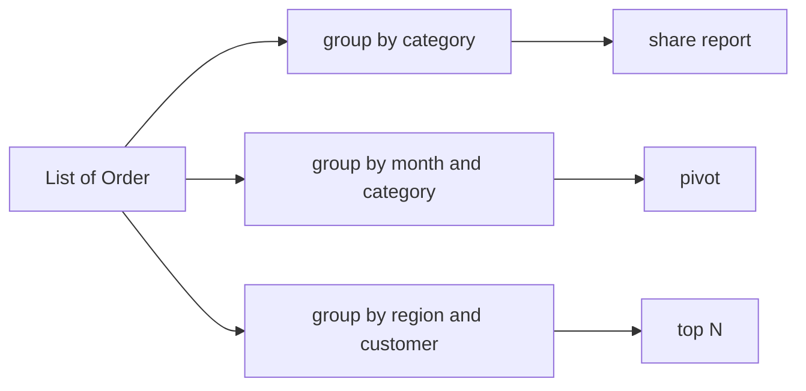

# 4.6 Complex Examples: Reporting and Aggregation

> **Goal:** Build realistic multi-step reports with streams: revenue shares, pivot tables, top-N per group, running totals, ranking, medians and Pareto analysis.

**Level:** applied. Each report is a pattern you can reuse in service code.
**Verified on:** OpenJDK 21.0.12. The data is generated with `new Random(7)` so results are reproducible on this JDK. Every output below was produced by running the code.

## Contents

1. [The dataset](#1-the-dataset)
2. [The full program](#2-the-full-program)
3. [Pattern 1: group, sum, sort, share](#3-pattern-1-group-sum-sort-share)
4. [Pattern 2: pivot tables with nested `groupingBy`](#4-pattern-2-pivot-tables-with-nested-groupingby)
5. [Pattern 3: top N per group](#5-pattern-3-top-n-per-group)
6. [Pattern 4: running totals](#6-pattern-4-running-totals)
7. [Pattern 5: ranking with ties](#7-pattern-5-ranking-with-ties)
8. [Pattern 6: median per group](#8-pattern-6-median-per-group)
9. [Pattern 7: "in every period" with sets](#9-pattern-7-in-every-period-with-sets)
10. [Pattern 8: Pareto cut-off with `takeWhile`](#10-pattern-8-pareto-cut-off-with-takewhile)
11. [Pattern 9: many answers in one pass with `teeing`](#11-pattern-9-many-answers-in-one-pass-with-teeing)
12. [Design notes](#12-design-notes)
13. [Common gotchas](#13-common-gotchas)
14. [Interview questions](#14-interview-questions)

---

## 1. The dataset

40 orders with a customer, category, region, date, quantity and unit price. `revenue()` is `qty * price`. A `YearMonth` accessor makes month grouping trivial. The first order is printed by the program so you can verify the data is what you think it is.



## 2. The full program

```java
import java.time.LocalDate;
import java.time.YearMonth;
import java.util.*;
import java.util.function.*;
import java.util.stream.*;

public class S06Reporting {
    record Order(int id, String customer, String category, String region, LocalDate date, int qty, double price) {
        double revenue() { return qty * price; }
        YearMonth month() { return YearMonth.from(date); }
    }

    static List<Order> orders() {
        String[] customers = {"Asha", "Ravi", "Meera", "Kabir", "Isha", "Dev"};
        String[] categories = {"Books", "Games", "Tools"};
        String[] regions = {"North", "South", "East"};
        Random r = new Random(7);                                    // fixed seed: reproducible data
        List<Order> list = new ArrayList<>();
        for (int i = 1; i <= 40; i++)
            list.add(new Order(i, customers[r.nextInt(6)], categories[r.nextInt(3)], regions[r.nextInt(3)],
                    LocalDate.of(2024, 1 + r.nextInt(3), 1 + r.nextInt(28)), 1 + r.nextInt(5), 10 + r.nextInt(9) * 5));
        return list;
    }

    public static void main(String[] args) {
        List<Order> orders = orders();
        System.out.println("orders: " + orders.size() + ", first: " + orders.get(0));
        double total = orders.stream().mapToDouble(Order::revenue).sum();
        System.out.printf("total revenue: %.2f%n%n", total);

        // 1. Revenue and share by category, sorted descending
        System.out.println("1. Revenue by category");
        orders.stream().collect(Collectors.groupingBy(Order::category, Collectors.summingDouble(Order::revenue)))
                .entrySet().stream().sorted(Map.Entry.<String, Double>comparingByValue().reversed())
                .forEach(e -> System.out.printf("   %-6s %8.2f  %5.1f%%%n", e.getKey(), e.getValue(), 100 * e.getValue() / total));

        // 2. Pivot table: month x category
        System.out.println("\n2. Revenue pivot (month x category)");
        Map<YearMonth, Map<String, Double>> pivot = orders.stream().collect(Collectors.groupingBy(Order::month, TreeMap::new,
                Collectors.groupingBy(Order::category, TreeMap::new, Collectors.summingDouble(Order::revenue))));
        List<String> cats = orders.stream().map(Order::category).distinct().sorted().toList();
        System.out.println("   month    " + cats.stream().map(c -> String.format("%8s", c)).collect(Collectors.joining()));
        pivot.forEach((m, row) -> System.out.println("   " + m + "  " + cats.stream().map(c -> String.format("%8.0f", row.getOrDefault(c, 0.0))).collect(Collectors.joining())));

        // 3. Top 2 customers per region
        System.out.println("\n3. Top 2 customers per region");
        orders.stream().collect(Collectors.groupingBy(Order::region, TreeMap::new, Collectors.groupingBy(Order::customer, Collectors.summingDouble(Order::revenue))))
                .forEach((region, byCust) -> System.out.println("   " + region + ": " + byCust.entrySet().stream()
                        .sorted(Map.Entry.<String, Double>comparingByValue().reversed().thenComparing(Map.Entry.comparingByKey()))
                        .limit(2).map(e -> e.getKey() + " " + Math.round(e.getValue())).toList()));

        // 4. Cumulative revenue by month (running total)
        System.out.println("\n4. Running total by month");
        Map<YearMonth, Double> monthly = orders.stream().collect(Collectors.groupingBy(Order::month, TreeMap::new, Collectors.summingDouble(Order::revenue)));
        List<YearMonth> months = new ArrayList<>(monthly.keySet());
        IntStream.range(0, months.size()).forEach(i -> System.out.printf("   %s  month %7.0f  cumulative %7.0f%n", months.get(i), monthly.get(months.get(i)),
                months.subList(0, i + 1).stream().mapToDouble(monthly::get).sum()));

        // 5. Dense ranking of customers (ties share a rank)
        System.out.println("\n5. Dense rank of customers by order count");
        Map<String, Long> counts = orders.stream().collect(Collectors.groupingBy(Order::customer, Collectors.counting()));
        List<Long> distinctCounts = counts.values().stream().distinct().sorted(Comparator.reverseOrder()).toList();
        counts.entrySet().stream().sorted(Map.Entry.<String, Long>comparingByValue().reversed().thenComparing(Map.Entry.comparingByKey()))
                .forEach(e -> System.out.println("   rank " + (distinctCounts.indexOf(e.getValue()) + 1) + "  " + e.getKey() + " (" + e.getValue() + " orders)"));

        // 6. Median order value per category
        System.out.println("\n6. Median order value per category");
        orders.stream().collect(Collectors.groupingBy(Order::category, TreeMap::new, Collectors.collectingAndThen(
                Collectors.mapping(Order::revenue, Collectors.toList()), list -> {
                    List<Double> s = list.stream().sorted().toList();
                    int n = s.size();
                    return n % 2 == 1 ? s.get(n / 2) : (s.get(n / 2 - 1) + s.get(n / 2)) / 2;
                }))).forEach((c, med) -> System.out.printf("   %-6s %.1f%n", c, med));

        // 7. Customers active in every month
        System.out.println("\n7. Customers who ordered in all 3 months");
        long monthCount = orders.stream().map(Order::month).distinct().count();
        System.out.println("   " + orders.stream().collect(Collectors.groupingBy(Order::customer, TreeMap::new, Collectors.mapping(Order::month, Collectors.toSet())))
                .entrySet().stream().filter(e -> e.getValue().size() == monthCount).map(Map.Entry::getKey).toList());

        // 8. Pareto: smallest set of customers making up 80% of revenue
        System.out.println("\n8. Pareto: customers covering 80% of revenue");
        List<Map.Entry<String, Double>> ranked = orders.stream().collect(Collectors.groupingBy(Order::customer, Collectors.summingDouble(Order::revenue)))
                .entrySet().stream().sorted(Map.Entry.<String, Double>comparingByValue().reversed()).toList();
        double[] cum = {0};
        List<String> pareto = ranked.stream().takeWhile(e -> { boolean take = cum[0] < 0.8 * total; cum[0] += e.getValue(); return take; }).map(Map.Entry::getKey).toList();
        System.out.println("   " + pareto);

        // 9. One pass, many answers with teeing
        System.out.println("\n9. Largest and smallest order in one pass");
        System.out.println("   " + orders.stream().collect(Collectors.teeing(
                Collectors.maxBy(Comparator.comparingDouble(Order::revenue)), Collectors.minBy(Comparator.comparingDouble(Order::revenue)),
                (max, min) -> "max #" + max.get().id() + " " + max.get().revenue() + ", min #" + min.get().id() + " " + min.get().revenue())));
    }
}

// ---- Output ----
// orders: 40, first: Order[id=1, customer=Isha, category=Tools, region=North, date=2024-02-13, qty=5, price=15.0]
// total revenue: 3590.00
//
// 1. Revenue by category
//    Books   1515.00   42.2%
//    Tools   1050.00   29.2%
//    Games   1025.00   28.6%
//
// 2. Revenue pivot (month x category)
//    month       Books   Games   Tools
//    2024-01       440     790     435
//    2024-02       610     235     410
//    2024-03       465       0     205
//
// 3. Top 2 customers per region
//    East: [Meera 350, Ravi 295]
//    North: [Ravi 860, Asha 255]
//    South: [Kabir 295, Dev 280]
//
// 4. Running total by month
//    2024-01  month    1665  cumulative    1665
//    2024-02  month    1255  cumulative    2920
//    2024-03  month     670  cumulative    3590
//
// 5. Dense rank of customers by order count
//    rank 1  Ravi (14 orders)
//    rank 2  Asha (8 orders)
//    rank 3  Meera (6 orders)
//    rank 4  Kabir (5 orders)
//    rank 5  Isha (4 orders)
//    rank 6  Dev (3 orders)
//
// 6. Median order value per category
//    Books  75.0
//    Games  70.0
//    Tools  75.0
//
// 7. Customers who ordered in all 3 months
//    [Asha, Meera, Ravi]
//
// 8. Pareto: customers covering 80% of revenue
//    [Ravi, Meera, Asha, Dev, Kabir]
//
// 9. Largest and smallest order in one pass
//    max #3 225.0, min #9 10.0
```

## 3. Pattern 1: group, sum, sort, share

`groupingBy(category, summingDouble(revenue))` produces a `Map`; a map has no order, so stream its `entrySet()`, sort by value descending (`Map.Entry.<String, Double>comparingByValue().reversed()`) and print. The explicit type witness on `comparingByValue()` is required before `.reversed()` because type inference stops at a method chain. Compute the grand total once, outside the pipeline, to avoid re-traversing the data for each percentage.

## 4. Pattern 2: pivot tables with nested `groupingBy`

A pivot is `groupingBy(rowKey, groupingBy(columnKey, summingX))`. Use `TreeMap::new` at both levels to get sorted rows and columns. Cells that do not exist (March has no Games) are missing from the inner map, so use `getOrDefault(column, 0.0)` when rendering. Derive the column list once from the data (`distinct().sorted()`), never hard-code it.

## 5. Pattern 3: top N per group

The cleanest form groups twice: region then customer to get totals, then for each region sort the totals and `limit(N)`. Include a **tie-breaker** (`thenComparing(Map.Entry.comparingByKey())`) so results do not depend on `HashMap` iteration order. Alternative: `groupingBy(region, collectingAndThen(toList(), list -> list.stream().sorted(...).limit(N).toList()))`.

## 6. Pattern 4: running totals

Streams are bad at **stateful, order-dependent** computation. The reliable options:

| Option | Trade-off |
|---|---|
| `IntStream.range` plus `subList(0, i + 1)` sum (used above) | O(n^2) but obviously correct and parallel-safe; fine for dozens of rows |
| A plain loop | O(n), clearest for large n |
| `Arrays.parallelPrefix(array, op)` | O(n), for primitive arrays (challenge c21) |
| A `double[]` accumulator mutated inside `map` | works only sequentially; fragile, avoid |

## 7. Pattern 5: ranking with ties

Dense rank: collect the **distinct sorted values**, then rank = index of the value + 1. Equal values share a rank because `indexOf` finds the first match. For standard competition ranking (1,2,2,4) you would use the count of strictly greater values + 1. Sort with a secondary key so output is stable.

## 8. Pattern 6: median per group

A median needs the full sorted list of a group, so use `collectingAndThen(mapping(revenue, toList()), finisher)` and compute inside the finisher: odd sizes take the middle element, even sizes average the two middle ones. Do not compute medians by averaging partial medians.

## 9. Pattern 7: "in every period" with sets

Map each customer to the **set of months** they appear in (`groupingBy(customer, mapping(month, toSet()))`), then keep customers whose set size equals the number of distinct months. This is the standard shape for "always", "at least once in each", and retention questions.

## 10. Pattern 8: Pareto cut-off with `takeWhile`

Sort customers by revenue descending, then `takeWhile` the running sum is below 80% of the total. The accumulator `double[] cum` is mutable state inside the lambda: it works because the stream is **sequential and ordered**. State this assumption in a comment, and never use this pattern on a parallel stream.

## 11. Pattern 9: many answers in one pass with `teeing`

`teeing(maxBy(c), minBy(c), merger)` finds the largest and smallest order in one traversal. For three or more aggregates, put them in a small custom accumulator or use `summarizingDouble`.

## 12. Design notes

| Principle | Reason |
|---|---|
| Build maps with a deliberate map type (`TreeMap`, `LinkedHashMap`) | deterministic output |
| Always add a tie-breaker to `sorted` | stable, reproducible reports |
| Aggregate in `double` for money? | no: use `BigDecimal` or integer cents in real systems; `double` is used here for brevity |
| Compute totals once | avoid re-scanning |
| Keep each report a small named method | testable pieces |
| Prefer records for intermediate rows | readable, value-based `equals` |

## 13. Common gotchas

| Gotcha | Why | Fix |
|---|---|---|
| Output order changes between runs | `HashMap` iteration | `TreeMap::new` / explicit sort |
| Wrong comparator generics (`comparingByValue().reversed()`) | inference stops at chained call | `Map.Entry.<K,V>comparingByValue().reversed()` |
| Percentages do not sum to 100 | rounding | round only for display |
| Pivot has gaps | missing combinations | `getOrDefault` |
| Floating-point money | binary rounding | `BigDecimal`/cents |
| Running total via side effects in `map` | order-dependent state | index-based or loop |
| Median of an empty group | no elements | guard against empty lists |
| Mutable accumulator in `takeWhile` | only valid sequentially | comment it; keep the stream sequential |

## 14. Interview questions

<details>
<summary><strong>Q1. How do you build a pivot table with streams?</strong></summary>

Nested <code>groupingBy</code>: row key outer, column key inner, a downstream numeric collector at the leaf. Use <code>TreeMap</code> factories for sorted output and <code>getOrDefault</code> for missing cells.
</details>

<details>
<summary><strong>Q2. How do you get the top 3 per group?</strong></summary>

Group, then sort each group's values descending with a tie-breaker and <code>limit(3)</code>, either with <code>collectingAndThen</code> downstream or by streaming the grouped map's entries.
</details>

<details>
<summary><strong>Q3. How do you compute a running total with streams?</strong></summary>

Prefer a loop or <code>Arrays.parallelPrefix</code>. With streams, an index-based <code>IntStream.range</code> with <code>subList</code> sums is safe; a mutable accumulator only works for sequential streams.
</details>

<details>
<summary><strong>Q4. Why is a tie-breaker needed in sorting grouped results?</strong></summary>

Map iteration order is unspecified for <code>HashMap</code>; equal values would appear in arbitrary order, making output and tests non-deterministic.
</details>

<details>
<summary><strong>Q5. How do you find customers present in every month?</strong></summary>

Map each customer to the set of months, then filter where the set size equals the number of distinct months.
</details>

<details>
<summary><strong>Q6. Why can't you average partial medians or averages?</strong></summary>

They are not decomposable. Averages need (sum, count) pairs; medians need the whole sorted data.
</details>

<details>
<summary><strong>Q7. How do you compute two aggregates in one pass?</strong></summary>

<code>Collectors.teeing</code> (Java 12), <code>summarizingX</code>, or a custom collector.
</details>

<details>
<summary><strong>Q8. What is wrong with using <code>double</code> for revenue in production?</strong></summary>

Binary floating point cannot represent most decimal fractions exactly; use <code>BigDecimal</code> or integer minor units and <code>Collectors.reducing(BigDecimal.ZERO, ..., BigDecimal::add)</code>.
</details>

<details>
<summary><strong>Q9. How would you implement standard competition ranking (1,2,2,4)?</strong></summary>

Rank = number of elements with a strictly greater value + 1, computed per element or with a sorted list and counting.
</details>

<details>
<summary><strong>Q10. When is a loop better than a stream for a report?</strong></summary>

When you need ordered state (running totals, previous element), early exit with complex conditions, or multiple outputs updated together.
</details>

---

[Previous: 4.5 Collectors in Depth](./05-collectors-in-depth.md) · [Part index](./README.md) · Next: [4.7 Complex Examples: Data Processing](./07-complex-examples-data-processing.md)