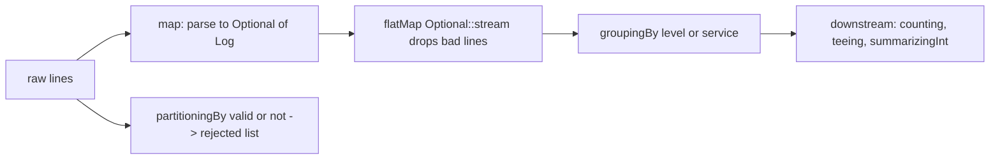

# 4.7 Complex Examples: Data Processing

> **Goal:** Apply streams to text analytics, log parsing, tree flattening, joins, sessionisation, de-duplication, windows, matrices and paging.

**Level:** applied. Each section is a reusable technique with real output.
**Verified on:** OpenJDK 21.0.12. Every output below was produced by running the code.

## Contents

1. [The full program](#1-the-full-program)
2. [Text analytics: frequency, ties, longest word](#2-text-analytics-frequency-ties-longest-word)
3. [Anagram groups](#3-anagram-groups)
4. [Log parsing: parse, drop bad lines, summarise](#4-log-parsing-parse-drop-bad-lines-summarise)
5. [Flattening a tree](#5-flattening-a-tree)
6. [Joins: inner, left, orphans](#6-joins-inner-left-orphans)
7. [Sessionisation](#7-sessionisation)
8. [Latest record per key](#8-latest-record-per-key)
9. [Windows, matrices, paging](#9-windows-matrices-paging)
10. [Techniques summary](#10-techniques-summary)
11. [Common gotchas](#11-common-gotchas)
12. [Interview questions](#12-interview-questions)

---

## 1. The full program

```java
import java.util.*;
import java.util.function.*;
import java.util.regex.*;
import java.util.stream.*;

public class S07DataProcessing {
    // ---------- 1. Text analytics ----------
    static final String TEXT = """
            the quick brown fox jumps over the lazy dog
            the dog barks and the fox runs away
            a quick fox is a happy fox
            """;

    // ---------- 2. Log parsing ----------
    record Log(int second, String level, String service, String message) { }
    static final Pattern LOG = Pattern.compile("(\\d+)s (\\w+) \\[(\\w+)] (.*)");
    static Optional<Log> parse(String line) {
        Matcher m = LOG.matcher(line);
        return m.matches() ? Optional.of(new Log(Integer.parseInt(m.group(1)), m.group(2), m.group(3), m.group(4))) : Optional.empty();
    }

    // ---------- 3. Tree flattening ----------
    record Node(String name, List<Node> children) {
        Node(String name, Node... kids) { this(name, List.of(kids)); }
        Stream<Node> flatten() { return Stream.concat(Stream.of(this), children.stream().flatMap(Node::flatten)); }
        Stream<String> paths(String prefix) {
            String here = prefix.isEmpty() ? name : prefix + "/" + name;
            return children.isEmpty() ? Stream.of(here) : children.stream().flatMap(c -> c.paths(here));
        }
    }

    // ---------- 4. Joins ----------
    record Customer(int id, String name) { }
    record Purchase(int id, int customerId, int amount) { }

    // ---------- 5. Sessions ----------
    record Event(String user, int second) { }

    public static void main(String[] args) {
        // 1. Word frequency: top 4, ties alphabetical
        System.out.println("1. word frequency");
        Map<String, Long> freq = Arrays.stream(TEXT.split("\\W+")).collect(Collectors.groupingBy(Function.identity(), Collectors.counting()));
        System.out.println("   top4: " + freq.entrySet().stream().sorted(Map.Entry.<String, Long>comparingByValue().reversed().thenComparing(Map.Entry.comparingByKey())).limit(4).map(e -> e.getKey() + "=" + e.getValue()).toList());
        System.out.println("   longest word: " + freq.keySet().stream().max(Comparator.comparingInt(String::length).thenComparing(Comparator.naturalOrder())).get());
        System.out.println("   words per line: " + TEXT.lines().map(l -> l.split(" ").length).toList());

        // 2. Anagram groups
        System.out.println("2. anagrams");
        System.out.println("   " + Stream.of("listen", "silent", "enlist", "google", "gogole", "cat", "act", "tac", "dog")
                .collect(Collectors.groupingBy(w -> { char[] c = w.toCharArray(); Arrays.sort(c); return new String(c); }, TreeMap::new, Collectors.toList()))
                .values().stream().filter(g -> g.size() > 1).toList());

        // 3. Log parsing: bad lines are dropped, good ones summarised
        System.out.println("3. logs");
        List<String> lines = List.of("1s INFO [auth] login ok", "3s ERROR [pay] timeout", "bad line", "4s INFO [pay] charged", "9s ERROR [auth] locked", "12s ERROR [pay] declined", "");
        List<Log> logs = lines.stream().map(S07DataProcessing::parse).flatMap(Optional::stream).toList();
        System.out.println("   parsed " + logs.size() + " of " + lines.size() + " lines");
        System.out.println("   by level: " + logs.stream().collect(Collectors.groupingBy(Log::level, TreeMap::new, Collectors.counting())));
        System.out.println("   error rate per service: " + logs.stream().collect(Collectors.groupingBy(Log::service, TreeMap::new,
                Collectors.teeing(Collectors.filtering(l -> l.level().equals("ERROR"), Collectors.counting()), Collectors.counting(), (e, n) -> e + "/" + n))));
        System.out.println("   first/last second per level: " + logs.stream().collect(Collectors.groupingBy(Log::level, TreeMap::new, Collectors.summarizingInt(Log::second)))
                .entrySet().stream().map(e -> e.getKey() + "[" + e.getValue().getMin() + ".." + e.getValue().getMax() + "]").toList());
        Map<Boolean, List<String>> valid = lines.stream().collect(Collectors.partitioningBy(l -> parse(l).isPresent()));
        System.out.println("   rejected lines: " + valid.get(false));

        // 4. Tree flattening
        System.out.println("4. tree");
        Node root = new Node("root", new Node("etc", new Node("hosts"), new Node("conf", new Node("app.yml"))), new Node("var", new Node("log")));
        System.out.println("   nodes: " + root.flatten().map(Node::name).toList());
        System.out.println("   leaf paths: " + root.paths("").toList());
        System.out.println("   leaf count: " + root.flatten().filter(n -> n.children().isEmpty()).count());

        // 5. Joins
        System.out.println("5. joins");
        List<Customer> customers = List.of(new Customer(1, "Asha"), new Customer(2, "Ravi"), new Customer(3, "Meera"));
        List<Purchase> purchases = List.of(new Purchase(10, 1, 50), new Purchase(11, 1, 70), new Purchase(12, 2, 30), new Purchase(13, 9, 99));
        Map<Integer, Customer> byId = customers.stream().collect(Collectors.toMap(Customer::id, Function.identity()));
        System.out.println("   inner join: " + purchases.stream().filter(p -> byId.containsKey(p.customerId())).map(p -> byId.get(p.customerId()).name() + ":" + p.amount()).toList());
        Map<Integer, Integer> totals = purchases.stream().collect(Collectors.groupingBy(Purchase::customerId, Collectors.summingInt(Purchase::amount)));
        System.out.println("   left join (customers without purchases show 0): " + customers.stream().map(c -> c.name() + "=" + totals.getOrDefault(c.id(), 0)).toList());
        System.out.println("   orphans (purchases without customer): " + purchases.stream().filter(p -> !byId.containsKey(p.customerId())).map(Purchase::id).toList());

        // 6. Sessionisation: a new session starts after a gap of more than 30 seconds
        System.out.println("6. sessions");
        List<Event> events = List.of(new Event("a", 0), new Event("a", 10), new Event("a", 100), new Event("a", 120), new Event("a", 125), new Event("b", 5), new Event("b", 500));
        events.stream().collect(Collectors.groupingBy(Event::user, TreeMap::new, Collectors.mapping(Event::second, Collectors.toList()))).forEach((user, secs) -> {
            List<Integer> sorted = secs.stream().sorted().toList();
            List<Integer> starts = IntStream.range(0, sorted.size()).filter(i -> i == 0 || sorted.get(i) - sorted.get(i - 1) > 30).boxed().toList();
            System.out.println("   user " + user + ": " + IntStream.range(0, starts.size()).mapToObj(k -> {
                int from = starts.get(k), to = k + 1 < starts.size() ? starts.get(k + 1) : sorted.size();
                return "session" + (k + 1) + sorted.subList(from, to) + " lasted " + (sorted.get(to - 1) - sorted.get(from)) + "s";
            }).toList());
        });

        // 7. Keep the latest record per key
        System.out.println("7. latest per key");
        record Rev(String key, int version, String value) { }
        System.out.println("   " + Stream.of(new Rev("k1", 1, "a"), new Rev("k2", 1, "b"), new Rev("k1", 3, "c"), new Rev("k1", 2, "d"))
                .collect(Collectors.toMap(Rev::key, Function.identity(), BinaryOperator.maxBy(Comparator.comparingInt(Rev::version)), TreeMap::new)).values());

        // 8. Moving average, matrix transpose, pagination
        System.out.println("8. windows, matrices, paging");
        int[] data = {3, 5, 8, 4, 9, 2};
        System.out.println("   moving avg(3): " + IntStream.rangeClosed(0, data.length - 3).mapToObj(i -> String.format("%.2f", Arrays.stream(data, i, i + 3).average().getAsDouble())).toList());
        int[][] matrix = {{1, 2, 3}, {4, 5, 6}};
        System.out.println("   transpose: " + IntStream.range(0, 3).mapToObj(c -> Arrays.stream(matrix).mapToInt(row -> row[c]).boxed().toList()).toList());
        System.out.println("   row sums " + Arrays.stream(matrix).map(r -> Arrays.stream(r).sum()).toList() + ", col sums " + IntStream.range(0, 3).map(c -> Arrays.stream(matrix).mapToInt(r -> r[c]).sum()).boxed().toList());
        List<Integer> all = IntStream.rangeClosed(1, 23).boxed().toList();
        System.out.println("   page 3 of size 10: " + all.stream().skip(2 * 10L).limit(10).toList() + ", pages = " + (all.size() + 9) / 10);
    }
}

// ---- Output ----
// 1. word frequency
//    top4: [fox=4, the=4, a=2, dog=2]
//    longest word: quick
//    words per line: [9, 8, 7]
// 2. anagrams
//    [[cat, act, tac], [google, gogole], [listen, silent, enlist]]
// 3. logs
//    parsed 5 of 7 lines
//    by level: {ERROR=3, INFO=2}
//    error rate per service: {auth=1/2, pay=2/3}
//    first/last second per level: [ERROR[3..12], INFO[1..4]]
//    rejected lines: [bad line, ]
// 4. tree
//    nodes: [root, etc, hosts, conf, app.yml, var, log]
//    leaf paths: [root/etc/hosts, root/etc/conf/app.yml, root/var/log]
//    leaf count: 3
// 5. joins
//    inner join: [Asha:50, Asha:70, Ravi:30]
//    left join (customers without purchases show 0): [Asha=120, Ravi=30, Meera=0]
//    orphans (purchases without customer): [13]
// 6. sessions
//    user a: [session1[0, 10] lasted 10s, session2[100, 120, 125] lasted 25s]
//    user b: [session1[5] lasted 0s, session2[500] lasted 0s]
// 7. latest per key
//    [Rev[key=k1, version=3, value=c], Rev[key=k2, version=1, value=b]]
// 8. windows, matrices, paging
//    moving avg(3): [5.33, 5.67, 7.00, 5.00]
//    transpose: [[1, 4], [2, 5], [3, 6]]
//    row sums [6, 15], col sums [5, 7, 9]
//    page 3 of size 10: [21, 22, 23], pages = 3
```

## 2. Text analytics: frequency, ties, longest word

Steps: split on `\W+` (one or more non-word characters), `groupingBy(identity(), counting())`, then sort entries by count descending **then key ascending** so ties are deterministic (`fox` and `the` both appear 4 times). `max(comparingInt(String::length).thenComparing(naturalOrder()))` finds the longest word with a stable tie-break. A text block (Java 15) keeps the input readable.

## 3. Anagram groups

Two words are anagrams when their sorted letters match, so the sorted letters are the **grouping key**. `groupingBy(sortedLetters, TreeMap::new, toList())`, then keep groups with more than one word. This "canonical form as key" idea also solves de-duplication of case, whitespace or unordered tuples.

## 4. Log parsing: parse, drop bad lines, summarise



Design points:

- `parse` returns `Optional<Log>`, so parsing failures are values, not exceptions.
- `flatMap(Optional::stream)` removes empty results in one step (Java 9).
- `teeing(filtering(isError, counting()), counting(), ...)` computes the error rate (`pay` is `2/3`) in one pass.
- `summarizingInt(Log::second)` gives first/last timestamps (`min`/`max`) per level.
- `partitioningBy(line -> parse(line).isPresent())` collects the **rejected** lines for reporting; parsing twice is acceptable for clarity, parse once and carry a result type for large inputs.

## 5. Flattening a tree

For recursive structures, a method that returns `Stream.concat(Stream.of(this), children.stream().flatMap(Node::flatten))` gives a pre-order stream of every node. A second method builds path strings for leaves. Streams of recursive calls are lazy and compose well with `filter`, `count`, `anyMatch`.

Caveat: very deep trees can overflow the stack because each level adds several frames; for depth in the thousands use an explicit stack (`ArrayDeque`).

## 6. Joins: inner, left, orphans

A stream pipeline has no join operator. The pattern is: **index the smaller side in a map** (`toMap(Customer::id, identity())`), then stream the other side and look up.

| Join | How |
|---|---|
| Inner | stream purchases, `filter(containsKey)`, `map(lookup)` |
| Left (keep all customers) | stream customers, `getOrDefault(id, 0)` from a pre-aggregated map |
| Anti-join / orphans | `filter(!containsKey)` |
| Many-to-many | `flatMap` over the matching list from `groupingBy` |

This is a hash join: O(n + m) instead of the O(n * m) nested loop.

## 7. Sessionisation

Goal: split each user's sorted timestamps into sessions where a gap over 30 seconds starts a new one. Approach without mutable state:

1. Group timestamps by user.
2. Sort each list.
3. Find **session start indexes**: `IntStream.range(0, n).filter(i -> i == 0 || t[i] - t[i-1] > 30)`.
4. Pair each start with the next start (or `n`) to slice the list with `subList`.

Index streams (`IntStream.range`) are the standard escape hatch when you need "the previous element".

## 8. Latest record per key

`toMap(key, identity(), BinaryOperator.maxBy(comparingInt(version)), TreeMap::new)` keeps one record per key, choosing the greatest version when keys collide. The merge function is the whole algorithm.

## 9. Windows, matrices, paging

- **Moving average**: `IntStream.rangeClosed(0, n - w)` and `Arrays.stream(data, i, i + w)`.
- **Transpose**: for each column index, stream the rows and pick that column.
- **Row/column sums**: `Arrays.stream(matrix).map(row -> Arrays.stream(row).sum())` and an index stream for columns.
- **Paging**: `skip((page - 1) * size).limit(size)`; remember to cast to `long` when multiplying to avoid `int` overflow.

## 10. Techniques summary

| Technique | Use for |
|---|---|
| Canonical key + `groupingBy` | anagrams, de-duplication, bucketing |
| `Optional` + `flatMap(Optional::stream)` | tolerant parsing |
| Hash index (`toMap`) + stream | joins |
| `IntStream.range` over indexes | previous/next element, windows, sessions |
| Recursive `flatMap` | trees, graphs without cycles |
| `toMap` + `maxBy` merge | latest/best per key |
| `partitioningBy` | separating good and bad records |
| `teeing`, `summarizingX` | several statistics in one pass |

## 11. Common gotchas

| Gotcha | Why | Fix |
|---|---|---|
| `split("\\s+")` leaves an empty first token | leading whitespace | `strip()` first or `\\W+` filter empties |
| Regex compiled inside the lambda | recompiled per element | compile a static `Pattern` |
| Parsing exceptions inside `map` | abort the pipeline | return `Optional` or a result record |
| Join with duplicate keys in `toMap` | duplicate key exception | `groupingBy` for one-to-many |
| Recursion depth | each level adds stack frames | explicit stack for deep structures |
| Pagination arithmetic overflow | `int` multiplication | use `long` |
| Order of `HashMap` output | unspecified | `TreeMap::new` |
| Streaming `Files.lines` without closing | handle leak | try-with-resources |

## 12. Interview questions

<details>
<summary><strong>Q1. How do you group anagrams?</strong></summary>

Use the sorted characters of each word as the key in <code>groupingBy</code> and keep groups of size greater than one.
</details>

<details>
<summary><strong>Q2. How do you parse lines tolerantly in a stream?</strong></summary>

Map each line to <code>Optional&lt;Parsed&gt;</code> and use <code>flatMap(Optional::stream)</code>, optionally collecting the rejected lines with <code>partitioningBy</code>.
</details>

<details>
<summary><strong>Q3. How do you join two collections with streams?</strong></summary>

Index one side by key in a <code>Map</code>, then stream the other side and look up: a hash join. Use <code>getOrDefault</code> for left joins and <code>containsKey</code> for anti-joins.
</details>

<details>
<summary><strong>Q4. How do you access the previous element in a stream pipeline?</strong></summary>

Not directly. Stream over indexes (<code>IntStream.range</code>) and read the list or array, or use a loop.
</details>

<details>
<summary><strong>Q5. How do you flatten a tree into paths?</strong></summary>

A recursive method returning a stream: leaves return their own path, inner nodes <code>flatMap</code> over children with an extended prefix.
</details>

<details>
<summary><strong>Q6. How do you keep only the latest record per key?</strong></summary>

<code>toMap(key, identity(), BinaryOperator.maxBy(comparing(version)))</code>.
</details>

<details>
<summary><strong>Q7. How do you detect session boundaries without mutable state?</strong></summary>

Compute indexes where the gap to the previous timestamp exceeds the threshold and slice between consecutive boundary indexes.
</details>

<details>
<summary><strong>Q8. How do you paginate a list with streams, and what is the catch?</strong></summary>

<code>skip((page-1)*size).limit(size)</code>; the catch is that skipping is O(offset) and the multiplication can overflow <code>int</code>. For databases paginate in the query.
</details>

<details>
<summary><strong>Q9. Why compile a regex outside the lambda?</strong></summary>

<code>Pattern.compile</code> is expensive; the lambda runs per element. Use a <code>static final Pattern</code>.
</details>

<details>
<summary><strong>Q10. When would you not use streams for data processing?</strong></summary>

When processing needs ordered mutable state, checked exceptions on every step, or multi-pass algorithms where a loop is clearer; or when data is too large for memory and you need a streaming framework instead.
</details>

---

[Previous: 4.6 Complex Examples: Reporting and Aggregation](./06-complex-examples-reporting-and-aggregation.md) · [Part index](./README.md) · Next: [4.8 Spliterators and Parallel Streams](./08-spliterators-and-parallel-streams.md)