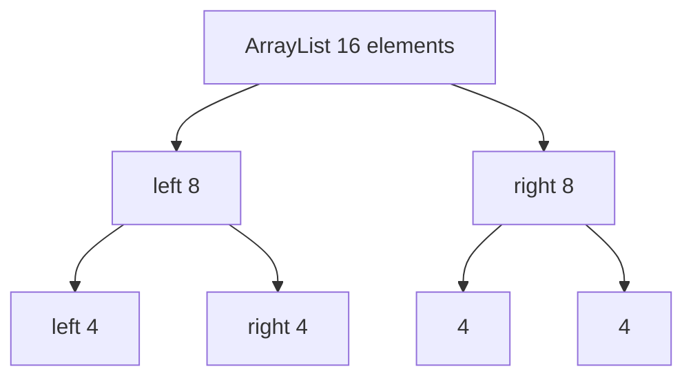
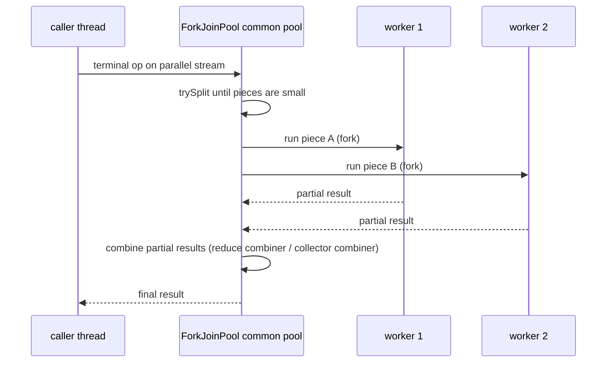

# 4.8 Spliterators and Parallel Streams

> **Goal:** Understand how a stream source is split for parallel execution, what `Spliterator` characteristics promise, when `parallel()` helps, and how to use it safely.

**Level:** advanced. Part 12 covers the Fork/Join framework underneath.
**Verified on:** OpenJDK 21.0.12. Every output below was produced by running deterministic code; timings are deliberately not shown because they depend on the machine.

## Contents

1. [Spliterator: the engine of every stream](#1-spliterator-the-engine-of-every-stream)
2. [Characteristics](#2-characteristics)
3. [Splitting in action](#3-splitting-in-action)
4. [Writing your own Spliterator](#4-writing-your-own-spliterator)
5. [How a parallel stream executes](#5-how-a-parallel-stream-executes)
6. [Rules for correct parallel code](#6-rules-for-correct-parallel-code)
7. [Safe patterns demonstrated](#7-safe-patterns-demonstrated)
8. [When does parallel actually help?](#8-when-does-parallel-actually-help)
9. [Common gotchas](#9-common-gotchas)
10. [Interview questions](#10-interview-questions)

---

## 1. Spliterator: the engine of every stream

**Intuition.** An `Iterator` hands out elements one by one. A **Spliterator** (splittable iterator) can also **divide itself in two**, so different threads can work on different halves. Every stream is built on one.

| Method | Role |
|---|---|
| `tryAdvance(consumer)` | process one element if any remain (returns `false` when done) |
| `forEachRemaining(consumer)` | bulk traversal |
| `trySplit()` | split off a portion (usually the first half) into a new spliterator, or `null` if too small |
| `estimateSize()` | how many elements remain (exact if `SIZED`) |
| `characteristics()` | bit flags describing the source |

## 2. Characteristics

| Flag | Meaning | Allows |
|---|---|---|
| `ORDERED` | has a defined encounter order | order-sensitive ops, `findFirst` determinism |
| `SIZED` | `estimateSize()` is exact | `count()` shortcut, preallocated arrays |
| `SUBSIZED` | splits are also `SIZED` | balanced splitting, `toArray` without copying |
| `DISTINCT` | no duplicates | `distinct()` becomes a no-op |
| `SORTED` | sorted by a comparator | `sorted()` becomes a no-op |
| `NONNULL` | no nulls | skip null checks |
| `IMMUTABLE` / `CONCURRENT` | source cannot / can be changed during traversal | fail-fast behaviour |

```java
import java.util.*;
import java.util.function.*;
import java.util.stream.*;

public class S08Spliterators {
    static String flags(Spliterator<?> s) {
        int[] all = {Spliterator.ORDERED, Spliterator.DISTINCT, Spliterator.SORTED, Spliterator.SIZED, Spliterator.NONNULL, Spliterator.IMMUTABLE, Spliterator.CONCURRENT, Spliterator.SUBSIZED};
        String[] names = {"ORDERED", "DISTINCT", "SORTED", "SIZED", "NONNULL", "IMMUTABLE", "CONCURRENT", "SUBSIZED"};
        return IntStream.range(0, all.length).filter(i -> s.hasCharacteristics(all[i])).mapToObj(i -> names[i]).collect(Collectors.joining(","));
    }

    // A hand-written spliterator over the ints [from, to): the heart of what a parallel stream needs
    static class IntRange implements Spliterator.OfInt {
        private int from; private final int to;
        IntRange(int from, int to) { this.from = from; this.to = to; }
        @Override public boolean tryAdvance(IntConsumer action) { if (from >= to) return false; action.accept(from++); return true; }
        @Override public OfInt trySplit() {                                 // hand the LEFT half to a new spliterator, keep the right half
            int mid = (from + to) >>> 1;
            if (mid <= from) return null;                                   // too small to split
            IntRange left = new IntRange(from, mid);
            from = mid;
            return left;
        }
        @Override public long estimateSize() { return to - from; }
        @Override public int characteristics() { return ORDERED | SIZED | SUBSIZED | IMMUTABLE | NONNULL | DISTINCT | SORTED; }
        @Override public Comparator<? super Integer> getComparator() { return null; }   // null = natural order
    }

    public static void main(String[] args) {
        // 1. What each source promises (characteristics drive optimisations)
        System.out.println("ArrayList   : " + flags(new ArrayList<>(List.of(1, 2, 3)).spliterator()));
        System.out.println("LinkedList  : " + flags(new LinkedList<>(List.of(1, 2, 3)).spliterator()));
        System.out.println("HashSet     : " + flags(new HashSet<>(List.of(1, 2, 3)).spliterator()));
        System.out.println("TreeSet     : " + flags(new TreeSet<>(List.of(1, 2, 3)).spliterator()));
        System.out.println("List.of     : " + flags(List.of(1, 2, 3).spliterator()));
        System.out.println("IntStream.range: " + flags(IntStream.range(0, 5).spliterator()));
        System.out.println("iterate     : " + flags(Stream.iterate(1, x -> x + 1).spliterator()));

        // 2. How splitting works: a parallel stream keeps calling trySplit until pieces are small
        Spliterator<Integer> sp = IntStream.range(0, 16).boxed().collect(Collectors.toCollection(ArrayList::new)).spliterator();
        Spliterator<Integer> left = sp.trySplit();
        System.out.println("ArrayList(16) split: left=" + left.estimateSize() + " right=" + sp.estimateSize());
        Spliterator<Integer> leftLeft = left.trySplit();
        System.out.println("split the left again: " + leftLeft.estimateSize() + " + " + left.estimateSize());
        LinkedList<Integer> ll = new LinkedList<>(IntStream.range(0, 16).boxed().toList());
        Spliterator<Integer> lsp = ll.spliterator();
        Spliterator<Integer> lleft = lsp.trySplit();
        System.out.println("LinkedList(16) split: left=" + lleft.estimateSize() + " right=" + lsp.estimateSize() + " (copied into an array batch: poor splitting)");

        // 3. Our own spliterator, plugged in with StreamSupport
        System.out.println("custom sequential sum: " + StreamSupport.intStream(new IntRange(0, 1000), false).sum());
        System.out.println("custom parallel sum  : " + StreamSupport.intStream(new IntRange(0, 1000), true).sum());
        IntRange range = new IntRange(0, 10);
        List<Integer> sizes = new ArrayList<>();
        Deque<Spliterator.OfInt> work = new ArrayDeque<>(List.of(range));
        while (!work.isEmpty()) {                                           // split until pieces have at most 3 elements
            Spliterator.OfInt s = work.pop();
            Spliterator.OfInt half;
            if (s.estimateSize() > 3 && (half = s.trySplit()) != null) { work.push(s); work.push(half); }
            else sizes.add((int) s.estimateSize());
        }
        System.out.println("pieces of range(0,10) after recursive splitting: " + sizes);

        // 4. Stream.spliterator() / iterator() as an escape hatch
        Spliterator<String> fromStream = Stream.of("x", "y", "z").spliterator();
        fromStream.tryAdvance(v -> System.out.println("tryAdvance consumed one: " + v));
        fromStream.forEachRemaining(v -> System.out.println("forEachRemaining: " + v));
    }
}

// ---- Output ----
// ArrayList   : ORDERED,SIZED,SUBSIZED
// LinkedList  : ORDERED,SIZED,SUBSIZED
// HashSet     : DISTINCT,SIZED
// TreeSet     : ORDERED,DISTINCT,SORTED,SIZED
// List.of     : ORDERED,SIZED,SUBSIZED
// IntStream.range: ORDERED,DISTINCT,SORTED,SIZED,NONNULL,IMMUTABLE,SUBSIZED
// iterate     : ORDERED,IMMUTABLE
// ArrayList(16) split: left=8 right=8
// split the left again: 4 + 4
// LinkedList(16) split: left=16 right=0 (copied into an array batch: poor splitting)
// custom sequential sum: 499500
// custom parallel sum  : 499500
// pieces of range(0,10) after recursive splitting: [2, 3, 2, 3]
// tryAdvance consumed one: x
// forEachRemaining: y
// forEachRemaining: z
```

Reading the first block:

- **`ArrayList` / `List.of`**: `ORDERED, SIZED, SUBSIZED`: excellent for parallelism (exact sizes, balanced splits).
- **`HashSet`**: `DISTINCT, SIZED` but **not** `SUBSIZED` or `ORDERED`: it can be split but not into exact halves.
- **`TreeSet`**: `SORTED` and `DISTINCT`, so `sorted()` and `distinct()` can be skipped.
- **`IntStream.range`**: carries almost every flag, which is why `IntStream.range(...).parallel()` is the textbook good case.
- **`Stream.iterate`**: only `ORDERED, IMMUTABLE`, not `SIZED`: sequential by nature, since element `n` depends on element `n-1`.

## 3. Splitting in action



The demo shows `ArrayList(16)` splitting into `8 + 8`, then the left half into `4 + 4`: pure halving by index, so work is balanced. `LinkedList` cannot jump to the middle, so its spliterator copies elements into an array batch: `left=16 right=0`, i.e. a poor split. **The data structure decides how well a stream parallelises.**

| Source | Split quality |
|---|---|
| `ArrayList`, arrays, `IntStream.range` | excellent |
| `HashSet`, `HashMap` | good (by table) |
| `TreeSet`, `TreeMap` | fair |
| `LinkedList`, `Stream.iterate`, `BufferedReader.lines` | poor |

## 4. Writing your own Spliterator

The `IntRange` class in the program above is a complete spliterator over `[from, to)`:

- `trySplit` hands the **left half** to a new spliterator and keeps the right half in `this`; if the range is too small it returns `null`.
- `estimateSize` is exact, so it declares `SIZED | SUBSIZED`.
- `StreamSupport.intStream(spliterator, parallel)` turns it into a stream.

Both the sequential and parallel sums equal `499500`, and the manual recursive splitting loop shows the pieces a parallel run would create (`[2, 3, 2, 3]` for a range of 10 split until pieces have at most 3 elements). Custom spliterators matter for unusual sources (a database cursor, a tree walker, fixed-size record files) and for gatherer-like operations; Java 22+ added `Gatherers` for custom intermediate operations, which is outside the Java 21 baseline of this part.

## 5. How a parallel stream executes



Facts:

- The default executor is the **common pool** (`ForkJoinPool.commonPool()`), shared by the whole JVM; its size defaults to the number of cores minus one, and the calling thread participates.
- Each leaf task runs the sequential pipeline over its chunk; results are combined with the reduction's combiner.
- `parallel()` and `sequential()` only set a flag on the **whole pipeline**: the last call wins (demo).

## 6. Rules for correct parallel code

| Rule | Why | Violation example |
|---|---|---|
| Associative operations | chunks are combined in unknown groupings | `a - b` (demo: `-10` versus `4`) |
| True identity | it is applied once per chunk | `reduce(10, sum)` gives 30 instead of 20 (demo) |
| Stateless lambdas | no shared mutable state | `forEach(list::add)` on an `ArrayList` |
| Non-interference | do not touch the source | modifying the list while streaming |
| No blocking inside | pool threads are scarce | JDBC call per element |
| Thread-safe containers if you must share | otherwise races | `ConcurrentHashMap`, `LongAdder` |
| Do not rely on order unless the stream is ordered | `forEach`, `findAny` | use `forEachOrdered`, `findFirst` |

## 7. Safe patterns demonstrated

```java
import java.util.*;
import java.util.concurrent.*;
import java.util.stream.*;

public class S08Parallel {
    public static void main(String[] args) throws Exception {
        // 1. Same answer for associative, stateless operations
        System.out.println("sum  seq/par: " + LongStream.rangeClosed(1, 100_000).sum() + " / " + LongStream.rangeClosed(1, 100_000).parallel().sum());
        System.out.println("collect keeps encounter order: " + IntStream.range(0, 12).boxed().parallel().map(i -> i * i).collect(Collectors.toList()));
        System.out.println("forEachOrdered keeps order   : " + collectViaForEachOrdered());

        // 2. Why reduce needs an associative operation: simulate a split by hand
        int sequential = Stream.of(1, 2, 3, 4).reduce(0, (a, b) -> a - b);
        int left = Stream.of(1, 2).reduce(0, (a, b) -> a - b), right = Stream.of(3, 4).reduce(0, (a, b) -> a - b);
        System.out.println("(a-b) sequential = " + sequential + "; two halves " + left + " and " + right + " combined = " + (left - right) + "  -> a parallel run may produce either");
        System.out.println("identity must be neutral: reduce(10, sum) over halves of [1,2,3,4] -> " + (Stream.of(1, 2).reduce(10, Integer::sum) + Stream.of(3, 4).reduce(10, Integer::sum)) + " instead of 20");

        // 3. The last call of parallel()/sequential() wins for the WHOLE pipeline
        System.out.println("parallel().sequential() isParallel: " + IntStream.range(0, 3).parallel().sequential().isParallel());
        System.out.println("sequential().parallel() isParallel: " + IntStream.range(0, 3).sequential().parallel().isParallel());

        // 4. Run parallel streams in your OWN pool, not the shared common pool
        ForkJoinPool pool = new ForkJoinPool(2, p -> {
            ForkJoinPool.ForkJoinWorkerThreadFactory f = ForkJoinPool.defaultForkJoinWorkerThreadFactory;
            var t = f.newThread(p); t.setName("custom-pool-" + t.getPoolIndex()); return t; }, null, false);
        boolean allInCustom = pool.submit(() -> IntStream.range(0, 1000).parallel().mapToObj(i -> Thread.currentThread().getName().startsWith("custom-pool-")).allMatch(b -> b)).get();
        System.out.println("all work ran inside the custom pool: " + allInCustom);
        pool.shutdown();

        // 5. Unordered + short circuit: findAny is allowed to return ANY match (deterministic here only because one element matches)
        System.out.println("findAny with a single match: " + IntStream.range(0, 1000).parallel().filter(i -> i == 777).findAny().getAsInt());

        // 6. Safe versus unsafe collection of results
        List<Integer> safe = IntStream.range(0, 1000).parallel().boxed().collect(Collectors.toList());   // each thread fills its own container, then merged
        System.out.println("collect() into a list from a parallel stream: size " + safe.size() + " (always correct)");
        System.out.println("forEach(list::add) on an ArrayList would race: lost updates, exceptions or nulls (not run here, non-deterministic)");

        // 7. Stateful operations on ordered parallel streams still honour encounter order
        System.out.println("parallel sorted().limit(5): " + IntStream.range(0, 100).boxed().parallel().sorted(Comparator.reverseOrder()).limit(5).toList());
        System.out.println("parallel skip(95)         : " + IntStream.range(0, 100).boxed().parallel().skip(95).toList());
    }

    static List<Integer> collectViaForEachOrdered() {
        List<Integer> out = Collections.synchronizedList(new ArrayList<>());
        IntStream.range(0, 12).boxed().parallel().forEachOrdered(out::add);
        return out;
    }
}

// ---- Output ----
// sum  seq/par: 5000050000 / 5000050000
// collect keeps encounter order: [0, 1, 4, 9, 16, 25, 36, 49, 64, 81, 100, 121]
// forEachOrdered keeps order   : [0, 1, 2, 3, 4, 5, 6, 7, 8, 9, 10, 11]
// (a-b) sequential = -10; two halves -3 and -7 combined = 4  -> a parallel run may produce either
// identity must be neutral: reduce(10, sum) over halves of [1,2,3,4] -> 30 instead of 20
// parallel().sequential() isParallel: false
// sequential().parallel() isParallel: true
// all work ran inside the custom pool: true
// findAny with a single match: 777
// collect() into a list from a parallel stream: size 1000 (always correct)
// forEach(list::add) on an ArrayList would race: lost updates, exceptions or nulls (not run here, non-deterministic)
// parallel sorted().limit(5): [99, 98, 97, 96, 95]
// parallel skip(95)         : [95, 96, 97, 98, 99]
```

What each block proves:

1. **Same answer** for associative, stateless operations; `collect` into a list preserves encounter order even in parallel.
2. **Non-associative reduce**: a hand simulation of two halves gives `4`, where the sequential answer is `-10`. A real parallel run may produce either depending on how it splits, which is why this bug is intermittent.
3. **Neutral identity**: `10` added once per chunk yields `30` for two chunks.
4. **The last call wins**: `parallel().sequential()` is sequential.
5. **Own pool**: submit the pipeline as a task to a custom `ForkJoinPool`; every element was processed on a thread of that pool, so the common pool stays free for others (this relies on how Fork/Join works, an implementation behaviour that is widely used but not part of the Streams specification).
6. **`collect` is the safe way** to gather results: each thread fills its own container and the combiner merges them.
7. **Order-sensitive ops stay correct**: `sorted().limit(5)` and `skip(95)` return the right answers on an ordered parallel stream, at the cost of coordination.

## 8. When does parallel actually help?

A rough cost model (Brian Goetz): parallel speed-up requires **enough work**: `N * Q` where N is the number of elements and Q the per-element cost. As a rule of thumb, N * Q should be at least on the order of tens of thousands of simple operations, otherwise splitting and merging overhead dominate.

| Good candidates | Poor candidates |
|---|---|
| Large arrays / `ArrayList` / `IntStream.range` | small collections (hundreds) |
| CPU-heavy, independent per-element work | I/O or blocking work |
| Associative reductions (`sum`, `max`, `groupingByConcurrent`) | order-dependent logic, `limit` on ordered data |
| Dedicated machine / dedicated pool | busy server where the common pool is shared |
| Cheap-to-split sources | `LinkedList`, `iterate`, line-by-line file reading |

Always **measure** with a benchmark harness (JMH, Part 16) on production-like hardware; guessing is wrong more often than right. On a container limited to one or two CPUs, parallel streams add overhead and nothing else.

## 9. Common gotchas

| Gotcha | Why | Fix |
|---|---|---|
| Parallel stream slower than sequential | overhead, tiny data, bad source | measure; stay sequential |
| Wrong results sometimes | shared mutable state or non-associative op | stateless lambdas, `collect` |
| Whole app slows down | common pool saturated by blocking tasks | own pool, or no parallel |
| `forEach` order surprises | no ordering guarantee | `forEachOrdered` |
| `limit`/`skip`/`findFirst` slow in parallel | must respect order | `unordered()` if order is irrelevant |
| `ThreadLocal` / transaction context missing | tasks run on other threads | pass data explicitly |
| `Collectors.toMap` merge function inconsistent | combiner uses it | associative merge |
| Debugging heisenbugs | non-determinism | reproduce sequentially first |
| Assuming `parallelStream()` uses all cores | default parallelism is cores minus one plus the caller | configure only if you understand the pool |

## 10. Interview questions

<details>
<summary><strong>Q1. What is a Spliterator and how does it differ from an Iterator?</strong></summary>

A Spliterator can both traverse (<code>tryAdvance</code>, <code>forEachRemaining</code>) and partition itself (<code>trySplit</code>) for parallel processing, and it reports characteristics and size estimates. Streams are built on spliterators.
</details>

<details>
<summary><strong>Q2. How does a parallel stream work?</strong></summary>

The source spliterator is recursively split into chunks processed by Fork/Join tasks in the common pool; each chunk runs the sequential pipeline and partial results are merged with the combiner.
</details>

<details>
<summary><strong>Q3. Which collections parallelise well and which don't?</strong></summary>

Arrays, <code>ArrayList</code> and <code>IntStream.range</code> split in exact halves. <code>LinkedList</code>, <code>Stream.iterate</code> and I/O line streams split poorly. Hash-based structures are in between.
</details>

<details>
<summary><strong>Q4. What requirements must a parallel <code>reduce</code> meet?</strong></summary>

Associative accumulator and combiner, identity that is neutral, stateless, non-interfering functions. Otherwise results depend on how the work happened to be split.
</details>

<details>
<summary><strong>Q5. Why is <code>forEach(list::add)</code> on a parallel stream a bug?</strong></summary>

<code>ArrayList</code> is not thread-safe: concurrent adds lose elements, throw exceptions or leave nulls. Use <code>collect(Collectors.toList())</code>.
</details>

<details>
<summary><strong>Q6. Which pool runs a parallel stream and how do you change it?</strong></summary>

The common <code>ForkJoinPool</code>. Run the pipeline inside your own <code>ForkJoinPool.submit(...)</code> so its tasks use that pool, or tune <code>-Djava.util.concurrent.ForkJoinPool.common.parallelism</code>.
</details>

<details>
<summary><strong>Q7. What does <code>parallel().sequential()</code> do?</strong></summary>

The stream becomes sequential: the last call decides for the entire pipeline.
</details>

<details>
<summary><strong>Q8. When is parallel streaming a bad idea?</strong></summary>

Small data, blocking I/O, shared common pool in a server, order-dependent logic, poorly splittable sources, or when you haven't measured a benefit.
</details>

<details>
<summary><strong>Q9. What do <code>SIZED</code> and <code>SUBSIZED</code> enable?</strong></summary>

Exact size knowledge for <code>count()</code> shortcuts, array preallocation and balanced splits; <code>SUBSIZED</code> says the pieces produced by <code>trySplit</code> are also sized.
</details>

<details>
<summary><strong>Q10. <code>findFirst</code> versus <code>findAny</code> in parallel?</strong></summary>

<code>findFirst</code> must honour encounter order, so it coordinates chunks; <code>findAny</code> can return the first result any thread finds, which is faster.
</details>

<details>
<summary><strong>Q11. How would you make a custom source stream parallel-friendly?</strong></summary>

Implement a Spliterator whose <code>trySplit</code> divides the data cheaply and evenly, report accurate <code>SIZED/SUBSIZED</code> if possible, and create the stream with <code>StreamSupport.stream(spliterator, true)</code>.
</details>

---

[Previous: 4.7 Complex Examples: Data Processing](./07-complex-examples-data-processing.md) · [Part index](./README.md) · Next: [4.9 Performance, Debugging and Pitfalls](./09-performance-debugging-and-pitfalls.md)