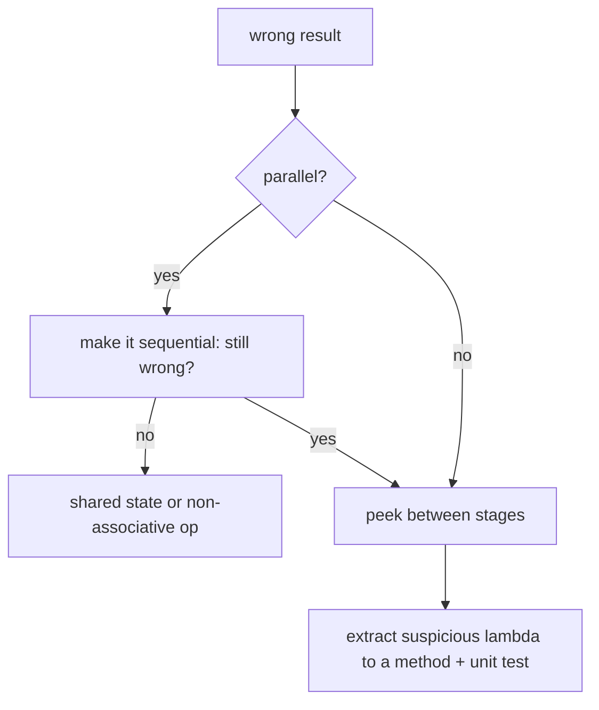

# 4.9 Performance, Debugging and Pitfalls

> **Goal:** Write streams that are fast enough, debug them when they misbehave, and recognise the traps that cause wrong results or surprising cost.

**Level:** advanced practice.
**Verified on:** OpenJDK 21.0.12. Every output below was produced by running the code. Counts of operations are shown instead of timings, so they are reproducible.

## Contents

1. [Where stream cost comes from](#1-where-stream-cost-comes-from)
2. [A tour of pitfalls, with proof](#2-a-tour-of-pitfalls-with-proof)
3. [Order of operations](#3-order-of-operations)
4. [Boxing and primitive streams](#4-boxing-and-primitive-streams)
5. [`sorted().limit(k)` and selection](#5-sortedlimitk-and-selection)
6. [Side effects and state](#6-side-effects-and-state)
7. [Exceptions and laziness](#7-exceptions-and-laziness)
8. [Debugging streams](#8-debugging-streams)
9. [Stream or loop?](#9-stream-or-loop)
10. [Benchmarking honestly](#10-benchmarking-honestly)
11. [Checklist](#11-checklist)
12. [Common gotchas](#12-common-gotchas)
13. [Interview questions](#13-interview-questions)

---

## 1. Where stream cost comes from

| Cost | Source | Mitigation |
|---|---|---|
| Per-pipeline setup | a few objects, spliterator, sinks | irrelevant for large data, visible in tiny hot loops |
| Per-element indirection | a virtual call per stage | JIT inlines monomorphic lambdas; megamorphic sites do not |
| Boxing | `Stream<Integer>`, `Stream<Long>`, `Stream<Double>` | primitive streams |
| Stateful barriers | `sorted`, `distinct`, `collect` containers | filter early, bound sizes |
| Intermediate objects | `flatMap` inner streams, `Optional`, records per row | `mapMulti`, loops for hot paths |
| Parallel overhead | splitting, scheduling, merging | measure, keep sequential if unsure |

Streams are rarely the bottleneck compared with I/O, allocation or algorithms. **Correctness and clarity first, then measure.**

## 2. A tour of pitfalls, with proof

```java
import java.util.*;
import java.util.function.*;
import java.util.stream.*;

public class S09Pitfalls {
    record P(String name, int score) { }

    public static void main(String[] args) {
        // 1. Order of operations changes the work done (and sometimes the result)
        int[] calls = {0};
        Function<Integer, Integer> expensive = x -> { calls[0]++; return x * x; };
        IntStream.rangeClosed(1, 1000).boxed().map(expensive).filter(x -> x % 7 == 0).limit(3).toList();
        int mapFirst = calls[0]; calls[0] = 0;
        IntStream.rangeClosed(1, 1000).boxed().filter(x -> x % 7 == 0).map(expensive).limit(3).toList();
        System.out.println("expensive calls: map-before-filter=" + mapFirst + ", filter-before-map=" + calls[0]);

        // 2. sorted() before limit() sorts everything; a partial selection can be cheaper by other means
        int[] cmp = {0};
        List<Integer> data = new Random(1).ints(1000, 0, 10_000).boxed().toList();
        data.stream().sorted((a, b) -> { cmp[0]++; return a.compareTo(b); }).limit(3).toList();
        System.out.println("comparisons to take the 3 smallest via sorted().limit(3): " + (cmp[0] > 1000 ? "more than 1000" : cmp[0]) + "; a single min-scan needs 999");

        // 3. Boxing: Stream<Integer> allocates, IntStream does not
        System.out.println("sum boxed vs primitive give the same value: " + (IntStream.range(0, 100).boxed().reduce(0, Integer::sum).equals(IntStream.range(0, 100).sum())));

        // 4. Side effects inside lambdas
        List<Integer> sink = new ArrayList<>();
        Stream.of(1, 2, 3).filter(x -> x > 1).forEach(sink::add);     // legal sequentially, wrong in parallel; prefer collect
        System.out.println("side-effect collect works only sequentially: " + sink);

        // 5. Lazy evaluation and exceptions: the error appears at the terminal operation, not where the lambda is written
        Stream<Integer> boom = Stream.of(1, 0, 2).map(x -> 10 / x);
        System.out.println("pipeline built without error");
        try { boom.toList(); } catch (ArithmeticException e) { System.out.println("thrown at the terminal op: " + e.getMessage()); }

        // 6. Collectors.toList() vs Stream.toList()
        List<String> withNull = Stream.of("a", null).toList();
        System.out.println("Stream.toList() allows null elements: " + withNull);
        try { Stream.of("a", null).collect(Collectors.toUnmodifiableList()); } catch (NullPointerException e) { System.out.println("Collectors.toUnmodifiableList() rejects null"); }

        // 7. Optional results: max/min/findFirst return Optional, an empty stream is not an error
        System.out.println("max of empty: " + Stream.<Integer>empty().max(Integer::compare) + ", count: " + Stream.empty().count());

        // 8. Comparator pitfalls: subtraction overflows
        Comparator<Integer> bad = (a, b) -> a - b;
        System.out.println("bad comparator on MIN_VALUE vs 1 says: " + bad.compare(Integer.MIN_VALUE, 1) + " (positive: wrong!), Integer.compare says " + Integer.compare(Integer.MIN_VALUE, 1));

        // 9. Mutating elements inside map (a peek/map that changes shared objects)
        List<StringBuilder> sbs = List.of(new StringBuilder("a"), new StringBuilder("b"));
        sbs.stream().map(sb -> sb.append("!")).toList();
        System.out.println("map mutated the source objects: " + sbs);

        // 10. distinct() on arrays does NOT work by content
        System.out.println("distinct on int[]: " + Stream.of(new int[]{1}, new int[]{1}).distinct().count() + " (arrays use identity equals)");

        // 11. Debugging with peek and labelled stages
        System.out.println(Stream.of(5, 3, 8).peek(x -> System.out.println("  src " + x)).filter(x -> x > 4).peek(x -> System.out.println("  kept " + x)).map(x -> x * 10).toList());

        // 12. Stream + checked exceptions + loops: sometimes a loop is better
        int total = 0;
        for (P p : List.of(new P("a", 5), new P("b", 7))) { if (p.score() > 6) break; total += p.score(); }
        System.out.println("a loop with break/early return and mutation is clearer than forcing a stream: " + total);

        // 13. groupingBy on a parallel stream and ordering of HashMap iteration are not specified
        Map<Integer, List<String>> byLen = Stream.of("aa", "b", "cc", "d").collect(Collectors.groupingBy(String::length));
        System.out.println("group result (as sorted view): " + new TreeMap<>(byLen));

        // 14. iterate without a bound hangs: this is the shape of the bug (not executed)
        System.out.println("never run: Stream.iterate(1, x -> x + 1).sorted().findFirst()  // sorted() needs ALL elements of an infinite stream");
    }
}

// ---- Output ----
// expensive calls: map-before-filter=21, filter-before-map=3
// comparisons to take the 3 smallest via sorted().limit(3): more than 1000; a single min-scan needs 999
// sum boxed vs primitive give the same value: true
// side-effect collect works only sequentially: [2, 3]
// pipeline built without error
// thrown at the terminal op: / by zero
// Stream.toList() allows null elements: [a, null]
// Collectors.toUnmodifiableList() rejects null
// max of empty: Optional.empty, count: 0
// bad comparator on MIN_VALUE vs 1 says: 2147483647 (positive: wrong!), Integer.compare says -1
// map mutated the source objects: [a!, b!]
// distinct on int[]: 2 (arrays use identity equals)
//   src 5
//   kept 5
//   src 3
//   src 8
//   kept 8
// [50, 80]
// a loop with break/early return and mutation is clearer than forcing a stream: 5
// group result (as sorted view): {1=[b, d], 2=[aa, cc]}
// never run: Stream.iterate(1, x -> x + 1).sorted().findFirst()  // sorted() needs ALL elements of an infinite stream
```

## 3. Order of operations

The program's first line: with an expensive `map` before the `filter`, `limit(3)` still forced **21** expensive calls (the stream had to reach `7, 14, 21` after squaring); with `filter` first, only **3**. In general:

1. Put selective, cheap operations first.
2. Put expensive transformations after the data has shrunk.
3. Put stateful operations (`sorted`, `distinct`) after filters.
4. `limit` early to cap the downstream work (it short-circuits upstream).

## 4. Boxing and primitive streams

`Stream<Integer>` allocates an `Integer` per element beyond the small cache and unboxes for arithmetic. In numeric pipelines use `mapToInt`/`IntStream`; the demo confirms that the boxed and primitive sums are equal, so correctness is the same and only the cost differs. Typical rule: no boxing in the inner loop of a hot path; boxing at the boundary is fine.

## 5. `sorted().limit(k)` and selection

`sorted().limit(3)` over 1000 numbers cost far more than 1000 comparisons (the demo prints "more than 1000"), whereas finding one minimum takes 999 comparisons. For top-k on large inputs, avoid sorting everything:

- `Collectors.collectingAndThen` with a bounded `PriorityQueue` of size k (O(n log k)).
- `stream.sorted().limit(k)` is acceptable when n is small or k is close to n (do not assume the JDK turns `sorted().limit(k)` into a bounded heap for you).
- `max`/`min` for k = 1.

## 6. Side effects and state

| Pattern | Safe sequentially? | Safe in parallel? | Prefer |
|---|---|---|---|
| `forEach(sink::add)` into an `ArrayList` | yes | **no** | `collect(toList())` |
| `filter(x -> seen.add(x))` | yes | **no** | `distinct()` / `groupingBy` |
| Counter via `int[]` captured | yes | **no** | `count()`, `summingInt`, `LongAdder` |
| `peek` for logging | yes | order not guaranteed | OK for debugging only |
| `map` that mutates the element | works (demo shows source objects changed) | racy | build new objects |

The demo's `map mutated the source objects: [a!, b!]` shows how a `map` can mutate what the source holds: a stream is not a defensive copy.

## 7. Exceptions and laziness

An exception thrown inside a lambda surfaces at the **terminal operation**, not where the lambda is written (demo: `thrown at the terminal op: / by zero`). Consequences:

- A `try/catch` around building the pipeline catches nothing.
- Checked exceptions cannot propagate through standard functional interfaces (chapter 3.1); wrap them or catch inside the lambda.
- With `Optional`-returning parse functions you can keep failures as data.

## 8. Debugging streams

| Technique | How |
|---|---|
| Label stages with `peek` | `peek(x -> log("after filter", x))` between stages; remove afterwards (demo shows the interleaving) |
| Break the chain | assign intermediate `Stream` variables? Not reusable, so instead collect intermediate results into lists while debugging |
| Name complex lambdas | extract to methods so stack traces and breakpoints are meaningful |
| IDE stream debugger | IntelliJ "Trace Current Stream Chain" visualises each stage |
| Read stack traces | frames like `ReferencePipeline$3$1.accept` are the framework; the lambda frame (`lambda$main$0`) is yours |
| Reproduce sequentially | remove `.parallel()` first when something is wrong |



## 9. Stream or loop?

| Prefer streams when | Prefer a loop when |
|---|---|
| filter / map / group / aggregate | early `break` / `return` with several conditions |
| the pipeline reads as a sentence | mutating several accumulators together |
| you want easy parallelism (and it is justified) | index arithmetic, previous/next element logic |
| collecting into maps with merging | checked exceptions on every step |
| | hot inner loops over primitives |

The demo's loop example (early exit plus mutation) is clearer as a loop than forced into a stream. Mixing is fine: loop outside, stream inside.

## 10. Benchmarking honestly

Hand-timed `System.nanoTime()` loops mislead: JIT warm-up, dead-code elimination, GC noise and constant folding all distort results. Use **JMH** (Part 16), run on realistic data sizes, compare against a loop baseline, and look at allocation (`-prof gc`). Do not publish a "streams are slow/fast" conclusion from a micro-test in `main`.

## 11. Checklist

```text
[ ] primitive streams for numeric work
[ ] filter / limit before map / sorted
[ ] no shared mutable state in lambdas
[ ] collect instead of forEach-add
[ ] tie-breakers in comparators; Integer.compare instead of subtraction
[ ] toMap has a merge function if keys can repeat
[ ] parallel only after measuring, never with blocking code
[ ] resource streams closed
[ ] lambdas short; complex ones extracted and tested
```

## 12. Common gotchas

| Gotcha | Why | Fix |
|---|---|---|
| Comparator `(a, b) -> a - b` | overflow gives the wrong sign (demo) | `Integer.compare` / `Comparator.comparingInt` |
| `distinct()` on arrays | identity equals (demo prints 2) | map to `List`/record first |
| `Stream.toList()` accepts null, `toUnmodifiableList` does not | different contracts | choose deliberately |
| Mutating elements in `map` | source objects change | create new objects |
| Exception appears late | lazy evaluation | test with a terminal operation |
| `sorted()` on infinite stream | never finishes | bound before sorting |
| Overusing streams for tiny tasks | readability and overhead | a loop or a method |
| Logging inside `map` on parallel streams | interleaved/out of order | use `peek` only for debugging |
| Using `Optional` in streams of streams | allocation | `flatMap(Optional::stream)` once |

## 13. Interview questions

<details>
<summary><strong>Q1. Why does the order of <code>filter</code> and <code>map</code> matter for performance?</strong></summary>

Each stage runs for every element that reaches it; filtering first shrinks the input of expensive stages. The demo needed 21 expensive calls with <code>map</code> first and 3 with <code>filter</code> first.
</details>

<details>
<summary><strong>Q2. Why prefer <code>IntStream</code> over <code>Stream&lt;Integer&gt;</code> in numeric code?</strong></summary>

It avoids boxing allocation and unboxing, improves cache behaviour and offers numeric terminal operations.
</details>

<details>
<summary><strong>Q3. Why is <code>sorted().limit(k)</code> sometimes wasteful?</strong></summary>

It sorts all elements (n log n) although only k are needed; a bounded priority queue or a single pass for k = 1 is cheaper.
</details>

<details>
<summary><strong>Q4. Why does an exception thrown inside a lambda not appear when the stream is built?</strong></summary>

Because the lambda runs during the terminal operation (laziness).
</details>

<details>
<summary><strong>Q5. How do you debug a long stream chain?</strong></summary>

Insert <code>peek</code> between stages, extract complicated lambdas into named methods, use the IDE stream tracer, reproduce sequentially, and unit-test small pieces.
</details>

<details>
<summary><strong>Q6. Why is <code>(a, b) -&gt; a - b</code> a bad comparator?</strong></summary>

Integer overflow can flip the sign; <code>Integer.MIN_VALUE - 1</code> wrapped to a large positive number in the demo. Use <code>Integer.compare</code> or <code>Comparator.comparingInt</code>.
</details>

<details>
<summary><strong>Q7. When should you replace a stream with a loop?</strong></summary>

When you need early exit with several conditions, ordered mutable state, indexed logic, or checked-exception handling per element, or in a measured hot path.
</details>

<details>
<summary><strong>Q8. Are streams slower than loops?</strong></summary>

For simple primitive loops, hand-written loops are usually equal or faster; for typical object pipelines the difference is small and dominated by other costs. Measure with JMH before deciding.
</details>

<details>
<summary><strong>Q9. Why is side-effecting <code>map</code> dangerous?</strong></summary>

The framework may skip, reorder or parallelise calls; also the source objects are shared, so mutation affects the caller's data. Keep lambdas pure.
</details>

<details>
<summary><strong>Q10. What does <code>distinct()</code> do on a <code>Stream&lt;int[]&gt;</code>?</strong></summary>

Nothing useful: arrays use identity <code>equals</code>, so equal-content arrays are kept (demo: 2).
</details>

<details>
<summary><strong>Q11. What is the risk of using <code>peek</code> in production logic?</strong></summary>

It is documented as a debugging aid; it may not run when the pipeline is optimised away (<code>count()</code> on a sized source) and its order in parallel is undefined.
</details>

<details>
<summary><strong>Q12. How would you benchmark a stream pipeline?</strong></summary>

JMH with warm-up, realistic input sizes, a loop baseline and allocation profiling; never rely on a single timed <code>main</code>.
</details>

---

[Previous: 4.8 Spliterators and Parallel Streams](./08-spliterators-and-parallel-streams.md) · [Part index](./README.md) · Next: [4.10 Stream Coding Challenges](./10-stream-coding-challenges.md)