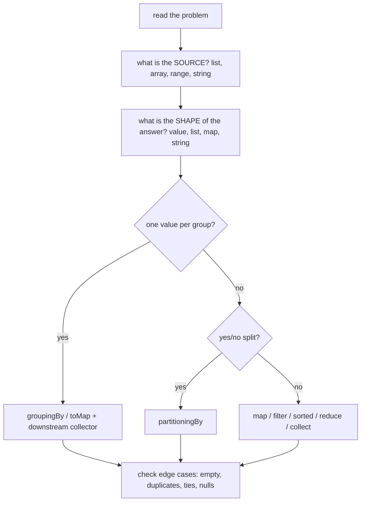

# 4.10 Stream Coding Challenges

> **Goal:** Practise 36 interview-style stream problems, from warm-ups to hard ones, each with a runnable solution and its real output.

**How to use this chapter:** read the statement, write your own answer, then open the solution. Every solution was compiled and run on OpenJDK 21.0.12; the output shown is the real output.

## Contents

1. [Method: how to attack a stream problem](#1-method-how-to-attack-a-stream-problem)
2. [Shared data](#2-shared-data)
3. [Easy challenges (1-10)](#3-easy-challenges-1-10)
4. [Medium challenges (11-24)](#4-medium-challenges-11-24)
5. [Hard challenges (25-36)](#5-hard-challenges-25-36)
6. [Pattern cheat sheet](#6-pattern-cheat-sheet)
7. [Common gotchas](#7-common-gotchas)
8. [Interview questions](#8-interview-questions)

---

## 1. Method: how to attack a stream problem



1. Identify the source and the shape of the answer.
2. Pick the collector or terminal operation that produces that shape.
3. Add tie-breakers wherever order matters.
4. Check empty input, duplicates and ties.
5. If it needs previous/next elements or early exit, consider a loop and say so.

## 2. Shared data

Challenges 11-13 use these records and employees (the full program defines them once):

```text
record Emp(String name, String dept, int salary)
Asha ENG 120 | Ravi ENG 100 | Meera ENG 140 | Zoya ENG 90
Kabir OPS 70 | Isha OPS 80  | Dev HR 60
```

Other records (`Sale`, `Interval`, `Tree`) are described in the challenges that use them. Each solution is a method in one class; `p("cNN", value)` prints the result as `[cNN] value`, and the output appears in the comments below the code.


## 3. Easy challenges (1-10)

### Challenge 1: Sum of odd squares

**Easy.** Sum the squares of the odd numbers from 1 to 10.

*Tools:* `filter`, `map`, `sum`

<details>
<summary>Solution 1</summary>

```java
static void c01() {
    int r = IntStream.rangeClosed(1, 10).filter(n -> n % 2 == 1).map(n -> n * n).sum();
    p("c01", r);
}

// ---- Output ----
// 165
```

</details>

### Challenge 2: Second-highest distinct value

**Easy.** From `[5, 9, 2, 9, 7, 1]` find the second-highest **distinct** value.

*Tools:* `distinct`, `sorted`, `skip`

<details>
<summary>Solution 2</summary>

```java
static void c02() {
    List<Integer> nums = List.of(5, 9, 2, 9, 7, 1);
    Optional<Integer> second = nums.stream().distinct().sorted(Comparator.reverseOrder()).skip(1).findFirst();
    p("c02", second.orElseThrow());
}

// ---- Output ----
// 7
```

</details>

### Challenge 3: Words longer than four letters

**Easy.** Count the words longer than 4 characters in `"the quick brown fox jumps over the lazy dog"`.

*Tools:* `split`, `filter`, `count`

<details>
<summary>Solution 3</summary>

```java
static void c03() {
    String s = "the quick brown fox jumps over the lazy dog";
    long n = Arrays.stream(s.split(" ")).filter(w -> w.length() > 4).count();
    p("c03", n);
}

// ---- Output ----
// 3
```

</details>

### Challenge 4: Uppercase, sort, join

**Easy.** Turn `kiwi, apple, fig` into one string like `<APPLE, FIG, KIWI>`.

*Tools:* `map`, `sorted`, `joining`

<details>
<summary>Solution 4</summary>

```java
static void c04() {
    String r = Stream.of("kiwi", "apple", "fig").map(String::toUpperCase).sorted().collect(Collectors.joining(", ", "<", ">"));
    p("c04", r);
}

// ---- Output ----
// <APPLE, FIG, KIWI>
```

</details>

### Challenge 5: First non-repeated character

**Easy.** Find the first character of `"swiss"` that occurs exactly once.

*Tools:* `groupingBy` + `LinkedHashMap`

<details>
<summary>Solution 5</summary>

```java
static void c05() {
    String s = "swiss";
    Map<Character, Long> counts = s.chars().mapToObj(c -> (char) c)
            .collect(Collectors.groupingBy(Function.identity(), LinkedHashMap::new, Collectors.counting()));   // LinkedHashMap keeps first-seen order
    Optional<Character> first = counts.entrySet().stream().filter(e -> e.getValue() == 1).map(Map.Entry::getKey).findFirst();
    p("c05", first.orElse('?'));
}

// ---- Output ----
// w
```

</details>

### Challenge 6: Palindrome check

**Easy.** Check whether `racecar` and `stream` are palindromes, without reversing the string.

*Tools:* `IntStream.range`, `allMatch`

<details>
<summary>Solution 6</summary>

```java
static void c06() {
    for (String s : List.of("racecar", "stream")) {
        boolean pal = IntStream.range(0, s.length() / 2).allMatch(i -> s.charAt(i) == s.charAt(s.length() - 1 - i));
        p("c06", s + " -> " + pal);
    }
}

// ---- Output ----
// racecar -> true
// stream -> false
```

</details>

### Challenge 7: Flatten, distinct, sort

**Easy.** Flatten `[[3,1],[2,3],[],[1,5]]` into one sorted list without duplicates.

*Tools:* `flatMap`

<details>
<summary>Solution 7</summary>

```java
static void c07() {
    List<List<Integer>> nested = List.of(List.of(3, 1), List.of(2, 3), List.of(), List.of(1, 5));
    p("c07", nested.stream().flatMap(List::stream).distinct().sorted().toList());
}

// ---- Output ----
// [1, 2, 3, 5]
```

</details>

### Challenge 8: Character frequency, sorted

**Easy.** Count characters in `mississippi`, ordered by count descending then character ascending, printed as `i4`.

*Tools:* `Map.Entry` comparators

<details>
<summary>Solution 8</summary>

```java
static void c08() {
    String s = "mississippi";
    List<String> r = s.chars().mapToObj(c -> (char) c).collect(Collectors.groupingBy(c -> c, Collectors.counting()))
            .entrySet().stream()
            .sorted(Map.Entry.<Character, Long>comparingByValue().reversed().thenComparing(Map.Entry.comparingByKey()))
            .map(e -> e.getKey() + "" + e.getValue()).toList();
    p("c08", r);
}

// ---- Output ----
// [i4, s4, p2, m1]
```

</details>

### Challenge 9: Summary statistics

**Easy.** Get min, max, average and count of `7, 3, 9, 1` in one pass.

*Tools:* `summaryStatistics`

<details>
<summary>Solution 9</summary>

```java
static void c09() {
    IntSummaryStatistics st = Stream.of(7, 3, 9, 1).mapToInt(Integer::intValue).summaryStatistics();
    p("c09", "min=" + st.getMin() + " max=" + st.getMax() + " avg=" + st.getAverage() + " n=" + st.getCount());
}

// ---- Output ----
// min=1 max=9 avg=5.0 n=4
```

</details>

### Challenge 10: Primes and composites

**Easy.** Split the numbers 2..20 into primes and composites.

*Tools:* `partitioningBy`

<details>
<summary>Solution 10</summary>

```java
static void c10() {
    Map<Boolean, List<Integer>> parts = IntStream.rangeClosed(2, 20).boxed()
            .collect(Collectors.partitioningBy(n -> IntStream.rangeClosed(2, (int) Math.sqrt(n)).noneMatch(d -> n % d == 0)));
    p("c10", "primes=" + parts.get(true) + " composites=" + parts.get(false));
}

// ---- Output ----
// primes=[2, 3, 5, 7, 11, 13, 17, 19] composites=[4, 6, 8, 9, 10, 12, 14, 15, 16, 18, 20]
```

</details>


## 4. Medium challenges (11-24)

### Challenge 11: Average salary per department

**Medium.** Using the employee list below, compute the average salary per department, sorted by department.

*Tools:* `groupingBy` + `averagingInt`

<details>
<summary>Solution 11</summary>

```java
static void c11() {
    Map<String, Double> avg = EMPS.stream().collect(Collectors.groupingBy(Emp::dept, TreeMap::new, Collectors.averagingInt(Emp::salary)));
    p("c11", avg);
}

// ---- Output ----
// {ENG=112.5, HR=60.0, OPS=75.0}
```

</details>

### Challenge 12: Top two earners per department

**Medium.** For each department list the names of the two best-paid employees.

*Tools:* `collectingAndThen`

<details>
<summary>Solution 12</summary>

```java
static void c12() {
    Map<String, List<String>> top = EMPS.stream().collect(Collectors.groupingBy(Emp::dept, TreeMap::new,
            Collectors.collectingAndThen(Collectors.toList(),
                    l -> l.stream().sorted(Comparator.comparingInt(Emp::salary).reversed()).limit(2).map(Emp::name).toList())));
    p("c12", top);
}

// ---- Output ----
// {ENG=[Meera, Asha], HR=[Dev], OPS=[Isha, Kabir]}
```

</details>

### Challenge 13: Highest paid per department

**Medium.** For each department find the single highest-paid employee.

*Tools:* `toMap` + `BinaryOperator.maxBy`

<details>
<summary>Solution 13</summary>

```java
static void c13() {
    Map<String, Emp> best = EMPS.stream().collect(Collectors.toMap(Emp::dept, Function.identity(),
            BinaryOperator.maxBy(Comparator.comparingInt(Emp::salary)), TreeMap::new));
    p("c13", best.values().stream().map(e -> e.dept() + ":" + e.name()).toList());
}

// ---- Output ----
// [ENG:Meera, HR:Dev, OPS:Isha]
```

</details>

### Challenge 14: Group anagrams

**Medium.** Group `eat, tea, tan, ate, nat, bat` into anagram families.

*Tools:* sorted-letters key

<details>
<summary>Solution 14</summary>

```java
static void c14() {
    List<List<String>> groups = Stream.of("eat", "tea", "tan", "ate", "nat", "bat").collect(Collectors.groupingBy(
            w -> w.chars().sorted().collect(StringBuilder::new, StringBuilder::appendCodePoint, StringBuilder::append).toString(), TreeMap::new, Collectors.toList()))
            .values().stream().toList();
    p("c14", groups);
}

// ---- Output ----
// [[bat], [eat, tea, ate], [tan, nat]]
```

</details>

### Challenge 15: Inverted index

**Medium.** For lines `"to be or not"`, `"to see"`, `"be happy"` build word → list of line numbers (1-based).

*Tools:* `flatMap` + `mapping`

<details>
<summary>Solution 15</summary>

```java
static void c15() {
    List<String> lines = List.of("to be or not", "to see", "be happy");
    Map<String, List<Integer>> index = IntStream.range(0, lines.size()).boxed()
            .flatMap(i -> Arrays.stream(lines.get(i).split(" ")).map(w -> Map.entry(w, i + 1)))
            .collect(Collectors.groupingBy(Map.Entry::getKey, TreeMap::new, Collectors.mapping(Map.Entry::getValue, Collectors.toList())));
    p("c15", index);
}

// ---- Output ----
// {be=[1, 3], happy=[3], not=[1], or=[1], see=[2], to=[1, 2]}
```

</details>

### Challenge 16: Consecutive runs

**Medium.** Split `[1,2,3,7,8,10,11,12,13]` into runs of consecutive integers and report the longest run length.

*Tools:* 3-arg `collect`

<details>
<summary>Solution 16</summary>

```java
static void c16() {
    int[] a = {1, 2, 3, 7, 8, 10, 11, 12, 13};
    List<List<Integer>> runs = IntStream.range(0, a.length).boxed().collect(
            ArrayList::new,
            (acc, i) -> { if (acc.isEmpty() || a[i] != a[i - 1] + 1) acc.add(new ArrayList<>()); acc.get(acc.size() - 1).add(a[i]); },
            ArrayList::addAll);
    p("c16", runs + " longest=" + runs.stream().mapToInt(List::size).max().getAsInt());
}

// ---- Output ----
// [[1, 2, 3], [7, 8], [10, 11, 12, 13]] longest=4
```

</details>

### Challenge 17: First ten Fibonacci numbers

**Medium.** Generate 0, 1, 1, 2, ... (ten numbers) lazily.

*Tools:* `Stream.iterate` with state

<details>
<summary>Solution 17</summary>

```java
static void c17() {
    List<Long> fib = Stream.iterate(new long[]{0, 1}, f -> new long[]{f[1], f[0] + f[1]}).limit(10).map(f -> f[0]).toList();
    p("c17", fib);
}

// ---- Output ----
// [0, 1, 1, 2, 3, 5, 8, 13, 21, 34]
```

</details>

### Challenge 18: Filtered cartesian product

**Medium.** From `{1,2,3}` × `{4,5,6}` keep the pairs whose sum is even.

*Tools:* nested `flatMap`

<details>
<summary>Solution 18</summary>

```java
static void c18() {
    List<String> pairs = Stream.of(1, 2, 3).flatMap(a -> Stream.of(4, 5, 6).filter(b -> (a + b) % 2 == 0).map(b -> "(" + a + "," + b + ")")).toList();
    p("c18", pairs);
}

// ---- Output ----
// [(1,5), (2,4), (2,6), (3,5)]
```

</details>

### Challenge 19: Transpose a matrix

**Medium.** Transpose `[[1,2,3],[4,5,6]]`.

*Tools:* index stream

<details>
<summary>Solution 19</summary>

```java
static void c19() {
    List<List<Integer>> m = List.of(List.of(1, 2, 3), List.of(4, 5, 6));
    List<List<Integer>> t = IntStream.range(0, m.get(0).size()).mapToObj(c -> m.stream().map(row -> row.get(c)).toList()).toList();
    p("c19", t);
}

// ---- Output ----
// [[1, 4], [2, 5], [3, 6]]
```

</details>

### Challenge 20: Merge maps, summing values

**Medium.** Merge `{x=1,y=2}` and `{y=10,z=5}`, adding values of equal keys.

*Tools:* `toMap` with merge function

<details>
<summary>Solution 20</summary>

```java
static void c20() {
    Map<String, Integer> a = Map.of("x", 1, "y", 2), b = Map.of("y", 10, "z", 5);
    Map<String, Integer> merged = Stream.of(a, b).flatMap(m -> m.entrySet().stream())
            .collect(Collectors.toMap(Map.Entry::getKey, Map.Entry::getValue, Integer::sum, TreeMap::new));
    p("c20", merged);
}

// ---- Output ----
// {x=1, y=12, z=5}
```

</details>

### Challenge 21: Prefix sums

**Medium.** Compute running totals of `[3,1,4,1,5]`; then do it the O(n) way for large arrays.

*Tools:* `Arrays.parallelPrefix`

<details>
<summary>Solution 21</summary>

```java
static void c21() {
    int[] data = {3, 1, 4, 1, 5};
    List<Integer> prefix = IntStream.rangeClosed(1, data.length).mapToObj(n -> Arrays.stream(data, 0, n).sum()).toList();   // O(n^2) but simple and parallel-safe
    int[] copy = data.clone();
    Arrays.parallelPrefix(copy, Integer::sum);                                                                           // O(n), the right tool for big arrays
    p("c21", prefix + " " + Arrays.toString(copy));
}

// ---- Output ----
// [3, 4, 8, 9, 14] [3, 4, 8, 9, 14]
```

</details>

### Challenge 22: Top three words

**Medium.** From `"a b a c b a d c a b"` return the three most frequent words as `word=count`, ties broken alphabetically.

*Tools:* count, sort, `limit`

<details>
<summary>Solution 22</summary>

```java
static void c22() {
    String text = "a b a c b a d c a b";
    List<String> top3 = Arrays.stream(text.split(" ")).collect(Collectors.groupingBy(w -> w, Collectors.counting())).entrySet().stream()
            .sorted(Map.Entry.<String, Long>comparingByValue().reversed().thenComparing(Map.Entry.comparingByKey()))
            .limit(3).map(e -> e.getKey() + "=" + e.getValue()).toList();
    p("c22", top3);
}

// ---- Output ----
// [a=4, b=3, c=2]
```

</details>

### Challenge 23: Median

**Medium.** Compute the median of `[5,1,9,3,7]` and `[4,1,3,2]`.

*Tools:* `sorted`, `skip`, `limit`

<details>
<summary>Solution 23</summary>

```java
static void c23() {
    for (List<Integer> l : List.of(List.of(5, 1, 9, 3, 7), List.of(4, 1, 3, 2))) {
        List<Integer> s = l.stream().sorted().toList();
        double median = s.size() % 2 == 1 ? s.get(s.size() / 2) : s.stream().skip(s.size() / 2 - 1).limit(2).mapToInt(Integer::intValue).average().getAsDouble();
        p("c23", l + " -> " + median);
    }
}

// ---- Output ----
// [5, 1, 9, 3, 7] -> 5.0
// [4, 1, 3, 2] -> 2.5
```

</details>

### Challenge 24: Sliding windows

**Medium.** Produce every window of size 3 of `[2,4,6,8,10]` together with its sum.

*Tools:* `IntStream.rangeClosed`

<details>
<summary>Solution 24</summary>

```java
static void c24() {
    int[] a = {2, 4, 6, 8, 10};
    List<String> windows = IntStream.rangeClosed(0, a.length - 3)
            .mapToObj(i -> Arrays.toString(Arrays.copyOfRange(a, i, i + 3)) + "=" + Arrays.stream(a, i, i + 3).sum()).toList();
    p("c24", windows);
}

// ---- Output ----
// [[2, 4, 6]=12, [4, 6, 8]=18, [6, 8, 10]=24]
```

</details>


## 5. Hard challenges (25-36)

### Challenge 25: Pivot table

**Hard.** Turn sales rows (Jan/A/10, Jan/B/5, Feb/A/7, Feb/A/3, Feb/B/4) into month → category → total.

*Tools:* nested `groupingBy`

<details>
<summary>Solution 25</summary>

```java
static void c25() {
    List<Sale> sales = List.of(new Sale("Jan", "A", 10), new Sale("Jan", "B", 5), new Sale("Feb", "A", 7), new Sale("Feb", "A", 3), new Sale("Feb", "B", 4));
    Map<String, Map<String, Integer>> pivot = sales.stream().collect(Collectors.groupingBy(Sale::month, TreeMap::new,
            Collectors.groupingBy(Sale::category, TreeMap::new, Collectors.summingInt(Sale::amount))));
    p("c25", pivot);
}

// ---- Output ----
// {Feb={A=10, B=4}, Jan={A=10, B=5}}
```

</details>

### Challenge 26: All paths of a tree

**Hard.** List every root-to-node path of the tree `a → (b → d, c)` as `/a/b/d`.

*Tools:* recursive `flatMap`

<details>
<summary>Solution 26</summary>

```java
static Stream<String> paths(Tree t, String prefix) {
    String here = prefix + "/" + t.name();
    return Stream.concat(Stream.of(here), t.kids().stream().flatMap(k -> paths(k, here)));
}
static void c26() {
    Tree t = new Tree("a", List.of(new Tree("b", List.of(new Tree("d", List.of()))), new Tree("c", List.of())));
    p("c26", paths(t, "").toList());
}

// ---- Output ----
// [/a, /a/b, /a/b/d, /a/c]
```

</details>

### Challenge 27: Batching collector

**Hard.** Write a reusable collector `batches(n)` and split 1..7 into lists of three.

*Tools:* `Collector.of`

<details>
<summary>Solution 27</summary>

```java
static <T> Collector<T, ?, List<List<T>>> batches(int n) {
    return Collector.<T, List<List<T>>>of(ArrayList::new,
            (acc, x) -> { if (acc.isEmpty() || acc.get(acc.size() - 1).size() == n) acc.add(new ArrayList<>()); acc.get(acc.size() - 1).add(x); },
            (l, r) -> { l.addAll(r); return l; });
}
static void c27() {
    p("c27", IntStream.rangeClosed(1, 7).boxed().collect(batches(3)));
}

// ---- Output ----
// [[1, 2, 3], [4, 5, 6], [7]]
```

</details>

### Challenge 28: Min and max in one pass

**Hard.** Return `min..max` of `4, 8, 15, 16, 23, 42` with a single traversal.

*Tools:* `Collectors.teeing`

<details>
<summary>Solution 28</summary>

```java
static void c28() {
    String r = Stream.of(4, 8, 15, 16, 23, 42).collect(Collectors.teeing(
            Collectors.minBy(Integer::compare), Collectors.maxBy(Integer::compare),
            (mn, mx) -> mn.get() + ".." + mx.get()));
    p("c28", r);
}

// ---- Output ----
// 4..42
```

</details>

### Challenge 29: Merge overlapping intervals

**Hard.** Merge `[8,10] [1,3] [2,6] [15,18] [17,20]`.

*Tools:* sort + stateful collect

<details>
<summary>Solution 29</summary>

```java
static void c29() {
    List<Interval> in = List.of(new Interval(8, 10), new Interval(1, 3), new Interval(2, 6), new Interval(15, 18), new Interval(17, 20));
    List<Interval> merged = in.stream().sorted(Comparator.comparingInt(Interval::start)).collect(ArrayList::new,
            (acc, cur) -> {
                if (acc.isEmpty() || acc.get(acc.size() - 1).end() < cur.start()) acc.add(cur);
                else { Interval last = acc.remove(acc.size() - 1); acc.add(new Interval(last.start(), Math.max(last.end(), cur.end()))); }
            }, (a, b) -> { throw new UnsupportedOperationException("sequential only"); });
    p("c29", merged.stream().map(i -> "[" + i.start() + "," + i.end() + "]").toList());
}

// ---- Output ----
// [[1,6], [8,10], [15,20]]
```

</details>

### Challenge 30: Run-length encoding

**Hard.** Encode `aaabccdddd` as `a3b1c2d4`.

*Tools:* boundary indices

<details>
<summary>Solution 30</summary>

```java
static void c30() {
    String s = "aaabccdddd";
    List<String> runs = IntStream.range(0, s.length()).filter(i -> i == 0 || s.charAt(i) != s.charAt(i - 1)).boxed().toList().stream()
            .map(start -> {
                int end = start;
                while (end < s.length() && s.charAt(end) == s.charAt(start)) end++;
                return "" + s.charAt(start) + (end - start);
            }).toList();
    p("c30", String.join("", runs));
}

// ---- Output ----
// a3b1c2d4
```

</details>

### Challenge 31: Join with a default

**Hard.** Attach department names to people; unknown department ids become `UNKNOWN` (people: Asha→1, Ravi→2, Zed→3, Meera→1).

*Tools:* lookup map + `Optional`

<details>
<summary>Solution 31</summary>

```java
static void c31() {
    record Dept(int id, String name) { }
    record Person(String name, int deptId) { }
    List<Dept> depts = List.of(new Dept(1, "ENG"), new Dept(2, "OPS"));
    List<Person> people = List.of(new Person("Asha", 1), new Person("Ravi", 2), new Person("Zed", 3), new Person("Meera", 1));
    Map<Integer, Dept> byId = depts.stream().collect(Collectors.toMap(Dept::id, d -> d));
    p("c31", people.stream().map(pe -> pe.name() + "@" + Optional.ofNullable(byId.get(pe.deptId())).map(Dept::name).orElse("UNKNOWN")).toList());
}

// ---- Output ----
// [Asha@ENG, Ravi@OPS, Zed@UNKNOWN, Meera@ENG]
```

</details>

### Challenge 32: Find duplicates

**Hard.** List the values occurring more than once in `1,2,3,2,4,1,2`. Show the tempting stateful solution and the parallel-safe one.

*Tools:* `filter(!seen.add)` vs `groupingBy`

<details>
<summary>Solution 32</summary>

```java
static void c32() {
    Set<Integer> seen = new HashSet<>();
    List<Integer> dups = Stream.of(1, 2, 3, 2, 4, 1, 2).filter(x -> !seen.add(x)).distinct().toList();   // works ONLY sequentially: stateful lambda
    Set<Integer> dupsSafe = Stream.of(1, 2, 3, 2, 4, 1, 2).collect(Collectors.groupingBy(x -> x, Collectors.counting()))
            .entrySet().stream().filter(e -> e.getValue() > 1).map(Map.Entry::getKey).collect(Collectors.toCollection(TreeSet::new));
    p("c32", dups + " vs parallel-safe " + dupsSafe);
}

// ---- Output ----
// [2, 1] vs parallel-safe [1, 2]
```

</details>

### Challenge 33: Two-sum pairs

**Hard.** List all pairs of `[1,5,3,4,2,6,0]` (distinct positions) adding up to 6.

*Tools:* `IntStream` pairs

<details>
<summary>Solution 33</summary>

```java
static void c33() {
    int[] a = {1, 5, 3, 4, 2, 6, 0};
    int target = 6;
    List<String> pairs = IntStream.range(0, a.length).boxed().flatMap(i -> IntStream.range(i + 1, a.length).filter(j -> a[i] + a[j] == target).mapToObj(j -> a[i] + "+" + a[j])).toList();
    p("c33", pairs);
}

// ---- Output ----
// [1+5, 4+2, 6+0]
```

</details>

### Challenge 34: Log statistics per level

**Hard.** Parse lines like `"10 INFO a"` and report min time, max time and count per level.

*Tools:* `summarizingInt`

<details>
<summary>Solution 34</summary>

```java
static void c34() {
    List<String> raw = List.of("10 INFO a", "12 WARN b", "15 INFO c", "20 ERROR d", "21 INFO e");
    record L(int t, String level) { }
    Map<String, IntSummaryStatistics> stats = raw.stream().map(s -> s.split(" ")).map(x -> new L(Integer.parseInt(x[0]), x[1]))
            .collect(Collectors.groupingBy(L::level, TreeMap::new, Collectors.summarizingInt(L::t)));
    p("c34", stats.entrySet().stream().map(e -> e.getKey() + "[" + e.getValue().getMin() + "-" + e.getValue().getMax() + ",n=" + e.getValue().getCount() + "]").toList());
}

// ---- Output ----
// [ERROR[20-20,n=1], INFO[10-21,n=3], WARN[12-12,n=1]]
```

</details>

### Challenge 35: Best stock profit

**Hard.** Given daily prices `[7,1,5,3,6,4]`, find the best single buy-then-sell profit with one pass.

*Tools:* 3-arg `reduce` with state

<details>
<summary>Solution 35</summary>

```java
static void c35() {
    int[] prices = {7, 1, 5, 3, 6, 4};
    int[] state = IntStream.of(prices).boxed().reduce(new int[]{Integer.MAX_VALUE, 0},          // state = {minSoFar, bestProfit}
            (s, price) -> new int[]{Math.min(s[0], price), Math.max(s[1], price - s[0])},
            (a, b) -> { throw new UnsupportedOperationException(); });
    p("c35", "best profit = " + state[1]);
}

// ---- Output ----
// best profit = 5
```

</details>

### Challenge 36: Flatten optionals with mapMulti

**Hard.** Collect the present values of `[Optional.of(a), empty, Optional.of(c)]` using `mapMulti`, compare with `flatMap(Optional::stream)`.

*Tools:* `mapMulti` (Java 16)

<details>
<summary>Solution 36</summary>

```java
static void c36() {
    List<Optional<String>> opts = List.of(Optional.of("a"), Optional.empty(), Optional.of("c"));
    p("c36", opts.stream().<String>mapMulti(Optional::ifPresent).toList() + " == " + opts.stream().flatMap(Optional::stream).toList());
}

// ---- Output ----
// [a, c] == [a, c]
```

</details>

## 6. Pattern cheat sheet

| Need | Pattern | Challenges |
|---|---|---|
| Count / sum / extremes | primitive stream terminal ops, `summaryStatistics` | 1, 3, 9, 28 |
| Remove duplicates, order | `distinct`, `sorted`, `skip` | 2, 7 |
| Frequency table | `groupingBy(identity, counting())` | 5, 8, 22 |
| Per-group aggregate | `groupingBy` + downstream (`averagingInt`, `summarizingInt`, `mapping`) | 11, 12, 15, 25, 34 |
| Keep best per key | `toMap` + merge function / `maxBy` | 13, 20 |
| Yes/no split | `partitioningBy` | 10 |
| Combinations | nested `flatMap` | 18, 33 |
| Positions and windows | `IntStream.range` over indices | 6, 19, 21, 24 |
| Generate sequences | `Stream.iterate` with a state object | 17 |
| Recursion | `flatMap` calling itself | 26 |
| Custom accumulation | 3-arg `collect`, `Collector.of`, 3-arg `reduce` | 16, 27, 29, 35 |
| Two results in one pass | `Collectors.teeing` | 28 |
| Optional elements | `flatMap(Optional::stream)` or `mapMulti` | 31, 36 |

## 7. Common gotchas

| Gotcha | Where it shows up | Fix |
|---|---|---|
| Forgetting tie-breakers | 8, 12, 22 | add `thenComparing` |
| `HashMap` ordering assumed | 5, 14, 15 | `LinkedHashMap` / `TreeMap` factory |
| Stateful lambdas | 29, 32 | use collectors; state only if sequential |
| Combiner that throws | 29, 35 | document "sequential only", or write a real combiner |
| Duplicate key in `toMap` | 13, 20, 31 | merge function |
| Empty input | 23, 28 | `Optional` handling, size checks |
| `sorted()` on `Stream<int[]>` | none, but common | give a comparator |
| Integer division in averages | 11, 23 | use `average()` / `averagingInt` |

## 8. Interview questions

<details>
<summary><strong>Q1. How do you find the second-highest distinct number with streams?</strong></summary>

<code>distinct().sorted(reverseOrder()).skip(1).findFirst()</code>. Without <code>distinct</code>, duplicates of the maximum would give the wrong answer (challenge 2).
</details>

<details>
<summary><strong>Q2. How do you find the first non-repeated character?</strong></summary>

Count with <code>groupingBy(identity, LinkedHashMap::new, counting())</code> so first-seen order is kept, then take the first entry with count 1 (challenge 5).
</details>

<details>
<summary><strong>Q3. How do you pick the top N per group?</strong></summary>

<code>groupingBy</code> with <code>collectingAndThen</code>: sort each group's list and <code>limit(N)</code> (challenge 12).
</details>

<details>
<summary><strong>Q4. <code>groupingBy</code> or <code>toMap</code> for "best per key"?</strong></summary>

<code>toMap</code> with <code>BinaryOperator.maxBy</code> is concise and keeps one element per key; <code>groupingBy(..., maxBy(...))</code> returns Optionals that need unwrapping (challenge 13).
</details>

<details>
<summary><strong>Q5. How can one traversal produce both min and max?</strong></summary>

<code>Collectors.teeing</code> (Java 12) or <code>summaryStatistics</code> for primitives (challenges 9, 28).
</details>

<details>
<summary><strong>Q6. How would you implement batching?</strong></summary>

A custom <code>Collector.of</code> that starts a new list when the last one is full; combiner merging is only approximately correct in parallel, so state that it is for sequential use or batch by index (challenge 27).
</details>

<details>
<summary><strong>Q7. When are stateful lambdas acceptable?</strong></summary>

Only in sequential streams as a pragmatic shortcut (challenge 32's <code>seen.add</code>); the parallel-safe version aggregates with a collector.
</details>

<details>
<summary><strong>Q8. How do you stream a recursive structure?</strong></summary>

Return a stream per node and <code>flatMap</code> into the children's streams, concatenated with the node itself (challenge 26).
</details>

<details>
<summary><strong>Q9. How do you write "previous element" logic with streams?</strong></summary>

Stream the indices and read the array/list around them (challenges 16, 24, 30), or use a stateful collector; if it gets awkward, use a loop.
</details>

<details>
<summary><strong>Q10. <code>mapMulti</code> or <code>flatMap</code>?</strong></summary>

<code>mapMulti</code> avoids creating a stream per element, best for few outputs per input; <code>flatMap</code> reads better and is fine for most code (challenge 36).
</details>

<details>
<summary><strong>Q11. How do you avoid O(n squared) prefix sums on big data?</strong></summary>

<code>Arrays.parallelPrefix</code> or a simple loop with a running total (challenge 21).
</details>

<details>
<summary><strong>Q12. How do you left-join two collections?</strong></summary>

Build a lookup map from the smaller side, then <code>map</code> the other side with <code>Optional.ofNullable(map.get(key)).orElse(default)</code> (challenge 31).
</details>

---

[Previous: 4.9 Performance, Debugging and Pitfalls](./09-performance-debugging-and-pitfalls.md) · [Part index](./README.md) · Next: [Part 5: Java 11](../05-lts-java-11/README.md)