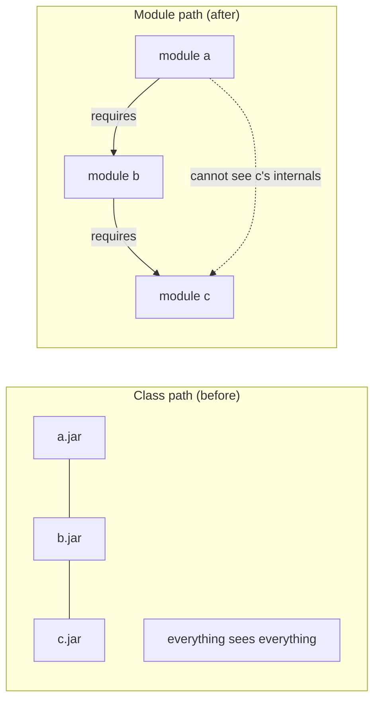
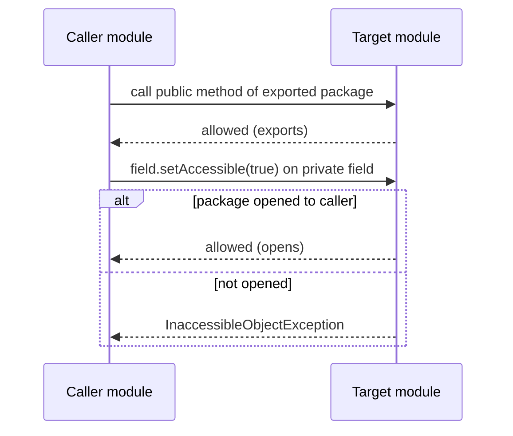
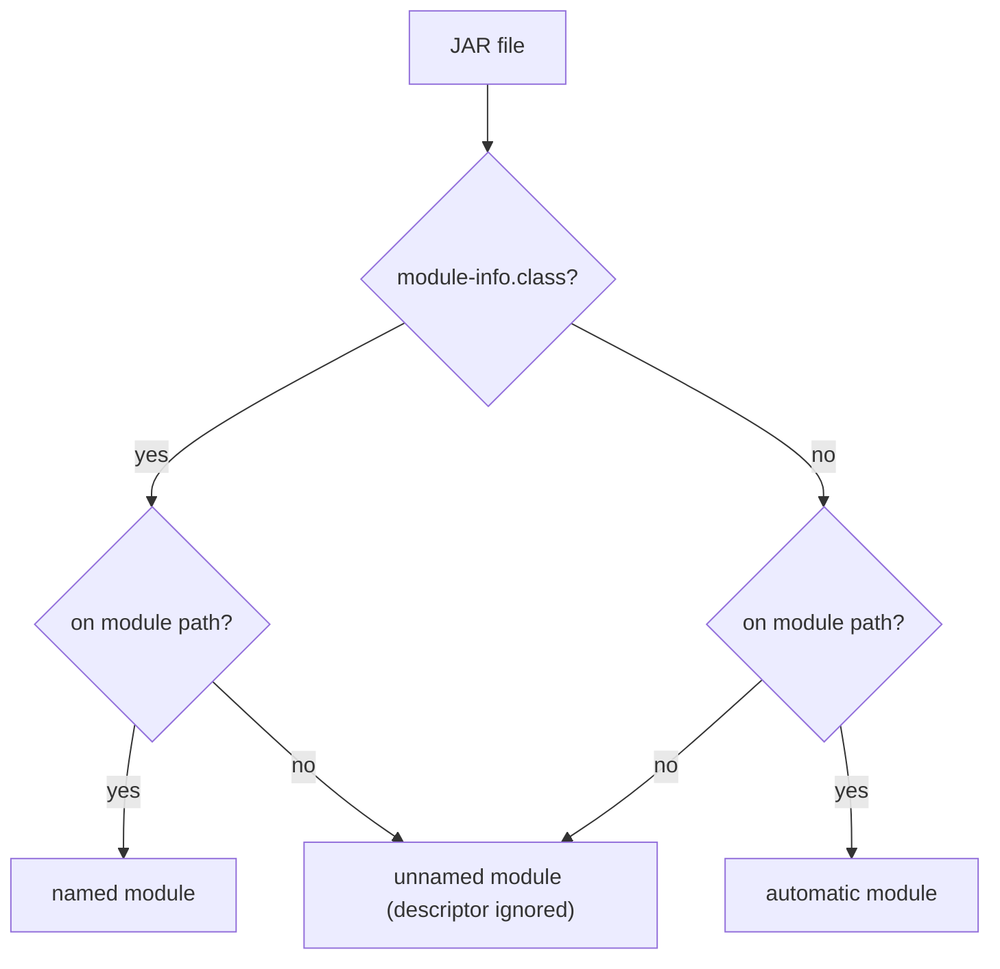

# 5.1 Modules (JPMS)

> **Goal:** Understand why the Java Platform Module System exists, read and write `module-info.java`, and know exactly how modules change compilation, reflection and the way the JDK itself is built.

**Level:** you know packages and the classpath; modules are new.
**Verified on:** OpenJDK 21.0.12. The module examples are small multi-module projects compiled and run with `javac --module-source-path` and `java --module-path`; all output is real.

## Contents

1. [The problem modules solve](#1-the-problem-modules-solve)
2. [Anatomy of `module-info.java`](#2-anatomy-of-module-infojava)
3. [A first modular application](#3-a-first-modular-application)
4. [Strong encapsulation: the compiler and the runtime say no](#4-strong-encapsulation-the-compiler-and-the-runtime-say-no)
5. [Services: loose coupling across modules](#5-services-loose-coupling-across-modules)
6. [Module path, class path, unnamed and automatic modules](#6-module-path-class-path-unnamed-and-automatic-modules)
7. [The JDK is modular too](#7-the-jdk-is-modular-too)
8. [Command-line escape hatches](#8-command-line-escape-hatches)
9. [Should you modularize your application?](#9-should-you-modularize-your-application)
10. [Common gotchas](#10-common-gotchas)
11. [Interview questions](#11-interview-questions)

---

## 1. The problem modules solve

**Intuition.** Before Java 9 a program was a pile of JARs on one flat list (the class path). Every `public` class in every JAR was visible to everyone: it is a building where every door is unlocked and the only "map" is the order in which you listed the JARs.

| Pre-9 problem | What happened | Module answer |
|---|---|---|
| `public` means "public to the world" | libraries' internals became de facto API; changing them broke users | only **exported** packages are accessible |
| JAR hell / missing JAR | a missing class showed up as `NoClassDefFoundError` at run time, maybe hours into a run | dependencies are declared and **checked at startup** |
| Split packages, duplicate classes | first JAR on the class path silently won | a package may live in **only one** module on the module path |
| Monolithic runtime (`rt.jar`) | every app shipped the whole JDK, including CORBA and Swing | the JDK is split into modules; `jlink` builds a minimal runtime (5.6) |
| Internal JDK APIs (`sun.*`) used freely | upgrades broke apps | JDK internals are **encapsulated** |



A module is a **named group of packages** plus a descriptor that says:

1. what it **needs** (`requires`),
2. what it **offers** (`exports`),
3. what it **allows reflection into** (`opens`),
4. which **services** it uses or provides (`uses`, `provides`).

## 2. Anatomy of `module-info.java`

The descriptor lives at the root of the module's source (and, compiled, at the root of its JAR).

| Directive | Meaning | Example |
|---|---|---|
| `requires m;` | I need module `m`; its exported packages become readable by me | `requires java.sql;` |
| `requires transitive m;` | anyone who requires me also reads `m` ("implied readability") | `requires transitive java.logging;` |
| `requires static m;` | needed at compile time, optional at run time | `requires static lombok;` |
| `exports p;` | package `p` public types are accessible to everyone | `exports com.acme.api;` |
| `exports p to a, b;` | only to listed modules ("qualified export") | `exports com.acme.spi to com.acme.impl;` |
| `opens p;` | deep reflection (even into `private`) allowed at run time | `opens com.acme.model;` |
| `opens p to a;` | same, only for module `a` | `opens com.acme.model to com.fasterxml.jackson.databind;` |
| `open module m { }` | every package is open (for frameworks) | `open module com.acme.web { ... }` |
| `uses S;` | I look up service `S` with `ServiceLoader` | `uses com.acme.api.Plugin;` |
| `provides S with I;` | I supply implementation `I` of service `S` | `provides Plugin with MyPlugin;` |

Key distinction, because it is asked in nearly every interview:

| | Compile time access to `public` types | Run time reflection into `private` members |
|---|---|---|
| plain package | no | no |
| `exports` | **yes** | public members only |
| `opens` | no (reflection only) | **yes** |
| `exports` + `opens` | yes | yes |

ASCII view of what a module looks like from outside and inside:

```text
            +------------------ module com.acme.greet ------------------+
 requires   |  exports  -> com.acme.greet.api        (visible to others)  |   requires
 java.base  |  hidden   -> com.acme.greet.internal   (invisible, even to  |   <- com.acme.app
 ---------> |             reflection unless opened)                       |
            |  provides Greeter with PoliteGreeter                        |
            +-------------------------------------------------------------+
```

## 3. A first modular application

Two modules: `com.acme.greet` exports an API package and hides its implementation, and `com.acme.app` uses it.

`com.acme.greet/module-info.java`:

```text
module com.acme.greet {
    exports com.acme.greet.api;
    provides com.acme.greet.api.Greeter with com.acme.greet.internal.PoliteGreeter;
}
```

`com.acme.greet/com/acme/greet/api/Greeter.java`:

```text
package com.acme.greet.api;

public interface Greeter {
    String greet(String name);
}
```

`com.acme.greet/com/acme/greet/internal/PoliteGreeter.java` (not exported):

```text
package com.acme.greet.internal;

import com.acme.greet.api.Greeter;

public class PoliteGreeter implements Greeter {
    @Override public String greet(String name) { return "Good day, " + name; }
}
```

`com.acme.app/module-info.java`:

```text
module com.acme.app {
    requires com.acme.greet;
    uses com.acme.greet.api.Greeter;
}
```

`com.acme.app/com/acme/app/Main.java`:

```text
package com.acme.app;

import com.acme.greet.api.Greeter;
import java.util.ServiceLoader;

public class Main {
    public static void main(String[] args) {
        Module me = Main.class.getModule();
        System.out.println("my module      : " + me.getName() + " named=" + me.isNamed());
        System.out.println("greet module   : " + Greeter.class.getModule().getName());
        System.out.println("reads greet    : " + me.canRead(Greeter.class.getModule()));
        for (Greeter g : ServiceLoader.load(Greeter.class)) {
            System.out.println("service found  : " + g.getClass().getName() + " -> " + g.greet("Mrinal"));
        }
        System.out.println("descriptor     : requires " + me.getDescriptor().requires().stream().map(r -> r.name()).sorted().toList());
        System.out.println("exports (greet): " + Greeter.class.getModule().getDescriptor().exports());
    }
}
```

Build and run (the script runs `javac --module-source-path . --module com.acme.app` and then `java --module-path out --module com.acme.app/com.acme.app.Main`):

```text
$ bash p5/mod.sh
my module      : com.acme.app named=true
greet module   : com.acme.greet
reads greet    : true
service found  : com.acme.greet.internal.PoliteGreeter -> Good day, Mrinal
descriptor     : requires [com.acme.greet, java.base]
exports (greet): [com.acme.greet.api]
```

What the output tells you:

- `Main.class.getModule()` is a **named** module: the code runs inside the module system.
- `canRead` is true because of `requires com.acme.greet`. The module graph is a set of *readability* edges.
- The `ServiceLoader` found `PoliteGreeter` even though `Main` never imported (and cannot import) its package: that is the point of services (section 5).
- `java.base` is required implicitly by every module ("mandated").

Directory layout used above:

```text
mods/
  com.acme.greet/
    module-info.java
    com/acme/greet/api/Greeter.java
    com/acme/greet/internal/PoliteGreeter.java
  com.acme.app/
    module-info.java
    com/acme/app/Main.java
```

By convention a module is named like a package (reverse-DNS) and its folder carries the module name.

## 4. Strong encapsulation: the compiler and the runtime say no

### 4.1 Compile time: a non-exported package does not exist

A third module tries to import the hidden implementation class:

```text
package com.acme.bad;

import com.acme.greet.internal.PoliteGreeter;

public class Cheat {
    public static void main(String[] args) {
        System.out.println(new PoliteGreeter().greet("x"));
    }
}
```

```text
$ bash p5/bad.sh
./com.acme.bad/com/acme/bad/Cheat.java:3: error: package com.acme.greet.internal does not exist
import com.acme.greet.internal.PoliteGreeter;
                              ^
./com.acme.bad/com/acme/bad/Cheat.java:7: error: cannot find symbol
        System.out.println(new PoliteGreeter().greet("x"));
                               ^
  symbol:   class PoliteGreeter
  location: class Cheat
2 errors
```

The message says "does not exist", not "is private": from outside, a non-exported package is simply not there.

### 4.2 Run time: reflection needs `opens`

Reflection used to bypass visibility with `setAccessible(true)`. In a module it works only if the package is **opened** to the caller. Here `User` has a private field, and its module exports but does not open the package:

```text
package com.acme.model;

public class User {
    private final String name;
    public User(String name) { this.name = name; }
    public String name() { return name; }
}
```

```text
package com.acme.reflect;

import com.acme.model.User;
import java.lang.reflect.Field;

public class Main {
    public static void main(String[] args) throws Exception {
        User u = new User("Mrinal");
        System.out.println("public API works: " + u.name());
        Field f = User.class.getDeclaredField("name");
        try {
            f.setAccessible(true);
            System.out.println("private field read by reflection: " + f.get(u));
        } catch (RuntimeException e) {
            System.out.println(e.getClass().getSimpleName() + ": " + e.getMessage());
        }
    }
}
```

```text
$ bash p5/reflect.sh
# exported but not opened
public API works: Mrinal
InaccessibleObjectException: Unable to make field private final java.lang.String com.acme.model.User.name accessible: module com.acme.model does not "opens com.acme.model" to module com.acme.reflect

# same code, with the package opened on the command line
public API works: Mrinal
private field read by reflection: Mrinal
```

The same rule protects the JDK itself. Reflecting into `java.lang` from application code fails unless the JDK package is opened on the command line, and the internal-but-still-shipped `sun.misc.Unsafe` (module `jdk.unsupported`) remains reachable:

```java
import java.lang.reflect.Field;

public class Encap {
    public static void main(String[] args) throws Exception {
        Field value = String.class.getDeclaredField("value");
        try {
            value.setAccessible(true);
            byte[] bytes = (byte[]) value.get("hi");
            System.out.println("opened java.lang: String.value has " + bytes.length + " bytes");
        } catch (RuntimeException e) {
            System.out.println(e.getClass().getSimpleName() + ": " + e.getMessage().replaceAll("@[0-9a-f]+", "@<hash>"));
        }
        Class<?> unsafe = Class.forName("sun.misc.Unsafe");
        Field f = unsafe.getDeclaredField("theUnsafe");
        f.setAccessible(true);
        System.out.println("sun.misc.Unsafe still reachable (jdk.unsupported): " + (f.get(null) != null));
    }
}

// ---- Output ----
// InaccessibleObjectException: Unable to make field private final byte[] java.lang.String.value accessible: module java.base does not "opens java.lang" to unnamed module @<hash>
// sun.misc.Unsafe still reachable (jdk.unsupported): true
```

```java
import java.lang.reflect.Field;

public class Encap {
    public static void main(String[] args) throws Exception {
        Field value = String.class.getDeclaredField("value");
        try {
            value.setAccessible(true);
            byte[] bytes = (byte[]) value.get("hi");
            System.out.println("opened java.lang: String.value has " + bytes.length + " bytes");
        } catch (RuntimeException e) {
            System.out.println(e.getClass().getSimpleName() + ": " + e.getMessage().replaceAll("@[0-9a-f]+", "@<hash>"));
        }
        Class<?> unsafe = Class.forName("sun.misc.Unsafe");
        Field f = unsafe.getDeclaredField("theUnsafe");
        f.setAccessible(true);
        System.out.println("sun.misc.Unsafe still reachable (jdk.unsupported): " + (f.get(null) != null));
    }
}

// Run with: java --add-opens java.base/java.lang=ALL-UNNAMED Encap
// ---- Output ----
// opened java.lang: String.value has 2 bytes
// sun.misc.Unsafe still reachable (jdk.unsupported): true
```



## 5. Services: loose coupling across modules

A **service** is an interface; a **provider** is an implementation in some other module; the **consumer** finds providers with `ServiceLoader`. In the demo:

| Role | Descriptor line |
|---|---|
| Service interface | `exports com.acme.greet.api;` (in `com.acme.greet`) |
| Provider | `provides com.acme.greet.api.Greeter with com.acme.greet.internal.PoliteGreeter;` |
| Consumer | `uses com.acme.greet.api.Greeter;` and `ServiceLoader.load(Greeter.class)` |

This replaces the old `META-INF/services/...` text files (still honoured on the class path) and gives you plug-in architectures without exposing the implementation package. The module system resolves providers when it builds the module graph, so `requires` between consumer and provider is not needed.

## 6. Module path, class path, unnamed and automatic modules

Real projects mix modular and non-modular JARs, and the platform defines how:

| Kind | Where it comes from | Readability | Exports |
|---|---|---|---|
| **Named (explicit) module** | has `module-info.class`, on the module path | only what it `requires` | only what it `exports` |
| **Unnamed module** | everything on the **class path** | reads **all** modules | exports **everything** |
| **Automatic module** | a plain JAR placed on the **module path** | reads all modules | exports everything; name from `Automatic-Module-Name` manifest entry or derived from the file name |



Consequences:

- Putting a modular JAR on the **class path** disables its encapsulation: it becomes part of the unnamed module. Most real Java 8 applications upgraded to 11 simply stay on the class path and never touch any of this, except for the JDK's own encapsulation.
- A named module **cannot** `requires` something on the class path (the unnamed module has no name). Dependencies must be automatic or named.
- Library authors who cannot modularize yet should at least add `Automatic-Module-Name: com.acme.lib` to the manifest, so downstream modular code can depend on a stable name.

## 7. The JDK is modular too

Since Java 9 the JDK is a set of modules. `java.base` is always present and holds `java.lang`, `java.util`, `java.io`, `java.nio` and so on; the rest are optional.

```text
$ bash p5/desc.sh
# a JDK module
exports java.sql
exports javax.sql
java.sql
requires java.base mandated
requires java.logging transitive
requires java.transaction.xa transitive
requires java.xml transitive
uses java.sql.Driver

p5/desc.sh: line 6: syntax error near unexpected token `('
p5/desc.sh: line 6: `java --list-modules | grep -E '^java\.(base|sql|logging|net\.http|xml)@' | sed 's/@.*//''
```

- `requires transitive` on `java.sql` means: code that requires `java.sql` automatically reads `java.logging` and `java.xml` too, because their types appear in `java.sql`'s API.
- `uses java.sql.Driver` is how JDBC drivers are discovered by `DriverManager`.
- `jdeps` shows which modules your code actually needs. This is the first step of building a slim runtime with `jlink` (5.6) and of migrating (5.7).

Java 9 split the JDK into dozens of modules; Java 11 removed the Java EE and CORBA modules (`java.xml.bind`, `java.xml.ws`, `java.activation`, `java.corba`, ...) and kept the Java SE ones (5.7).

## 8. Command-line escape hatches

| Option | Effect | Typical use |
|---|---|---|
| `--add-modules m` | add a root module to the module graph | use `java.sql` from the class path on a trimmed JDK |
| `--add-reads a=b` | module `a` also reads `b` | tests reading code under test |
| `--add-exports m/p=t` | export package `p` of `m` to `t` | legacy code touching an internal API |
| `--add-opens m/p=t` | open package `p` of `m` to `t` for reflection | frameworks reflecting into JDK classes |
| `--patch-module m=dir` | inject classes into module `m` | compiling/testing in the same package |
| `--illegal-access=permit/deny` | Java 9-15 only: whether reflection into JDK internals from the class path is allowed | removed in 17: option ignored |

Timeline of JDK-internal access from the class path: **9** permit by default (warns on first illegal access), **16** deny by default, **17** `--illegal-access` removed, and only `--add-opens` and `--add-exports` work. Anything that "just worked" on 8 and 11 may need `--add-opens` on 17+ (Part 6).

## 9. Should you modularize your application?

| Situation | Recommendation |
|---|---|
| Library with many consumers | add `module-info.java` (or at least `Automatic-Module-Name`) |
| Large app with strict internal boundaries | modules enforce layering at compile time; worth it |
| Spring Boot / Hibernate / Jackson app | usually stay on the class path: these frameworks reflect heavily and need `opens` everywhere |
| Need a small container image / runtime | modules + `jlink` (5.6) pay off |
| Java 8 app being upgraded | do **not** modularize as part of the upgrade; fix the JDK-internal access problems first (5.7) |

A practical, pragmatic route: upgrade the JDK first, stay on the class path, add `--add-opens` where required, and modularize only the parts that gain from it.

## 10. Common gotchas

| Gotcha | Why | Fix |
|---|---|---|
| `package x does not exist` for a package you can see in a JAR | package not exported | export it, or use the API that is exported |
| `InaccessibleObjectException` in a framework | package not opened to the framework | `opens p to framework.module`, or `--add-opens` |
| Split package error | two modules contain the same package | rename or merge packages |
| `module not found` at startup | dependency missing from the module path | add the JAR; `jdeps` finds it earlier |
| Cyclic dependency between modules | `requires` cycles are forbidden | extract an API module, use services |
| Classpath dependency from a named module | unnamed module cannot be required | move the JAR to the module path as automatic |
| Automatic module name changes between releases | derived from file name | ask the library to set `Automatic-Module-Name` |
| `ServiceLoader` finds nothing | missing `provides`/`uses`, or provider module not in the graph | add `--add-modules` for the provider |
| Tests cannot see package-private classes | tests are a different module | `--patch-module`, or keep tests on the class path |
| Reflection into JDK internals works on 11 but not 17 | `--illegal-access` default changed in 16, removed in 17 | `--add-opens` |

## 11. Interview questions

<details>
<summary><strong>Q1. What problems did JPMS (Project Jigsaw) set out to solve?</strong></summary>

Reliable configuration (declared, verified dependencies), strong encapsulation (only exported packages are accessible), and a scalable platform (the modular JDK and custom runtimes with <code>jlink</code>). It ended the "everything on the class path sees everything" model.
</details>

<details>
<summary><strong>Q2. What is the difference between <code>exports</code> and <code>opens</code>?</strong></summary>

<code>exports</code> makes the public types of a package accessible at compile time and run time. <code>opens</code> allows <em>deep reflection</em> (including private members) at run time only. A package can be exported, opened, both or neither.
</details>

<details>
<summary><strong>Q3. What does <code>requires transitive</code> do?</strong></summary>

It gives "implied readability": modules that require me also read the transitive dependency. Use it when the dependency's types appear in your public API (as <code>java.sql</code> does for <code>java.logging</code> and <code>java.xml</code>).
</details>

<details>
<summary><strong>Q4. What is the unnamed module? What is an automatic module?</strong></summary>

The unnamed module holds everything on the class path; it reads all modules and exports everything. An automatic module is a plain JAR on the module path: it gets a name (manifest or file name), reads all modules and exports all its packages.
</details>

<details>
<summary><strong>Q5. Why can a named module not depend on a class-path JAR?</strong></summary>

The unnamed module has no name, so a <code>requires</code> clause cannot refer to it. Put the JAR on the module path as an automatic module instead.
</details>

<details>
<summary><strong>Q6. How do services work with modules?</strong></summary>

The consumer declares <code>uses S</code> and calls <code>ServiceLoader.load(S.class)</code>; each provider module declares <code>provides S with Impl</code>. The runtime resolves providers while building the module graph, so the consumer never depends on the implementation package.
</details>

<details>
<summary><strong>Q7. What happened to <code>--illegal-access</code>?</strong></summary>

Java 9 to 15 defaulted to <code>permit</code> (warning on first illegal reflective access from the class path), 16 changed the default to <code>deny</code>, and 17 removed the option. Use <code>--add-opens</code> or <code>--add-exports</code> for specific packages.
</details>

<details>
<summary><strong>Q8. What is <code>java.base</code>?</strong></summary>

The fundamental module every other module implicitly requires; it contains the core packages such as <code>java.lang</code>, <code>java.util</code>, <code>java.io</code>, <code>java.nio</code>, <code>java.net</code> and <code>java.security</code>.
</details>

<details>
<summary><strong>Q9. What is a split package and why is it a problem?</strong></summary>

The same package name present in two modules. The module system forbids it on the module path, since it cannot decide which module owns the package; on the class path the first JAR wins silently, which is the old hazard.
</details>

<details>
<summary><strong>Q10. Can a module cycle exist (A requires B, B requires A)?</strong></summary>

No: <code>requires</code> cycles are rejected at compile time. Break the cycle by extracting shared types into a third module or using services.
</details>

<details>
<summary><strong>Q11. Why do frameworks like Spring or Hibernate need <code>opens</code>?</strong></summary>

They use reflection to instantiate beans and populate private fields. Without <code>opens</code> (or an <code>open module</code>) that reflection fails with <code>InaccessibleObjectException</code>.
</details>

<details>
<summary><strong>Q12. How would you find out which JDK modules your application needs?</strong></summary>

Run <code>jdeps --print-module-deps</code> (or <code>jdeps -s</code>) on the JARs/classes, then feed the result to <code>jlink --add-modules</code> to build a trimmed runtime.
</details>

---

[Previous: Part 5 index](./README.md) · Next: [5.2 var and Small Language Features](./02-var-and-small-language-features.md)