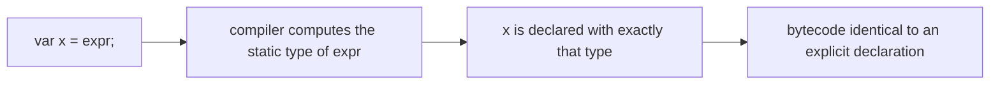

# 5.2 `var` and Small Language Features (Java 9 to 11)

> **Goal:** Use local-variable type inference (`var`) with good judgement, and know every small language and library-syntax change between Java 8 and 11 that you will meet in real code.

**Level:** quick wins, but with sharp edges that interviewers like.
**Verified on:** OpenJDK 21.0.12. Compile errors are the real `javac` messages.

## Contents

1. [`var`: local-variable type inference (Java 10)](#1-var-local-variable-type-inference-java-10)
2. [What `var` really does](#2-what-var-really-does)
3. [Where `var` is not allowed](#3-where-var-is-not-allowed)
4. [Style: when `var` helps and when it hurts](#4-style-when-var-helps-and-when-it-hurts)
5. [`var` in lambda parameters (Java 11)](#5-var-in-lambda-parameters-java-11)
6. [Other language changes in Java 9](#6-other-language-changes-in-java-9)
7. [New `String` methods (Java 11) and friends](#7-new-string-methods-java-11-and-friends)
8. [Summary table: language changes 9 to 11](#8-summary-table-language-changes-9-to-11)
9. [Common gotchas](#9-common-gotchas)
10. [Interview questions](#10-interview-questions)

---

## 1. `var`: local-variable type inference (Java 10)

**Intuition.** You already wrote the type once, on the right-hand side. `var` lets the compiler read it from there instead of making you repeat it:

```text
Map<String, List<Integer>> index = new HashMap<String, List<Integer>>();   // Java 6
Map<String, List<Integer>> index = new HashMap<>();                         // Java 7 diamond
var index = new HashMap<String, List<Integer>>();                           // Java 10
```

It is *not* dynamic typing. The compiler infers the type at compile time and the variable is statically typed forever after. The bytecode is identical to writing the type by hand.

```java
import java.util.*;
import java.util.function.*;
import java.util.stream.*;

public class Var {
    interface Shape { double area(); }
    record Circle(double r) implements Shape { public double area() { return Math.PI * r * r; } }

    public static void main(String[] args) {
        // 1. var infers the type from the right-hand side (compile time, still static typing)
        var count = 10;                       // int
        var name = "Mrinal";                  // String
        var list = new ArrayList<String>();   // ArrayList<String>
        list.add("a");
        var map = new HashMap<String, List<Integer>>();
        map.computeIfAbsent("x", k -> new ArrayList<>()).add(1);
        System.out.println(((Object) count).getClass().getSimpleName() + " " + name.getClass().getSimpleName()
                + " " + list.getClass().getSimpleName() + " " + map);

        // 2. var is NOT dynamic typing: the type is fixed after inference
        var n = 1;
        n = n + 1;
        System.out.println("n = " + n);

        // 3. diamond inference trap: var + diamond infers Object
        var objs = new ArrayList<>();         // ArrayList<Object>
        objs.add("text");
        objs.add(42);
        System.out.println("objs = " + objs);

        // 4. var with the "most specific" type (useful with anonymous classes)
        var anon = new Object() { int hits = 3; String hello() { return "hi"; } };
        System.out.println("anonymous type members usable through var: " + anon.hits + " " + anon.hello());

        // 5. var in for loops and try-with-resources
        for (var e : Map.of("k", 1).entrySet()) System.out.println(e.getKey() + "=" + e.getValue());
        for (var i = 0; i < 2; i++) System.out.print("i" + i + " ");
        System.out.println();

        // 6. intersection-ish types and literals: var keeps the exact type
        var shapes = List.of(new Circle(1), new Circle(2));
        System.out.printf("total area %.2f%n", shapes.stream().mapToDouble(Shape::area).sum());

        // 7. Java 11: var in lambda parameters lets you add annotations / final
        BiFunction<Integer, Integer, Integer> add = (var a, var b) -> a + b;
        System.out.println("lambda with var params: " + add.apply(2, 3));

        // 8. var with a ternary mixing types gives a lub type
        var mixed = args.length > 0 ? "text" : 1;
        System.out.println("mixed inferred as Serializable & Comparable: " + mixed);

        // 9. var and generics methods
        var empty = Collections.emptyList();  // List<Object>
        System.out.println("empty: " + empty);
    }
}

// ---- Output ----
// Integer String ArrayList {x=[1]}
// n = 2
// objs = [text, 42]
// anonymous type members usable through var: 3 hi
// k=1
// i0 i1
// total area 15.71
// lambda with var params: 5
// mixed inferred as Serializable & Comparable: 1
// empty: []
```

Walk through the output:

1. `count` is an `int`, `name` a `String`, `list` an `ArrayList<String>`: types come from the initializer.
2. `n = n + 1` still type-checks as `int`; you cannot later assign a `String` to `n`.
3. `new ArrayList<>()` with `var` infers **`ArrayList<Object>`** because the diamond has no target type to learn from: a classic trap.
4. `var` can name an **anonymous class type**, so its extra members are usable (`anon.hits`): the one thing you cannot do with an explicit type.
5. `var` works in `for`/enhanced-`for` and `try-with-resources`.

## 2. What `var` really does



Rules of inference:

| Initializer | Inferred type |
|---|---|
| literal `10`, `"s"`, `1.5` | `int`, `String`, `double` |
| `new Foo()` | `Foo` |
| `new ArrayList<>()` | `ArrayList<Object>` (no target type) |
| `new ArrayList<String>()` | `ArrayList<String>` |
| method call | the method's declared return type (not a runtime subtype) |
| `cond ? "a" : 1` | an intersection of the common supertypes (e.g. `Serializable & Comparable<...>`) |
| `Collections.emptyList()` | `List<Object>` |
| anonymous class creation | the anonymous class itself |

Important: `var` takes the **declared** type of the expression. `var s = factory.create();` where `create()` returns `Shape` gives you `Shape`, even if it returns a `Circle` at run time.

```text
 source:    var items = new ArrayList<String>();
               |             |
               |             +--- type of the right-hand side: ArrayList<String>
               v
 compiler:  ArrayList<String> items = new ArrayList<String>();     (nothing is left to guess at run time)
```

## 3. Where `var` is not allowed

`var` is a *reserved type name*, not a keyword (so `var` is still legal as a variable or method name; a class named `var` is not). It is limited to local variables.

```java
public class VarErrors {
    var field = 1;                       // fields are not allowed
    static var m(var x) { return x; }    // parameters and return types are not allowed

    public static void main(String[] args) {
        var f = 1, g = 2;                // no compound declarations
    }
}
```

Real `javac` output:

```text
s/p5/VarErrors.java:2: error: 'var' is not allowed here
    var field = 1;                       // fields are not allowed
    ^
s/p5/VarErrors.java:3: error: 'var' is not allowed here
    static var m(var x) { return x; }    // parameters and return types are not allowed
           ^
s/p5/VarErrors.java:3: error: 'var' is not allowed here
    static var m(var x) { return x; }    // parameters and return types are not allowed
                 ^
s/p5/VarErrors.java:6: error: 'var' is not allowed in a compound declaration
        var f = 1, g = 2;                // no compound declarations
        ^
4 errors
```

And without enough information to infer a type:

```java
public class VarErrors2 {
    public static void main(String[] args) {
        var a;                           // no initializer
        var b = null;                    // null has no type
        var c = {1, 2};                  // array initializer needs an explicit type
        var d = () -> 1;                 // lambda needs a target type
        var e = VarErrors2::main;        // method reference needs a target type
    }
}
```

Real `javac` output:

```text
s/p5/VarErrors2.java:3: error: cannot infer type for local variable a
        var a;                           // no initializer
            ^
  (cannot use 'var' on variable without initializer)
s/p5/VarErrors2.java:4: error: cannot infer type for local variable b
        var b = null;                    // null has no type
            ^
  (variable initializer is 'null')
s/p5/VarErrors2.java:5: error: cannot infer type for local variable c
        var c = {1, 2};                  // array initializer needs an explicit type
            ^
  (array initializer needs an explicit target-type)
s/p5/VarErrors2.java:6: error: cannot infer type for local variable d
        var d = () -> 1;                 // lambda needs a target type
            ^
  (lambda expression needs an explicit target-type)
s/p5/VarErrors2.java:7: error: cannot infer type for local variable e
        var e = VarErrors2::main;        // method reference needs a target type
            ^
  (method reference needs an explicit target-type)
5 errors
```

| Not allowed | Why |
|---|---|
| fields | their type is part of the class's contract |
| method parameters and return types | same: signatures must be explicit |
| `var a;` | nothing to infer from |
| `var b = null;` | `null` has no type |
| `var c = {1, 2};` | array initializers need a declared array type |
| lambdas, method references | they need a target functional interface |
| `var x = 1, y = 2;` | compound declarations are rejected |

## 4. Style: when `var` helps and when it hurts

| Use `var` when | Prefer the explicit type when |
|---|---|
| the type is obvious from the right side: `var users = new ArrayList<User>();` | the right side hides it: `var result = service.process(data);` |
| the type name is long and noisy (nested generics) | you want a **wider** declared type (`List<String> l = new ArrayList<>();`) |
| you need an anonymous or intersection type | numeric literals where `long`/`double` matters: `var n = 1;` is an `int` |
| `for (var e : map.entrySet())` | public API shapes and anything shown in documentation |

Guidelines adapted from the JDK's own style notes:

1. Choose **variable names** that carry the meaning, since the type is no longer shown.
2. Keep scopes small; `var` pays off when the declaration and its use are close together.
3. Do not use `var` to *hide* a type that the reader must know.
4. Beware diamond + `var`: always give the type argument (`new ArrayList<String>()`).

## 5. `var` in lambda parameters (Java 11)

Java 11 allows `var` for implicitly typed lambda parameters. This looks pointless until you need annotations or `final` on a parameter without writing the type:

```text
BiFunction<Integer, Integer, Integer> add = (var a, var b) -> a + b;
BiFunction<Integer, Integer, Integer> add = (@NonNull var a, final var b) -> a + b;   // the reason it exists
```

(The first form is executed in the program in section 1 and prints `5`.) Rules: either **all** parameters use `var` or none do, and you cannot mix `var` with explicit types: `(var a, int b) -> ...` is an error.

## 6. Other language changes in Java 9

```java
import java.io.*;
import java.util.*;
import java.util.function.*;

public class Lang9 {
    // Java 9: private interface methods (share code between default methods)
    interface Logger {
        default void info(String m)  { log("INFO",  m); }
        default void error(String m) { log("ERROR", m); }
        private void log(String level, String m) { System.out.println(prefix() + level + ": " + m); }
        private static String prefix() { return "[app] "; }
    }

    static class Res implements AutoCloseable {
        final String name;
        Res(String name) { this.name = name; System.out.println("open " + name); }
        @Override public void close() { System.out.println("close " + name); }
    }

    // Java 9: @SafeVarargs allowed on private instance methods
    @SafeVarargs private <T> List<T> listOf(T... items) { return Arrays.asList(items); }

    public static void main(String[] args) throws Exception {
        new Logger() { }.info("started");

        // Java 9: effectively final variable directly in try-with-resources
        Res a = new Res("A");
        final Res b = new Res("B");
        try (a; b) {
            System.out.println("working with " + a.name + b.name);
        }

        // Java 9: diamond with anonymous classes
        Comparator<String> byLen = new Comparator<>() {
            @Override public int compare(String x, String y) { return Integer.compare(x.length(), y.length()); }
        };
        System.out.println("anonymous diamond: " + byLen.compare("aa", "b"));

        System.out.println(new Lang9().listOf(1, 2, 3));

        // Java 9: "_" is no longer a valid identifier (compile error) -- see chapter
        // Java 10: var (chapter section 2)
        // Java 11: var in lambda parameters; single-file launch (chapter 5.6)

        // Java 11: new String methods
        String text = "    hello\n \tworld  ";
        System.out.println("isBlank(\"  \") = " + "  ".isBlank() + ", isBlank(\"x\") = " + "x".isBlank());
        System.out.println("strip      = [" + text.strip() + "]");
        System.out.println("trim       = [" + text.trim().replace("\n", "\\n") + "]  (trim leaves the Unicode space \\u2003)");
        System.out.println("stripLeading/Trailing lengths: " + text.stripLeading().length() + "/" + text.stripTrailing().length());
        System.out.println("lines      = " + "one\ntwo\r\nthree".lines().toList());
        System.out.println("repeat     = " + "ab".repeat(3) + " [" + "x".repeat(0) + "]");

        // Java 11: Files.readString / writeString
        var path = java.nio.file.Files.createTempFile("p5", ".txt");
        java.nio.file.Files.writeString(path, "line1\nline2\n");
        System.out.println("readString = " + java.nio.file.Files.readString(path).replace("\n", "|"));
        java.nio.file.Files.delete(path);

        // Java 11: Path.of, Predicate.not, Optional.isEmpty
        System.out.println("Path.of    = " + java.nio.file.Path.of("a", "b", "c.txt"));
        System.out.println("Predicate.not: " + java.util.stream.Stream.of("a", "", " ", "b").filter(Predicate.not(String::isBlank)).toList());
        System.out.println("Optional.isEmpty: " + Optional.empty().isEmpty());

        // Java 11: Collection.toArray(IntFunction)
        String[] arr = List.of("x", "y").toArray(String[]::new);
        System.out.println("toArray(String[]::new) -> " + arr.length + " " + arr.getClass().getSimpleName());

        // Java 11: Runtime.version
        System.out.println("Runtime.version().feature() >= 11: " + (Runtime.version().feature() >= 11));
    }
}

// ---- Output ----
// [app] INFO: started
// open A
// open B
// working with AB
// close B
// close A
// anonymous diamond: 1
// [1, 2, 3]
// isBlank("  ") = true, isBlank("x") = false
// strip      = [hello
//  	world]
// trim       = [  hello\n 	world]  (trim leaves the Unicode space \u2003)
// stripLeading/Trailing lengths: 15/17
// lines      = [one, two, three]
// repeat     = ababab []
// readString = line1|line2|
// Path.of    = a/b/c.txt
// Predicate.not: [a, b]
// Optional.isEmpty: true
// toArray(String[]::new) -> 2 String[]
// Runtime.version().feature() >= 11: true
```

| Feature (version) | What it does |
|---|---|
| **Private interface methods** (9) | interfaces can have `private` and `private static` helpers shared by `default` methods (`log` in the demo) |
| **Effectively final resources in try-with-resources** (9) | `try (a; b)` instead of redeclaring: `close()` runs in reverse order (`B` then `A`) |
| **Diamond with anonymous classes** (9) | `new Comparator<>() { ... }` infers the type argument |
| **`@SafeVarargs` on private methods** (9) | allowed on `private` instance methods, not only `static`/`final` |
| **`_` is a reserved word** (9) | can no longer be used as an identifier. Java 21 re-uses it as a *preview* "unnamed variable" and Java 22 finalizes it |
| **Module declarations** (9) | `module-info.java` (5.1) |
| **`var`** (10), **`var` in lambdas** (11) | sections 1 to 5 |
| **Nest-based access control** (11) | inner classes can access outer `private` members without synthetic bridges (5.5) |
| **Single-file source launch** (11) | `java Hello.java` (5.6) |

Note on the private interface methods example: since `info` and `error` are `default` methods, the anonymous `new Logger() { }` needs no implementation, and `log` and `prefix` stay invisible to implementors.

## 7. New `String` methods (Java 11) and friends

The output above also exercises the small API additions you will use daily:

| Method | Behaviour | Note |
|---|---|---|
| `isBlank()` | true if empty or only whitespace | Unicode-aware (`Character.isWhitespace`) |
| `strip()`, `stripLeading()`, `stripTrailing()` | remove leading/trailing whitespace | `trim()` only removes characters `<= U+0020`, so it left the em-space ` ` in the demo |
| `lines()` | `Stream<String>` split on `\n`, `\r`, `\r\n` | lazy; no trailing empty element |
| `repeat(n)` | concatenates `n` copies | `repeat(0)` is `""` |
| `Files.readString` / `writeString` | whole-file text I/O (UTF-8) | for small files |
| `Path.of(...)` | replaces `Paths.get(...)` | same result |
| `Predicate.not(p)` | negation for method references | `filter(Predicate.not(String::isBlank))` |
| `Optional.isEmpty()` | inverse of `isPresent()` | |
| `Collection.toArray(IntFunction)` | `list.toArray(String[]::new)` | generic-friendly |
| `Runtime.version()` | parsed version object | no more string splitting (5.7) |

Rule of thumb: prefer `strip()` over `trim()` for user text, and `isBlank()` over `trim().isEmpty()`.

## 8. Summary table: language changes 9 to 11

| Version | Language / syntax changes |
|---|---|
| 9 | modules, private interface methods, try-with-resources on variables, diamond for anonymous classes, `@SafeVarargs` on private methods, `_` reserved |
| 10 | local-variable type inference (`var`) |
| 11 | `var` in lambda parameters, nest-based access control (VM level) |

Java 12 to 16 add switch expressions, text blocks, records and pattern matching; those arrive with Part 6 (Java 17).

## 9. Common gotchas

| Gotcha | Why | Fix |
|---|---|---|
| `var list = new ArrayList<>();` is `ArrayList<Object>` | diamond has no target type | `new ArrayList<String>()` or an explicit type |
| `var x = 1;` then `x = 1L;` fails | `x` is an `int` | declare `long x = 1;` |
| Wider type lost | `var l = new ArrayList<String>();` is an `ArrayList`, not a `List` | declare `List<String> l = ...` when the interface matters |
| Readability drops on long methods | the type is not visible | good names, small methods |
| Using `var` for a method result whose type is unclear | reader has to look it up | explicit type |
| `trim()` leaves Unicode whitespace | it only removes `<= U+0020` | `strip()` |
| `lines()` assumed to return a `List` | it is a `Stream` | `.toList()` (16) or `collect` |
| `var` as an identifier | still legal for variables and methods, illegal for types | do not name a class `var` |
| `(var a, int b)` mixing | all or nothing | use one style |

## 10. Interview questions

<details>
<summary><strong>Q1. Is <code>var</code> dynamic typing?</strong></summary>

No. The compiler infers a static type from the initializer; the variable keeps that type for its whole life and the bytecode is the same as with an explicit declaration.
</details>

<details>
<summary><strong>Q2. What type does <code>var list = new ArrayList&lt;&gt;();</code> have?</strong></summary>

<code>ArrayList&lt;Object&gt;</code>, because the diamond has no target type to infer from. Write <code>new ArrayList&lt;String&gt;()</code> or declare the type.
</details>

<details>
<summary><strong>Q3. Where can you not use <code>var</code>?</strong></summary>

Fields, method parameters, return types, without an initializer, with <code>null</code>, with array initializers, lambdas, method references, and compound declarations.
</details>

<details>
<summary><strong>Q4. Is <code>var</code> a keyword?</strong></summary>

It is a reserved type name. <code>var var = 1;</code> compiles (a variable named <code>var</code>), but you cannot declare a class or interface called <code>var</code>.
</details>

<details>
<summary><strong>Q5. Why did Java 11 allow <code>var</code> in lambda parameters?</strong></summary>

So implicitly typed lambda parameters can carry annotations or <code>final</code> (<code>(@NonNull var x) -&gt; ...</code>) without spelling out the type.
</details>

<details>
<summary><strong>Q6. Does <code>var</code> keep the runtime type of the object?</strong></summary>

No, it keeps the <em>declared</em> (static) type of the initializer expression. If a method returns <code>Shape</code>, <code>var s = f();</code> is a <code>Shape</code> even if the object is a <code>Circle</code>.
</details>

<details>
<summary><strong>Q7. What is the benefit of private interface methods?</strong></summary>

They let several <code>default</code> or <code>static</code> methods share code without exposing a helper in the interface's public API.
</details>

<details>
<summary><strong>Q8. What changed in try-with-resources in Java 9?</strong></summary>

You can use an existing effectively final variable directly: <code>try (a; b) { ... }</code>. Resources close in reverse order.
</details>

<details>
<summary><strong>Q9. What is the difference between <code>trim()</code> and <code>strip()</code>?</strong></summary>

<code>trim()</code> removes characters up to U+0020; <code>strip()</code> removes all Unicode whitespace as defined by <code>Character.isWhitespace</code>. Java 11 added <code>strip</code>, <code>stripLeading</code>, <code>stripTrailing</code> and <code>isBlank</code>.
</details>

<details>
<summary><strong>Q10. How do you negate a method reference in a stream filter?</strong></summary>

<code>Predicate.not(String::isBlank)</code> (Java 11), instead of a lambda <code>s -&gt; !s.isBlank()</code>.
</details>

<details>
<summary><strong>Q11. Should you use <code>var</code> everywhere?</strong></summary>

No. Use it when the type is obvious or noisy, keep names descriptive, and keep an explicit (often wider) type when the interface matters or the right-hand side hides it.
</details>

---

[Previous: 5.1 Modules (JPMS)](./01-modules-jpms.md) · [Part index](./README.md) · Next: [5.3 Collection Factories and API Additions](./03-collection-factories-and-api-additions.md)