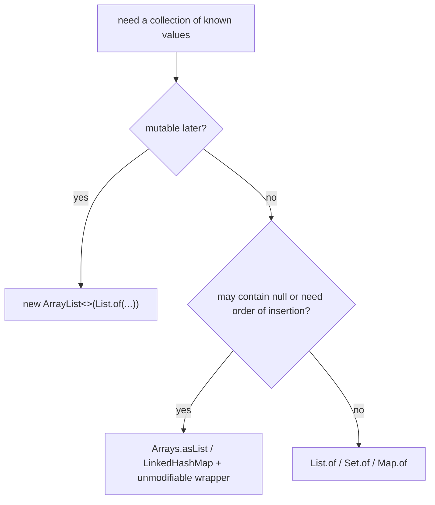
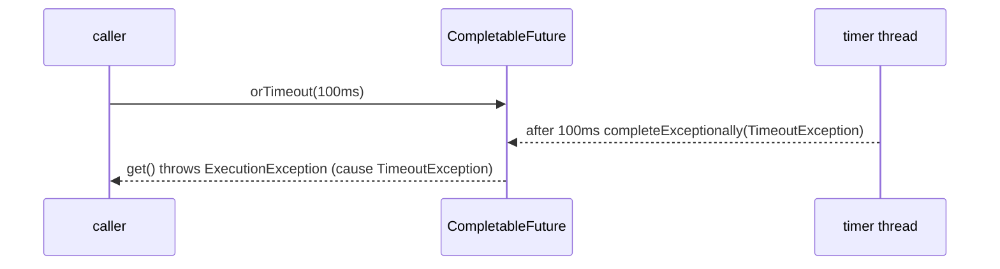

# 5.3 Collection Factories and API Additions (Java 9 to 11)

> **Goal:** Use the immutable collection factories correctly, know the exact guarantees they give, and recognise the other library additions of Java 9 to 11 (Optional, I/O, concurrency, process and stack APIs).

**Level:** everyday API. Most items are small, but the immutability rules are a favourite interview topic.
**Verified on:** OpenJDK 21.0.12. All output is real. Stream additions (`takeWhile`, `teeing`, `toList()`...) are covered in Part 4.

## Contents

1. [Immutable collection factories (Java 9)](#1-immutable-collection-factories-java-9)
2. [Immutable, unmodifiable, fixed-size: three different things](#2-immutable-unmodifiable-fixed-size-three-different-things)
3. [`copyOf` and unmodifiable collectors (Java 10)](#3-copyof-and-unmodifiable-collectors-java-10)
4. [Other API additions, with proof](#4-other-api-additions-with-proof)
5. [`CompletableFuture` additions (Java 9)](#5-completablefuture-additions-java-9)
6. [Cheat sheet: what arrived when](#6-cheat-sheet-what-arrived-when)
7. [Common gotchas](#7-common-gotchas)
8. [Interview questions](#8-interview-questions)

---

## 1. Immutable collection factories (Java 9)

**Intuition.** Before Java 9, a three-element constant list needed `Collections.unmodifiableList(Arrays.asList("a","b","c"))`: two wrappers and still a mutable list underneath. Now the intent is one call:

```text
List<String> list = List.of("a", "b", "c");
Set<Integer> set  = Set.of(3, 1, 2);
Map<String, Integer> map = Map.of("one", 1, "two", 2);                 // up to 10 pairs
Map<String, Integer> big = Map.ofEntries(Map.entry("a", 1), Map.entry("b", 2));   // any size
```

```java
import java.util.*;
import java.util.stream.*;

public class Factories {
    static void tryIt(String label, Runnable r) {
        try { r.run(); System.out.println(label + ": ok"); }
        catch (Exception e) { System.out.println(label + ": " + e.getClass().getSimpleName() + (e.getMessage() == null ? "" : " - " + e.getMessage())); }
    }

    public static void main(String[] args) {
        // Java 9 factory methods
        List<String> list = List.of("a", "b", "c");
        Set<Integer> set = Set.of(3, 1, 2);
        Map<String, Integer> map = Map.of("one", 1, "two", 2);
        Map<String, Integer> big = Map.ofEntries(Map.entry("a", 1), Map.entry("b", 2), Map.entry("c", 3));
        System.out.println(list + " " + new TreeSet<>(set) + " " + new TreeMap<>(map) + " " + new TreeMap<>(big));

        // They are truly immutable and null-hostile
        tryIt("List.of add", () -> list.add("d"));
        tryIt("List.of set", () -> list.set(0, "z"));
        tryIt("List.of null element", () -> List.of("a", null));
        tryIt("List.of contains(null)", () -> list.contains(null));
        tryIt("Set.of duplicate", () -> Set.of(1, 1));
        tryIt("Map.of duplicate key", () -> Map.of("k", 1, "k", 2));
        tryIt("Map.of null value", () -> Map.of("k", (Integer) null));

        // Iteration order of Set.of / Map.of is deliberately unspecified (randomised per JVM run)
        System.out.println("Set.of order is unspecified: sort or use a TreeSet before printing");

        // Java 10: copyOf and unmodifiable collectors
        List<String> source = new ArrayList<>(List.of("x", "y"));
        List<String> copy = List.copyOf(source);
        source.add("z");
        System.out.println("copy is a snapshot: " + copy + " vs source " + source);
        System.out.println("copyOf an immutable list returns the same object: " + (List.copyOf(copy) == copy));
        List<Integer> unmod = Stream.of(1, 2, 3).collect(Collectors.toUnmodifiableList());
        tryIt("toUnmodifiableList add", () -> unmod.add(4));
        Set<Integer> us = Stream.of(1, 2, 2).collect(Collectors.toUnmodifiableSet());
        System.out.println("toUnmodifiableSet size: " + us.size());

        // Unmodifiable view vs immutable copy
        List<String> backing = new ArrayList<>(List.of("p", "q"));
        List<String> view = Collections.unmodifiableList(backing);
        backing.add("r");
        System.out.println("unmodifiableList is a VIEW (sees changes): " + view);

        // Arrays.asList: fixed-size but writable
        List<String> asList = Arrays.asList("m", "n");
        asList.set(0, "M");
        tryIt("Arrays.asList add", () -> asList.add("o"));
        System.out.println("Arrays.asList after set: " + asList);

        // Java 9 Arrays additions
        int[] a = {1, 2, 3, 4}, b = {1, 2, 9, 4};
        System.out.println("Arrays.mismatch = " + Arrays.mismatch(a, b) + ", compare = " + Arrays.compare(a, b)
                + ", equals(range) = " + Arrays.equals(a, 0, 2, b, 0, 2));
    }
}

// ---- Output ----
// [a, b, c] [1, 2, 3] {one=1, two=2} {a=1, b=2, c=3}
// List.of add: UnsupportedOperationException
// List.of set: UnsupportedOperationException
// List.of null element: NullPointerException
// List.of contains(null): NullPointerException
// Set.of duplicate: IllegalArgumentException - duplicate element: 1
// Map.of duplicate key: IllegalArgumentException - duplicate key: k
// Map.of null value: NullPointerException
// Set.of order is unspecified: sort or use a TreeSet before printing
// copy is a snapshot: [x, y] vs source [x, y, z]
// copyOf an immutable list returns the same object: true
// toUnmodifiableList add: UnsupportedOperationException
// toUnmodifiableSet size: 2
// unmodifiableList is a VIEW (sees changes): [p, q, r]
// Arrays.asList add: UnsupportedOperationException
// Arrays.asList after set: [M, n]
// Arrays.mismatch = 2, compare = -1, equals(range) = true
```

What the output proves:

| Behaviour | Output line |
|---|---|
| Truly immutable: every mutator throws `UnsupportedOperationException` | `List.of add`, `List.of set` |
| **No nulls**, anywhere | `List.of("a", null)` and `Map.of("k", null)` throw `NullPointerException` |
| `contains(null)` also throws | the implementation rejects null even for queries |
| Duplicates rejected at creation | `Set.of(1,1)` and `Map.of("k",1,"k",2)` throw `IllegalArgumentException` |
| Iteration order of `Set.of`/`Map.of` is **unspecified and randomised per JVM run** | which is why the program sorts before printing |

The random order is deliberate: it stops programs from depending on an accidental order (a `SALT` is computed at startup). Never print or compare `Set.of(...)`/`Map.of(...)` iteration order in tests; sort, or use `equals`.



## 2. Immutable, unmodifiable, fixed-size: three different things

The output of the program above also shows all three flavours side by side:

| Collection | Add/remove | Set element | Sees changes in the backing data? | Allows null |
|---|---|---|---|---|
| `List.of(...)`, `List.copyOf(...)` | no | no | no (**immutable**) | no |
| `Collections.unmodifiableList(backing)` | no | no | **yes**: it is only a *view* (`[p, q, r]` after `backing.add("r")`) | as backing |
| `Arrays.asList(...)` | no (fixed size) | **yes** (writes through to the array) | yes | yes |
| `new ArrayList<>(...)` | yes | yes | n/a | yes |

Memorise it as: **immutable = nobody can change it**; **unmodifiable view = I cannot change it, others might**; **fixed-size = length fixed, content writable**.

Implementation detail worth knowing: `List.of(...)` returns specialised compact classes for one and two elements and an array-backed one for more, so it is also smaller and faster than `new ArrayList<>(Arrays.asList(...))`.

```text
 who can change the data?         ArrayList   Arrays.asList   unmodifiableList(x)   List.of
 -------------------------------------------------------------------------------------------
 add / remove through this ref       yes          no               no                 no
 set element through this ref        yes          yes              no                 no
 changes made via the backing x      n/a        (array)           visible             none
                                   <------ more mutable                  less mutable ------>
```

## 3. `copyOf` and unmodifiable collectors (Java 10)

| API | What it gives |
|---|---|
| `List.copyOf(c)`, `Set.copyOf(c)`, `Map.copyOf(m)` | an immutable **snapshot**. If the argument is already an immutable collection created by the factories, the **same object** is returned (the demo prints `true`), so defensive copying is free |
| `Collectors.toUnmodifiableList()`, `toUnmodifiableSet()`, `toUnmodifiableMap()` | collectors that produce immutable results; they reject `null` elements |
| `Stream.toList()` (16) | unmodifiable, but allows nulls (Part 4) |

Practical pattern for value objects:

```text
public Order(List<Item> items) {
    this.items = List.copyOf(items);       // snapshot + null check + no extra copy if already immutable
}
```

## 4. Other API additions, with proof

```java
import java.io.*;
import java.nio.charset.StandardCharsets;
import java.util.*;
import java.util.concurrent.*;
import java.util.stream.*;

public class ApiAdditions {
    static void frame(StackWalker w) {
        System.out.println("StackWalker frames: " + w.walk(s -> s.map(StackWalker.StackFrame::getMethodName).limit(2).toList()));
    }

    public static void main(String[] args) throws Exception {
        // ---- Optional (9, 10, 11) ----
        Optional<String> some = Optional.of("v"), none = Optional.empty();
        none.ifPresentOrElse(v -> System.out.println("present " + v), () -> System.out.println("ifPresentOrElse: empty branch"));
        System.out.println("or(): " + none.or(() -> Optional.of("fallback")).get());
        System.out.println("stream(): " + Stream.of(some, none, Optional.of("w")).flatMap(Optional::stream).toList());
        System.out.println("orElseThrow() (10): " + some.orElseThrow());
        System.out.println("isEmpty() (11): " + none.isEmpty());

        // ---- Objects (9) ----
        System.out.println("requireNonNullElse: " + Objects.requireNonNullElse(null, "default"));
        System.out.println("requireNonNullElseGet: " + Objects.requireNonNullElseGet(null, () -> "lazy"));
        try { Objects.checkIndex(5, 3); } catch (IndexOutOfBoundsException e) { System.out.println("checkIndex: " + e.getMessage()); }

        // ---- I/O (9) ----
        byte[] data = "hello streams".getBytes(StandardCharsets.UTF_8);
        try (InputStream in = new ByteArrayInputStream(data); ByteArrayOutputStream out = new ByteArrayOutputStream()) {
            long n = in.transferTo(out);
            System.out.println("transferTo copied " + n + " bytes: " + out);
        }
        System.out.println("readAllBytes: " + new String(new ByteArrayInputStream(data).readAllBytes()));
        System.out.println("readNBytes(5): " + new String(new ByteArrayInputStream(data).readNBytes(5)));
        System.out.println("nullInputStream available: " + InputStream.nullInputStream().available());

        // ---- StackWalker (9) ----
        frame(StackWalker.getInstance());

        // ---- ProcessHandle (9) ----
        ProcessHandle me = ProcessHandle.current();
        System.out.println("pid > 0: " + (me.pid() > 0) + ", isAlive: " + me.isAlive() + ", has command: " + me.info().command().isPresent());

        // ---- CompletableFuture additions (9) ----
        CompletableFuture<String> slow = new CompletableFuture<>();
        System.out.println("completeOnTimeout: " + slow.completeOnTimeout("fallback", 100, TimeUnit.MILLISECONDS).get());
        try {
            new CompletableFuture<String>().orTimeout(100, TimeUnit.MILLISECONDS).get();
        } catch (ExecutionException e) {
            System.out.println("orTimeout: " + e.getCause().getClass().getSimpleName());
        }
        System.out.println("failedFuture: " + CompletableFuture.failedFuture(new IllegalStateException("boom")).isCompletedExceptionally());
        Executor delayed = CompletableFuture.delayedExecutor(50, TimeUnit.MILLISECONDS);
        System.out.println("delayedExecutor: " + CompletableFuture.supplyAsync(() -> "ran later", delayed).get());
        System.out.println("minimalCompletionStage is read-only view: " + CompletableFuture.completedFuture(1).minimalCompletionStage().toCompletableFuture().get());

        // ---- Math / misc (9) ----
        System.out.println("Math.multiplyHigh: " + Math.multiplyHigh(Long.MAX_VALUE, 4L) + ", Math.fma: " + Math.fma(2.0, 3.0, 1.0));
        System.out.println("Integer parse from CharSequence range: " + Integer.parseInt("xx42yy", 2, 4, 10));
        System.out.println("Character.toString(codePoint): " + Character.toString(0x1F600).length() + " UTF-16 units");
    }
}

// ---- Output ----
// ifPresentOrElse: empty branch
// or(): fallback
// stream(): [v, w]
// orElseThrow() (10): v
// isEmpty() (11): true
// requireNonNullElse: default
// requireNonNullElseGet: lazy
// checkIndex: Index 5 out of bounds for length 3
// transferTo copied 13 bytes: hello streams
// readAllBytes: hello streams
// readNBytes(5): hello
// nullInputStream available: 0
// StackWalker frames: [frame, main]
// pid > 0: true, isAlive: true, has command: true
// completeOnTimeout: fallback
// orTimeout: TimeoutException
// failedFuture: true
// delayedExecutor: ran later
// minimalCompletionStage is read-only view: 1
// Math.multiplyHigh: 1, Math.fma: 7.0
// Integer parse from CharSequence range: 42
// Character.toString(codePoint): 2 UTF-16 units
```

| Area | Addition | Why it matters |
|---|---|---|
| `Optional` (9) | `ifPresentOrElse`, `or`, `stream()` | complete the if/else, lazy fallback `Optional`, and `flatMap(Optional::stream)` to drop empties |
| `Optional` (10, 11) | `orElseThrow()` with no argument, `isEmpty()` | the readable replacement for `get()` |
| `Objects` (9) | `requireNonNullElse`, `requireNonNullElseGet`, `checkIndex` | null defaults and consistent bounds-error messages |
| I/O (9) | `InputStream.transferTo`, `readAllBytes`, `readNBytes`, `nullInputStream` | no more hand-written copy loops |
| `StackWalker` (9) | lazy, filterable stack inspection | replaces `new Throwable().getStackTrace()` (which builds the whole trace) |
| `ProcessHandle` (9) | pid, info, parent/children, `onExit()` | native process management without shelling out to `ps` |
| `Arrays` (9) | `mismatch`, `compare`, ranged `equals` | vectorised comparisons (see the earlier program) |
| Math (9) | `multiplyHigh`, `fma`, `floorMod` variants | wide multiplication, fused multiply-add |
| `Integer.parseInt(CharSequence, begin, end, radix)` (9) | parse a substring without allocating it | |
| Strings (9) | compact strings: Latin-1 text stored as one byte per char | up to half the memory for many strings (5.5) |

`Optional.get()` is not removed, but the zero-argument `orElseThrow()` says what it does (throws `NoSuchElementException`) and static analysers stop flagging it.

## 5. `CompletableFuture` additions (Java 9)

These were part of `ApiAdditions` above. Java 8's `CompletableFuture` (Part 3.3) had no built-in timeout; Java 9 added:

| Method | Behaviour |
|---|---|
| `orTimeout(t, unit)` | completes **exceptionally** with `TimeoutException` if not done in time (the demo shows it surfacing as the cause inside `ExecutionException`) |
| `completeOnTimeout(value, t, unit)` | completes **normally** with a fallback value (`fallback` in the output) |
| `failedFuture(ex)` | a future already completed exceptionally |
| `delayedExecutor(delay, unit)` | an `Executor` that starts tasks after a delay; useful for retries and back-off |
| `minimalCompletionStage()` | a read-only view that cannot be completed by callers |
| `copy()` | a defensive copy; cancelling it does not cancel the original |



All of these use a single shared daemon scheduler thread for timeouts, so they are cheap; the work itself still runs on whichever executor you provide.

## 6. Cheat sheet: what arrived when

| Version | Library additions worth remembering |
|---|---|
| 9 | `List/Set/Map.of`, `Optional.or/ifPresentOrElse/stream`, `Objects` helpers, `StackWalker`, `ProcessHandle`, `CompletableFuture` timeouts, `InputStream.transferTo`, `Arrays.mismatch`, Flow API (5.4), `Stream.takeWhile/dropWhile/iterate/ofNullable` |
| 10 | `List/Set/Map.copyOf`, `Collectors.toUnmodifiable*`, `Optional.orElseThrow()` |
| 11 | `String` methods (5.2), `Files.readString/writeString`, `Path.of`, `Predicate.not`, `Optional.isEmpty`, `Collection.toArray(IntFunction)`, HTTP Client (5.4) |

## 7. Common gotchas

| Gotcha | Why | Fix |
|---|---|---|
| `NullPointerException` from `List.of(a, b)` | nulls are rejected | filter nulls, or use `Arrays.asList` / a mutable list |
| `list.contains(null)` throws on `List.of` | implementation rejects null probes | check for null first |
| Test fails randomly comparing `Set.of(...).toString()` | iteration order is randomised per run | compare with `equals`, or sort |
| `Map.of` with 11+ pairs does not compile | overloads stop at 10 | `Map.ofEntries` |
| `Collections.unmodifiableList(x)` mutated "by itself" | it is a view of `x` | `List.copyOf(x)` |
| `Arrays.asList(array)` write-through | it wraps the array | copy first |
| `List.copyOf(list)` returns the very same object | optimisation for immutable inputs | treat the result as immutable anyway |
| `Collectors.toList()` result assumed immutable | it is an `ArrayList` today but unspecified | `toUnmodifiableList()` or `Stream.toList()` |
| `Optional.or` vs `orElse` confusion | `or` takes a `Supplier<Optional>` | `orElse` returns the value |
| Thread-safety assumed for immutable collection of mutable elements | only the structure is immutable | use immutable elements |

## 8. Interview questions

<details>
<summary><strong>Q1. How is <code>List.of(...)</code> different from <code>Arrays.asList(...)</code> and from <code>Collections.unmodifiableList(...)</code>?</strong></summary>

<code>List.of</code> is truly immutable and rejects nulls; <code>Arrays.asList</code> is fixed-size but writable and write-through to the array; <code>unmodifiableList</code> is a read-only <em>view</em> that reflects later changes to the backing list.
</details>

<details>
<summary><strong>Q2. Why does <code>Set.of(...)</code> iterate in a different order on each run?</strong></summary>

The order is deliberately unspecified; a per-JVM random salt is mixed in so programs cannot depend on an accidental order.
</details>

<details>
<summary><strong>Q3. Can immutable collections contain <code>null</code>?</strong></summary>

Not those from <code>List.of</code>, <code>Set.of</code>, <code>Map.of</code>, <code>copyOf</code> or <code>toUnmodifiable*</code>; they throw <code>NullPointerException</code>. <code>Stream.toList()</code> (16) does allow nulls.
</details>

<details>
<summary><strong>Q4. What does <code>List.copyOf</code> do when the argument is already immutable?</strong></summary>

Returns the same instance, so defensive copying costs nothing for already-immutable lists.
</details>

<details>
<summary><strong>Q5. How do you create a <code>Map</code> with more than ten entries immutably?</strong></summary>

<code>Map.ofEntries(Map.entry(k, v), ...)</code>, or build a mutable map and wrap it with <code>Map.copyOf</code>.
</details>

<details>
<summary><strong>Q6. Is an immutable list of mutable objects thread-safe?</strong></summary>

Only the list structure is safe. The elements can still be mutated, so you need immutable elements or synchronisation.
</details>

<details>
<summary><strong>Q7. What do <code>orTimeout</code> and <code>completeOnTimeout</code> do?</strong></summary>

<code>orTimeout</code> completes the future exceptionally with <code>TimeoutException</code>; <code>completeOnTimeout</code> completes it normally with a default value. Neither stops the underlying computation.
</details>

<details>
<summary><strong>Q8. What is <code>StackWalker</code> and why is it better than <code>Throwable.getStackTrace()</code>?</strong></summary>

It walks the stack lazily with a stream, can limit depth and filter frames, and avoids materialising the entire trace; it can also expose the caller's <code>Class</code> with <code>RETAIN_CLASS_REFERENCE</code>.
</details>

<details>
<summary><strong>Q9. What is the point of <code>Optional.stream()</code>?</strong></summary>

It lets you drop empty optionals in a pipeline: <code>flatMap(Optional::stream)</code>.
</details>

<details>
<summary><strong>Q10. Which API gives you your own process id in modern Java?</strong></summary>

<code>ProcessHandle.current().pid()</code> (Java 9), replacing the <code>ManagementFactory</code> name-parsing trick.
</details>

<details>
<summary><strong>Q11. Why prefer <code>Optional.orElseThrow()</code> over <code>get()</code>?</strong></summary>

Same behaviour, but the name states that it throws, and analysers no longer flag it. Use <code>orElseThrow(Supplier)</code> when you want a specific exception.
</details>

---

[Previous: 5.2 var and Small Language Features](./02-var-and-small-language-features.md) · [Part index](./README.md) · Next: [5.4 HTTP Client and Flow](./04-http-client-and-flow.md)