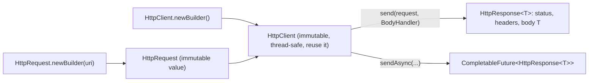
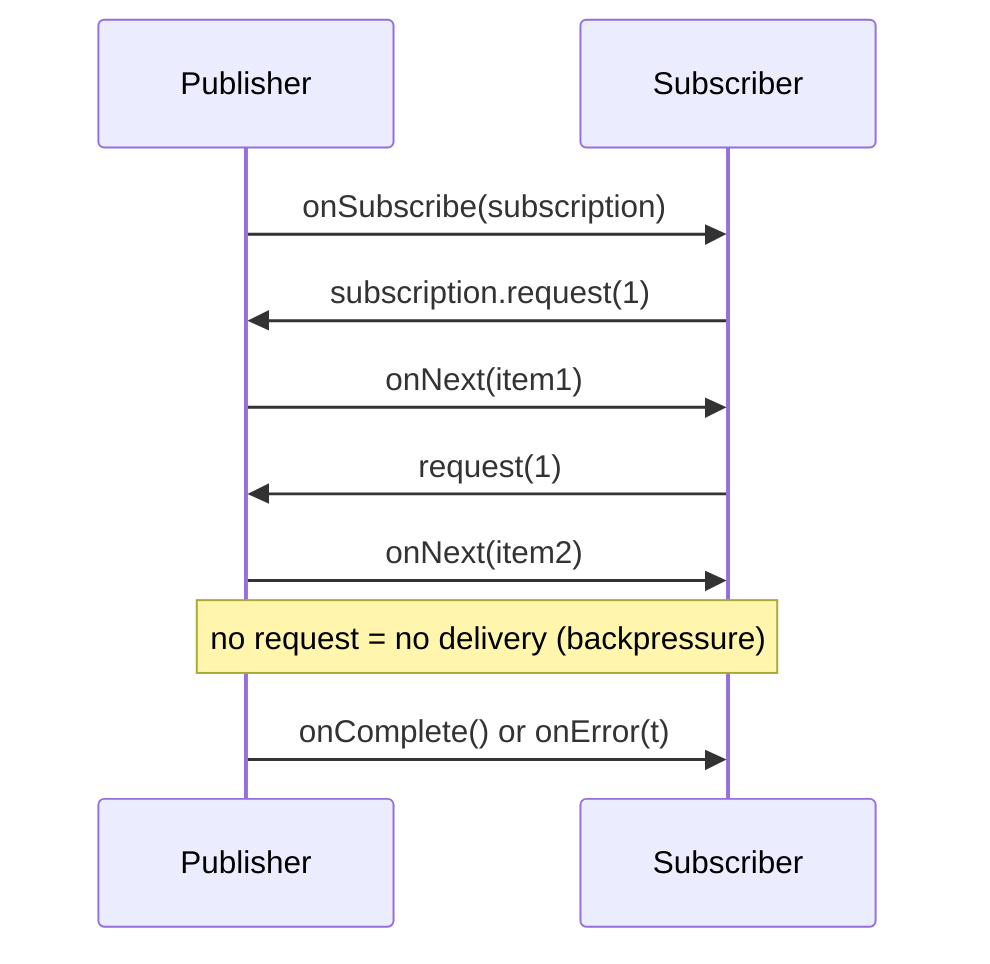

# 5.4 HTTP Client and the Flow API

> **Goal:** Replace `HttpURLConnection` with the modern `java.net.http` client (synchronous, asynchronous, timeouts, body handlers), and understand reactive streams backpressure through the `java.util.concurrent.Flow` API that arrived in the same release.

**Level:** practical. Both APIs are in the JDK and need no library.
**Verified on:** OpenJDK 21.0.12. The HTTP examples talk to an in-process `com.sun.net.httpserver.HttpServer` on a random local port, so they are self-contained and repeatable.

## Contents

1. [Why a new HTTP client](#1-why-a-new-http-client)
2. [The three objects: client, request, response](#2-the-three-objects-client-request-response)
3. [A complete example](#3-a-complete-example)
4. [Sync vs async](#4-sync-vs-async)
5. [Body publishers and handlers](#5-body-publishers-and-handlers)
6. [Timeouts, redirects, authentication, proxies, HTTP/2](#6-timeouts-redirects-authentication-proxies-http2)
7. [The Flow API: reactive streams in the JDK](#7-the-flow-api-reactive-streams-in-the-jdk)
8. [Backpressure, step by step](#8-backpressure-step-by-step)
9. [Common gotchas](#9-common-gotchas)
10. [Interview questions](#10-interview-questions)

---

## 1. Why a new HTTP client

| `HttpURLConnection` (since 1.1) | `java.net.http.HttpClient` (incubated 9, standard 11) |
|---|---|
| blocking only | blocking **and** non-blocking (`CompletableFuture`) |
| mutable, one object per request, awkward API | immutable builders; one client reused for many requests |
| HTTP/1.1 | HTTP/1.1 and **HTTP/2** (default preference), WebSocket client |
| no built-in timeouts per request | connect timeout on client, request timeout per request |
| no reactive integration | bodies are `Flow` publishers/subscribers |

The package is `java.net.http` and lives in its own module, `java.net.http` (5.1). The first sentence in an interview: *"one immutable, thread-safe `HttpClient` per application, requests are values, responses come back as a `HttpResponse<T>` whose body type is chosen by a handler."*

## 2. The three objects: client, request, response



| Type | Role | Notes |
|---|---|---|
| `HttpClient` | holds configuration (version, redirects, proxy, authenticator, executor, cookie handler, SSL) and a connection pool | build once, share |
| `HttpRequest` | URI, method, headers, body publisher, timeout | immutable; safe to send many times |
| `HttpResponse<T>` | status code, headers, `body()`, `version()`, `uri()` | `T` depends on the `BodyHandler` |
| `BodyPublisher` | turns a request body into a `Flow.Publisher<ByteBuffer>` | `ofString`, `ofByteArray`, `ofFile`, `noBody` |
| `BodyHandler<T>` | decides how the response body becomes `T` | `ofString`, `ofLines`, `ofFile`, `ofInputStream`, `discarding` |

## 3. A complete example

```java
import com.sun.net.httpserver.HttpServer;
import java.io.IOException;
import java.net.InetSocketAddress;
import java.net.URI;
import java.net.http.*;
import java.nio.charset.StandardCharsets;
import java.time.Duration;
import java.util.List;
import java.util.concurrent.*;

public class Http {
    public static void main(String[] args) throws Exception {
        // a tiny local server so the demo is self-contained and deterministic
        HttpServer server = HttpServer.create(new InetSocketAddress("127.0.0.1", 0), 0);
        server.createContext("/hello", ex -> {
            byte[] body = ("hello " + ex.getRequestMethod() + " " + ex.getRequestURI().getQuery()).getBytes(StandardCharsets.UTF_8);
            ex.getResponseHeaders().add("X-Demo", "yes");
            ex.sendResponseHeaders(200, body.length);
            ex.getResponseBody().write(body);
            ex.close();
        });
        server.createContext("/echo", ex -> {
            byte[] in = ex.getRequestBody().readAllBytes();
            String ct = ex.getRequestHeaders().getFirst("Content-Type");
            byte[] out = ("echo[" + new String(in, StandardCharsets.UTF_8) + "] ct=" + ct).getBytes(StandardCharsets.UTF_8);
            ex.sendResponseHeaders(201, out.length);
            ex.getResponseBody().write(out);
            ex.close();
        });
        server.createContext("/slow", ex -> {
            try { Thread.sleep(1500); } catch (InterruptedException ignored) { }
            ex.sendResponseHeaders(200, -1);
            ex.close();
        });
        server.start();
        String base = "http://127.0.0.1:" + server.getAddress().getPort();

        // 1. one reusable, immutable client
        HttpClient client = HttpClient.newBuilder()
                .version(HttpClient.Version.HTTP_1_1)
                .connectTimeout(Duration.ofSeconds(2))
                .followRedirects(HttpClient.Redirect.NORMAL)
                .build();

        // 2. synchronous GET
        HttpRequest get = HttpRequest.newBuilder(URI.create(base + "/hello?x=1")).GET().header("Accept", "text/plain").build();
        HttpResponse<String> r = client.send(get, HttpResponse.BodyHandlers.ofString());
        System.out.println("sync   : " + r.statusCode() + " " + r.body() + " | X-Demo=" + r.headers().firstValue("X-Demo").orElse("-") + " | version " + r.version());

        // 3. POST with a body
        HttpRequest post = HttpRequest.newBuilder(URI.create(base + "/echo"))
                .header("Content-Type", "application/json")
                .POST(HttpRequest.BodyPublishers.ofString("{\"a\":1}")).build();
        HttpResponse<String> pr = client.send(post, HttpResponse.BodyHandlers.ofString());
        System.out.println("post   : " + pr.statusCode() + " " + pr.body());

        // 4. asynchronous calls compose like any CompletableFuture
        List<CompletableFuture<String>> calls = List.of("a", "b", "c").stream()
                .map(q -> client.sendAsync(HttpRequest.newBuilder(URI.create(base + "/hello?q=" + q)).build(), HttpResponse.BodyHandlers.ofString())
                        .thenApply(HttpResponse::body)).toList();
        CompletableFuture.allOf(calls.toArray(CompletableFuture[]::new)).join();
        System.out.println("async  : " + calls.stream().map(CompletableFuture::join).toList());

        // 5. body handlers: ofString, ofByteArray, ofLines, discarding, ofFile
        System.out.println("lines  : " + client.send(get, HttpResponse.BodyHandlers.ofLines()).body().toList());
        System.out.println("discard: " + client.send(get, HttpResponse.BodyHandlers.discarding()).body());

        // 6. per-request timeout
        HttpRequest slow = HttpRequest.newBuilder(URI.create(base + "/slow")).timeout(Duration.ofMillis(200)).build();
        try {
            client.send(slow, HttpResponse.BodyHandlers.discarding());
        } catch (HttpTimeoutException e) {
            System.out.println("timeout: " + e.getClass().getSimpleName());
        }

        // 7. immutability: the request is a value
        System.out.println("request: " + get.method() + " " + get.uri().getPath() + " headers=" + get.headers().map());

        server.stop(0);
    }
}

// ---- Output ----
// sync   : 200 hello GET x=1 | X-Demo=yes | version HTTP_1_1
// post   : 201 echo[{"a":1}] ct=application/json
// async  : [hello GET q=a, hello GET q=b, hello GET q=c]
// lines  : [hello GET x=1]
// discard: null
// timeout: HttpTimeoutException
// request: GET /hello headers={Accept=[text/plain]}
```

Line by line:

1. **sync**: `client.send(request, BodyHandlers.ofString())` blocks and returns a response with status 200, the body, a response header and the negotiated protocol version. We forced `HTTP_1_1` because the test server is plain HTTP; against `https` URLs the default is to negotiate HTTP/2.
2. **post**: the `POST` carries a `Content-Type` header and a `BodyPublishers.ofString` body; the server echoed both.
3. **async**: three `sendAsync` calls in flight at once, joined with `CompletableFuture.allOf`; results come back in request order because we collected the futures in a list.
4. **lines / discard**: the same request with different handlers: `ofLines()` gives a `Stream<String>`, `discarding()` gives no body (`null`).
5. **timeout**: a request-level `timeout(200ms)` against a handler that sleeps 1.5 s throws `HttpTimeoutException`.
6. **request is a value**: it has a method, URI and header map and can be reused.

```text
  your code                 HttpClient (pool of connections, executor)              server
  ---------                 -------------------------------------------            --------
  send(req) ----------------> [ connection reuse | HTTP/2 multiplexing ] ---------> GET /x
     |  blocks                                                                         |
     +<---------------------------- HttpResponse<String> (status, headers, body) <----+
  sendAsync(req) -> returns a CompletableFuture immediately; callbacks run when headers/body arrive
```

## 4. Sync vs async

| | `send` | `sendAsync` |
|---|---|---|
| Returns | `HttpResponse<T>` | `CompletableFuture<HttpResponse<T>>` |
| Blocks caller | yes | no |
| Failure | checked `IOException` / `InterruptedException` | future completes exceptionally (`CompletionException` wrapping) |
| Use for | scripts, simple services, virtual-thread code (Part 7) | fan-out, pipelines, many requests in parallel |

Because the async method returns a normal `CompletableFuture`, everything from Part 3.3 applies: `thenApply`, `thenCompose`, `exceptionally`, `orTimeout` (5.3).

```text
client.sendAsync(request, BodyHandlers.ofString())
      .thenApply(HttpResponse::body)
      .thenApply(json -> parse(json))
      .orTimeout(3, TimeUnit.SECONDS)
      .exceptionally(ex -> fallback());
```

By default the client uses its own executor for callbacks; pass `.executor(myPool)` to the builder to control threads.

## 5. Body publishers and handlers

| Request body | Publisher |
|---|---|
| none | `BodyPublishers.noBody()` |
| text / JSON string | `ofString(s)` (UTF-8 default) |
| bytes | `ofByteArray(b)` |
| file | `ofFile(path)` |
| stream | `ofInputStream(supplier)` |
| form data | build the string yourself (`a=1&b=2`) and set `Content-Type` |

| Response body wanted | Handler |
|---|---|
| String | `ofString()` |
| bytes | `ofByteArray()` |
| lines (lazy) | `ofLines()` |
| save to a file | `ofFile(path)` |
| stream to consume | `ofInputStream()` |
| ignore | `discarding()` |
| custom | `BodySubscriber` implementation |

There is no built-in JSON support: combine the string/bytes handler with Jackson or Gson.

## 6. Timeouts, redirects, authentication, proxies, HTTP/2

| Concern | API | Default |
|---|---|---|
| Connect timeout | `HttpClient.Builder.connectTimeout` | none (infinite) |
| Request timeout | `HttpRequest.Builder.timeout` | none (infinite) |
| Redirects | `followRedirects(NEVER / NORMAL / ALWAYS)` | `NEVER` |
| Proxy | `proxy(ProxySelector.of(addr))` | system default |
| Authentication | `authenticator(...)` for Basic/Digest; set a header yourself for Bearer | none |
| Cookies | `cookieHandler(new CookieManager())` | none |
| HTTP version | `version(HTTP_2 / HTTP_1_1)` | `HTTP_2`, falling back to 1.1 |
| TLS | `sslContext`, `sslParameters` | JDK default (TLS 1.3 available since 11, section 5.5) |
| Threads | `executor(...)` | internal cached pool |

**Always set both timeouts.** The defaults are infinite, which is the single most common production issue with this client.

HTTP/2 gives multiplexing over one connection, header compression and server push (push support exists in the API but is rarely used and was removed from most browsers). The client keeps connections alive and pools them per host.

## 7. The Flow API: reactive streams in the JDK

Java 9 added the four reactive-streams interfaces to the JDK as `java.util.concurrent.Flow`, so libraries (RxJava, Reactor, Akka Streams, the HTTP client) can interoperate without a third-party jar:

| Interface | Role |
|---|---|
| `Publisher<T>` | produces items; `subscribe(Subscriber)` |
| `Subscriber<T>` | `onSubscribe`, `onNext`, `onError`, `onComplete` |
| `Subscription` | the link between them: `request(n)` and `cancel()` |
| `Processor<T,R>` | both a Subscriber and a Publisher (a transformation stage) |

The JDK also ships one concrete implementation: **`SubmissionPublisher<T>`**, which buffers items per subscriber and delivers them asynchronously.



```java
import java.util.*;
import java.util.concurrent.*;
import java.util.function.Function;

public class FlowDemo {
    // A subscriber that asks for ONE item at a time (the strictest backpressure)
    static class Pull<T> implements Flow.Subscriber<T> {
        final List<String> log = Collections.synchronizedList(new ArrayList<>());
        final CountDownLatch done = new CountDownLatch(1);
        Flow.Subscription sub;
        public void onSubscribe(Flow.Subscription s) { sub = s; log.add("onSubscribe"); s.request(1); }
        public void onNext(T item)                  { log.add("onNext " + item); sub.request(1); }
        public void onError(Throwable t)            { log.add("onError " + t.getMessage()); done.countDown(); }
        public void onComplete()                    { log.add("onComplete"); done.countDown(); }
    }

    // A Processor is both Subscriber and Publisher: it transforms items in the middle
    static class MapProcessor<T, R> extends SubmissionPublisher<R> implements Flow.Processor<T, R> {
        final Function<T, R> fn;
        Flow.Subscription sub;
        MapProcessor(Function<T, R> fn) { this.fn = fn; }
        public void onSubscribe(Flow.Subscription s) { sub = s; s.request(1); }
        public void onNext(T item)                  { submit(fn.apply(item)); sub.request(1); }
        public void onError(Throwable t)            { closeExceptionally(t); }
        public void onComplete()                    { close(); }
    }

    public static void main(String[] args) throws Exception {
        // 1. publisher -> subscriber
        Pull<Integer> s1 = new Pull<>();
        try (SubmissionPublisher<Integer> pub = new SubmissionPublisher<>()) {
            pub.subscribe(s1);
            for (int i = 1; i <= 3; i++) pub.submit(i);
        }
        s1.done.await();
        System.out.println("plain      : " + s1.log);

        // 2. publisher -> processor (x10) -> subscriber
        Pull<Integer> s2 = new Pull<>();
        MapProcessor<Integer, Integer> times10 = new MapProcessor<>(x -> x * 10);
        try (SubmissionPublisher<Integer> pub = new SubmissionPublisher<>()) {
            pub.subscribe(times10);
            times10.subscribe(s2);
            for (int i = 1; i <= 3; i++) pub.submit(i);
        }
        s2.done.await();
        System.out.println("processor  : " + s2.log);

        // 3. backpressure in numbers: tiny buffer, slow consumer, offer() with a drop handler
        Flow.Subscriber<Integer> never = new Flow.Subscriber<>() {
            public void onSubscribe(Flow.Subscription s) { /* never requests anything */ }
            public void onNext(Integer i) { }
            public void onError(Throwable t) { }
            public void onComplete() { }
        };
        SubmissionPublisher<Integer> tiny = new SubmissionPublisher<>(ForkJoinPool.commonPool(), 2);
        tiny.subscribe(never);
        int[] dropped = {0};
        for (int i = 0; i < 6; i++) tiny.offer(i, (sub, item) -> { dropped[0]++; return false; });   // false = do not retry
        System.out.println("buffer=2, subscriber requests nothing, 6 offered: dropped=" + dropped[0] + ", maxBufferCapacity=" + tiny.getMaxBufferCapacity());
        tiny.close();

        // 4. error propagation
        Pull<Integer> s4 = new Pull<>();
        SubmissionPublisher<Integer> p4 = new SubmissionPublisher<>();
        p4.subscribe(s4);
        p4.closeExceptionally(new RuntimeException("upstream failed"));
        s4.done.await();
        System.out.println("error      : " + s4.log);
    }
}

// ---- Output ----
// plain      : [onSubscribe, onNext 1, onNext 2, onNext 3, onComplete]
// processor  : [onSubscribe, onNext 10, onNext 20, onNext 30, onComplete]
// buffer=2, subscriber requests nothing, 6 offered: dropped=4, maxBufferCapacity=2
// error      : [onSubscribe, onError upstream failed]
```

1. **plain**: the subscriber asks for one item at a time (`request(1)` in `onSubscribe` and again in every `onNext`) and receives them in order, then `onComplete`.
2. **processor**: `MapProcessor` is a subscriber to the publisher *and* a publisher to the final subscriber; it multiplies by 10. Chains of processors form a pipeline.
3. **backpressure in numbers**: a subscriber that never requests anything plus a buffer of 2: six `offer` calls leave 2 items buffered and 4 are dropped by the handler.
4. **error**: `closeExceptionally` delivers `onError` and no further `onNext`.

## 8. Backpressure, step by step

**Intuition.** A fast producer plus a slow consumer plus an unbounded buffer equals an `OutOfMemoryError`. Backpressure means the consumer *pulls*: it tells the producer how many items it can take.

| Policy when the buffer is full | Flow API |
|---|---|
| Block the producer | `submit(item)` blocks until space is available |
| Drop the new item | `offer(item, onDrop)` returns negative; handler decides |
| Drop with timeout | `offer(item, timeout, unit, onDrop)` |

Rules of the specification worth knowing: `onNext` is never called concurrently for one subscriber, signals are delivered in order, a subscriber must `request` before anything arrives, and `cancel()` is idempotent. The JDK interfaces are deliberately minimal: for operators such as `map`, `flatMap` and `retry`, use a library (Reactor, RxJava), which implements these same interfaces.

## 9. Common gotchas

| Gotcha | Why | Fix |
|---|---|---|
| Hangs forever on a dead server | timeouts default to infinite | `connectTimeout` and `timeout` |
| Redirects not followed | default is `NEVER` | `followRedirects(NORMAL)` |
| New `HttpClient` per request | loses connection pool, creates threads | create once, reuse |
| `ofString()` on a giant response | whole body in memory | `ofFile`, `ofInputStream`, `ofLines` |
| Response body is `null` | handler was `discarding()` | use a real handler |
| Exceptions swallowed in `sendAsync` | they live in the future | add `exceptionally` / `handle` |
| Wrong charset | `ofString()` uses the response header charset, else UTF-8 | pass a `Charset` |
| Non-2xx treated as success | the client does not throw on 404/500 | check `statusCode()` |
| Thread starvation with huge fan-out | shared internal executor | provide your own executor |
| Subscriber never receives data | forgot `request(n)` | request in `onSubscribe` |

## 10. Interview questions

<details>
<summary><strong>Q1. Why was <code>HttpURLConnection</code> replaced?</strong></summary>

It is blocking-only, mutable, HTTP/1.1-only, has a clumsy API and no async or reactive support. <code>java.net.http.HttpClient</code> is immutable, supports HTTP/2 and WebSocket, and offers <code>sendAsync</code> returning <code>CompletableFuture</code>.
</details>

<details>
<summary><strong>Q2. Is <code>HttpClient</code> thread-safe? Should you create one per request?</strong></summary>

It is immutable and thread-safe. Create one and share it; a client per request wastes connections and threads.
</details>

<details>
<summary><strong>Q3. What are the default timeouts?</strong></summary>

None: both connect and request timeouts are infinite unless you set <code>connectTimeout</code> on the client and <code>timeout</code> on the request.
</details>

<details>
<summary><strong>Q4. How do you make parallel calls with the client?</strong></summary>

Call <code>sendAsync</code> for each request, collect the futures, and combine them with <code>CompletableFuture.allOf</code> or <code>thenCombine</code>.
</details>

<details>
<summary><strong>Q5. Does <code>HttpClient</code> throw on a 404 or 500?</strong></summary>

No. It returns the response with that status code; checking <code>statusCode()</code> is your job.
</details>

<details>
<summary><strong>Q6. What is a <code>BodyHandler</code>?</strong></summary>

A factory that receives the response status and headers and returns a <code>BodySubscriber&lt;T&gt;</code> that converts the byte stream into the body type <code>T</code> (string, bytes, file, stream, lines...).
</details>

<details>
<summary><strong>Q7. What does the Flow API contain?</strong></summary>

Four nested interfaces: <code>Publisher</code>, <code>Subscriber</code>, <code>Subscription</code>, <code>Processor</code>, plus the concrete <code>SubmissionPublisher</code>. It mirrors the Reactive Streams specification so libraries interoperate.
</details>

<details>
<summary><strong>Q8. What is backpressure?</strong></summary>

A protocol in which the consumer signals how many items it is ready to receive (<code>request(n)</code>) so a fast producer cannot overwhelm it. Without demand, the publisher must buffer, drop or block.
</details>

<details>
<summary><strong>Q9. What is the difference between <code>submit</code> and <code>offer</code> on <code>SubmissionPublisher</code>?</strong></summary>

<code>submit</code> blocks when a subscriber's buffer is full; <code>offer</code> lets you supply a drop handler and optionally a timeout, so the producer can discard or retry.
</details>

<details>
<summary><strong>Q10. What is a <code>Processor</code>?</strong></summary>

A component that is both a <code>Subscriber</code> of an upstream publisher and a <code>Publisher</code> to downstream subscribers, used to transform items in a pipeline.
</details>

<details>
<summary><strong>Q11. Which HTTP version does the client use by default?</strong></summary>

HTTP/2 where the server supports it (via ALPN for https, upgrade for http), otherwise HTTP/1.1. You can force one with <code>version(...)</code>.
</details>

---

[Previous: 5.3 Collection Factories and API Additions](./03-collection-factories-and-api-additions.md) · [Part index](./README.md) · Next: [5.5 JVM Changes 9 to 11](./05-jvm-changes-9-11.md)