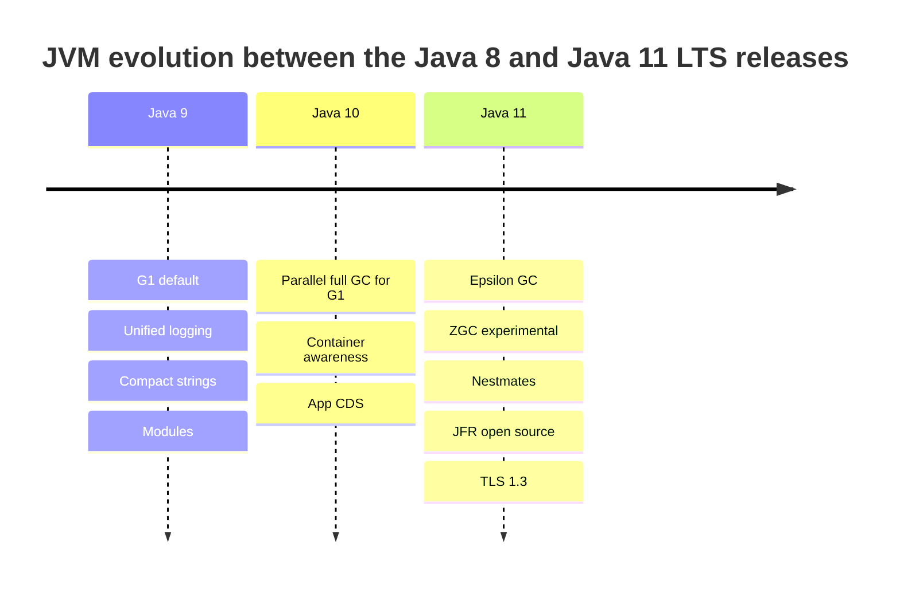
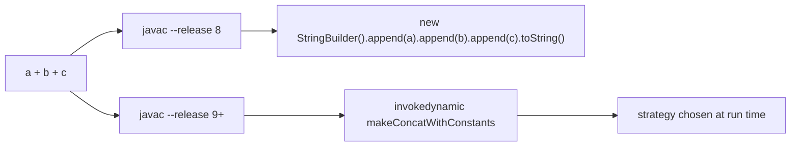

# 5.5 JVM Changes in Java 9 to 11

> **Goal:** Know what changed inside the JVM between Java 8 and 11: garbage collectors, logging, string representation, nestmates, JFR, TLS 1.3, container awareness and what was deprecated or removed, so that you can explain a behaviour difference after an upgrade.

**Level:** intermediate. Part 10 goes deeper into JVM internals and Part 13 into GC tuning.
**Verified on:** OpenJDK 21.0.12. Where a feature is demonstrated, the output is real; JDK 11 itself is not installed in the sandbox, so version statements come from the JEPs and release notes and are labelled as such.

## Contents

1. [The landscape at a glance](#1-the-landscape-at-a-glance)
2. [Garbage collectors: G1 by default, Epsilon, ZGC](#2-garbage-collectors-g1-by-default-epsilon-zgc)
3. [Unified JVM logging (`-Xlog`)](#3-unified-jvm-logging--xlog)
4. [Compact strings and `invokedynamic` string concatenation](#4-compact-strings-and-invokedynamic-string-concatenation)
5. [Nest-based access control](#5-nest-based-access-control)
6. [Java Flight Recorder in OpenJDK](#6-java-flight-recorder-in-openjdk)
7. [TLS 1.3 and security updates](#7-tls-13-and-security-updates)
8. [Containers: the JVM reads cgroup limits](#8-containers-the-jvm-reads-cgroup-limits)
9. [Class Data Sharing](#9-class-data-sharing)
10. [Deprecations and removals 8 to 11](#10-deprecations-and-removals-8-to-11)
11. [Old flags and their replacements](#11-old-flags-and-their-replacements)
12. [Common gotchas](#12-common-gotchas)
13. [Interview questions](#13-interview-questions)

---

## 1. The landscape at a glance

| Version | JVM-level change | JEP |
|---|---|---|
| 9 | G1 becomes the default collector | 248 |
| 9 | Unified JVM logging (`-Xlog`) | 158, 271 |
| 9 | Compact strings | 254 |
| 9 | `invokedynamic`-based string concatenation | 280 |
| 9 | Modular JDK, strong encapsulation | 261 |
| 9 | Multi-release JARs | 238 |
| 9 | Version-string scheme (`9`, `11.0.2`, not `1.8.0_292`) | 223 |
| 10 | Parallel full GC for G1 | 307 |
| 10 | Application class-data sharing | 310 |
| 10 | JVM understands container (cgroup) limits | (JDK-8146115) |
| 11 | Epsilon (no-op) GC, ZGC (experimental) | 318, 333 |
| 11 | Nest-based access control | 181 |
| 11 | Dynamic class-file constants | 309 |
| 11 | Flight Recorder and low-overhead heap profiling in OpenJDK | 328, 331 |
| 11 | TLS 1.3, ChaCha20 | 332, 329 |
| 11 | Removal of Java EE and CORBA modules; Nashorn deprecated | 320, 335 |



## 2. Garbage collectors: G1 by default, Epsilon, ZGC

| Collector | Flag | Introduced / changed | Shape |
|---|---|---|---|
| Serial | `-XX:+UseSerialGC` | old | single-threaded, small heaps, tiny containers |
| Parallel | `-XX:+UseParallelGC` | old; default through Java 8 | throughput, stop-the-world |
| **G1** | `-XX:+UseG1GC` | default from **9** (on "server-class" machines) | region-based, pause-time goals |
| CMS | `-XX:+UseConcMarkSweepGC` | deprecated in 9, **removed in 14** | concurrent, fragmentation |
| **Epsilon** | `-XX:+UnlockExperimentalVMOptions -XX:+UseEpsilonGC` | **11** | allocates, never collects |
| **ZGC** | `-XX:+UnlockExperimentalVMOptions -XX:+UseZGC` | **11 experimental**, production in 15 | concurrent, sub-ms pauses (Linux only in 11) |

"Server-class machine" means at least 2 processors and about 1.8 GB of memory; on smaller machines or containers the JVM silently selects Serial instead. This is a frequent surprise when a service behaves differently in a 1-CPU container: the GC is not what you assumed. Always print the GC in use at startup (`-Xlog:gc` prints `Using G1` / `Using Serial`).

You can see the active collector from inside the program through the management beans. The same class run with four flags:

```java
import java.lang.management.ManagementFactory;
import java.util.stream.*;

public class GcNames {
    public static void main(String[] args) {
        System.out.println(ManagementFactory.getGarbageCollectorMXBeans().stream().map(b -> b.getName()).sorted().collect(Collectors.joining(" | ")));
    }
}

// Run with: java -XX:+UseSerialGC GcNames
// ---- Output ----
// Copy | MarkSweepCompact
```

```java
import java.lang.management.ManagementFactory;
import java.util.stream.*;

public class GcNames {
    public static void main(String[] args) {
        System.out.println(ManagementFactory.getGarbageCollectorMXBeans().stream().map(b -> b.getName()).sorted().collect(Collectors.joining(" | ")));
    }
}

// Run with: java -XX:+UseParallelGC GcNames
// ---- Output ----
// PS MarkSweep | PS Scavenge
```

```java
import java.lang.management.ManagementFactory;
import java.util.stream.*;

public class GcNames {
    public static void main(String[] args) {
        System.out.println(ManagementFactory.getGarbageCollectorMXBeans().stream().map(b -> b.getName()).sorted().collect(Collectors.joining(" | ")));
    }
}

// Run with: java -XX:+UseG1GC GcNames
// ---- Output ----
// G1 Concurrent GC | G1 Old Generation | G1 Young Generation
```

```java
import java.lang.management.ManagementFactory;
import java.util.stream.*;

public class GcNames {
    public static void main(String[] args) {
        System.out.println(ManagementFactory.getGarbageCollectorMXBeans().stream().map(b -> b.getName()).sorted().collect(Collectors.joining(" | ")));
    }
}

// Run with: java -XX:+UnlockExperimentalVMOptions -XX:+UseEpsilonGC GcNames
// ---- Output ----
// Epsilon Heap
```

Reading the names: Serial has *Copy* (young) and *MarkSweepCompact* (old); Parallel has *PS Scavenge* and *PS MarkSweep*; G1 has young, old and concurrent cycles; Epsilon is a single *heap* with no collecting at all.

When is Epsilon useful? Very short-lived jobs, GC-pressure experiments ("how much does this code allocate?"), latency tests that must exclude GC noise, and last-drop performance tuning when the allocation rate is known to fit in the heap. When the heap fills, the JVM exits with `OutOfMemoryError`.

G1 in short: the heap is split into equal **regions**; young, old and humongous regions are labelled dynamically; it collects the regions with most garbage first within a pause-time target (`-XX:MaxGCPauseMillis`, default 200 ms). Java 10 made its full collection parallel (previously single-threaded, the cause of very long "full GC" pauses in 9).

```text
 G1 heap = many equal-sized regions, roles change over time
 +----+----+----+----+----+----+----+----+
 | E  | E  | S  | O  | O  | H  | H  | .  |      E = eden   S = survivor   O = old
 +----+----+----+----+----+----+----+----+      H = humongous (objects larger than half a region)
 | O  | E  | .  | O  | E  | .  | O  | E  |      . = free
 +----+----+----+----+----+----+----+----+
 A collection picks the regions with the most garbage first, within the pause-time goal.
```

## 3. Unified JVM logging (`-Xlog`)

Before 9, every logging concern had its own flags (`-XX:+PrintGCDetails`, `-XX:+PrintGCTimeStamps`, `-verbose:class`, `-XX:+PrintSafepointStatistics`...). Java 9 unified them: **tags**, **levels**, **outputs** and **decorators**.

```text
-Xlog:<tags>=<level>:<output>:<decorators>
-Xlog:gc*=info:file=gc.log:time,uptime,level,tags:filecount=5,filesize=10m
```

| Part | Examples |
|---|---|
| tags | `gc`, `gc+heap`, `safepoint`, `class+load`, `jit+compilation`, `os+container` |
| level | `off`, `error`, `warning`, `info`, `debug`, `trace` |
| output | `stdout`, `stderr`, `file=name` |
| decorators | `time`, `uptime`, `pid`, `tid`, `level`, `tags`, `none` |

A real run: a program calls `System.gc()` on the Serial collector with `-Xlog:gc:stdout:none` (no decorators). Numbers are masked as `N` by a `sed` filter because sizes and times vary per run:

```text
$ bash p5/gclog.sh
Using Serial
before gc
GC(0) Pause Full (System.gc()) NM->NM(NM) Nms
after gc
```

Useful starting set in production: `-Xlog:gc*,safepoint:file=gc.log:time,uptime,level,tags:filecount=10,filesize=20m`. List every tag with `java -Xlog:help`.

## 4. Compact strings and `invokedynamic` string concatenation

### Compact strings (9)

Java 8 stored every `String` as `char[]` (2 bytes per character). Most strings are Latin-1, so Java 9 stores them as **`byte[]` plus a coder flag**: one byte per character if all characters fit in Latin-1, otherwise UTF-16. The JEP measured roughly 10 to 15 percent smaller heaps on typical applications, with less GC pressure. It is fully transparent to code; `-XX:-CompactStrings` turns it off.

### String concatenation (9)

`"id=" + a + ", n=" + b` used to compile to a `StringBuilder` chain fixed at compile time. Since 9 it compiles to **one `invokedynamic` call** to `StringConcatFactory`, and the JVM chooses the best strategy at run time (and can improve it in later JDKs without recompiling your code). The same source compiled for two targets:

```text
$ bash p5/concat.sh
# --release 11: ONE invokedynamic call decides how to concatenate at run time
invokedynamic #7,  0              // InvokeDynamic #0:makeConcatWithConstants:(Ljava/lang/String;I)Ljava/lang/String;

# --release 8: a StringBuilder chain is compiled in
new           #7                  // class java/lang/StringBuilder
invokespecial #9                  // Method java/lang/StringBuilder."<init>":()V
invokevirtual #12                 // Method java/lang/StringBuilder.append:(Ljava/lang/String;)Ljava/lang/StringBuilder;
invokevirtual #12                 // Method java/lang/StringBuilder.append:(Ljava/lang/String;)Ljava/lang/StringBuilder;
invokevirtual #12                 // Method java/lang/StringBuilder.append:(Ljava/lang/String;)Ljava/lang/StringBuilder;
invokevirtual #18                 // Method java/lang/StringBuilder.append:(I)Ljava/lang/StringBuilder;
invokevirtual #21                 // Method java/lang/StringBuilder.toString:()Ljava/lang/String;
```

Consequence: code compiled with `--release 8` keeps the `StringBuilder` chain; recompiling for 9+ changes the bytecode but not the result.



## 5. Nest-based access control

An inner class may read the outer class's `private` field. In the class-file world those are two separate classes, and the JVM forbids cross-class private access, so before Java 11 the compiler generated hidden **synthetic accessors** (`access$000`). Java 11 introduces *nests*: the outer class is the **nest host**, the inner classes are **nest members**, and the JVM lets nestmates access each other's private members directly.

```text
$ bash p5/nest.sh
# compiled with --release 11: Audit reads the private field directly (nestmates)
       1: getfield      #1                  // Field this$0:LAccount;
       4: getfield      #13                 // Field Account.balance:I

# compiled with --release 8: the compiler generated a synthetic accessor
  static int access$000(Account);
       1: getfield      #1                  // Field this$0:LAccount;
       4: invokestatic  #13 // Method Account.access$000:(LAccount;)I
```

Benefits: smaller bytecode, no synthetic methods in stack traces, and reflection now agrees with the language: `Method.invoke` / `Field.get` between nestmates no longer needs `setAccessible` tricks. New methods: `Class.getNestHost()`, `isNestmateOf()`, `getNestMembers()`.

```java
public class Nest {
    private int secret = 42;

    class Inner {
        int peek() { return secret; }          // reads the private field of the outer class
    }

    public static void main(String[] args) throws Exception {
        System.out.println("Inner.getNestHost()      = " + Inner.class.getNestHost().getSimpleName());
        System.out.println("isNestmateOf(Nest)       = " + Inner.class.isNestmateOf(Nest.class));
        System.out.println("Nest.getNestMembers()    = " + java.util.Arrays.stream(Nest.class.getNestMembers()).map(Class::getName).sorted().toList());
        System.out.println("peek()                   = " + new Nest().new Inner().peek());
        var f = Nest.class.getDeclaredField("secret");
        f.setAccessible(true);                    // same-module reflection is fine
        System.out.println("reflective read          = " + f.get(new Nest()));
    }
}

// ---- Output ----
// Inner.getNestHost()      = Nest
// isNestmateOf(Nest)       = true
// Nest.getNestMembers()    = [Nest, Nest$Inner]
// peek()                   = 42
// reflective read          = 42
```

## 6. Java Flight Recorder in OpenJDK

Java Flight Recorder (JFR) is a low-overhead event recorder built into the JVM. Before 11 it was a commercial Oracle JDK feature; Java 11 open-sourced it (JEP 328). You can start it from the command line (`-XX:StartFlightRecording=duration=60s,filename=app.jfr`) or from code, define your own events, and analyse files with JDK Mission Control or the `jfr` tool.

```java
import jdk.jfr.*;
import jdk.jfr.consumer.*;
import java.nio.file.*;
import java.util.*;

public class Jfr {
    @Name("demo.OrderPlaced")
    @Label("Order placed")
    @Category("Demo")
    static class OrderPlaced extends Event {
        @Label("Order id") String orderId;
        @Label("Amount")   int amount;
    }

    public static void main(String[] args) throws Exception {
        Path file = Files.createTempFile("demo", ".jfr");
        try (Recording rec = new Recording()) {
            rec.enable("demo.OrderPlaced");
            rec.start();
            for (int i = 1; i <= 3; i++) {
                OrderPlaced e = new OrderPlaced();
                e.begin();
                e.orderId = "O-" + i;
                e.amount = i * 100;
                e.commit();
            }
            rec.stop();
            rec.dump(file);
        }
        List<RecordedEvent> events = RecordingFile.readAllEvents(file);
        for (RecordedEvent e : events) {
            System.out.println(e.getEventType().getName() + " " + e.getString("orderId") + " amount=" + e.getInt("amount"));
        }
        System.out.println("events read back: " + events.size());
        Files.delete(file);
    }
}

// ---- Output ----
// demo.OrderPlaced O-1 amount=100
// demo.OrderPlaced O-2 amount=200
// demo.OrderPlaced O-3 amount=300
// events read back: 3
```

| JFR concept | Meaning |
|---|---|
| Event | a typed record with timestamp, thread and optional duration (`begin()`/`commit()`) |
| Recording | a session that enables a set of events and writes a `.jfr` file |
| Settings profile | `default` (about 1% overhead) or `profile` (more detail) |
| Built-in events | GC, allocation, locks, I/O, JIT, exceptions, threads |

JFR is the first thing to try for production profiling: always-on in many shops, because overhead is low. Part 16 returns to it.

## 7. TLS 1.3 and security updates

Java 11 added **TLS 1.3** (JEP 332) with fewer round trips and removal of weak ciphers, plus the ChaCha20/Poly1305 ciphers. Real output of the supported protocols and TLS 1.3 cipher suites on this JDK:

```java
import javax.net.ssl.*;
import java.util.*;

public class Tls {
    public static void main(String[] args) throws Exception {
        SSLContext ctx = SSLContext.getInstance("TLSv1.3");
        ctx.init(null, null, null);
        SSLParameters p = ctx.getSupportedSSLParameters();
        List<String> protos = Arrays.stream(p.getProtocols()).sorted().toList();
        System.out.println("supported protocols : " + protos);
        System.out.println("TLS 1.3 ciphers     : " + Arrays.stream(p.getCipherSuites()).filter(s -> s.startsWith("TLS_AES") || s.startsWith("TLS_CHACHA")).sorted().toList());
    }
}

// ---- Output ----
// supported protocols : [SSLv2Hello, SSLv3, TLSv1, TLSv1.1, TLSv1.2, TLSv1.3]
// TLS 1.3 ciphers     : [TLS_AES_128_GCM_SHA256, TLS_AES_256_GCM_SHA384, TLS_CHACHA20_POLY1305_SHA256]
```

Notes: *supported* is not *enabled*: `SSLv3` and `TLSv1`/`TLSv1.1` are in the list of supported protocols but disabled by security policy (`jdk.tls.disabledAlgorithms` in `java.security`). Later Java 8 updates added TLS 1.3 support on some builds, but 11 is where it is a standard, enabled feature. A client that cannot negotiate a modern protocol after an upgrade is usually talking to a server that only offers TLS 1.0/1.1 or weak ciphers, not a JDK bug.

## 8. Containers: the JVM reads cgroup limits

Before 10 the JVM read the *host's* CPU count and memory (`/proc`), so in a 512 MB container on a 64 GB host it sized the heap by 64 GB and was killed by the OOM-killer. Java 10 (and Java 8u191) added container support, enabled by default (`-XX:+UseContainerSupport`):

| Setting | Behaviour |
|---|---|
| `Runtime.availableProcessors()` | respects CPU quota/limit (cpu shares are considered) |
| default max heap | 1/4 of the container memory limit (`-XX:MaxRAMPercentage` overrides) |
| GC and compiler thread counts | derived from container CPUs |
| `-XX:ActiveProcessorCount=n` | explicit override |

Rule: in Kubernetes set a memory limit and use `-XX:MaxRAMPercentage=75` (for example) instead of a fixed `-Xmx`; a container with fewer than two CPUs or under about 1.8 GB selects the **Serial** collector, as noted in section 2. `-Xlog:os+container` shows what the JVM detected.

## 9. Class Data Sharing

CDS maps a pre-parsed archive of JDK classes into memory so startup is faster and several JVMs share the pages. Java 10 extended it to **application classes** (AppCDS): dump the classes loaded by your app once and reuse the archive.

```text
java -XX:ArchiveClassesAtExit=app.jsa -jar app.jar      # dynamic archive, Java 13+; Java 10 to 12 build the archive from a class list with -Xshare:dump
java -XX:SharedArchiveFile=app.jsa -jar app.jar
```

Gains are typically tens of percent on startup time for large applications. The JDK's own default CDS archive has been enabled by default since Java 12 (the `sharing` word in `java -version`).

## 10. Deprecations and removals 8 to 11

| What | Status |
|---|---|
| Java EE modules (`javax.xml.bind`, `javax.xml.ws`, `javax.activation`, `javax.annotation`, `javax.transaction`) and CORBA | **removed in 11**; replace with Jakarta artifacts (5.7) |
| JavaFX | **removed** from the JDK in 11 (now OpenJFX, a separate download) |
| Java Web Start / `javaws`, Java plug-in | removed in 11 (applet API deprecated in 9) |
| Nashorn JavaScript engine | deprecated in 11, removed in 15 |
| Pack200 tools and API | deprecated in 11, removed in 14 |
| CMS collector | deprecated in 9, removed in 14 |
| `-XX:+PrintGCDetails` and the other old GC-logging flags | deprecated in 9 (JEP 271) and mapped onto `-Xlog`; several were later removed (see the real run in section 11) |
| `Object.finalize()` | deprecated in 9; deprecated *for removal* in 18 |
| `new Integer(5)`, `new Long(5)`... | deprecated for removal in 9 (use `valueOf`) |
| `Thread.destroy`, `stop(Throwable)`, `Runtime.runFinalizersOnExit` | removed in 11 |
| `sun.misc.BASE64Encoder` and friends | removed in 9 (use `java.util.Base64`) |

## 11. Old flags and their replacements

| Java 8 flag | Java 9+ replacement |
|---|---|
| `-XX:+PrintGCDetails -XX:+PrintGCTimeStamps -Xloggc:gc.log` | `-Xlog:gc*:file=gc.log:time,uptime` |
| `-verbose:gc` | `-Xlog:gc` |
| `-XX:+PrintGCApplicationStoppedTime` | `-Xlog:safepoint` |
| `-XX:+UseGCLogFileRotation -XX:NumberOfGCLogFiles=5` | `-Xlog:gc*:file=gc.log:...:filecount=5,filesize=10m` |
| `-XX:MaxPermSize` | n/a (Metaspace: `-XX:MaxMetaspaceSize`) |
| `-XX:+UseConcMarkSweepGC` | `-XX:+UseG1GC` (or Parallel) |
| `-Djava.endorsed.dirs`, `-Djava.ext.dirs` | removed: use `--patch-module`, `--upgrade-module-path` |
| `-XX:+AggressiveOpts` | removed |

What the JDK 21 launcher says today about the flags that fill Java 8 command lines:

```text
$ bash p5/flags.sh
-XX:+PrintGCDetails                -> [warning][gc] -XX:+PrintGCDetails is deprecated. Will use -Xlog:gc* instead.
-XX:+PrintGCTimeStamps             -> Unrecognized VM option 'PrintGCTimeStamps'
-XX:+UseConcMarkSweepGC            -> Unrecognized VM option 'UseConcMarkSweepGC'
-XX:MaxPermSize=64m                -> Unrecognized VM option 'MaxPermSize=64m'
-XX:+UnlockCommercialFeatures      -> Unrecognized VM option 'UnlockCommercialFeatures'
-XX:+AggressiveOpts                -> Unrecognized VM option 'AggressiveOpts'
-XX:+UseGCLogFileRotation          -> Unrecognized VM option 'UseGCLogFileRotation'
```

So `PrintGCDetails` still works as a deprecated alias, while the others are gone. (Many of these were still accepted with deprecation warnings on Java 9 to 11, per the deprecation policy of JEP 271; that is why a Java 8 command line often starts on 11 and then breaks on a later release.) A JVM given an **unrecognised** `-XX:` option fails to start ("Unrecognized VM option"); add `-XX:+IgnoreUnrecognizedVMOptions` during migration to find the rest, then clean them up.

## 12. Common gotchas

| Gotcha | Why | Fix |
|---|---|---|
| JVM will not start after upgrade: `Unrecognized VM option` | removed GC/log flags | translate to `-Xlog` |
| Service uses the Serial collector in a small container | server-class check fails | `-XX:+UseG1GC` explicitly, or give 2+ CPUs and 2 GB |
| Heap much smaller than expected in Docker | default max heap is 25% of the container limit | `-XX:MaxRAMPercentage` |
| Stack traces differ after recompiling for 11 | no `access$000` frames | none needed |
| Concatenation benchmarks differ | indy strategy vs `StringBuilder` | measure with JMH on the target JDK |
| `ClassNotFoundException: javax.xml.bind...` | Java EE modules removed | add Jakarta/JAXB dependencies |
| JavaFX app broken | removed from the JDK | add OpenJFX |
| `-Xmx` equal to the container limit gets OOM-killed | heap is not all of the process memory (metaspace, thread stacks, direct buffers) | leave 25 to 40% headroom |
| JFR used with Oracle-JDK-only flags | `-XX:+UnlockCommercialFeatures` is gone | use `-XX:StartFlightRecording` |

## 13. Interview questions

<details>
<summary><strong>Q1. What is the default garbage collector in Java 8, 11, 17 and 21?</strong></summary>

Java 8: Parallel. Java 9 and later: G1 on server-class machines (2+ CPUs, about 1.8 GB or more), otherwise Serial.
</details>

<details>
<summary><strong>Q2. Why can a containerised JVM silently pick the Serial collector?</strong></summary>

Ergonomics classify a machine as server-class only with at least two available processors and enough memory. A container limited to one CPU or under about 1.8 GB fails the check.
</details>

<details>
<summary><strong>Q3. What are compact strings?</strong></summary>

Since Java 9, <code>String</code> stores a <code>byte[]</code> plus a coder: Latin-1 text uses one byte per char, other text UTF-16. It reduces heap use without any code change.
</details>

<details>
<summary><strong>Q4. How does Java 9 compile <code>a + b + c</code> for strings?</strong></summary>

As a single <code>invokedynamic</code> call to <code>StringConcatFactory</code> (<code>makeConcatWithConstants</code>), so the concatenation strategy is chosen at run time; before 9 it was a compile-time <code>StringBuilder</code> chain.
</details>

<details>
<summary><strong>Q5. What are nestmates and why were they introduced?</strong></summary>

Classes in the same nest (outer class and its inner classes) may access each other's private members directly at the JVM level. They remove synthetic accessor methods and align reflection with source-level rules (JEP 181, Java 11).
</details>

<details>
<summary><strong>Q6. What is Epsilon GC for?</strong></summary>

A no-op collector that only allocates: for performance tests that must exclude GC, tiny short-lived programs, and allocation-rate experiments. The JVM exits with <code>OutOfMemoryError</code> when the heap is exhausted.
</details>

<details>
<summary><strong>Q7. What replaced <code>-XX:+PrintGCDetails</code>?</strong></summary>

Unified logging: <code>-Xlog:gc*</code> with outputs and decorators, for example <code>-Xlog:gc*:file=gc.log:time,uptime,level,tags</code>.
</details>

<details>
<summary><strong>Q8. What did Java 10 change for Docker/Kubernetes users?</strong></summary>

The JVM became container-aware: CPU and memory limits from cgroups drive <code>availableProcessors()</code>, default heap sizing and thread-pool sizing (backported to 8u191).
</details>

<details>
<summary><strong>Q9. Which Java EE technologies disappeared in Java 11 and what do you do?</strong></summary>

JAXB, JAX-WS, JAF (<code>javax.activation</code>), common annotations, JTA and CORBA. Add the standalone Jakarta artifacts (and a runtime such as the JAXB reference implementation) as dependencies.
</details>

<details>
<summary><strong>Q10. What is JFR and why did Java 11 matter for it?</strong></summary>

Java Flight Recorder is the JVM's built-in low-overhead event recorder. It was commercial in Oracle JDK 8 and became part of OpenJDK in 11, so it is available everywhere. It can be started by flag or API and analysed with JDK Mission Control or the <code>jfr</code> tool.
</details>

<details>
<summary><strong>Q11. How is ZGC different from G1?</strong></summary>

ZGC does almost all its work concurrently with application threads using colored pointers and load barriers, aiming for pauses below a millisecond regardless of heap size; it was experimental in 11 and production-ready in 15. G1 is region-based with pause-time goals in the tens to hundreds of milliseconds.
</details>

<details>
<summary><strong>Q12. What does AppCDS give you?</strong></summary>

A pre-processed archive of application classes mapped at startup, cutting start time and sharing memory between JVMs.
</details>

---

[Previous: 5.4 HTTP Client and Flow](./04-http-client-and-flow.md) · [Part index](./README.md) · Next: [5.6 Launcher and Packaging](./06-launcher-and-packaging-9-11.md)