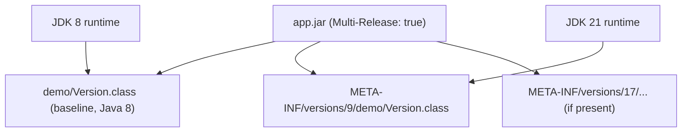
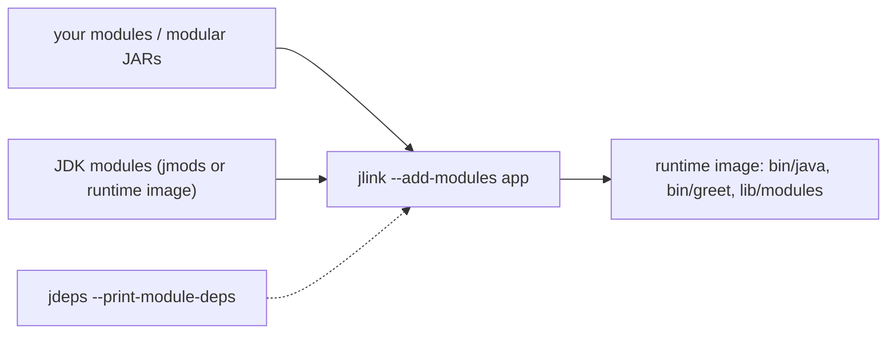
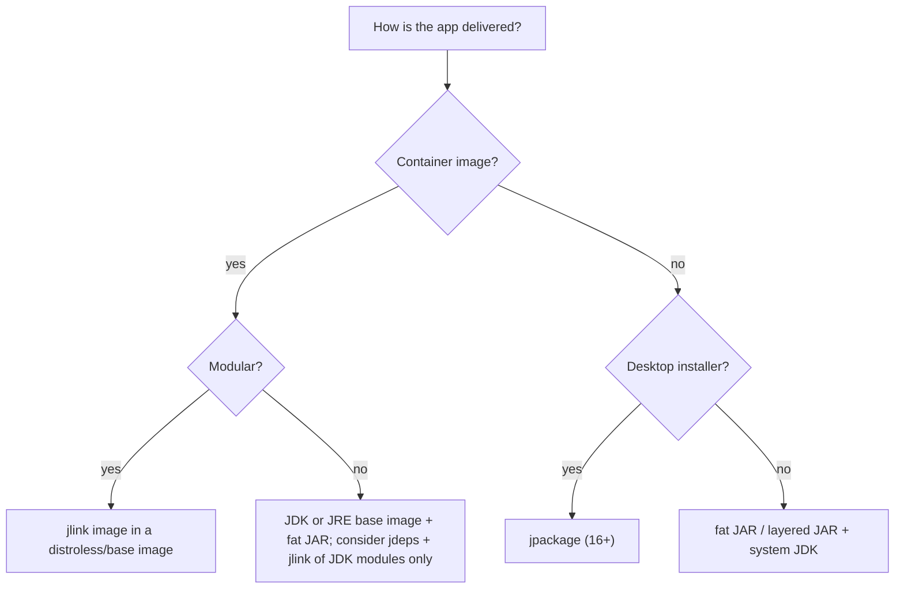

# 5.6 Launcher and Packaging: jshell, Single-File Launch, Multi-Release JARs, jlink

> **Goal:** Use the tools Java 9 to 11 added around the language: `jshell` for experiments, `java File.java` for scripts, multi-release JARs for libraries, `jlink` for a minimal runtime, `jdeps` for dependency analysis, and know what `jpackage` adds later.

**Level:** practical tooling. These are the tools you will actually type.
**Verified on:** OpenJDK 21.0.12. Every command and its output below was produced by running it on this machine; absolute paths are shortened to `...`.

## Contents

1. [jshell: the Java REPL (9)](#1-jshell-the-java-repl-9)
2. [Single-file source launch (11)](#2-single-file-source-launch-11)
3. [Multi-release JARs (9)](#3-multi-release-jars-9)
4. [Modular JARs and `jar` improvements](#4-modular-jars-and-jar-improvements)
5. [jlink: build your own runtime (9)](#5-jlink-build-your-own-runtime-9)
6. [jdeps and jdeprscan: know your dependencies](#6-jdeps-and-jdeprscan-know-your-dependencies)
7. [jpackage and the rest of the toolbox](#7-jpackage-and-the-rest-of-the-toolbox)
8. [Choosing a packaging strategy](#8-choosing-a-packaging-strategy)
9. [Common gotchas](#9-common-gotchas)
10. [Interview questions](#10-interview-questions)

---

## 1. jshell: the Java REPL (9)

**Intuition.** Until Java 9, trying one line of Java meant creating a class, `main`, compiling and running. `jshell` evaluates **snippets**: expressions, declarations, imports, methods, classes, one at a time, with immediate feedback and automatic imports of the common packages.

The script `demo.jsh`:

```text
int x = 6 * 7
x + 1
String greet(String n) { return "hi " + n; }
greet("jshell")
List.of(3, 1, 2).stream().sorted().toList()
int y = 1 / 0
/exit
```

Fed to `jshell`, the real session output is:

```text
$ bash p5/jshell.sh
jshell> x ==> 42
jshell> $2 ==> 43
jshell> |  created method greet(String)
jshell> $4 ==> "hi jshell"
jshell> $5 ==> [1, 2, 3]
jshell> |  Exception java.lang.ArithmeticException: / by zero
|        at (#6:1)
jshell> |  Goodbye
```

What to notice:

- `int x = 6 * 7` prints `x ==> 42`; an expression without a name gets a scratch variable (`$2 ==> 43`).
- A method can be declared at top level (`created method greet(String)`) and called immediately.
- `java.util.*`, `java.util.stream.*`, `java.io.*` and several more packages are imported by default (that is why `List` worked).
- An exception does not end the session: it prints the stack and keeps going.

Handy commands inside jshell:

| Command | Purpose |
|---|---|
| `/vars`, `/methods`, `/types`, `/imports` | list what is defined |
| `/list`, `/edit`, `/drop name` | manage snippets |
| `/open file.jsh`, `/save file.jsh` | load or save a script |
| `/env --class-path lib.jar` | add libraries (restart context) |
| `/set feedback concise` | change verbosity |
| `/exit` | leave |

Use it to check an API's behaviour, explore a library, or teach. It is not a replacement for tests, and anything it can do can be put in a unit test too.

## 2. Single-file source launch (11)

Java 11 lets the `java` launcher compile **and** run a single source file in memory, without `javac` and without writing a `.class` file:

```text
import java.util.*;

public class Single {
    public static void main(String[] args) {
        var words = new ArrayList<>(List.of(args));
        Collections.sort(words);
        System.out.println("single-file source launch, sorted args = " + words);
    }
}
```

```text
$ bash p5/launch.sh
single-file source launch, sorted args = [one, two]
--- no .class file was written:
ls: cannot access 's/p5/*.class': No such file or directory
```

Rules:

| Rule | Detail |
|---|---|
| The first top-level class must contain `main` | that class is run; the file name need not match |
| Everything in one file | other source files are not found (multi-file source launch arrived in Java 22) |
| Options | the usual ones go before the file name: `java -Xmx256m --enable-preview Tool.java args` |
| Classpath | `java -cp lib/\* Tool.java` works for libraries |
| Shebang | a file starting with `#!/usr/bin/java --source 11` can be made executable and run as a script (the file then does not need a `.java` extension) |

Typical uses: one-off scripts, build helpers, interview exercises, and reproducible bug reports ("run this single file"). In JDK 11 the compiler language level defaults to the JDK's own version unless you pass `--source`.

## 3. Multi-release JARs (9)

A library that must run on Java 8 and also use newer APIs on newer JDKs used to ship two JARs or reflection tricks. A **multi-release JAR** (MRJAR) contains the baseline classes at the root and optional replacements under `META-INF/versions/<N>/`; the runtime picks the highest version it supports.



The two `Version` classes, one compiled with `--release 8`, one with `--release 9` and using `List.of`:

```text
package demo;

public class Version {
    public static String describe() { return "baseline implementation (Java 8 compatible)"; }
}
```

```text
package demo;

public class Version {
    public static String describe() { return "Java 9+ implementation (uses List.of)" + java.util.List.of(9); }
}
```

Building and running the JAR (`jar --create ... -C base . --release 9 -C v9 .`):

```text
$ bash p5/mrjar.sh
# jar contents
META-INF/MANIFEST.MF
META-INF/versions/9/demo/Version.class
demo/Main.class
demo/Version.class

# run on this JDK (21): the versions/9 class wins
Java 9+ implementation (uses List.of)[9]

# same jar, multi-release switched off (what Java 8 would see)
baseline implementation (Java 8 compatible)
```

The same bytes behave differently depending on the JVM: with multi-release processing disabled (what Java 8 effectively does) the baseline class is used.

| Detail | Note |
|---|---|
| Manifest | `Multi-Release: true` is set by `jar --release` |
| Public API must match | versioned classes may differ internally but should expose the same public signatures |
| Maven | `maven-compiler-plugin` with several executions + `maven-jar-plugin` config `Multi-Release`, or the MRJAR plugins |
| Tools | older tools (some shaders, scanners) ignore `META-INF/versions` |
| Typical use | `java.util.concurrent` backports, `VarHandle` instead of `Unsafe`, `StackWalker` instead of reflection |

```text
 app.jar
 +-- META-INF/MANIFEST.MF                      Multi-Release: true
 +-- demo/Main.class
 +-- demo/Version.class                        <- Java 8 sees only this
 +-- META-INF/versions/9/demo/Version.class    <- Java 9 and later prefer this
```

## 4. Modular JARs and `jar` improvements

A JAR containing `module-info.class` at its root is a **modular JAR**. The `jar` tool (new long options in 9) can inspect it:

```text
$ bash p5/jlink.sh
# modular JARs describe themselves
com.acme.greet jar:file:///.../p5/out-jars/greet.jar!/module-info.class
exports com.acme.greet.api
requires java.base mandated
provides com.acme.greet.api.Greeter with com.acme.greet.internal.PoliteGreeter
contains com.acme.greet.internal


# jlink: build a private runtime containing ONLY what the app needs
com.acme.app
com.acme.greet
java.base

# run the image (no JDK on the path needed)
my module      : com.acme.app named=true
greet module   : com.acme.greet
reads greet    : true
service found  : com.acme.greet.internal.PoliteGreeter -> Good day, Mrinal
```

(The same script continues into section 5; the first part shows `--describe-module` reading the descriptor straight from the JAR.)

Useful `jar` commands:

| Command | Purpose |
|---|---|
| `jar --create --file app.jar --main-class a.Main -C classes .` | build with an entry point |
| `jar --list --file app.jar` | list entries |
| `jar --describe-module --file app.jar` | show a module's descriptor (or automatic module name) |
| `jar --update --file app.jar --module-version 1.2` | set the module version |
| `jar --extract --file app.jar` | unpack |

## 5. jlink: build your own runtime (9)

`jlink` assembles a **custom runtime image**: only the JDK modules your application needs plus your own modules, with an optional launcher script. The image built below measured about 50 MB on this machine, against roughly 290 MB for the full JDK installed here, and shipping it removes the "which Java is installed on the server?" problem.



The `jlink` command used above (output shown in the previous block after the module descriptor):

```text
jlink --module-path out-jars:$JAVA_HOME/jmods \
      --add-modules com.acme.app \
      --output out-img \
      --launcher greet=com.acme.app/com.acme.app.Main \
      --strip-debug --no-header-files --no-man-pages
```

The image's `bin/java --list-modules` shows **only three modules** (`com.acme.app`, `com.acme.greet`, `java.base`): that is the whole runtime, versus the dozens in a full JDK. Running `out-img/bin/greet` executes the application with no other Java installed.

Useful options:

| Option | Effect |
|---|---|
| `--add-modules` | root modules; dependencies are pulled in automatically |
| `--launcher name=module/class` | create `bin/name` |
| `--strip-debug` | drop debug info from classes |
| `--compress=zip-6` | compress the image's class data |
| `--bind-services` | include service providers that the chosen modules `uses` |
| `--no-header-files --no-man-pages` | trim extras |

Limits: jlink needs **modular** inputs; an application full of automatic modules or class-path JARs cannot be linked directly. For non-modular apps, run `jdeps --print-module-deps app.jar` to learn which JDK modules to add, then build an image of the JDK parts only and put the app on the class path.

## 6. jdeps and jdeprscan: know your dependencies

```text
$ bash p5/desc.sh
# a JDK module
exports java.sql
exports javax.sql
java.sql
requires java.base mandated
requires java.logging transitive
requires java.transaction.xa transitive
requires java.xml transitive
uses java.sql.Driver

p5/desc.sh: line 6: syntax error near unexpected token `('
p5/desc.sh: line 6: `java --list-modules | grep -E '^java\.(base|sql|logging|net\.http|xml)@' | sed 's/@.*//''
```

(See section 7 of chapter 5.1 for the full explanation of that output.) `jdeps` options you will use:

| Command | Answer it gives |
|---|---|
| `jdeps -s app.jar` | summary: which JARs/modules it depends on |
| `jdeps --print-module-deps app.jar` | comma-separated JDK modules required (feed to `jlink`) |
| `jdeps --jdk-internals app.jar` | use of internal JDK APIs and the suggested replacement |
| `jdeps --multi-release 11 --class-path 'lib/*' app.jar` | analyse MRJARs for a specific version |
| `jdeprscan --release 21 app.jar` | use of deprecated or removed APIs |

Real runs of `--jdk-internals` and `jdeprscan` are shown in chapter 5.7.

## 7. jpackage and the rest of the toolbox

| Tool | Since | Purpose |
|---|---|---|
| `jshell` | 9 | REPL |
| `jlink`, `jmod` | 9 | runtime images, JMOD archives |
| `jdeps`, `jdeprscan` | 8 / 9 | dependency and deprecation analysis |
| `jcmd` | 7 | diagnostic commands: heap dumps, JFR, thread dumps (Part 10, 16) |
| `jfr` | 12 | print and summarise `.jfr` files |
| `jpackage` | 14 incubator, **16** final | native installers (`.msi`, `.dmg`, `.deb`, `.rpm`) bundling a jlink'd runtime |
| `javadoc` | old | HTML5 output and search box from 9/10 |

`jpackage` is outside the Java 11 baseline, so it is listed here and revisited in Part 18 (tooling and delivery).

## 8. Choosing a packaging strategy



| Strategy | Pros | Cons |
|---|---|---|
| Fat JAR + system JDK | simplest | JDK version drift on servers |
| Layered JAR in container | cache-friendly images (Spring Boot layers) | image carries a full JRE |
| jlink image | small, private, reproducible | needs modular inputs or careful `jdeps` |
| jpackage | native installer | build per OS |

## 9. Common gotchas

| Gotcha | Why | Fix |
|---|---|---|
| `java Foo.java` cannot find another class in the project | single-file mode compiles only that file | put on class path precompiled, or use javac for multi-file |
| jshell prints nothing for a statement | statements ending in `;` that return nothing produce no feedback | evaluate an expression or use `/vars` |
| MRJAR ignored by tools | tool does not understand `META-INF/versions` | test with the real runtime, not just the build |
| MRJAR differing public APIs | versioned class exposes more/fewer members | keep signatures identical |
| `jlink` fails: "module not found" or automatic module error | non-modular dependency | modularize, or use `jdeps` + class path |
| `jlink` image misses a JDK module at run time | reflection/services not visible to static analysis | `--add-modules`, `--bind-services` |
| `jar --release` classes compiled with wrong `--release` | JDK's newer API silently used | compile each version directory with `javac --release N` |
| Different `JAVA_HOME` for jlink and runtime | image is tied to the JDK build that produced it | rebuild the image after JDK patch updates |
| Shebang script not executable | file permissions | `chmod +x` |

## 10. Interview questions

<details>
<summary><strong>Q1. What is jshell and when would you use it?</strong></summary>

A read-eval-print loop for Java (Java 9) that evaluates snippets without a class or <code>main</code>. Useful to check an API, prototype an expression, explore a library on a class path, or teach.
</details>

<details>
<summary><strong>Q2. What does <code>java Hello.java</code> do (Java 11)?</strong></summary>

Compiles the single source file in memory and runs its first top-level class's <code>main</code>, without producing a <code>.class</code> file. It only supports one source file until Java 22.
</details>

<details>
<summary><strong>Q3. What is a multi-release JAR?</strong></summary>

A JAR with baseline classes at the root and optional version-specific replacements under <code>META-INF/versions/N/</code>, marked <code>Multi-Release: true</code>. The runtime uses the highest version it supports; Java 8 ignores the versioned directories.
</details>

<details>
<summary><strong>Q4. What does jlink do and what does it require?</strong></summary>

It builds a custom runtime image containing only the required JDK modules and your modules (plus an optional launcher). Inputs must be modules; non-modular dependencies need to be modularized or handled outside the image.
</details>

<details>
<summary><strong>Q5. How do you find the JDK modules an application needs?</strong></summary>

<code>jdeps --print-module-deps app.jar</code> (add <code>--ignore-missing-deps</code> if needed), then pass the list to <code>jlink --add-modules</code>.
</details>

<details>
<summary><strong>Q6. How do you check for use of internal JDK APIs before upgrading?</strong></summary>

<code>jdeps --jdk-internals</code> reports uses of <code>sun.*</code> and similar packages with suggested replacements; <code>jdeprscan</code> reports deprecated and removed APIs.
</details>

<details>
<summary><strong>Q7. Why would a library ship a multi-release JAR?</strong></summary>

To keep Java 8 compatibility while using better APIs (for example <code>VarHandle</code>, <code>StackWalker</code>, <code>List.of</code>) on newer JDKs, without maintaining two artifacts.
</details>

<details>
<summary><strong>Q8. What does <code>jar --describe-module</code> show?</strong></summary>

The module descriptor of a modular JAR: name, exports, requires, provides, contains packages. For a non-modular JAR it shows the automatic module name.
</details>

<details>
<summary><strong>Q9. What is jpackage?</strong></summary>

A tool (final in 16) that packages an application with a jlink-built runtime into native installers such as MSI, DMG, DEB or RPM.
</details>

<details>
<summary><strong>Q10. Can single-file launch use libraries?</strong></summary>

Yes, with <code>-cp</code> or <code>--module-path</code> pointing at compiled libraries; only the source being launched must be one file.
</details>

<details>
<summary><strong>Q11. Why is a jlink image tied to a specific JDK build?</strong></summary>

It contains copies of that JDK's modules. Security patches to the JDK are not applied to an existing image; rebuild the image on each JDK update.
</details>

---

[Previous: 5.5 JVM Changes 9 to 11](./05-jvm-changes-9-11.md) · [Part index](./README.md) · Next: [5.7 Migrating from Java 8 to 11](./07-migrating-8-to-11.md)