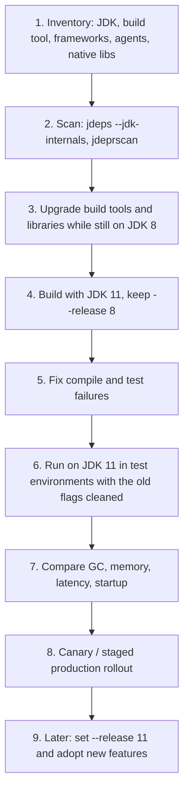
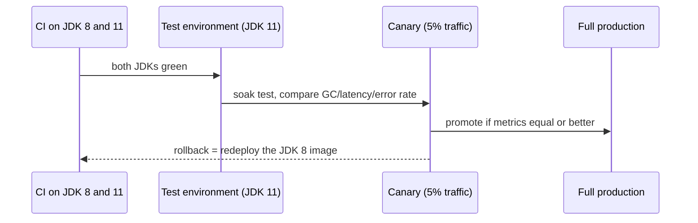

# 5.7 Migrating from Java 8 to 11

> **Goal:** Upgrade a real Java 8 application to 11 with a repeatable plan: know the exact things that break (and why), find them with tools before running anything, and fix them in the right order.

**Level:** the chapter you will use at work. Everything here also applies, with additions, when you jump from 8 straight to 17 or 21.
**Verified on:** OpenJDK 21.0.12. Breakages are demonstrated with the real compiler and runtime messages; code is compiled with `--release 8` or `--release 11` where that is the point. Version-compatibility statements for third-party libraries are deliberately general because the exact minimum versions change; check each project's release notes.

## Contents

1. [Why migrate, and what "migrate" means](#1-why-migrate-and-what-migrate-means)
2. [A repeatable plan](#2-a-repeatable-plan)
3. [Step 1: scan with the JDK's own tools](#3-step-1-scan-with-the-jdks-own-tools)
4. [Compile-time breakages](#4-compile-time-breakages)
5. [Run-time breakages](#5-run-time-breakages)
6. [Behaviour changes that compile and run, but differ](#6-behaviour-changes-that-compile-and-run-but-differ)
7. [Build tools, frameworks and libraries](#7-build-tools-frameworks-and-libraries)
8. [JVM flags and operations](#8-jvm-flags-and-operations)
9. [Rolling out safely](#9-rolling-out-safely)
10. [Migration checklist](#10-migration-checklist)
11. [Common gotchas](#11-common-gotchas)
12. [Interview questions](#12-interview-questions)

---

## 1. Why migrate, and what "migrate" means

| Reason | Detail |
|---|---|
| Security and support | Java 8 free updates now depend on your vendor's policy and ending dates; newer LTS releases get the security work first |
| Performance | better GC (G1 improvements), compact strings, container awareness, faster string concatenation, JIT improvements |
| Language and library | `var`, immutable collections, HTTP client, later records, text blocks, virtual threads (Parts 6 to 8) |
| Ecosystem | new library versions stop supporting Java 8 |

"Migrate" has two independent parts, and separating them lowers risk:

| Part | Question | Tool |
|---|---|---|
| **Run** on the new JDK | does the app still work on Java 11 (or 17, 21)? | new JDK on the build and test servers |
| **Target** the new language level | do we want to use Java 11 syntax and APIs? | `--release 11` |

Do the first, ship it, then do the second.

## 2. A repeatable plan



Why step 3 is done on JDK 8: updating Maven plugins, Mockito, Lombok, Spring or Hibernate to versions that *support* 11 can be tested without changing the JDK, so each change is isolated.

```text
 Java 8 app                          what the move to 11 changes underneath it
 -------------------------------------------------------------------------------
 your code + libraries      --->     bytecode must be readable (class file 52 -> 55)
 javax.xml.bind etc.        --->     gone from the JDK: add as dependencies
 sun.* / reflection         --->     encapsulated: fix or --add-opens
 -XX flags / GC logs        --->     renamed or removed: -Xlog
 Parallel GC, host memory   --->     G1 (server-class), container limits
 locale / TLS defaults      --->     CLDR, TLS 1.3
```

## 3. Step 1: scan with the JDK's own tools

Four short programs show what the scanners find. First, code that uses a removed Java EE class and a newer-than-8 API, and code that uses a JDK-internal class:

```text
import javax.xml.bind.DatatypeConverter;

public class UsesJaxb {
    public static void main(String[] args) {
        System.out.println(DatatypeConverter.printHexBinary(new byte[]{1, 2}));
    }
}
```

```text
import java.util.List;

public class NewerApi {
    public static void main(String[] args) {
        System.out.println(List.of(1, 2).isEmpty() + " " + "x".repeat(2));
    }
}
```

```text
import sun.security.x509.X500Name;

public class Legacy {
    @SuppressWarnings("removal")
    public static void main(String[] args) throws Exception {
        System.out.println(new X500Name("CN=demo") + " " + new Integer(7) + " " + Thread.currentThread().getName().length());
    }
}
```

Now every tool run against them:

```text
$ bash p5/mig.sh
# 1. a Java EE package that was removed from the JDK in 11
s/p5/mig/UsesJaxb.java:1: error: package javax.xml.bind does not exist
import javax.xml.bind.DatatypeConverter;
                     ^
s/p5/mig/UsesJaxb.java:5: error: cannot find symbol
        System.out.println(DatatypeConverter.printHexBinary(new byte[]{1, 2}));
                           ^
  symbol:   variable DatatypeConverter
  location: class UsesJaxb
2 errors

# 2. --release 8 hides every API newer than 8 (what -source/-target alone does NOT do)
s/p5/mig/NewerApi.java:5: error: cannot find symbol
        System.out.println(List.of(1, 2).isEmpty() + " " + "x".repeat(2));
                               ^
  symbol:   method of(int,int)
  location: interface List
s/p5/mig/NewerApi.java:5: error: cannot find symbol
        System.out.println(List.of(1, 2).isEmpty() + " " + "x".repeat(2));
                                                              ^
  symbol:   method repeat(int)
  location: class String
2 errors

# 3. compiling against a JDK-internal package is refused
s/p5/mig/Legacy.java:1: error: package sun.security.x509 is not visible
import sun.security.x509.X500Name;
                   ^
  (package sun.security.x509 is declared in module java.base, which does not export it to the unnamed module)
1 error

# 4. jdeps finds internal-API use in a compiled class (compiled here with --add-exports just to get a class file)
d -> java.base
   Legacy                                             -> sun.security.x509.X500Name                         JDK internal API (java.base)

Warning: JDK internal APIs are unsupported and private to JDK implementation that are
subject to be removed or changed incompatibly and could break your application.
Please modify your code to eliminate dependence on any JDK internal APIs.
For the most recent update on JDK internal API replacements, please check:
https://wiki.openjdk.org/display/JDK8/Java+Dependency+Analysis+Tool

JDK Internal API                         Suggested Replacement
----------------                         ---------------------
sun.security.x509.X500Name               Use javax.security.auth.x500.X500Principal @since 1.4

# 5. jdeprscan flags deprecated / removed API use in the same class
Directory out/mig/d:
class Legacy uses deprecated method java/lang/Integer::<init>(I)V (forRemoval=true)
```

What each step teaches:

1. **Removed package.** `javax.xml.bind` (JAXB) was part of Java SE 8 but not of Java 11. The fix is a dependency, not code: `jakarta.xml.bind-api` plus an implementation such as `org.glassfish.jaxb:jaxb-runtime` (older code may use `javax.xml.bind:jaxb-api` 2.3.x). The same applies to `javax.activation`, `javax.annotation` (`jakarta.annotation-api`), `javax.transaction`, JAX-WS and CORBA.
2. **`--release 8`.** Plain `-source 8 -target 8` still compiles against the *new* JDK's class library, so you can use `List.of` and `String.repeat` and only discover at run time on Java 8 that they are missing. `--release 8` compiles against the real Java 8 API signatures and rejects them. Use `--release`, not `-source/-target`, for every multi-version build.
3. **Internal APIs.** Compilation fails because `sun.security.x509` is in `java.base` but not exported. `jdeps --jdk-internals` lists every use and suggests the public replacement (`X500Principal` here).
4. **`jdeprscan`.** Finds uses of deprecated and removed APIs, with `forRemoval=true` flagged: `new Integer(int)` still works on 21 but is scheduled for removal.

## 4. Compile-time breakages

| Symptom | Cause | Fix |
|---|---|---|
| `package javax.xml.bind does not exist` (and `javax.activation`, `javax.annotation`, `javax.jws`, `javax.transaction`) | Java EE modules removed in 11 | add Jakarta/JAXB dependencies |
| `package sun.misc does not exist` or `X is not visible` | internal API encapsulated or removed | use the public replacement (`java.util.Base64`, `javax.security.auth.x500`, VarHandle) |
| `cannot find symbol` for `List.of`, `String.repeat`, `var`, etc. | compiling with `--release 8` and using newer API | raise `--release` or avoid the API |
| `error: '_' is a keyword` | underscore identifier banned in 9 | rename |
| `module not found` | `module-info` appeared where there was none, or an automatic module name differs | remove `module-info` until you want modules |
| Annotation processor crashes | old Lombok/MapStruct/Dagger on a new JDK | upgrade processors |
| `Unsupported class file major version 55` (11), `61` (17), `65` (21) | a tool (ASM, ByteBuddy, Jacoco, Spring, Mockito, Gradle plugin) is too old to read newer bytecode | upgrade that tool |

Class-file versions are worth memorising: Java 8 = **52**, 9 = 53, 10 = 54, **11 = 55**, 17 = 61, 21 = 65.

## 5. Run-time breakages

The program below exercises the runtime changes most often hit:

```java
import java.net.URLClassLoader;
import java.util.*;

public class Migrate {
    public static void main(String[] args) throws Exception {
        // 1. The classic Java 9 break: the system class loader is no longer a URLClassLoader
        ClassLoader cl = ClassLoader.getSystemClassLoader();
        System.out.println("system loader is a URLClassLoader? " + (cl instanceof URLClassLoader));
        try {
            URLClassLoader u = (URLClassLoader) cl;
        } catch (ClassCastException e) {
            System.out.println("cast fails: ClassCastException");
        }

        // 2. java.version parsing: "1.8.0_292" became "9", "11.0.2"
        String legacy = "1.8.0_292", modern = "11.0.2";
        System.out.println("naive parse of '" + modern + "' => " + Integer.parseInt(modern.split("\\.")[1]) + "   (code that expects '1.x' reads the wrong number)");
        Runtime.Version v = Runtime.Version.parse("11.0.2+9");
        System.out.println("Runtime.Version.parse: feature=" + v.feature() + " interim=" + v.interim() + " update=" + v.update());
        System.out.println("legacy string 1.8.0_292 is not a valid Runtime.Version? " + isInvalid(legacy));

        // 3. Strong encapsulation of JDK internals
        try {
            Class<?> c = Class.forName("sun.security.x509.X500Name");
            c.getDeclaredConstructor(String.class).newInstance("CN=demo");
            System.out.println("internal class instantiated");
        } catch (Exception e) {
            System.out.println("internal JDK class: " + e.getClass().getSimpleName());
        }

        // 4. Removed Java EE modules: javax.xml.bind etc. are gone from the JDK (11)
        try {
            Class.forName("javax.xml.bind.JAXBContext");
            System.out.println("JAXB present");
        } catch (ClassNotFoundException e) {
            System.out.println("javax.xml.bind.JAXBContext: ClassNotFoundException (add jakarta.xml.bind-api + a runtime)");
        }
        // But java.sql and java.xml (DOM/SAX) remain
        System.out.println("java.sql still present: " + Class.forName("java.sql.Connection").getModule().getName());

        // 5. Deprecated-for-removal constructors still compile but are on borrowed time
        @SuppressWarnings("removal") Integer boxed = new Integer(5);
        System.out.println("new Integer(5) works but is deprecated for removal: " + boxed);
        System.out.println("Integer.valueOf(5) is the replacement: " + Integer.valueOf(5));
    }

    static boolean isInvalid(String s) {
        try { Runtime.Version.parse(s); return false; } catch (IllegalArgumentException e) { return true; }
    }
}

// ---- Output ----
// system loader is a URLClassLoader? false
// cast fails: ClassCastException
// naive parse of '11.0.2' => 0   (code that expects '1.x' reads the wrong number)
// Runtime.Version.parse: feature=11 interim=0 update=2
// legacy string 1.8.0_292 is not a valid Runtime.Version? true
// internal JDK class: IllegalAccessException
// javax.xml.bind.JAXBContext: ClassNotFoundException (add jakarta.xml.bind-api + a runtime)
// java.sql still present: java.sql
// new Integer(5) works but is deprecated for removal: 5
// Integer.valueOf(5) is the replacement: 5
```

| Output line | What it means for your code |
|---|---|
| `system loader is a URLClassLoader? false` | Pre-9 code that casts `ClassLoader.getSystemClassLoader()` to `URLClassLoader` (to inject JARs at run time or print the class path) throws `ClassCastException`. Read `System.getProperty("java.class.path")` instead; to add JARs dynamically use your own `URLClassLoader` |
| version parsing | `java.version` is `1.8.0_292` on 8 but `11.0.2` on 11. Code that splits on `.` and takes element `1` is wrong. Use `Runtime.version().feature()` |
| internal JDK class: `IllegalAccessException` | strong encapsulation: reflection into non-exported JDK internals fails (5.1). Add `--add-opens`/`--add-exports` as a stop-gap, remove the dependency as the cure |
| `javax.xml.bind.JAXBContext: ClassNotFoundException` | same as the compile error, but found at run time: Spring or Hibernate may fail at start-up |
| `java.sql still present` | `java.sql`, `java.xml` and most of Java SE remain |
| `new Integer(5)` | works, but deprecated for removal since 9 |

### The illegal-access warning (Java 9 to 15)

On Java 9 to 15 the first illegal reflective access from the class path prints this and continues:

```text
WARNING: An illegal reflective access operation has occurred
WARNING: Illegal reflective access by com.foo.Reflector (file:/app/lib/foo.jar) to field java.lang.String.value
WARNING: Please consider reporting this to the maintainers of com.foo.Reflector
WARNING: Use --illegal-access=warn to enable warnings of further illegal reflective access operations
WARNING: All illegal access operations will be denied in a future release
```

(That text is from the JDK 9 to 15 behaviour and is shown for recognition; it is not reproducible on JDK 21, where access is denied outright.) The right reaction is a ticket against the library, not silencing the warning. On Java 16+ the default is **deny**, and 17 removed the option, so a 11-to-17 migration turns each warning into an `InaccessibleObjectException`.

## 6. Behaviour changes that compile and run, but differ

These are the nasty ones because nothing fails.

**Locale data (Java 9).** The default locale provider changed from the JDK's own data (`COMPAT`, the Java 8 behaviour) to Unicode **CLDR**. Dates, numbers and currency print differently. Real output from the same program under both providers:

```text
$ bash p5/locale.sh
# default (CLDR data, the default since Java 9)
providers   : (default: CLDR,COMPAT)
en_US  date MEDIUM: Mar 7, 2025 | number: 1,234,567.891
en_GB  date MEDIUM: 7 Mar 2025 | number: 1,234,567.891
de_DE  date MEDIUM: 07.03.2025 | number: 1.234.567,891
fr_FR  date MEDIUM: 7 mars 2025 | number: 1~234~567,891
first day of week UK : MONDAY, US: SUNDAY

# -Djava.locale.providers=COMPAT (the Java 8 data), JDK warning line removed
providers   : COMPAT
en_US  date MEDIUM: Mar 7, 2025 | number: 1,234,567.891
en_GB  date MEDIUM: 07-Mar-2025 | number: 1,234,567.891
de_DE  date MEDIUM: 07.03.2025 | number: 1.234.567,891
fr_FR  date MEDIUM: 7 mars 2025 | number: 1_234_567,891
first day of week UK : MONDAY, US: SUNDAY
```

Look at `en_GB`: `7 Mar 2025` versus `07-Mar-2025`, and at `fr_FR`: the grouping separator is a narrow no-break space (shown as `~`) in CLDR and a no-break space (`_`) under COMPAT. Anything that parses or compares formatted text (CSV exports, tests with expected strings, regexes) can break. Fix by formatting with explicit patterns (`DateTimeFormatter.ofPattern(..., Locale.ROOT)`), not by relying on locale defaults. `-Djava.locale.providers=COMPAT` restores the old data as a temporary measure (it is removed in later JDKs).

| Other silent change | Details |
|---|---|
| Default GC | Parallel to G1 (5.5); different pause and throughput profile |
| Heap sizing in containers | now respects cgroup limits (5.5) |
| `String` concatenation bytecode | invokedynamic; benchmarks and stack traces differ |
| TLS defaults | TLS 1.3 enabled, legacy protocols and weak ciphers disabled; old servers may refuse to connect |
| Default CA certificates | OpenJDK builds ship a populated `cacerts` from 10 on (Java 8 OpenJDK packages relied on the distribution) |
| `HashMap` iteration order for `Set.of`/`Map.of` | randomised per run (5.3) |
| Default charset | still the platform default until Java 18 (UTF-8 default, Part 6); on Linux with `LANG=C` an 8 or 11 app may read files differently than on a developer's laptop |
| Time zone and locale updates | tzdata and CLDR versions advance with each JDK |

## 7. Build tools, frameworks and libraries

Rather than a stale version table, use this process for each dependency category:

| Category | What to check | Typical symptom if too old |
|---|---|---|
| Build tool and plugins | Maven (compiler plugin with `<release>` support, Surefire, Failsafe, JaCoCo), Gradle wrapper | `Unsupported class file major version`, plugin crashes |
| Bytecode libraries | ASM, ByteBuddy, Javassist, cglib, Objenesis (via Mockito, Spring, Hibernate) | `IllegalArgumentException: Unsupported class file`, proxy creation failures |
| Frameworks | Spring Framework/Boot, Hibernate, Jackson, Guice, Micronaut, Quarkus | reflection failures on JDK internals |
| Annotation processors | Lombok, MapStruct, Dagger, Immutables | compile crashes |
| Agents | APM agents, profilers, coverage agents | JVM fails to start with `-javaagent` |
| Application servers | Tomcat/Jetty/WildFly/WebLogic versions certified for 11 | classloader or module errors |
| Docker base images | `eclipse-temurin:11`, distro packages | wrong JDK in CI |

Typical Maven fix when moving to 11:

```text
<properties>
  <maven.compiler.release>8</maven.compiler.release>   <!-- later: 11 -->
</properties>
```

And for Java EE removals add explicit dependencies, for example JAXB:

```text
<dependency><groupId>jakarta.xml.bind</groupId><artifactId>jakarta.xml.bind-api</artifactId><version>(a 2.3.x version for javax.xml.bind packages)</version></dependency>
<dependency><groupId>org.glassfish.jaxb</groupId><artifactId>jaxb-runtime</artifactId><version>(matching 2.3.x)</version></dependency>
```

Two namespace worlds exist: Jakarta EE 8 and earlier keep the `javax.*` packages (artifacts at 2.x/1.x versions), Jakarta EE 9+ renamed them to `jakarta.*`. Pick the artifact version that matches the package names your frameworks use. Spring Framework 6 and Spring Boot 3 need Java 17 and the `jakarta.*` namespace (Part 6).

## 8. JVM flags and operations

Use the replacement table in chapter 5.5 section 11. During the move:

| Task | How |
|---|---|
| Find unknown flags | start with `-XX:+IgnoreUnrecognizedVMOptions` once, read what was ignored, then remove them |
| GC logs | convert to `-Xlog:gc*:file=...` and update log parsers/dashboards |
| Heap in containers | `-XX:MaxRAMPercentage` instead of fixed `-Xmx` |
| Keep old behaviour explicitly | `--add-opens`, `--add-exports`, `-Djava.locale.providers=COMPAT` are bridges, not destinations |
| JFR | enable `-XX:StartFlightRecording` on a test box and compare before/after |
| Monitoring | JMX still works; `jcmd` covers most `jmap`/`jstack` tasks |

## 9. Rolling out safely



Practical rules:

1. Run **both** JDKs in CI for a while; the matrix catches regressions in either.
2. Change only the JDK in the first release; do not bundle feature work.
3. Compare the same dashboards before and after: GC pause, heap, CPU, p99 latency, error rate, startup time.
4. Keep rollback trivial: the old image or JDK stays available until the new one has run through a full business cycle (month-end jobs, batch windows).
5. Re-run performance tests: G1 vs Parallel can change throughput and tail latency in opposite directions.

## 10. Migration checklist

```text
[ ] Choose target (11 for a stepping stone; 17 or 21 as the real destination)
[ ] Inventory: JDK vendors, build tool versions, agents, native libraries
[ ] jdeps --jdk-internals and jdeprscan run on the application AND its dependencies
[ ] Build tools and libraries upgraded while still on JDK 8
[ ] CI builds with JDK 11 and --release 8, then tests run on 11
[ ] Java EE replacements added (JAXB, activation, annotation, transaction)
[ ] Replace sun.misc.* / sun.security.* usage; add --add-opens only where unavoidable
[ ] Remove casts to URLClassLoader; use Runtime.version() for version checks
[ ] Locale/format-sensitive code and tests reviewed (CLDR)
[ ] JVM flags translated (Xlog, MaxRAMPercentage); no Unrecognized VM option
[ ] GC choice made explicitly, container CPU/memory verified
[ ] TLS endpoints tested with TLS 1.3 and disabled legacy protocols
[ ] Performance and soak tests compared with the Java 8 baseline
[ ] Canary rollout with a rollback plan
[ ] Later: raise --release to 11, adopt var, factories, HTTP client; plan the next LTS
```

## 11. Common gotchas

| Gotcha | Why | Fix |
|---|---|---|
| Build passes, production fails | compiled with `-source/-target`, not `--release` | use `--release` |
| `Unsupported class file major version` | bytecode library too old | upgrade ASM/ByteBuddy/Mockito/Jacoco |
| App prints illegal-access warnings | library reflects into JDK internals | upgrade the library; temporary `--add-opens` |
| `ClassNotFoundException: javax.xml.bind...` at start | EE modules removed | add dependencies |
| Dates/numbers changed format | CLDR default | explicit patterns and `Locale.ROOT` |
| Container uses 1 CPU and Serial GC | ergonomics | set GC explicitly, provide 2+ CPUs |
| Agent fails at startup | agent built for 8 | upgrade the agent |
| Tests that print `Set.of` fail randomly | randomised order | sort before comparing |
| TLS handshake failures with a legacy partner | TLS 1.0/1.1 disabled | fix the server; do not re-enable globally |
| Everything works but is slower | different GC, cache sizing, JIT warm-up | measure and tune (Part 13) |

## 12. Interview questions

<details>
<summary><strong>Q1. What are the most common things that break when moving from Java 8 to 11?</strong></summary>

Removed Java EE modules (JAXB, JAX-WS, activation, annotations), encapsulated JDK internals (<code>sun.*</code>, reflection into <code>java.*</code>), tools and libraries that cannot read class-file version 55, the <code>URLClassLoader</code> cast on the system class loader, <code>java.version</code> parsing, removed JVM flags, and the default locale data (CLDR).
</details>

<details>
<summary><strong>Q2. Why use <code>--release 8</code> instead of <code>-source 8 -target 8</code>?</strong></summary>

<code>--release</code> also restricts the API to the signatures of the chosen release, so you cannot accidentally call <code>List.of</code> or <code>String.repeat</code> and break on Java 8 at run time. <code>-source/-target</code> alone compile against the new JDK's class library.
</details>

<details>
<summary><strong>Q3. How do you find use of internal JDK APIs before the upgrade?</strong></summary>

<code>jdeps --jdk-internals</code> (including the dependency JARs) lists the uses and suggested replacements; <code>jdeprscan</code> finds deprecated and removed API usage.
</details>

<details>
<summary><strong>Q4. Your app threw <code>ClassCastException</code> casting <code>ClassLoader.getSystemClassLoader()</code> to <code>URLClassLoader</code> after the upgrade. Why?</strong></summary>

Since Java 9 the application class loader is an internal <code>jdk.internal.loader.ClassLoaders$AppClassLoader</code>, not a <code>URLClassLoader</code>. Read <code>java.class.path</code> or create your own <code>URLClassLoader</code>.
</details>

<details>
<summary><strong>Q5. Why did dates and numbers format differently after the upgrade?</strong></summary>

Java 9 changed the default locale provider to CLDR. Use explicit patterns and a fixed <code>Locale</code> for machine-readable output, and <code>java.locale.providers=COMPAT</code> only as a temporary bridge.
</details>

<details>
<summary><strong>Q6. What replaces <code>javax.xml.bind</code> on Java 11?</strong></summary>

Standalone dependencies: <code>jakarta.xml.bind-api</code> and a runtime like <code>jaxb-runtime</code>. Same approach for <code>javax.activation</code>, <code>javax.annotation</code> and <code>javax.transaction</code>.
</details>

<details>
<summary><strong>Q7. What is the illegal reflective access warning?</strong></summary>

A Java 9 to 15 warning when class-path code reflects into JDK internals. In 16 it became an error by default, and 17 removed the <code>--illegal-access</code> switch, leaving <code>--add-opens</code>.
</details>

<details>
<summary><strong>Q8. How do you minimise risk when rolling out a new JDK?</strong></summary>

Change only the JDK, run CI on both versions, compare GC/latency/error dashboards in test and canary, keep rollback to the old image trivial, and stage the rollout.
</details>

<details>
<summary><strong>Q9. Should you modularize the application during the migration?</strong></summary>

Usually no. Run on the class path first; modularize later if the boundaries and tooling (jlink) justify it.
</details>

<details>
<summary><strong>Q10. Why might the JVM fail to start after the upgrade with "Unrecognized VM option"?</strong></summary>

Flags removed or renamed, for example the CMS collector (removed in 14), old GC-logging flags such as <code>PrintGCTimeStamps</code>, <code>MaxPermSize</code>, <code>UnlockCommercialFeatures</code> and <code>AggressiveOpts</code>. Use <code>-XX:+IgnoreUnrecognizedVMOptions</code> temporarily to find them, then translate to <code>-Xlog</code> and current flags.
</details>

<details>
<summary><strong>Q11. Which class-file version does Java 8 emit, and Java 11, 17 and 21?</strong></summary>

52, 55, 61 and 65 respectively (Java 8 = 52, each later release adds one).
</details>

<details>
<summary><strong>Q12. Is moving from 8 straight to 17 or 21 possible?</strong></summary>

Yes, and common, but all the breakages of 8 to 11 plus those of 11 to 17 (strong encapsulation enforced, removed flags and APIs) arrive at once. Many teams do 8 to 11 first to separate the causes, then 11 to 17/21.
</details>

---

[Previous: 5.6 Launcher and Packaging](./06-launcher-and-packaging-9-11.md) · [Part index](./README.md) · Next: [Part 6: LTS Java 17](../06-lts-java-17/README.md)