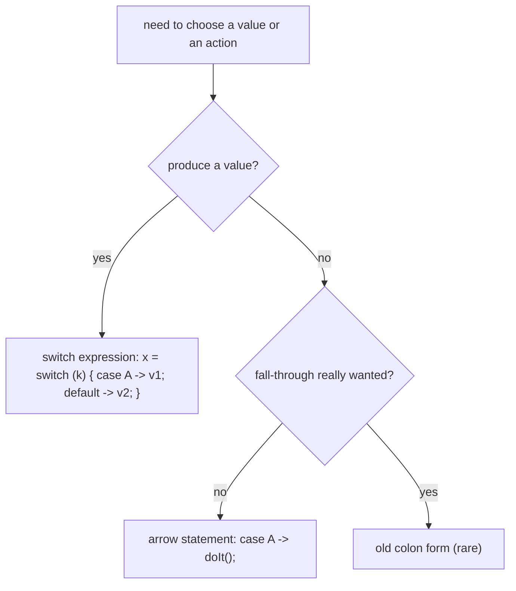
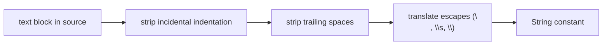

# 6.1 Switch Expressions and Text Blocks

> **Goal:** Replace fall-through `switch` statements with safe, exhaustive switch expressions, and write multi-line strings (JSON, SQL, HTML) as text blocks without escape noise, knowing the exact whitespace rules.

**Level:** everyday syntax. Both features were previews first (switch in 12 and 13, text blocks in 13 and 14) and became final in **14** and **15**; Java 17 contains both.
**Verified on:** OpenJDK 21.0.12. Outputs are real. Where a compiler message depends on the language level, the example is compiled with `--release 17` or the default and says so.

## Contents

1. [What was wrong with the old `switch`](#1-what-was-wrong-with-the-old-switch)
2. [Arrow labels and switch expressions](#2-arrow-labels-and-switch-expressions)
3. [`yield`, blocks and `throw`](#3-yield-blocks-and-throw)
4. [Exhaustiveness](#4-exhaustiveness)
5. [Rules and compiler errors](#5-rules-and-compiler-errors)
6. [Where pattern matching for `switch` fits (Java 21)](#6-where-pattern-matching-for-switch-fits-java-21)
7. [Text blocks](#7-text-blocks)
8. [The indentation rule, step by step](#8-the-indentation-rule-step-by-step)
9. [Escapes, `formatted()` and helper methods](#9-escapes-formatted-and-helper-methods)
10. [Common gotchas](#10-common-gotchas)
11. [Interview questions](#11-interview-questions)

---

## 1. What was wrong with the old `switch`

The statement inherited from C has four problems:

| Problem | Example |
|---|---|
| **Fall-through by default** | forgetting `break` runs the next case |
| **Verbose** | one `break` per case, a temporary variable to carry the result |
| **Not exhaustive** | a missing enum constant silently does nothing |
| **One scope** | all cases share a single block, so variables leak between cases |

```text
 old:   case 1:  ... (no break) ----+            new:   case 1 -> ...    (stops here)
        case 2:  ... <-------------+ runs too         case 2 -> ...
```

## 2. Arrow labels and switch expressions

Two independent changes arrived together:

1. **Arrow form** `case X -> ...`: no fall-through, no `break`, several labels per case (`case A, B ->`).
2. **Switch expression**: `switch` can now *produce a value* and sit anywhere an expression can.

```java
import java.time.DayOfWeek;
import java.util.*;

public class SwitchDemo {
    enum Level { LOW, MEDIUM, HIGH }

    // the old statement: fall-through is the default and a classic bug
    static String oldStyle(int day) {
        String r = "";
        switch (day) {
            case 1:
            case 7:
                r += "weekend ";           // no break: falls into the next case!
            case 2:
                r += "midweek ";
                break;
            default:
                r += "other ";
        }
        return r.trim();
    }

    // Java 14: arrow form, no fall-through, multiple labels, and it is an EXPRESSION
    static String kind(DayOfWeek d) {
        return switch (d) {
            case SATURDAY, SUNDAY -> "weekend";
            case MONDAY, TUESDAY, WEDNESDAY, THURSDAY, FRIDAY -> "weekday";
        };                                  // exhaustive over the enum: no default needed
    }

    // block bodies produce a value with yield
    static int score(String grade) {
        return switch (grade) {
            case "A" -> 90;
            case "B" -> {
                int base = 80;
                yield base + 5;
            }
            case "C", "D" -> 60;
            default -> {
                if (grade.isEmpty()) throw new IllegalArgumentException("empty grade");
                yield 0;
            }
        };
    }

    // old-style colon labels can also yield a value
    static int legacyYield(Level l) {
        return switch (l) {
            case LOW:
                yield 1;
            case MEDIUM:
                yield 5;
            default:
                yield 10;
        };
    }

    // switch as a statement with arrows (no value needed)
    static void log(Level l) {
        switch (l) {
            case LOW -> System.out.println("low: ignore");
            case MEDIUM -> System.out.println("medium: watch");
            case HIGH -> System.out.println("high: page someone");
        }
    }

    public static void main(String[] args) {
        System.out.println("old style 1 -> [" + oldStyle(1) + "]   (fell through: weekend + midweek)");
        System.out.println("old style 2 -> [" + oldStyle(2) + "]");
        System.out.println("old style 9 -> [" + oldStyle(9) + "]");
        for (DayOfWeek d : new DayOfWeek[]{DayOfWeek.MONDAY, DayOfWeek.SUNDAY}) System.out.println(d + " -> " + kind(d));
        System.out.println("scores: " + score("A") + " " + score("B") + " " + score("D") + " " + score("Z"));
        try { score(""); } catch (IllegalArgumentException e) { System.out.println("throw inside a switch expression: " + e.getMessage()); }
        System.out.println("legacy yield: " + legacyYield(Level.LOW) + " " + legacyYield(Level.HIGH));
        log(Level.HIGH);

        // the value of a switch expression can be used anywhere an expression can
        int len = args.length;
        String size = "size is " + switch (len) { case 0 -> "empty"; case 1 -> "single"; default -> "many"; };
        System.out.println(size);

        // mixed types: the result type is computed like a conditional expression
        Object mixed = switch (len) { case 0 -> 1; default -> "text"; };
        System.out.println("mixed result: " + mixed + " (" + mixed.getClass().getSimpleName() + ")");

        // null still throws NPE (null labels arrive with pattern switch, Java 21)
        String s = null;
        try { switch (s) { case "a" -> System.out.println("a"); default -> System.out.println("other"); } }
        catch (NullPointerException e) { System.out.println("switch on null: NullPointerException"); }
    }
}

// ---- Output ----
// old style 1 -> [weekend midweek]   (fell through: weekend + midweek)
// old style 2 -> [midweek]
// old style 9 -> [other]
// MONDAY -> weekday
// SUNDAY -> weekend
// scores: 90 85 60 0
// throw inside a switch expression: empty grade
// legacy yield: 1 10
// high: page someone
// size is empty
// mixed result: 1 (Integer)
// switch on null: NullPointerException
```

What the output shows, in order:

- `oldStyle(1)` printed `weekend midweek`: the classic fall-through the arrow form removes.
- `kind(DayOfWeek)` returns the result of the switch directly. There is **no `default`**: it is allowed because the switch covers every constant (section 4).
- `score` mixes forms: single-value arrows, a block using `yield`, grouped labels `case "C", "D"`, and a `default` that can `throw`.
- A switch expression can be embedded inside a string concatenation (`"size is " + switch ...`).
- With branches of different types (`1` and `"text"`), the result is typed like a conditional expression (here `Object`, holding an `Integer`).
- Switching on `null` still throws `NullPointerException`; `case null` only arrives with pattern switch in Java 21.



## 3. `yield`, blocks and `throw`

An arrow's right-hand side is one of three things:

| Right side | Meaning |
|---|---|
| an expression | its value is the result (`case "A" -> 90;`) |
| a block `{ ... }` | must end by `yield value;` (or throw) |
| `throw ...;` | the branch never produces a value |

`yield` is a *contextual* keyword used only inside switch expressions. It also works with the old colon labels (`legacyYield` in the demo), which still allow fall-through but now return a value. Do not mix `->` and `:` in one switch: the compiler rejects it.

## 4. Exhaustiveness

A switch **expression** must cover every possible input, or it does not compile. For enums that means listing all constants or adding `default`. Real compiler output when a constant is missing:

```java
import java.time.DayOfWeek;

public class SwitchErr1 {
    static String f(DayOfWeek d) {
        return switch (d) {
            case SATURDAY, SUNDAY -> "weekend";
            case MONDAY -> "monday";
        };
    }
}
```

Real `javac` output:

```text
s/p6/SwitchErr1.java:5: error: the switch expression does not cover all possible input values
        return switch (d) {
               ^
1 error
```

Design consequence: **omit `default` for enums** when you want the compiler to tell you about every switch that needs a new case when someone adds a constant. A `default` hides that signal. (If the enum is compiled separately and a constant is added later, the switch expression fails at run time instead, with `IncompatibleClassChangeError` on 17 and `MatchException` from 21.)

| Switch on | Needs `default` for an expression? |
|---|---|
| `int`, `char`, `String` | yes (infinite domain) |
| enum | not if all constants are covered |
| sealed type (Java 21 patterns) | not if all permitted subtypes are covered (chapter 6.3) |

## 5. Rules and compiler errors

```java
public class SwitchErr2 {
    static int f(int x) {
        int y = switch (x) {
            case 1 -> 10;
            case 1 -> 20;
            default -> 0;
        };
        switch (x) {
            case 1 -> System.out.println("a");
            case 2: System.out.println("b");
        }
        return y;
    }
}
```

Real `javac` output:

```text
s/p6/SwitchErr2.java:5: error: duplicate case label
            case 1 -> 20;
            ^
s/p6/SwitchErr2.java:10: error: different case kinds used in the switch
            case 2: System.out.println("b");
            ^
2 errors
```

| Rule | Detail |
|---|---|
| Labels must be unique | duplicate constants are errors |
| No mixing `->` and `:` | `different case kinds used in the switch` |
| Selector types | `byte`, `short`, `char`, `int` and boxes, `String`, enums (and, from 21, any reference type with patterns) |
| Case constants | compile-time constants only |
| Scope | each arrow branch has its own scope; colon branches share one |
| Switch expression must produce on every path | a branch that neither yields nor throws is an error |
| `break`/`continue`/`return` | cannot jump **out of** a switch expression (allowed in a switch statement) |

## 6. Where pattern matching for `switch` fits (Java 21)

Java 17 `switch` still matches **constants**. Matching on types (`case Circle c ->`), guards (`when`), `case null`, and record deconstruction arrive in Java 21 (Part 7), built on the sealed types of 6.3 and the `instanceof` patterns of 6.4. In 17 the compiler says so:

```text
$ bash p6/pat.sh
# scope errors (any release since 16)
s/p6/PatErr1.java:3: error: cannot find symbol
        if (o instanceof String s || s.length() > 2) { }       // s not definitely matched on the right of ||
                                     ^
  symbol:   variable s
  location: class PatErr1
s/p6/PatErr1.java:5: error: cannot find symbol
        System.out.println(s);                                 // s is out of scope here
                           ^
  symbol:   variable s
  location: class PatErr1
2 errors

# --release 17: a pattern whose type is a supertype of the expression type is rejected
s/p6/PatErr2.java:3: error: unconditional patterns in instanceof are not supported in -source 17
        if (i instanceof Number n) { }          // pattern type is a supertype of the expression type
              ^
  (use -source 21 or higher to enable unconditional patterns in instanceof)
1 error

# --release 21: the same code compiles (rule relaxed in 21)
(compiles with no output)
```

The first block is about `instanceof` and is explained in 6.4. The important point here: with `--release 17` any pattern in a `switch` is rejected; `SealedPractice` in 6.3 shows the Java 21 version.

## 7. Text blocks

**Intuition.** A string literal must be on one line, so JSON or SQL needed `\n`, `\"` and `+` on every line. A text block is a literal delimited by `"""` that can span lines and keeps quotes unescaped.

```java
public class TextBlocks {
    static void show(String label, String s) {
        System.out.println("--- " + label + " (length " + s.length() + ")");
        System.out.println(s.replace(" ", "·").replace("\t", "→").replace("\n", "⏎\n") + "▮");
    }

    public static void main(String[] args) {
        // 1. the old way
        String old = "{\n" +
                     "  \"name\": \"Asha\",\n" +
                     "  \"age\": 31\n" +
                     "}\n";

        // 2. text block: opening delimiter, newline, content, closing delimiter
        String json = """
                {
                  "name": "Asha",
                  "age": 31
                }
                """;
        System.out.println("same content as concatenation? " + json.equals(old));
        show("json", json);

        // 3. indentation: the smallest indent among content lines AND the closing delimiter is removed
        String closingMovesLeft = """
                one
                  two
            """;                    // closing delimiter is 4 columns left of the content -> 4 extra spaces kept
        show("closing delimiter further left", closingMovesLeft);

        String noTrailingNewline = """
                no newline at the end""";
        show("closing on the same line", noTrailingNewline);

        // 4. trailing spaces are stripped; use \s to keep one
        String trailing = """
                keep\s
                lose   
                """;
        show("trailing spaces", trailing);

        // 5. escapes: \" is rarely needed, triple quotes need one escape; \ at end of line joins lines
        String quotes = """
                She said "hi" and ""\"triple""\".
                """;
        show("quotes", quotes);
        String joined = """
                one long \
                line of text
                """;
        show("line continuation", joined);

        // 6. embedding values: formatted() / String.format (no interpolation in Java)
        String name = "Mrinal";
        String greeting = """
                Hello, %s!
                You have %d new messages.
                """.formatted(name, 3);
        show("formatted", greeting);

        // 7. SQL, HTML
        String sql = """
                SELECT id, name
                  FROM users
                 WHERE active = true
                 ORDER BY name
                """;
        show("sql", sql);

        // 8. helper methods
        String raw = "   a\n     b\n   c";
        show("stripIndent", raw.stripIndent());
        String escaped = "tab:\\t newline:\\n";
        show("translateEscapes", escaped.translateEscapes());
        System.out.println("indent(2): " + "x\ny".indent(2).replace("\n", "|"));
        System.out.println("lines(): " + """
                a
                b
                """.lines().toList());
    }
}

// ---- Output ----
// same content as concatenation? true
// --- json (length 34)
// {⏎
// ··"name":·"Asha",⏎
// ··"age":·31⏎
// }⏎
// ▮
// --- closing delimiter further left (length 18)
// ····one⏎
// ······two⏎
// ▮
// --- closing on the same line (length 21)
// no·newline·at·the·end▮
// --- trailing spaces (length 11)
// keep·⏎
// lose⏎
// ▮
// --- quotes (length 32)
// She·said·"hi"·and·"""triple""".⏎
// ▮
// --- line continuation (length 22)
// one·long·line·of·text⏎
// ▮
// --- formatted (length 40)
// Hello,·Mrinal!⏎
// You·have·3·new·messages.⏎
// ▮
// --- sql (length 65)
// SELECT·id,·name⏎
// ··FROM·users⏎
// ·WHERE·active·=·true⏎
// ·ORDER·BY·name⏎
// ▮
// --- stripIndent (length 7)
// a⏎
// ··b⏎
// c▮
// --- translateEscapes (length 15)
// tab:→·newline:⏎
// ▮
// indent(2):   x|  y|
// lines(): [a, b]
```

(The program prints visible markers: `·` for a space, `→` for a tab, `⏎` for a newline and `▮` for the end of the string, so whitespace can be seen.)

Highlights:

- The first block equals the concatenation version character for character (`true`) but is readable as JSON.
- The content begins on the line **after** the opening `"""`, and nothing else may follow the opening delimiter on that line.
- The final newline exists only because the closing `"""` is on its own line.

## 8. The indentation rule, step by step

The compiler removes *incidental* indentation (the indentation you used to line the block up with your code) and keeps *essential* indentation (the structure of the content).

```text
 source (every line indented 16 spaces inside a method):
 16 spaces + {
 16 spaces +   "name": "Asha",        <- 18 spaces
 16 spaces + }
 16 spaces + """                       <- closing delimiter, 16 spaces

 1. find the minimum indentation over all non-blank lines AND the closing delimiter line  -> 16
 2. remove 16 spaces from each line                                                      -> "{", "  \"name\"...", "}"
 3. strip trailing spaces on every line
 4. normalise line endings to \n
```

Consequences you can see in the output above:

| Layout | Effect |
|---|---|
| Closing `"""` aligned with the content | no extra indent, ends with `\n` |
| Closing `"""` **further left** | that many extra spaces are kept on every line (`closing delimiter further left`) |
| Closing `"""` on the **last content line** | no trailing newline (`closing on the same line`) |
| Trailing spaces in source | removed; use `\s` to keep one (`keep\s`) |
| Tabs and spaces mixed | counted as single characters, so keep one kind |

## 9. Escapes, `formatted()` and helper methods

| Need | Write | Note |
|---|---|---|
| a double quote | just `"` | one or two in a row are fine |
| three quotes | `""\"` | escape one of them |
| a literal backslash | `\\` | |
| keep a trailing space | `\s` | translates to one space |
| join two source lines | `\` at end of line | no newline is inserted (`line continuation`) |
| insert a value | `"...%s...".formatted(x)` | Java has **no** string interpolation in Java 17/21 |
| remove indentation from an existing string | `stripIndent()` | same algorithm as the compiler |
| interpret escapes in runtime data | `translateEscapes()` | turns the two characters `\` `t` into a tab |
| add or remove indentation | `indent(n)` | also normalises line endings and appends a final newline |
| iterate lines | `lines()` | |

Text blocks are ordinary `String` constants: same type, same interning, usable in annotations (`@Query("""...""")`), and `equals` works as with any string.



## 10. Common gotchas

| Gotcha | Why | Fix |
|---|---|---|
| Forgot `break` in an old switch | fall-through | arrow form |
| `default` hides new enum constants | catch-all branch | omit `default` for closed enums when exhaustiveness is wanted |
| `missing return statement` in a switch expression branch | a block ended without `yield` | add `yield` |
| Cannot `return` inside a switch expression | would leave the expression | compute the value, return after |
| Mixed `->` and `:` | different case kinds | one form per switch |
| NPE on `null` selector | no `case null` before Java 21 | check first |
| Text block has unexpected leading spaces | closing delimiter is left of the content | align the delimiter |
| Missing final newline | closing `"""` on the content line | move it down |
| Trailing spaces vanished | stripped by design | `\s` |
| Line endings differ per OS | normalised to `\n` | `lines()` / `System.lineSeparator()` if needed |
| Expecting `${name}` interpolation | not in Java | `formatted()` |

## 11. Interview questions

<details>
<summary><strong>Q1. What is the difference between a switch statement and a switch expression?</strong></summary>

An expression yields a value, must be exhaustive, and (in arrow form) has no fall-through. A statement performs actions and may be non-exhaustive.
</details>

<details>
<summary><strong>Q2. Does the arrow form fall through?</strong></summary>

No. Only the matching branch runs. The old colon form still falls through unless you <code>break</code> or <code>yield</code>.
</details>

<details>
<summary><strong>Q3. What does <code>yield</code> do?</strong></summary>

It produces the value of a switch expression from inside a block (or from a colon-style case). It is a contextual keyword, not a general-purpose return.
</details>

<details>
<summary><strong>Q4. Why can a switch over an enum omit <code>default</code>?</strong></summary>

If every constant is covered the expression is exhaustive. Omitting <code>default</code> lets the compiler flag every switch when a constant is added.
</details>

<details>
<summary><strong>Q5. What happens if you switch on <code>null</code>?</strong></summary>

<code>NullPointerException</code> in Java 17. Java 21 adds <code>case null</code> in pattern switches.
</details>

<details>
<summary><strong>Q6. Can a branch of a switch expression <code>return</code> from the method?</strong></summary>

No: control may not leave a switch expression via <code>return</code>, <code>break</code> or <code>continue</code>. It may throw.
</details>

<details>
<summary><strong>Q7. What types can you switch on in Java 17?</strong></summary>

<code>byte</code>, <code>short</code>, <code>char</code>, <code>int</code> (and their boxes), <code>String</code> and enums. Type patterns need Java 21.
</details>

<details>
<summary><strong>Q8. How does the compiler decide how much indentation to strip from a text block?</strong></summary>

It takes the smallest indentation of any non-blank content line and of the closing delimiter line, then removes that from every line. Trailing spaces are stripped as well.
</details>

<details>
<summary><strong>Q9. How do you keep a trailing space or avoid a newline in a text block?</strong></summary>

<code>\s</code> keeps a trailing space; a backslash at the end of a line suppresses the newline; putting the closing delimiter on the last content line removes the final newline.
</details>

<details>
<summary><strong>Q10. Is there string interpolation in Java text blocks?</strong></summary>

No. Use <code>String.formatted(...)</code> or <code>String.format</code>. (String templates were previewed in Java 21 and later removed for redesign.)
</details>

<details>
<summary><strong>Q11. Is a text block a different type from a normal string?</strong></summary>

No. It is a normal <code>String</code> constant produced by different source syntax.
</details>

---

[Previous: Part 6 index](./README.md) · Next: [6.2 Records](./02-records.md)