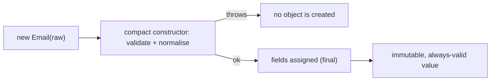

# 6.2 Records in Practice

> **Goal:** Use records (final in Java 16) as the default carrier for immutable data: DTOs, value objects, map keys and local tuples, with validation, copying, serialization and framework behaviour understood.

**Level:** the language mechanics, bytecode and edge cases of records are covered in depth in [Part 2, B.8 Records in Depth](../02-oop-deep-dive/B-all-class-types/08-records-in-depth.md). This chapter is the Java 17 **practice** view and does not repeat that chapter; read B.8 first if constructors or generated members are unfamiliar.
**Verified on:** OpenJDK 21.0.12. Outputs and compiler messages are real.

## Contents

1. [Sixty-second recap](#1-sixty-second-recap)
2. [What the compiler writes for you](#2-what-the-compiler-writes-for-you)
3. [Value objects: validation and normalisation](#3-value-objects-validation-and-normalisation)
4. [Copy-and-modify ("withers")](#4-copy-and-modify-withers)
5. [Shallow immutability and defensive copies](#5-shallow-immutability-and-defensive-copies)
6. [Records as keys, tuples and stream carriers](#6-records-as-keys-tuples-and-stream-carriers)
7. [Reflection, serialization and frameworks](#7-reflection-serialization-and-frameworks)
8. [Restrictions, with the real compiler errors](#8-restrictions-with-the-real-compiler-errors)
9. [When not to use a record](#9-when-not-to-use-a-record)
10. [Evolving a record safely](#10-evolving-a-record-safely)
11. [Common gotchas](#11-common-gotchas)
12. [Interview questions](#12-interview-questions)

---

## 1. Sixty-second recap

```text
record Point(int x, int y) { }
```

declares a **final** class extending `java.lang.Record` with: private final fields `x`, `y`; a canonical constructor; accessors `x()` and `y()`; and `equals`, `hashCode`, `toString` based on all components. Preview in 14 and 15, **final in 16**.

| Version | Record-related milestone |
|---|---|
| 14 | records (preview) |
| 15 | second preview, sealed types (preview) |
| 16 | records final; `instanceof` patterns final |
| 17 | sealed classes final |
| 21 | **record patterns** (deconstruction in `instanceof` and `switch`), Part 7 |

## 2. What the compiler writes for you

```java
import java.io.*;
import java.lang.reflect.RecordComponent;
import java.util.*;
import java.util.stream.*;

public class RecordsPractice {
    // value object with validation and normalisation in the compact constructor
    record Email(String value) implements Serializable {
        Email {
            Objects.requireNonNull(value, "email");
            value = value.strip().toLowerCase();
            if (!value.contains("@")) throw new IllegalArgumentException("not an email: " + value);
        }
        String domain() { return value.substring(value.indexOf('@') + 1); }
    }

    // "with-er" methods give copy-and-modify since records are immutable
    record User(int id, String name, Email email) implements Serializable {
        User withName(String newName) { return new User(id, newName, email); }
        static User of(int id, String name, String email) { return new User(id, name, new Email(email)); }
    }

    // defensive copy for mutable components: shallow immutability otherwise
    record Team(String name, List<String> members) {
        Team { members = List.copyOf(members); }
    }
    record LeakyTeam(String name, List<String> members) { }

    // generic record + interface + nested/local use
    record Pair<A, B>(A first, B second) {
        <C> Pair<A, C> withSecond(C c) { return new Pair<>(first, c); }
    }

    // records as composite map keys
    record Point(int x, int y) { }

    // a record can have static fields, static factories and extra constructors
    record Range(int lo, int hi) {
        static final Range EMPTY = new Range(0, 0);
        Range { if (lo > hi) throw new IllegalArgumentException("lo > hi: " + lo + " > " + hi); }
        Range(int single) { this(single, single); }
        int length() { return hi - lo; }
    }

    public static void main(String[] args) throws Exception {
        // 1. what you get for free
        User u = User.of(1, "Asha", "  ASHA@Example.COM ");
        System.out.println(u);
        System.out.println("equals: " + u.equals(User.of(1, "Asha", "asha@example.com")) + ", hash equal: "
                + (u.hashCode() == User.of(1, "Asha", "asha@example.com").hashCode()));
        System.out.println("accessor is name(), not getName(): " + u.name() + ", domain: " + u.email().domain());
        System.out.println("withName: " + u.withName("Asha K.") + " (original unchanged: " + u.name() + ")");

        // 2. validation runs on every construction path
        try { new Email("nope"); } catch (IllegalArgumentException e) { System.out.println("validation: " + e.getMessage()); }
        try { new Range(5, 1); } catch (IllegalArgumentException e) { System.out.println("validation: " + e.getMessage()); }
        System.out.println(new Range(4) + " length " + new Range(2, 9).length() + " " + Range.EMPTY);

        // 3. shallow immutability
        List<String> mutable = new ArrayList<>(List.of("a", "b"));
        LeakyTeam leaky = new LeakyTeam("t", mutable);
        Team safe = new Team("t", mutable);
        mutable.add("c");
        System.out.println("leaky sees later change: " + leaky.members() + ", defensive copy does not: " + safe.members());

        // 4. map keys, sets, streams
        Map<Point, String> grid = new HashMap<>();
        grid.put(new Point(1, 2), "treasure");
        System.out.println("record as key: " + grid.get(new Point(1, 2)));
        record Sale(String city, int amount) { }                       // local record: a tuple for a pipeline
        var sales = List.of(new Sale("Pune", 10), new Sale("Pune", 5), new Sale("Delhi", 7));
        System.out.println("totals: " + sales.stream().collect(Collectors.groupingBy(Sale::city, TreeMap::new, Collectors.summingInt(Sale::amount))));

        // 5. generics
        Pair<String, Integer> p = new Pair<>("x", 1);
        System.out.println(p + " -> " + p.withSecond(2.5));

        // 6. reflection: components are real metadata (frameworks use this)
        for (RecordComponent rc : User.class.getRecordComponents())
            System.out.println("component " + rc.getName() + " : " + rc.getType().getSimpleName() + " via " + rc.getAccessor().getName() + "()");
        System.out.println("isRecord: " + User.class.isRecord() + ", superclass: " + User.class.getSuperclass().getName());

        // 7. serialization: uses the canonical constructor on deserialization (validation runs again)
        // every component type must be Serializable as well, otherwise NotSerializableException
        ByteArrayOutputStream bos = new ByteArrayOutputStream();
        try (ObjectOutputStream out = new ObjectOutputStream(bos)) { out.writeObject(u); }
        try (ObjectInputStream in = new ObjectInputStream(new ByteArrayInputStream(bos.toByteArray()))) {
            System.out.println("deserialized equals original: " + u.equals(in.readObject()) + "");
        } catch (NotSerializableException e) {
            System.out.println("NotSerializableException: " + e.getMessage());
        }
    }
}

// ---- Output ----
// User[id=1, name=Asha, email=Email[value=asha@example.com]]
// equals: true, hash equal: true
// accessor is name(), not getName(): Asha, domain: example.com
// withName: User[id=1, name=Asha K., email=Email[value=asha@example.com]] (original unchanged: Asha)
// validation: not an email: nope
// validation: lo > hi: 5 > 1
// Range[lo=4, hi=4] length 7 Range[lo=0, hi=0]
// leaky sees later change: [a, b, c], defensive copy does not: [a, b]
// record as key: treasure
// totals: {Delhi=7, Pune=15}
// Pair[first=x, second=1] -> Pair[first=x, second=2.5]
// component id : int via id()
// component name : String via name()
// component email : Email via email()
// isRecord: true, superclass: java.lang.Record
// deserialized equals original: true
```

Read the output top to bottom:

1. `toString` prints `User[id=1, name=Asha, email=Email[value=asha@example.com]]`: nested records print recursively.
2. `equals`/`hashCode` are value-based: two separately built users with the same data are equal and hash alike.
3. Accessors are `name()`, not `getName()`: records break the JavaBean convention on purpose.
4. The reflection output shows records keep their components as real metadata (`getRecordComponents`), which is what serialization libraries use.

```text
 record User(int id, String name)            what the compiler produces
 +--------------------------------+          +--------------------------------------------+
 | components: id, name           |   --->   | final class User extends java.lang.Record  |
 +--------------------------------+          |   private final int id; String name;       |
                                             |   User(int id, String name)  [canonical]   |
                                             |   id()  name()  equals  hashCode  toString |
                                             +--------------------------------------------+
```

## 3. Value objects: validation and normalisation


A **compact constructor** runs before the fields are assigned, so you can validate and also *reassign the parameters* to normalise:

```text
record Email(String value) {
    Email {
        Objects.requireNonNull(value, "email");
        value = value.strip().toLowerCase();       // normalises the parameter, then the field is assigned
        if (!value.contains("@")) throw new IllegalArgumentException("not an email: " + value);
    }
}
```

The program shows `"  ASHA@Example.COM "` stored as `asha@example.com`, `new Email("nope")` rejected, and `new Range(5, 1)` rejected with `lo > hi: 5 > 1`. Since every construction path (including deserialization) goes through the canonical constructor, **an invariant written there holds for every instance that exists**.



Domain-modelling advice: wrap primitives that carry meaning (`Email`, `UserId`, `Money`) in tiny records. They document the API, prevent mixing arguments (`transfer(UserId, UserId)` cannot be called with the arguments swapped as raw `long`s of different meaning), and cost nothing at the API level.

## 4. Copy-and-modify ("withers")

Records are immutable, so "changing" means creating a new instance. Java 17 has no built-in `with` syntax; write small methods:

```text
User withName(String newName) { return new User(id, newName, email); }
```

The demo prints the changed copy while the original stays untouched. For records with many components, a nested `Builder` class or a static factory with defaults are common; a language-level "derived record creation" has been discussed in the Amber project but is not part of Java 21. Pair the pattern with the compact constructor so copies are validated too.

## 5. Shallow immutability and defensive copies

A record's fields are final, but if a component is a mutable object, the *contents* can still change. The demo mutates a list after creating both records:

| Record | After `mutable.add("c")` |
|---|---|
| `LeakyTeam(name, members)` | sees `[a, b, c]`: it kept the caller's list |
| `Team` with `members = List.copyOf(members)` in the compact constructor | still `[a, b]` |

Rules of thumb: copy mutable inputs in the constructor (`List.copyOf`, `Set.copyOf`, `Map.copyOf`, `clone()` for arrays, `Date` copy) and return immutable views from accessors. `List.copyOf` also rejects nulls and avoids a second copy when the list is already immutable (chapter 5.3).

## 6. Records as keys, tuples and stream carriers

| Use | Why a record fits |
|---|---|
| `Map` key / `Set` element | correct `equals` and `hashCode` for free (`Point` as grid key in the demo) |
| Multi-value return | `record MinMax(int min, int max)` instead of `int[]` or `Pair` |
| Stream intermediate | a **local record** declared inside the method (`Sale` in the demo) names the tuple that `map` produces, replacing `Map.Entry` and `Object[]` |
| `Comparator` keys | `Comparator.comparing(Sale::city).thenComparingInt(Sale::amount)` |
| Messages and events | immutable, easy to log, easy to compare in tests |

Local records are implicitly `static`, so they cannot capture local variables of the enclosing method; that is a feature (no hidden state).

## 7. Reflection, serialization and frameworks

**Reflection.** `Class.isRecord()` and `getRecordComponents()` expose names, types and accessors (shown in the output). Tools use them to build mappers without parameter-name tricks.

**Serialization.** A serializable record (`implements Serializable`) is written from its components and **read back by calling the canonical constructor**, so validation runs on deserialization too; `serialVersionUID` is not compared by default, and custom `readObject`/`writeObject` are ignored for records. Every component type must be serializable too: the first run of this demo failed with `NotSerializableException: RecordsPractice$Email` until `Email` also implemented `Serializable`. The final run prints `deserialized equals original: true`.

**Frameworks (general guidance, check the exact version you use).**

| Area | Typical status |
|---|---|
| JSON (Jackson, Gson, JSON-B) | current versions bind records through the canonical constructor and component names; older versions need upgrades |
| Spring | records work as `@ConfigurationProperties` and as request/response DTOs in recent versions |
| JPA/Hibernate **entities** | **not** supported as entities (entities need a no-arg constructor and mutable fields); records are fine for query projections and DTOs |
| Bean Validation | annotations on components propagate to fields, accessors and constructor parameters |
| Mockito | records are final: mock the collaborators, not the records |

## 8. Restrictions, with the real compiler errors

```java
public class RecErr {
    record A(int x) {
        int extra;                                   // no instance fields beyond the components
    }
}
```

Real `javac` output:

```text
s/p6/RecErr.java:3: error: field declaration must be static
        int extra;                                   // no instance fields beyond the components
            ^
  (consider replacing field with record component)
1 error
```

```java
public class RecErr2 {
    record B(int x) extends Object { }               // records cannot extend a class
}
```

Real `javac` output:

```text
s/p6/RecErr2.java:2: error: '{' expected
    record B(int x) extends Object { }               // records cannot extend a class
                   ^
1 error
```

```java
public class RecErr3 {
    record C(int x) {
        C(int x) { }                                 // canonical constructor must assign every field
    }
}
```

Real `javac` output:

```text
s/p6/RecErr3.java:3: error: variable x might not have been initialized
        C(int x) { }                                 // canonical constructor must assign every field
                   ^
1 error
```

```java
public class RecErr4 {
    record D(int x) {
        void setX(int v) { this.x = v; }             // component fields are final
    }
}
```

Real `javac` output:

```text
s/p6/RecErr4.java:3: error: cannot assign a value to final variable x
        void setX(int v) { this.x = v; }             // component fields are final
                               ^
1 error
```

| Restriction | Why |
|---|---|
| No instance fields other than components | the state *is* the components |
| Cannot extend a class | already extends `Record`; keeps the model simple |
| Implicitly `final`, cannot be abstract | a record is a transparent data carrier |
| Component fields are `final` | immutability |
| May implement interfaces, have static members, nested types, generics and extra constructors (which must call another constructor) | still a normal class otherwise |
| May declare instance methods | behaviour derived from the data (`Range.length()`) is welcome |

## 9. When not to use a record

| Situation | Better choice |
|---|---|
| JPA/Hibernate entity or anything needing mutation or a no-arg constructor | a class |
| Identity matters more than data (two equal accounts are still different accounts) | a class with `equals` on the id only |
| Many optional fields / large evolving shape | a class with a builder |
| Needs inheritance among data types | sealed interface of records (6.3) |
| Hides representation or needs invariants across mutable state | a class |

## 10. Evolving a record safely

Components are part of the public API: constructor, accessors, `toString`, serialized form.

| Change | Effect |
|---|---|
| Add a component | breaking: constructor signature changes. Keep the old signature as an extra constructor with a default |
| Remove or rename a component | breaking: accessor disappears, serialized form changes |
| Reorder components | breaking for constructor callers and positional deconstruction (record patterns in 21) |
| Add a static method or instance method | safe |
| Change validation to be stricter | behavioural break for callers that passed borderline values |

## 11. Common gotchas

| Gotcha | Why | Fix |
|---|---|---|
| Record "mutated" through a list component | shallow immutability | `List.copyOf` in the compact constructor |
| `getName()` not found | accessors are `name()` | use the record accessor |
| Array component compared with `equals` | arrays use identity | use `List`, or override `equals` |
| Compact constructor assigns `this.x = x` | not allowed there | assign to the parameter |
| `NotSerializableException` for a record | component type not serializable | make components serializable |
| Record used as JPA entity | needs no-arg constructor | class entity, record DTO |
| Overriding `toString` includes secrets | auto `toString` prints everything | override for passwords/tokens |
| Adding a component breaks callers | constructor changed | add a delegating constructor |
| Expecting `with` syntax | not in Java 17 or 21 | write withers or use a builder |

## 12. Interview questions

<details>
<summary><strong>Q1. What does the compiler generate for a record?</strong></summary>

A final class extending <code>java.lang.Record</code> with private final fields, a canonical constructor, accessor methods named after the components, and <code>equals</code>, <code>hashCode</code>, <code>toString</code> over all components.
</details>

<details>
<summary><strong>Q2. What is a compact constructor?</strong></summary>

A constructor without a parameter list inside a record. It runs before the field assignments, so it can validate and reassign the parameters; the compiler appends the field assignments.
</details>

<details>
<summary><strong>Q3. Are records deeply immutable?</strong></summary>

No. The fields are final, but a mutable component (list, array, date) can still be changed. Copy defensively in the compact constructor.
</details>

<details>
<summary><strong>Q4. Why are record accessors not called <code>getX()</code>?</strong></summary>

The design chose <code>x()</code> to match the component name; records are not JavaBeans. Frameworks adapted to the record API.
</details>

<details>
<summary><strong>Q5. How does serialization of a record differ from a normal class?</strong></summary>

It is based on the components and deserialization calls the canonical constructor; custom <code>readObject</code>/<code>writeObject</code> hooks are not used, and the usual serialVersionUID matching is not applied by default.
</details>

<details>
<summary><strong>Q6. Can a record extend a class or be extended?</strong></summary>

No: it already extends <code>Record</code> and is implicitly final. It can implement interfaces, including sealed ones.
</details>

<details>
<summary><strong>Q7. Can you declare extra instance fields in a record?</strong></summary>

No (compile error: field declaration must be static). Derived values should be methods; static fields are allowed.
</details>

<details>
<summary><strong>Q8. How do you "modify" a record?</strong></summary>

Create a new instance, usually via a wither method or builder. There is no in-place mutation.
</details>

<details>
<summary><strong>Q9. Record versus Lombok <code>@Value</code>?</strong></summary>

Records are language-level (no annotation processing), consistently supported by tools and the platform (reflection, serialization, patterns), but less configurable; Lombok offers builders, toString exclusions and similar knobs.
</details>

<details>
<summary><strong>Q10. Can a record be a JPA entity?</strong></summary>

No: entities need a no-arg constructor and mutable state. Use records for DTOs and projections.
</details>

<details>
<summary><strong>Q11. What is a local record and why is it useful?</strong></summary>

A record declared inside a method. It names an intermediate tuple in a stream pipeline without polluting the class; it is implicitly static and cannot capture locals.
</details>

---

[Previous: 6.1 Switch Expressions and Text Blocks](./01-switch-expressions-and-text-blocks.md) · [Part index](./README.md) · Next: [6.3 Sealed Classes](./03-sealed-classes.md)