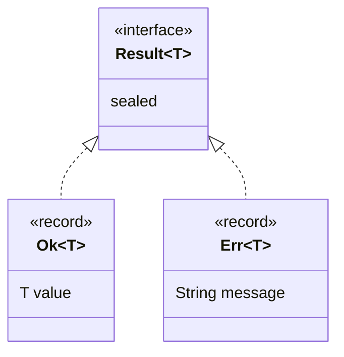

# 6.3 Sealed Classes and Interfaces

> **Goal:** Model "one of a fixed set of cases" in the type system with `sealed`, `permits`, `final` and `non-sealed`, so that the compiler (and, from Java 21, `switch`) knows every possibility.

**Level:** the syntax rules and the compiler errors are covered in [Part 2, B.9 Sealed Classes and Interfaces](../02-oop-deep-dive/B-all-class-types/09-sealed-classes-and-interfaces.md). This chapter shows the **modelling patterns**, runtime reflection and evolution rules for Java 17, and the Java 21 payoff.
**Verified on:** OpenJDK 21.0.12. Final in **17** (previews in 15 and 16). Compiler messages are real; the one example that needs Java 21 is labelled.

## Contents

1. [The idea in one picture](#1-the-idea-in-one-picture)
2. [Syntax in thirty seconds](#2-syntax-in-thirty-seconds)
3. [Pattern 1: algebraic data types with records](#3-pattern-1-algebraic-data-types-with-records)
4. [Pattern 2: a controlled class hierarchy](#4-pattern-2-a-controlled-class-hierarchy)
5. [Pattern 3: commands and enums together](#5-pattern-3-commands-and-enums-together)
6. [Reflection](#6-reflection)
7. [Exhaustive `switch` (Java 21)](#7-exhaustive-switch-java-21)
8. [Rules and the errors you will see](#8-rules-and-the-errors-you-will-see)
9. [Sealed, enum, final, abstract: choosing](#9-sealed-enum-final-abstract-choosing)
10. [Evolving a sealed hierarchy](#10-evolving-a-sealed-hierarchy)
11. [Common gotchas](#11-common-gotchas)
12. [Interview questions](#12-interview-questions)

---

## 1. The idea in one picture

Before sealed types a public interface or non-final class could be extended by **anyone**. You could not say "a `Shape` is a circle, a rectangle or a polygon, and nothing else". `sealed` lets the author list the subtypes, so everyone else (including the compiler) can rely on the list.

```text
 open hierarchy                         sealed hierarchy
   Shape                                  Shape  (sealed, permits Circle, Rect, Polygon)
  /  |  \  \                             /     |       \
 ?   ?   ?  anything, anywhere         Circle  Rect   Polygon
 (unknown subtypes)                     final   final   non-sealed
                                        closed set: the compiler knows all cases
```

| Closed vs open | Open (normal) | Sealed |
|---|---|---|
| Who may extend | anyone | only the permitted classes |
| Adding a subtype | free | requires editing the sealed type |
| Compiler knows all subtypes | no | yes (exhaustiveness checks) |
| Good for | extension points, plug-ins | domain models, ASTs, results, protocols |

## 2. Syntax in thirty seconds

```text
public sealed interface Shape permits Circle, Rect { }
public final class Circle implements Shape { }
public record Rect(double w, double h) implements Shape { }      // records are implicitly final
```

Every permitted subclass must declare exactly one of:

| Modifier | Meaning |
|---|---|
| `final` | no further subclasses (records and enums are implicitly final) |
| `sealed` | closed again, with its own `permits` list |
| `non-sealed` | the hierarchy is open again from here down |

If the subclasses are declared in the same source file, `permits` can be omitted and the compiler infers them.

## 3. Pattern 1: algebraic data types with records

A sealed interface plus records gives you a *sum type* ("either this or that"). `Result<T>` below is `Ok` or `Err`:

```java
import java.util.*;

public class SealedPractice {
    // 1. a closed algebraic data type: Result is either Ok or Err, nothing else
    sealed interface Result<T> permits Ok, Err { }
    record Ok<T>(T value) implements Result<T> { }
    record Err<T>(String message) implements Result<T> { }

    static Result<Integer> parse(String s) {
        try { return new Ok<>(Integer.parseInt(s)); }
        catch (NumberFormatException e) { return new Err<>("bad number: " + s); }
    }

    // Java 17 style: exhaustiveness is known to the compiler but not yet enforced in instanceof chains
    static String describe17(Result<Integer> r) {
        if (r instanceof Ok<Integer> ok) return "ok " + ok.value();
        else if (r instanceof Err<Integer> err) return "error " + err.message();
        throw new AssertionError("unreachable: Result is sealed");
    }

    // 2. a sealed class hierarchy with all three subclass modifiers
    sealed static abstract class Shape permits Circle, Rect, Polygon { abstract double area(); }
    static final class Circle extends Shape {
        final double r; Circle(double r) { this.r = r; }
        double area() { return Math.PI * r * r; }
    }
    static final class Rect extends Shape {
        final double w, h; Rect(double w, double h) { this.w = w; this.h = h; }
        double area() { return w * h; }
    }
    // non-sealed re-opens the hierarchy below this point
    static non-sealed class Polygon extends Shape {
        double area() { return 0; }
    }
    static class Triangle extends Polygon { }

    // 3. sealed interface + enum: enums are implicitly final so they can be permitted
    sealed interface Command permits Start, Stop, Mode { }
    record Start(String service) implements Command { }
    record Stop(String service) implements Command { }
    enum Mode implements Command { FAST, SAFE }

    public static void main(String[] args) {
        System.out.println(describe17(parse("42")) + " | " + describe17(parse("x")));

        Class<?> c = Result.class;
        System.out.println("Result.isSealed: " + c.isSealed() + ", permitted: "
                + Arrays.stream(c.getPermittedSubclasses()).map(Class::getSimpleName).toList());
        System.out.println("Shape permitted: " + Arrays.stream(Shape.class.getPermittedSubclasses()).map(Class::getSimpleName).sorted().toList());
        System.out.println("Circle final? " + java.lang.reflect.Modifier.isFinal(Circle.class.getModifiers())
                + ", Polygon sealed? " + Polygon.class.isSealed() + ", Triangle allowed under non-sealed Polygon: " + new Triangle().area());
        System.out.println("Command permitted: " + Arrays.stream(Command.class.getPermittedSubclasses()).map(Class::getSimpleName).sorted().toList());

        // 4. what exhaustiveness buys you (Java 21 pattern matching for switch, shown here because the sandbox runs 21)
        List<Command> cmds = List.of(new Start("db"), new Stop("web"), Mode.SAFE);
        for (Command cmd : cmds) {
            String out = switch (cmd) {                 // Java 21: no default needed, compiler checks all permitted types
                case Start s -> "starting " + s.service();
                case Stop s -> "stopping " + s.service();
                case Mode m -> "mode " + m;
            };
            System.out.println(out);
        }
    }
}

// ---- Output ----
// ok 42 | error bad number: x
// Result.isSealed: true, permitted: [Ok, Err]
// Shape permitted: [Circle, Polygon, Rect]
// Circle final? true, Polygon sealed? false, Triangle allowed under non-sealed Polygon: 0.0
// Command permitted: [Mode, Start, Stop]
// starting db
// stopping web
// mode SAFE
```

How to read the output:

1. `describe17` works in plain Java 17 with an `instanceof` chain. The trailing `throw` is the unavoidable "cannot happen" branch: in 17 the compiler cannot check that the chain is complete.
2. `isSealed` and `getPermittedSubclasses` expose the list at run time.
3. `Shape` permits `Circle` (final), `Rect` (final) and `Polygon` (non-sealed), and `Triangle extends Polygon` compiles because `non-sealed` reopened that branch.
4. `Command` mixes two records and an **enum** (`Mode`), since enums are implicitly final.
5. The last block uses a type-pattern `switch`, **Java 21 syntax** (it runs here because the sandbox is JDK 21). No `default` branch is needed: the compiler checks that `Start`, `Stop` and `Mode` cover all permitted types, and adding a fourth command makes this switch a compile error until it is handled.



Typical uses: results and errors without exceptions, parser ASTs (`Expr = Num | Add | Mul`), UI events, protocol messages, state machines (`State = Idle | Running | Failed`).

## 4. Pattern 2: a controlled class hierarchy

`Shape` uses `sealed static abstract class ... permits Circle, Rect, Polygon`. This is the same idea with classes: the abstract base keeps shared behaviour (`area()`), and the closed set protects it. `non-sealed Polygon` is a deliberate escape hatch ("shapes may be extended by anyone as polygons, but nothing else is open").

Design rule: prefer `final` leaves; use `non-sealed` only when extension below that point is part of the API.

## 5. Pattern 3: commands and enums together

An enum is a closed set of **instances**; a sealed interface is a closed set of **types**. When some cases carry data and others do not, mix them (`Command`: `Start(service)`, `Stop(service)` and enum `Mode`). That keeps constants as constants and data-carrying cases as records.

## 6. Reflection

| API | Result |
|---|---|
| `Class.isSealed()` | true for sealed classes and interfaces |
| `Class.getPermittedSubclasses()` | `Class<?>[]` of permitted subtypes (null if not sealed) |
| `Modifier.isFinal(c.getModifiers())` | a `final` leaf |
| `Class.isRecord()` / `isEnum()` | tell leaves apart |

At the bytecode level the class file carries a `PermittedSubclasses` attribute, and the **JVM itself** refuses to load a class that extends a sealed class without being listed, so reflection or bytecode generation cannot bypass the rule.

## 7. Exhaustive `switch` (Java 21)

Exhaustiveness is the main payoff, and it needs pattern matching for `switch` (final in 21, Part 7); in Java 17 it is only a preview. The same incomplete switch (a `Result` switch that forgot the `Err` case) compiled for both levels:

```text
$ bash p6/sealedswitch.sh
# javac --release 17
s/p6/SealedErr3.java:7: error: patterns in switch statements are not supported in -source 17
            case Ok o -> "ok";
                 ^
  (use -source 21 or higher to enable patterns in switch statements)
1 error

# javac --release 21
s/p6/SealedErr3.java:6: error: the switch expression does not cover all possible input values
        return switch (r) {
               ^
1 error
```

The second message is the point: the compiler knows the permitted subtypes and rejects the switch because one is missing. Fixing it means adding the `Err` case, and the same happens in every switch over `Result` when a new subtype is added.

## 8. Rules and the errors you will see

```java
public class SealedErr1 {
    sealed interface Animal permits Dog, Cat { }
    record Dog() implements Animal { }
    record Cat() implements Animal { }
    record Cow() implements Animal { }                 // not in the permits list
    static class Bird implements Animal { }            // not permitted either
}
```

Real `javac` output:

```text
s/p6/SealedErr1.java:5: error: class is not allowed to extend sealed class: Animal (as it is not listed in its 'permits' clause)
    record Cow() implements Animal { }                 // not in the permits list
    ^
s/p6/SealedErr1.java:6: error: class is not allowed to extend sealed class: Animal (as it is not listed in its 'permits' clause)
    static class Bird implements Animal { }            // not permitted either
           ^
2 errors
```

```java
public class SealedErr2 {
    sealed interface Shape permits Square { }
    static class Square implements Shape { }           // must be final, sealed or non-sealed
}
```

Real `javac` output:

```text
s/p6/SealedErr2.java:3: error: sealed, non-sealed or final modifiers expected
    static class Square implements Shape { }           // must be final, sealed or non-sealed
           ^
1 error
```

| Rule | Detail |
|---|---|
| Subclasses must be in the same **module**, or, when there are no modules, the same **package** as the sealed type | they cannot live in an unrelated JAR |
| Each permitted class must directly extend/implement the sealed type | no skipping levels |
| Every permitted class needs `final`, `sealed` or `non-sealed` | else `sealed, non-sealed or final modifiers expected` |
| A sealed class may be `abstract` | and a sealed interface is implicitly abstract |
| `permits` may be omitted if all subclasses are in the same compilation unit | inferred |
| Anonymous classes and lambdas cannot implement a sealed interface | they cannot be named in `permits` |

## 9. Sealed, enum, final, abstract: choosing

| Need | Use |
|---|---|
| A fixed set of **constants** (no per-case state beyond fields) | `enum` |
| A fixed set of **kinds** with different data | `sealed interface` + records |
| A closed class tree with shared implementation | `sealed abstract class` |
| No extension at all | `final` |
| Open extension point | plain interface / abstract class |
| Library API that others implement | **not** sealed |

## 10. Evolving a sealed hierarchy

| Change | Effect on users |
|---|---|
| Add a permitted subtype | source break for every exhaustive `switch` over the type (this is intended: the compiler lists what to update) |
| Remove a permitted subtype | binary and source break |
| Change `final` leaf to `non-sealed` | open hierarchy, exhaustive checks still pass but behaviour for unknown subtypes must be considered |
| Move a subtype to another package/module | allowed only within the same module/package rule |

Publishing a sealed type in a library is a promise that you control the cases. If clients should add their own cases, do not seal it.

## 11. Common gotchas

| Gotcha | Why | Fix |
|---|---|---|
| `class is not allowed to extend sealed class` | not in the `permits` list | add it, or remove the subclass |
| `sealed, non-sealed or final modifiers expected` | permitted subclass lacks a modifier | add one |
| Subclass in another module rejected | same-module/package rule | move it |
| `switch` over a sealed type still needs `default` on Java 17 | patterns in switch arrive in 21 | upgrade, or use an `instanceof` chain |
| Mocking a sealed interface fails | cannot create a non-permitted subclass | test with real permitted types |
| Lambda for a sealed functional interface | not allowed | use a class or record |
| Adding a case breaks many switches | intended, exhaustiveness | handle each, or provide a default for open-ended logic |
| Using sealed for a public SPI | clients cannot implement it | leave it open |

## 12. Interview questions

<details>
<summary><strong>Q1. What problem do sealed classes solve?</strong></summary>

They let an author restrict which classes may extend a type, giving a closed set of subtypes that the compiler (and exhaustive <code>switch</code>) can reason about.
</details>

<details>
<summary><strong>Q2. What must a permitted subclass declare?</strong></summary>

Exactly one of <code>final</code>, <code>sealed</code> or <code>non-sealed</code> (records and enums are implicitly final).
</details>

<details>
<summary><strong>Q3. What does <code>non-sealed</code> do?</strong></summary>

It reopens the hierarchy below that class, so anyone may extend it.
</details>

<details>
<summary><strong>Q4. Where may permitted subclasses live?</strong></summary>

In the same module as the sealed type, or in the same package when the code is not in a named module. If all are in the same source file, <code>permits</code> may be omitted.
</details>

<details>
<summary><strong>Q5. How do sealed types and records combine?</strong></summary>

A sealed interface with record implementations models an algebraic data type: a value is exactly one of a fixed set of data-carrying cases.
</details>

<details>
<summary><strong>Q6. Why does <code>switch</code> not need <code>default</code> over a sealed type?</strong></summary>

Since Java 21 the compiler checks that the cases cover all permitted subtypes. Adding a new permitted subtype turns every incomplete switch into a compile error.
</details>

<details>
<summary><strong>Q7. Sealed versus enum?</strong></summary>

An enum is a closed set of instances of one type. A sealed hierarchy is a closed set of types, each of which can have its own fields and many instances.
</details>

<details>
<summary><strong>Q8. How can you see the permitted subclasses at run time?</strong></summary>

<code>Class.isSealed()</code> and <code>Class.getPermittedSubclasses()</code>.
</details>

<details>
<summary><strong>Q9. Can the JVM enforce sealing, or only the compiler?</strong></summary>

Both: the class file has a <code>PermittedSubclasses</code> attribute and the JVM throws <code>IncompatibleClassChangeError</code> if a non-permitted class tries to extend the sealed type.
</details>

<details>
<summary><strong>Q10. Is adding a permitted subclass a breaking change?</strong></summary>

For clients with exhaustive switches over the type, yes at source level, which is deliberate. For code that treats the type as open it is harmless.
</details>

<details>
<summary><strong>Q11. Can a lambda or anonymous class implement a sealed interface?</strong></summary>

No: neither can be listed as a permitted subtype.
</details>

---

[Previous: 6.2 Records in Practice](./02-records.md) · [Part index](./README.md) · Next: [6.4 Pattern Matching for instanceof](./04-pattern-matching-instanceof.md)