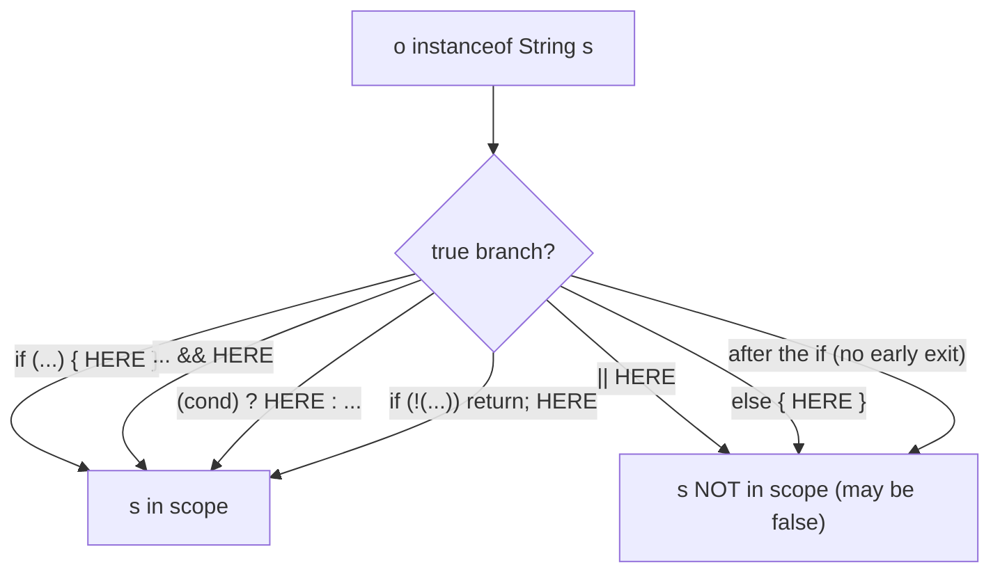

# 6.4 Pattern Matching for `instanceof`

> **Goal:** Replace the test-cast-assign ritual with `if (o instanceof String s)`, understand exactly where the binding variable is in scope (flow scoping), and see how it leads to the pattern features of Java 21.

**Level:** small feature, big readability win, with scope rules that are asked about in interviews.
**Verified on:** OpenJDK 21.0.12. Preview in 14 and 15, **final in 16**. Compiler messages are real; where behaviour differs between 17 and 21 the example is compiled with `--release 17` and `--release 21`.

## Contents

1. [The ritual it replaces](#1-the-ritual-it-replaces)
2. [Syntax and meaning](#2-syntax-and-meaning)
3. [Flow scoping: where the binding lives](#3-flow-scoping-where-the-binding-lives)
4. [Idioms: `equals`, chains, guards](#4-idioms-equals-chains-guards)
5. [What does not work, with the compiler's words](#5-what-does-not-work-with-the-compilers-words)
6. [Generics, `final` and null](#6-generics-final-and-null)
7. [How it is compiled](#7-how-it-is-compiled)
8. [The road to Java 21](#8-the-road-to-java-21)
9. [Common gotchas](#9-common-gotchas)
10. [Interview questions](#10-interview-questions)

---

## 1. The ritual it replaces

```text
if (o instanceof String) {            // 1. test the type
    String s = (String) o;            // 2. cast (repeating the type)
    use(s);                           // 3. use it
}
```

Three steps, with the type written twice and a cast that cannot fail but must still be written. Cast-after-test is among the most repeated boilerplate in Java code, and a copy-paste slip (testing one type, casting to another) is a `ClassCastException` waiting to happen.

## 2. Syntax and meaning

```text
if (o instanceof String s) {          // test AND declare s, definitely assigned when true
    use(s);
}
```

`o instanceof String s` is a boolean expression: true when `o` is a non-null `String`, in which case the **pattern variable** `s` is bound to `o` with the narrowed type. If `o` is `null` the result is `false`, never an exception.

```java
import java.util.*;

public class PatternInstanceof {
    // 1. before: test, cast, bind
    static int lenOld(Object o) {
        if (o instanceof String) {
            String s = (String) o;
            return s.length();
        }
        return -1;
    }

    // 2. after: test + bind in one step
    static int lenNew(Object o) {
        if (o instanceof String s) return s.length();
        return -1;
    }

    // 3. && extends the scope of the binding to the right-hand side
    static boolean longString(Object o) {
        return o instanceof String s && s.length() > 5;
    }

    // 4. flow scoping: binding is in scope AFTER an early exit when the test is negated
    static String firstChar(Object o) {
        if (!(o instanceof String s)) {
            return "not a string";
        }
        return "first char: " + s.charAt(0);     // s is definitely assigned here
    }

    // 5. the classic: equals()
    record Point(int x, int y) {
        @Override public boolean equals(Object o) {
            return o instanceof Point p && x == p.x && y == p.y;
        }
        @Override public int hashCode() { return Objects.hash(x, y); }
    }

    // 6. a chain replaces cast ladders
    static String describe(Object o) {
        if (o instanceof Integer i && i > 100) return "big int " + i;
        else if (o instanceof Integer i) return "int " + i;
        else if (o instanceof String s && !s.isEmpty()) return "string of " + s.length();
        else if (o instanceof List<?> l) return "list of " + l.size();
        else if (o == null) return "null";
        else return "other " + o.getClass().getSimpleName();
    }

    public static void main(String[] args) {
        System.out.println(lenOld("abc") + " " + lenNew("abcd") + " " + lenNew(42));
        System.out.println(longString("abcdef") + " " + longString("ab") + " " + longString(7));
        System.out.println(firstChar("zed") + " | " + firstChar(3));
        System.out.println(new Point(1, 2).equals(new Point(1, 2)) + " " + new Point(1, 2).equals("x") + " " + new Point(1, 2).equals(null));
        for (Object o : new Object[]{500, 7, "hello", "", List.of(1, 2), null, 2.5})
            System.out.println(describe(o));
        System.out.println("instanceof with null is false, never throws: " + (null instanceof String));
    }
}

// ---- Output ----
// 3 4 -1
// true false false
// first char: z | not a string
// true false false
// big int 500
// int 7
// string of 5
// other String
// list of 2
// null
// other Double
// instanceof with null is false, never throws: false
```

Walk through the output:

1. `lenOld`/`lenNew` return the same values; the new one has no cast.
2. `longString` uses `&&`: `s` is usable to the right, because that code only runs when the match succeeded.
3. `firstChar` shows the **negated early exit**: after `if (!(o instanceof String s)) return ...;` the variable `s` is in scope for the rest of the method.
4. The `equals` implementation on `Point` is the classic use: `o instanceof Point p && x == p.x && y == p.y` handles null, type check and cast in one expression.
5. `describe` is a cast ladder turned into a readable chain; note `i` is reused in two branches because each binding is scoped to its own `if`.
6. A `null` operand is simply `false`.

## 3. Flow scoping: where the binding lives

The binding variable is in scope **exactly where the compiler can prove the match succeeded**. That is the rule behind every example above.



| Expression | `s` in scope? |
|---|---|
| `if (o instanceof String s) { s... }` | yes, inside the block |
| `o instanceof String s && s.length() > 2` | yes, right of `&&` |
| `!(o instanceof String s) \|\| s.isEmpty()` | yes, right of `\|\|` (the left being false means the match succeeded) |
| `o instanceof String s \|\| s.isEmpty()` | **no** |
| `if (!(o instanceof String s)) { return; } s...` | yes, after the statement |
| `while (!(o instanceof String s)) { ... } s...` | yes, after the loop |
| `else` branch of a positive test | no |

The scope follows the *logic*, not the braces. Two bindings with the same name may coexist in one method as long as their scopes do not overlap (`describe` reuses `i`), but a pattern variable cannot shadow a local variable or parameter that is already in scope.

## 4. Idioms: `equals`, chains, guards

| Idiom | Example | Benefit |
|---|---|---|
| `equals` | `return o instanceof Point p && x == p.x && y == p.y;` | null-safe, no cast |
| Early return | `if (!(o instanceof Foo f)) return false;` | flat code, `f` usable below |
| Chain of types | `if (o instanceof A a) ... else if (o instanceof B b) ...` | replaces cast ladders |
| Guard in the same condition | `o instanceof Integer i && i > 100` | type and value test together |
| Stream filtering | `.filter(x -> x instanceof String s && s.length() > 3)` | binding works inside lambdas |

Keep conditions short. When the chain grows beyond three or four types, the Java 21 `switch` over a sealed type (6.3) reads better and is exhaustive.

## 5. What does not work, with the compiler's words

```text
$ bash p6/pat.sh
# scope errors (any release since 16)
s/p6/PatErr1.java:3: error: cannot find symbol
        if (o instanceof String s || s.length() > 2) { }       // s not definitely matched on the right of ||
                                     ^
  symbol:   variable s
  location: class PatErr1
s/p6/PatErr1.java:5: error: cannot find symbol
        System.out.println(s);                                 // s is out of scope here
                           ^
  symbol:   variable s
  location: class PatErr1
2 errors

# --release 17: a pattern whose type is a supertype of the expression type is rejected
s/p6/PatErr2.java:3: error: unconditional patterns in instanceof are not supported in -source 17
        if (i instanceof Number n) { }          // pattern type is a supertype of the expression type
              ^
  (use -source 21 or higher to enable unconditional patterns in instanceof)
1 error

# --release 21: the same code compiles (rule relaxed in 21)
(compiles with no output)
```

- **`cannot find symbol` (twice).** The binding was used where the compiler cannot prove the match: right of `||` and after an `if` without an early exit. Pattern variables are not "maybe assigned"; they are simply not in scope there.
- **`unconditional patterns in instanceof are not supported in -source 17`.** In Java 16 and 17, `i instanceof Number n` with `i` already an `Integer` was an error (the test is always true for non-null values). Java 21 relaxed this rule, which also makes generated or refactored code easier. The last block shows the same code accepted by `--release 21`.

## 6. Generics, `final` and null

| Topic | Rule |
|---|---|
| Generics | the pattern type must be **reifiable-safe**: `o instanceof List<?> l` is fine; `o instanceof List<String> l` is only allowed when the cast is checked (not an unchecked cast), e.g. when `o` is statically a `Collection<String>` |
| `final` | `o instanceof final String s` makes the binding final; by default it is assignable (do not reassign) |
| `null` | never matches; no NPE |
| Primitive types | not allowed in 17 or 21 patterns (`o instanceof int i` is an error; primitive patterns are a preview in later releases) |
| Side effects | the left operand is evaluated once |

## 7. How it is compiled

`javac` desugars the pattern into the same instructions you would write by hand: an `instanceof` check, a `checkcast`, and a store into a synthetic local variable. There is no runtime cost or new bytecode kind, so performance is identical to the manual version. (The `switch` patterns of Java 21 are different: they use `invokedynamic` and a bootstrap method.)

## 8. The road to Java 21

| Release | What changed for patterns |
|---|---|
| 14, 15 | `instanceof` patterns (preview) |
| **16** | `instanceof` patterns **final** |
| 17 | pattern matching for `switch` (first preview) |
| 19, 20 | record patterns (preview); switch patterns (more previews) |
| **21** | switch patterns **final**, record patterns **final**, unconditional `instanceof` patterns allowed |
| 22+ | unnamed patterns `_`, primitive patterns (preview) |

```text
 Java 17:  if (shape instanceof Circle c) { ... } else if (shape instanceof Rect r) { ... }
 Java 21:  switch (shape) { case Circle c -> ...; case Rect r -> ...; }          // exhaustive when sealed
           if (shape instanceof Rect(double w, double h)) { ... }                 // record deconstruction
```

Part 7 develops both Java 21 forms; everything you learned about **binding and scope** here carries over unchanged.

## 9. Common gotchas

| Gotcha | Why | Fix |
|---|---|---|
| Using `s` after the `if` | out of scope | early-exit form `if (!(o instanceof T s)) return;` |
| `||` with the binding on the right | match not proven | restructure with `&&` or negation |
| Pattern name clashes with a local | no shadowing | rename |
| `instanceof` on a type already known (Java 17) | unconditional pattern rejected | drop the test, or use Java 21 |
| Expecting `o instanceof List<String> l` to compile | unchecked cast | `List<?>` and cast elements as needed |
| Long `else if` chains | readability | switch over a sealed type (21) |
| Binding reassigned inside the block | allowed unless `final` | treat as read-only |
| Mutating `s` expecting `o` to change | it is a reference copy | no effect on `o` |

## 10. Interview questions

<details>
<summary><strong>Q1. What is pattern matching for <code>instanceof</code>?</strong></summary>

A type test combined with a declaration of a typed variable: <code>if (o instanceof String s)</code> tests, casts and binds in one step. Final in Java 16.
</details>

<details>
<summary><strong>Q2. What happens if the operand is <code>null</code>?</strong></summary>

The test is <code>false</code> and the binding is not assigned; there is no exception.
</details>

<details>
<summary><strong>Q3. Where is the pattern variable in scope?</strong></summary>

Wherever the compiler can prove the match succeeded: inside the true branch, to the right of <code>&&</code>, in the true branch of <code>?:</code>, and after a statement such as <code>if (!(o instanceof T t)) return;</code>.
</details>

<details>
<summary><strong>Q4. Why does <code>o instanceof String s || s.isEmpty()</code> not compile?</strong></summary>

When the left side is false the match failed, so <code>s</code> would not be assigned. The variable is not in scope on the right of <code>||</code>.
</details>

<details>
<summary><strong>Q5. How does it simplify <code>equals</code>?</strong></summary>

<code>return o instanceof Point p &amp;&amp; x == p.x &amp;&amp; y == p.y;</code> handles null, type check, and cast in one line.
</details>

<details>
<summary><strong>Q6. Is there a runtime performance difference?</strong></summary>

No: the compiler generates the same <code>instanceof</code> + <code>checkcast</code> sequence as hand-written code.
</details>

<details>
<summary><strong>Q7. Can the binding variable be reassigned?</strong></summary>

Yes unless declared <code>final</code>, but it is a copy of the reference; reassigning it does not change the original variable.
</details>

<details>
<summary><strong>Q8. Can you use generic patterns like <code>List&lt;String&gt; l</code>?</strong></summary>

Only when the cast is checked, that is, when the static type of the operand already guarantees the type arguments; otherwise use <code>List&lt;?&gt;</code>.
</details>

<details>
<summary><strong>Q9. What changed for <code>instanceof</code> patterns between 17 and 21?</strong></summary>

Java 21 allows unconditional patterns (pattern type is a supertype of the expression type), adds record patterns (<code>o instanceof Point(int x, int y)</code>) and the <code>switch</code> forms.
</details>

<details>
<summary><strong>Q10. How do sealed types and patterns work together?</strong></summary>

A sealed hierarchy gives the compiler the complete list of subtypes; a pattern <code>switch</code> over it can be checked for exhaustiveness without <code>default</code> (Java 21).
</details>

---

[Previous: 6.3 Sealed Classes](./03-sealed-classes.md) · [Part index](./README.md) · Next: [6.5 API Additions 12 to 17](./05-api-additions-12-17.md)