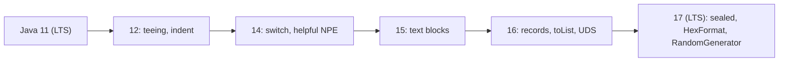

# 6.5 API Additions in Java 12 to 17

> **Goal:** Know the library additions between Java 11 and 17 that change everyday code: `Stream.toList`, `mapMulti`, `teeing`, string helpers, compact number formatting, `HexFormat`, the new `RandomGenerator` family, Unix-domain sockets and more.

**Level:** reference with proofs. Each row says which release introduced the API.
**Verified on:** OpenJDK 21.0.12. All output is real. Language features of these releases are in chapters 6.1 to 6.4; JVM changes are in 6.6.

## Contents

1. [Release-by-release map](#1-release-by-release-map)
2. [Strings and text](#2-strings-and-text)
3. [Streams and collectors](#3-streams-and-collectors)
4. [Files, I/O and numbers](#4-files-io-and-numbers)
5. [Date and time](#5-date-and-time)
6. [Random numbers (Java 17)](#6-random-numbers-java-17)
7. [Hex, bytes and misc](#7-hex-bytes-and-misc)
8. [Unix-domain sockets (Java 16)](#8-unix-domain-sockets-java-16)
9. [Other additions worth knowing](#9-other-additions-worth-knowing)
10. [Common gotchas](#10-common-gotchas)
11. [Interview questions](#11-interview-questions)

---

## 1. Release-by-release map

| Release | API / platform additions |
|---|---|
| **12** | `Collectors.teeing`, `String.indent` / `transform`, `Files.mismatch`, `CompactNumberFormat`, `InputStream.skipNBytes`, default CDS archive |
| 13 | text blocks (preview), small `ByteBuffer` additions, socket implementation rewrite |
| **14** | switch expressions final, helpful `NullPointerException` messages, JFR event streaming, records (preview) |
| **15** | text blocks final, `String.formatted` / `stripIndent` / `translateEscapes`, `CharSequence.isEmpty`, hidden classes, `Math.absExact`, sealed (preview) |
| **16** | `Stream.toList`, `Stream.mapMulti`, `instanceof` patterns final, records final, Unix-domain sockets, day-period pattern `B`, strong encapsulation by default, `jpackage` final, vector API (incubator), foreign linker (incubator) |
| **17** | sealed final, `HexFormat`, `RandomGenerator` and `java.util.random`, deserialization filter factories, always-strict floating point, macOS/AArch64 port, security manager deprecated for removal |



## 2. Strings and text

```java
import java.nio.file.*;
import java.text.NumberFormat;
import java.time.*;
import java.time.format.DateTimeFormatter;
import java.util.*;
import java.util.random.*;
import java.util.stream.*;

public class Api12to17 {
    public static void main(String[] args) throws Exception {
        // ---- Strings (12, 15) ----
        System.out.println("indent(4): [" + "a\nb".indent(4).replace("\n", "|") + "]   indent(-2) on '    x': [" + "    x".indent(-2).replace("\n", "|") + "]");
        System.out.println("transform: " + "  title ".transform(String::strip).transform(String::toUpperCase));
        System.out.println("formatted: " + "%s is %d".formatted("age", 31));
        System.out.println("CharSequence.isEmpty (15): " + new StringBuilder().isEmpty());

        // ---- Collectors.teeing (12) ----
        System.out.println("teeing: " + Stream.of(3, 9, 4).collect(Collectors.teeing(
                Collectors.counting(), Collectors.summingInt(i -> i), (n, sum) -> "n=" + n + " sum=" + sum)));

        // ---- Stream.toList, mapMulti (16) ----
        List<Integer> unmod = Stream.of(1, 2, 3).toList();
        try { unmod.add(4); } catch (UnsupportedOperationException e) { System.out.println("Stream.toList() is unmodifiable"); }
        System.out.println("mapMulti: " + Stream.of(1, 2, 3).<Integer>mapMulti((n, sink) -> { for (int i = 0; i < n; i++) sink.accept(n); }).toList());

        // ---- Files.mismatch (12) ----
        Path a = Files.createTempFile("a", ".txt"), b = Files.createTempFile("b", ".txt");
        Files.writeString(a, "hello world");
        Files.writeString(b, "hello there");
        System.out.println("Files.mismatch: " + Files.mismatch(a, b) + " (first differing byte), identical files: " + Files.mismatch(a, a));
        Files.delete(a); Files.delete(b);

        // ---- Compact number format (12) ----
        NumberFormat shortFmt = NumberFormat.getCompactNumberInstance(Locale.US, NumberFormat.Style.SHORT);
        NumberFormat longFmt = NumberFormat.getCompactNumberInstance(Locale.US, NumberFormat.Style.LONG);
        System.out.println("compact: " + shortFmt.format(1_250_000) + " / " + longFmt.format(1_250_000) + " / " + shortFmt.format(3_400));

        // ---- Day periods (16) ----
        DateTimeFormatter dp = DateTimeFormatter.ofPattern("h B", Locale.US);
        System.out.println("day period: " + LocalTime.of(8, 0).format(dp) + " | " + LocalTime.of(15, 0).format(dp) + " | " + LocalTime.of(22, 0).format(dp));

        // ---- InputStream.skipNBytes (12) ----
        var in = new java.io.ByteArrayInputStream("0123456789".getBytes());
        in.skipNBytes(4);
        System.out.println("skipNBytes then read: " + (char) in.read());

        // ---- HexFormat (17) ----
        HexFormat hf = HexFormat.of();
        byte[] bytes = {(byte) 0xCA, (byte) 0xFE, 0x01};
        System.out.println("HexFormat: " + hf.formatHex(bytes) + " / " + HexFormat.ofDelimiter(":").withUpperCase().formatHex(bytes) + " / parse -> " + Arrays.toString(hf.parseHex("0aff")));

        // ---- RandomGenerator (17): seedable, algorithm chosen by name ----
        RandomGenerator g = RandomGeneratorFactory.of("L64X128MixRandom").create(42L);
        RandomGenerator g2 = RandomGeneratorFactory.of("L64X128MixRandom").create(42L);
        System.out.println("same seed, same sequence: " + (g.nextInt(1000) == g2.nextInt(1000)) + ", in range: " + (g.nextInt(5, 10) >= 5));
        System.out.println("java.util.Random implements RandomGenerator: " + (new Random() instanceof RandomGenerator));

        // ---- Math (15, 18) ----
        try { Math.absExact(Integer.MIN_VALUE); } catch (ArithmeticException e) { System.out.println("Math.absExact(MIN_VALUE): " + e.getMessage()); }

    }
}

// ---- Output ----
// indent(4): [    a|    b|]   indent(-2) on '    x': [  x|]
// transform: TITLE
// formatted: age is 31
// CharSequence.isEmpty (15): true
// teeing: n=3 sum=16
// Stream.toList() is unmodifiable
// mapMulti: [1, 2, 2, 3, 3, 3]
// Files.mismatch: 6 (first differing byte), identical files: -1
// compact: 1M / 1 million / 3K
// day period: 8 in the morning | 3 in the afternoon | 10 at night
// skipNBytes then read: 4
// HexFormat: cafe01 / CA:FE:01 / parse -> [10, -1]
// same seed, same sequence: true, in range: true
// java.util.Random implements RandomGenerator: true
// Math.absExact(MIN_VALUE): Overflow to represent absolute value of Integer.MIN_VALUE
```

| API | Since | Notes |
|---|---|---|
| `String.indent(n)` | 12 | adds or removes `n` spaces on every line; **normalises line endings and appends a final `\n`**, as the first output line shows (`[    a\|    b\|]`) |
| `String.transform(Function)` | 12 | pipe a string through functions without temporaries (`strip` then `toUpperCase`) |
| `String.formatted(Object...)` | 15 | instance version of `String.format`, pairs well with text blocks |
| `String.stripIndent()` / `translateEscapes()` | 15 | the text-block algorithms exposed as methods (6.1) |
| `CharSequence.isEmpty()` | 15 | on `StringBuilder`, `CharBuffer` and others |
| `NumberFormat.getCompactNumberInstance` | 12 | locale-aware "1M" / "1 million" / "3K" (rounds to an integer by default: `1_250_000` printed as `1M`; set `setMaximumFractionDigits` for more) |

```text
 teeing:   stream --+--> collector 1 (count) --+
                    |                          +--> merger(n, sum) --> one result, one pass
                    +--> collector 2 (sum)  ---+
 mapMulti: element --> (element, sink) --> sink.accept(x) 0..n times --> flattened stream
```

## 3. Streams and collectors


| API | Since | Meaning | Output above |
|---|---|---|---|
| `Collectors.teeing(c1, c2, merger)` | 12 | two collectors over one pass | `n=3 sum=16` |
| `Stream.toList()` | 16 | unmodifiable list, **allows nulls**, no `Collectors` import | `unmodifiable` message |
| `Stream.mapMulti(BiConsumer)` | 16 | emit zero, one or many outputs per input without creating a sub-stream | `[1, 2, 2, 3, 3, 3]` |

`Stream.toList()` versus `Collectors.toList()`: the old collector returns an `ArrayList` whose type is *unspecified* (mutable today), while `toList()` guarantees an unmodifiable result, but it differs from `List.copyOf` and `toUnmodifiableList()` in accepting `null` elements. Full treatment in Part 4 (4.4 and 4.5).

## 4. Files, I/O and numbers

| API | Since | Meaning |
|---|---|---|
| `Files.mismatch(a, b)` | 12 | index of the first differing byte, `-1` if identical (`6` for `hello world` vs `hello there`) |
| `InputStream.skipNBytes(n)` | 12 | skips exactly `n` bytes or throws `EOFException`; `skip` may skip fewer |
| `Math.absExact`, `negateExact` | 15 | throws on `Integer.MIN_VALUE` instead of returning a negative number (`Overflow to represent absolute value...`) |
| `Math.fma`, `multiplyHigh` | 9 | covered in chapter 5.3 |
| `NumberFormat` compact styles | 12 | see section 2 |

## 5. Date and time

The pattern letter `B` formats the *day period* in natural language:

| Pattern `h B` | Output |
|---|---|
| 08:00 | `8 in the morning` |
| 15:00 | `3 in the afternoon` |
| 22:00 | `10 at night` |

Also new, in Java 17: `java.time.InstantSource`, a small interface (implemented by `Clock`) that only provides `instant()`; inject it where code needs "now" but not time zones.

## 6. Random numbers (Java 17)

JEP 356 introduced `java.util.random.RandomGenerator`, an interface that `Random`, `ThreadLocalRandom`, `SecureRandom` and `SplittableRandom` now implement, plus a factory that selects algorithms **by name**:

| Piece | Purpose |
|---|---|
| `RandomGenerator` | common interface: `nextInt(bound)`, `nextInt(origin, bound)`, `ints()`, `nextGaussian()`... |
| `RandomGeneratorFactory.of("L64X128MixRandom")` | choose a modern, statistically stronger algorithm |
| `RandomGeneratorFactory.all()` | list the algorithms available |
| `SplittableGenerator`, `JumpableGenerator` | derive independent streams for parallel work |

The demo creates two generators with the same seed and gets the same first value (`true`), shows the range form `nextInt(5, 10)` and confirms `java.util.Random` is a `RandomGenerator`. Guidance: for new code that only needs good random numbers, depend on the `RandomGenerator` interface and pick `L64X128MixRandom` (or the default `RandomGenerator.getDefault()`); for security-sensitive values keep using `SecureRandom`.

## 7. Hex, bytes and misc

`HexFormat` (17) replaces hand-written hex loops and `String.format("%02x")`:

| Call | Output above |
|---|---|
| `HexFormat.of().formatHex(bytes)` | `cafe01` |
| `HexFormat.ofDelimiter(":").withUpperCase().formatHex(bytes)` | `CA:FE:01` |
| `HexFormat.of().parseHex("0aff")` | `[10, -1]` (bytes are signed) |

It also formats single bytes and chars (`toHexDigits`), parses with prefixes/suffixes and validates input.

## 8. Unix-domain sockets (Java 16)

Local inter-process communication through a filesystem path instead of a TCP port: no port allocation, protected by file permissions, and faster than loopback TCP. The same NIO channel API, with `StandardProtocolFamily.UNIX` and `UnixDomainSocketAddress`:

```java
import java.net.*;
import java.nio.ByteBuffer;
import java.nio.channels.*;
import java.nio.charset.StandardCharsets;
import java.nio.file.*;

public class UnixSock {
    public static void main(String[] args) throws Exception {
        Path sock = Files.createTempDirectory("uds").resolve("demo.sock");
        UnixDomainSocketAddress addr = UnixDomainSocketAddress.of(sock);

        try (ServerSocketChannel server = ServerSocketChannel.open(StandardProtocolFamily.UNIX)) {
            server.bind(addr);
            Thread t = new Thread(() -> {
                try (SocketChannel c = server.accept()) {
                    ByteBuffer buf = ByteBuffer.allocate(64);
                    c.read(buf);
                    buf.flip();
                    String msg = StandardCharsets.UTF_8.decode(buf).toString();
                    c.write(StandardCharsets.UTF_8.encode("echo:" + msg));
                } catch (Exception e) { e.printStackTrace(); }
            });
            t.start();
            try (SocketChannel client = SocketChannel.open(StandardProtocolFamily.UNIX)) {
                client.connect(addr);
                client.write(StandardCharsets.UTF_8.encode("ping"));
                ByteBuffer reply = ByteBuffer.allocate(64);
                client.read(reply);
                reply.flip();
                System.out.println("client got: " + StandardCharsets.UTF_8.decode(reply));
            }
            t.join();
        }
        System.out.println("socket file existed while bound: " + Files.exists(sock) + ", address kind: " + addr.getClass().getSimpleName());
        Files.deleteIfExists(sock);
        Files.deleteIfExists(sock.getParent());
    }
}

// ---- Output ----
// client got: echo:ping
// socket file existed while bound: true, address kind: UnixDomainSocketAddress
```

Typical uses: database drivers talking to a local server socket, sidecar processes, tools that expose a local control socket. Remember that the path must be unique and the socket file is **not** removed automatically; delete it when done (the demo does).

## 9. Other additions worth knowing

| Item | Since | Why you might care |
|---|---|---|
| `Stream.takeWhile`, `dropWhile`, `iterate(seed, hasNext, next)` | 9 | Part 4 |
| `Collectors.flatMapping`, `filtering` | 9 | Part 4 |
| `Optional.isEmpty` | 11 | chapter 5.3 |
| `ProcessHandle` | 9 | chapter 5.3 |
| Deserialization filter factory (`ObjectInputFilter.Config.setSerialFilterFactory`) | 17 | context-specific serialization filters, a defense against deserialization attacks |
| `java.lang.constant` API | 12 | model bytecode constants; used by tools |
| `Class.arrayType()`, `componentType()` | 12 | reflection helpers |
| `SequencedCollection` (`getFirst`, `getLast`, `reversed`) | 21 | Part 7 |
| Vector API | incubator 16+ | SIMD, Part 16 |
| Foreign Function and Memory API | incubator 14 to 18, final 22 | replaces JNI over time, Part 8 |
| `jpackage` | 16 | native installers, Part 18 |
| Enhanced pseudo-random numbers | 17 | section 6 |

## 10. Common gotchas

| Gotcha | Why | Fix |
|---|---|---|
| `Stream.toList()` result assumed mutable | it is unmodifiable | `new ArrayList<>(stream.toList())` |
| `Collectors.toList()` vs `toList()` equivalence assumed | different contracts (null, mutability) | choose on purpose |
| `indent` adds an extra trailing newline | normalises and appends `\n` | `stripTrailing` if needed |
| Compact format prints `1M` for 1.25 million | rounds to integer by default | `setMaximumFractionDigits(2)` |
| `Random` seeded results differ across Java versions for new algorithms | algorithm changed | name the algorithm explicitly in tests |
| `skip(n)` skipped fewer bytes | `skip` is best effort | `skipNBytes` |
| Unix socket path already exists | bind fails | delete the stale file first |
| `HexFormat.parseHex` returns signed bytes | Java bytes are signed | mask with `& 0xFF` when printing as int |
| `mapMulti` used for simple 1-to-1 | needless complexity | `map` |

## 11. Interview questions

<details>
<summary><strong>Q1. What is the difference between <code>Stream.toList()</code> and <code>Collectors.toList()</code>?</strong></summary>

<code>Stream.toList()</code> (16) returns an unmodifiable list and allows null elements; <code>Collectors.toList()</code> returns an unspecified, currently mutable <code>ArrayList</code>. <code>Collectors.toUnmodifiableList()</code> is unmodifiable but rejects nulls.
</details>

<details>
<summary><strong>Q2. When would you use <code>mapMulti</code> instead of <code>flatMap</code>?</strong></summary>

When each element produces few (often zero or one) outputs, since it avoids allocating a stream per element; also for imperative logic that is clumsy to express as a returned stream.
</details>

<details>
<summary><strong>Q3. What does <code>Collectors.teeing</code> solve?</strong></summary>

Computing two results in one traversal by running two downstream collectors and merging their results, for example min and max, or count and sum.
</details>

<details>
<summary><strong>Q4. What is <code>RandomGenerator</code>?</strong></summary>

A Java 17 interface common to all random number generators, with a factory that selects algorithms by name. <code>Random</code>, <code>SecureRandom</code>, <code>SplittableRandom</code> and <code>ThreadLocalRandom</code> implement it.
</details>

<details>
<summary><strong>Q5. Why use Unix-domain sockets?</strong></summary>

For local IPC without TCP ports: access control through file permissions, lower overhead than loopback TCP, and no exposure on the network.
</details>

<details>
<summary><strong>Q6. What does <code>Files.mismatch</code> return?</strong></summary>

The position of the first byte where two files differ, or <code>-1</code> when the content is identical.
</details>

<details>
<summary><strong>Q7. How is <code>String.formatted</code> different from <code>String.format</code>?</strong></summary>

Same formatting rules; it is an instance method on the format string, which chains nicely after a text block.
</details>

<details>
<summary><strong>Q8. What is <code>HexFormat</code> for?</strong></summary>

Converting between bytes and hex text with configurable delimiter, prefix, suffix and case, replacing manual loops and <code>String.format("%02x")</code>.
</details>

<details>
<summary><strong>Q9. Why prefer <code>Math.absExact</code>?</strong></summary>

<code>Math.abs(Integer.MIN_VALUE)</code> silently returns a negative number; the exact variant throws <code>ArithmeticException</code> on overflow.
</details>

<details>
<summary><strong>Q10. What does <code>skipNBytes</code> guarantee that <code>skip</code> does not?</strong></summary>

It skips exactly the requested number of bytes or throws <code>EOFException</code>; <code>skip</code> may skip fewer and just return the count.
</details>

<details>
<summary><strong>Q11. How do you format "1,250,000" as "1.25M" in Java?</strong></summary>

<code>NumberFormat.getCompactNumberInstance(locale, Style.SHORT)</code> with <code>setMaximumFractionDigits(2)</code>.
</details>

---

[Previous: 6.4 Pattern Matching for instanceof](./04-pattern-matching-instanceof.md) · [Part index](./README.md) · Next: [6.6 JVM Changes 12 to 17](./06-jvm-changes-12-17.md)