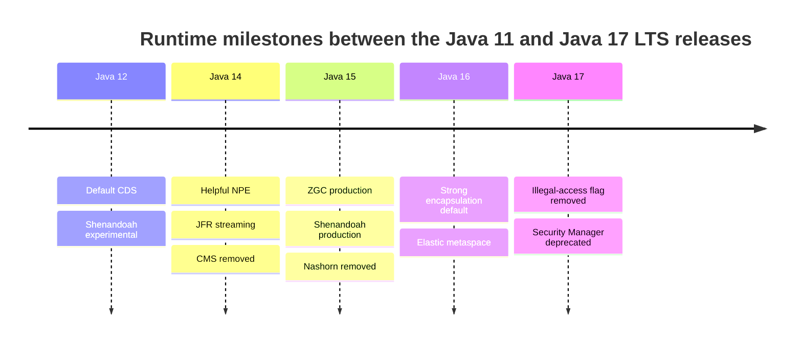
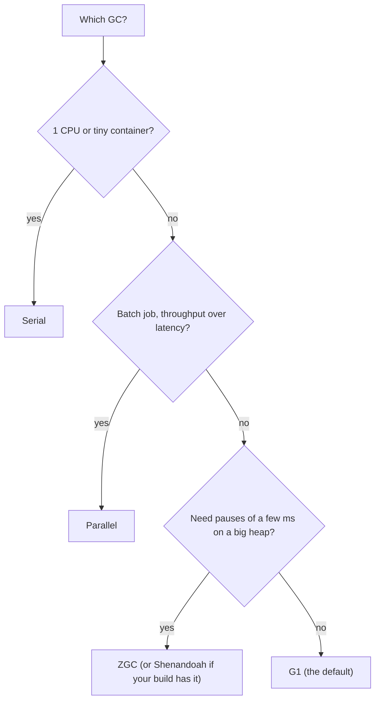

# 6.6 JVM Changes in Java 12 to 17

> **Goal:** Know what the JVM gained and lost between the 11 and 17 LTS releases (collectors, helpful NPE messages, strong encapsulation, CDS, JFR streaming, deprecations), so that you can explain behaviour after an upgrade and pick GC settings consciously.

**Level:** intermediate. Part 10 (JVM internals) and Part 13 (GC tuning) go deeper.
**Verified on:** OpenJDK 21.0.12. Demonstrations run on 21, which includes everything from 17; version labels come from the JEPs.

## Contents

1. [The landscape](#1-the-landscape)
2. [Garbage collectors: ZGC, Shenandoah, G1 improvements, CMS gone](#2-garbage-collectors-zgc-shenandoah-g1-improvements-cms-gone)
3. [Helpful NullPointerException messages (14)](#3-helpful-nullpointerexception-messages-14)
4. [Strong encapsulation of JDK internals (16 and 17)](#4-strong-encapsulation-of-jdk-internals-16-and-17)
5. [Class Data Sharing and startup](#5-class-data-sharing-and-startup)
6. [JFR event streaming and diagnostics](#6-jfr-event-streaming-and-diagnostics)
7. [Other runtime changes](#7-other-runtime-changes)
8. [Deprecations and removals 12 to 17](#8-deprecations-and-removals-12-to-17)
9. [Choosing a collector in 17](#9-choosing-a-collector-in-17)
10. [Common gotchas](#10-common-gotchas)
11. [Interview questions](#11-interview-questions)

---

## 1. The landscape

| Release | JVM / runtime change | JEP |
|---|---|---|
| 12 | Default CDS archive; Shenandoah (experimental); G1 abortable mixed collections; return unused memory | 341, 189, 344, 346 |
| 13 | ZGC returns unused memory; dynamic CDS archives; `Socket` implementation reimplemented | 351, 350, 353 |
| **14** | Helpful NPE messages; JFR event streaming; NUMA-aware G1; **CMS removed**; Pack200 removed | 358, 349, 345, 363, 367 |
| **15** | **ZGC and Shenandoah production-ready**; biased locking disabled; hidden classes; Nashorn removed | 377, 379, 374, 371, 372 |
| **16** | **Strong encapsulation by default**; ZGC concurrent thread-stack processing; Unix-domain sockets; elastic metaspace | 396, 376, 380, 387 |
| **17** | `--illegal-access` removed; Security Manager deprecated for removal; always-strict floating point; new macOS rendering; RMI activation removed | 403, 411, 306, 382, 407 |



## 2. Garbage collectors: ZGC, Shenandoah, G1 improvements, CMS gone

The same program, run with each collector flag on this JDK (the management bean names reveal which collector is active):

```text
$ bash p6/gcs.sh
-XX:+UseSerialGC         -> Copy | MarkSweepCompact
-XX:+UseParallelGC       -> PS MarkSweep | PS Scavenge
-XX:+UseG1GC             -> G1 Concurrent GC | G1 Old Generation | G1 Young Generation
-XX:+UseZGC              -> ZGC Cycles | ZGC Pauses
-XX:+UseShenandoahGC     -> Shenandoah Cycles | Shenandoah Pauses
```

(Shenandoah is included in this build; some vendor builds omit it. If a flag is not supported you get `Unrecognized VM option`, not a silent fallback.)

| Collector | Flag | Production status | Character |
|---|---|---|---|
| Serial | `-XX:+UseSerialGC` | always | tiny heaps, single CPU |
| Parallel | `-XX:+UseParallelGC` | always | throughput, batch jobs |
| **G1** | `-XX:+UseG1GC` | default since 9 | balanced, pause-time goal |
| **ZGC** | `-XX:+UseZGC` | **15** (experimental in 11) | concurrent, pauses well under a few ms independent of heap size; up to multi-TB heaps |
| **Shenandoah** | `-XX:+UseShenandoahGC` | **15** (experimental 12) | concurrent compaction, low pauses; not in every vendor build |
| CMS | `-XX:+UseConcMarkSweepGC` | **removed in 14** | replaced by G1 |
| Epsilon | `-XX:+UseEpsilonGC` | experimental | no collection (5.5) |

What matters in practice:

- **ZGC and Shenandoah are concurrent.** They trade some throughput and memory for very short pauses, mostly interesting for latency-sensitive services with large heaps. The generational ZGC arrives in Java 21 (Part 7).
- **G1 got incremental improvements**: abortable mixed collections (12) to honour pause goals, NUMA awareness (14), returning memory to the OS promptly (12), and many throughput fixes.
- **CMS is gone.** A Java 8 service tuned with `-XX:+UseConcMarkSweepGC` fails to start on 14+ (`Unrecognized VM option`); the replacement is G1 (or ZGC for the lowest pauses).
- **Metaspace** became *elastic* in 16 (JEP 387): memory is returned to the OS more eagerly and fragmentation is lower. It does not fix class-loader leaks, it only makes the footprint smaller.

```text
 Pause comparison (shape only, not measurements)
 Parallel : |=====long STW pause=====|  work  |=====long STW pause=====|
 G1       : |==short==|  work  |==short==|  work  |==short==|
 ZGC      : | tiny |   work (collection runs concurrently with the application)   | tiny |
```

## 3. Helpful NullPointerException messages (14)


Before 14 an NPE said only `java.lang.NullPointerException` with a line number. Now the JVM computes a description of what was null from the bytecode. It was disabled by default in 14 and **enabled by default in 15**.

```text
$ bash p6/npe.sh
# compiled with -g (local variable and parameter names available)
field chain   : Cannot read field "city" because "person.address" is null
null field    : Cannot invoke "String.length()" because "person.address.city" is null
array field   : Cannot load from object array because "person.tags" is null
array slot    : Cannot invoke "String.trim()" because "names[1]" is null
local variable: Cannot invoke "String.length()" because "text" is null
method result : Cannot invoke "String.toUpperCase()" because the return value of "HelpfulNpe.get()" is null
unboxing      : Cannot invoke "java.lang.Integer.intValue()" because "boxed" is null

# compiled without -g (javac default: names are replaced by slots)
array slot    : Cannot invoke "String.trim()" because "<parameter1>[1]" is null
local variable: Cannot invoke "String.length()" because "<local0>" is null
method result : Cannot invoke "String.toUpperCase()" because the return value of "HelpfulNpe.get()" is null
unboxing      : Cannot invoke "java.lang.Integer.intValue()" because "<parameter1>" is null

# the feature switched off (-XX:-ShowCodeDetailsInExceptionMessages)
field chain   : null
null field    : null
```

What to learn from this run:

1. The message names the failed action (`Cannot invoke "String.length()"`), and **what** was null (`person.address.city`).
2. Array slots, method results (`the return value of "HelpfulNpe.get()"`) and unboxing are all described.
3. Variable names appear only when the class was compiled with `-g` (local variable table). Without it, you get `<local0>` and `<parameter1>`. Maven and Gradle compile with debug info by default; `javac` on the command line does not include local names unless asked.
4. The feature can be switched off with `-XX:-ShowCodeDetailsInExceptionMessages` (the last block shows the old bare message).

Security note: the message is built from code details, never from data values, so it does not leak the contents of variables. Still, keep stack traces out of API responses.

## 4. Strong encapsulation of JDK internals (16 and 17)

Chapter 5.1 covered the module system. The timeline of enforcement:

| Release | Behaviour for reflective access from the class path to JDK internals |
|---|---|
| 9 to 15 | `--illegal-access=permit` is the default: works, with a one-time warning |
| **16** | default becomes `deny` (JEP 396); `permit` still selectable |
| **17** | the option is **removed** (JEP 403); only `--add-opens` / `--add-exports` work |

Real behaviour of this JDK when the removed flag is used, and when code reflects into `java.util`:

```text
$ bash p6/encap17.sh
# the removed option
OpenJDK 64-Bit Server VM warning: Ignoring option --illegal-access=permit; support was removed in 17.0

# reflecting into java.util from the class path
InaccessibleObjectException: Unable to make field transient java.lang.Object[] java.util.ArrayList.elementData accessible: module java.base does not "opens java.util" to unnamed module @<hash>

# with the package opened explicitly
read elementData
```

Operational rules:

- If a library throws `InaccessibleObjectException`, upgrade it first. If you must keep it, add `--add-opens java.base/java.util=ALL-UNNAMED` (the exact package named in the message).
- `JAVA_TOOL_OPTIONS` or the `Add-Opens:` manifest attribute of an executable JAR are the usual places to keep these flags.
- `sun.misc.Unsafe` is still available through the `jdk.unsupported` module (shown in chapter 5.1 and again in 6.7), but many of its methods are deprecated for removal in later releases.

## 5. Class Data Sharing and startup

| Release | CDS change |
|---|---|
| 10 | AppCDS for application classes (5.5) |
| **12** | a default CDS archive of JDK classes is built into the JDK image; used automatically (the `sharing` word in `java -version`) |
| 13 | dynamic archive: `-XX:ArchiveClassesAtExit=app.jsa` then `-XX:SharedArchiveFile=app.jsa` |
| 19 | `-XX:+AutoCreateSharedArchive` makes the dynamic archive automatically |

Effect: JDK start-up of a trivial program dropped noticeably, and an application with thousands of classes saves tens of percent of start-up time with an archive. Benchmark in your own environment; the gain depends on class count and disk.

## 6. JFR event streaming and diagnostics

Java 14 added **JFR event streaming** (JEP 349): consume events in-process while the application runs, without dumping a file. It makes always-on monitoring ("alert if GC pause > X") possible with plain Java code:

```text
try (var rs = new jdk.jfr.consumer.RecordingStream()) {
    rs.enable("jdk.GarbageCollection").withoutThreshold();
    rs.onEvent("jdk.GarbageCollection", e -> log(e.getDuration()));
    rs.startAsync();
}
```

(This snippet is illustrative; event content depends on the live JVM.) Other diagnostics additions: `jcmd` gained more commands, `jfr` command-line tool arrived in 12 for printing and summarising recordings, and the new "hidden classes" API (15) lets frameworks define classes that are not discoverable by name.

## 7. Other runtime changes

| Change | Release | Effect |
|---|---|---|
| **Biased locking disabled by default** | 15 (deprecated), removed later | uncontended `synchronized` is slightly different in cost, which rarely matters; remove `-XX:+UseBiasedLocking` from command lines |
| **Always-strict floating point** | 17 | `strictfp` is redundant; floating-point results are the same on all platforms |
| **Hidden classes** | 15 | lambdas use them internally; frameworks can define classes that can be unloaded independently |
| **Elastic metaspace** | 16 | better return of memory to the OS |
| **Records, sealed classes at the VM level** | 16, 17 | `Record` attribute, `PermittedSubclasses` attribute |
| **Unix-domain sockets** | 16 | chapter 6.5 |
| **Vector API, foreign memory/linker** | incubating | not for production |
| **New rendering pipelines, macOS/AArch64 port** | 17 | desktop and Apple silicon |
| **Reimplemented socket API** | 13 (`Socket`), 15 (`DatagramSocket`) | simpler, virtual-thread-friendly (21) |
| **Context-specific deserialization filters** | 17 | protect against hostile serialized data |

## 8. Deprecations and removals 12 to 17

| What | Status |
|---|---|
| CMS collector | removed in 14 |
| Pack200 tools and API | removed in 14 |
| Solaris and SPARC ports | removed in 15 |
| Nashorn JavaScript engine and `jjs` | removed in 15 (Part 5 deprecated it) |
| Biased locking | disabled in 15 |
| RMI Activation | removed in 17 |
| **Security Manager** | deprecated for removal in 17 |
| Applet API | deprecated for removal in 17 |
| `--illegal-access` | removed in 17 |
| `Object.finalize()` | deprecated for removal in 18 |
| `sun.misc` / `sun.reflect` internals | encapsulated; `jdk.unsupported` remains |
| Experimental AOT and JIT compiler (Graal) | removed in 17 |

## 9. Choosing a collector in 17



Start with the default (G1), measure pauses with `-Xlog:gc*` and JFR, and switch only for a measured reason. Throughput-oriented batch jobs often win with Parallel; latency-sensitive services with big heaps often win with ZGC. Details in Part 13.

## 10. Common gotchas

| Gotcha | Why | Fix |
|---|---|---|
| JVM fails with `Unrecognized VM option 'UseConcMarkSweepGC'` | CMS removed in 14 | G1 or ZGC |
| NPE messages show `<local4>` | class compiled without `-g` | compile with debug info (Maven default has it) |
| Library suddenly throws `InaccessibleObjectException` after 11 to 17 | strong encapsulation default | upgrade or `--add-opens` |
| `--illegal-access=permit` ignored | removed in 17 (JVM prints a warning and continues) | use `--add-opens` |
| Switched to ZGC and throughput dropped | concurrent barriers cost CPU | measure; stay on G1/Parallel if pauses are acceptable |
| Shenandoah flag fails | not in every distribution | check vendor build |
| `-XX:+UseBiasedLocking` has no effect | feature disabled/removed | delete the flag |
| Container memory exceeded with ZGC | multi-mapped memory looks large in tools | check RSS, not VSZ |
| `strictfp` warnings | redundant in 17 | remove it |

## 11. Interview questions

<details>
<summary><strong>Q1. Which collectors became production-ready between 11 and 17?</strong></summary>

ZGC and Shenandoah, both in Java 15. G1 stayed the default and CMS was removed in 14.
</details>

<details>
<summary><strong>Q2. What are helpful NullPointerException messages?</strong></summary>

JVM-generated descriptions of which expression was null and which action failed, for example <code>Cannot invoke "String.length()" because "person.address.city" is null</code>. They need debug info for local variable names and are on by default since 15.
</details>

<details>
<summary><strong>Q3. What changed about <code>--illegal-access</code> from 9 to 17?</strong></summary>

9 to 15 default <code>permit</code> with a warning, 16 default <code>deny</code>, 17 option removed. <code>--add-opens</code> and <code>--add-exports</code> are the only escape hatches.
</details>

<details>
<summary><strong>Q4. How is ZGC different from G1?</strong></summary>

ZGC does marking, relocation and compaction concurrently using load barriers and colored pointers, aiming at pauses of a few milliseconds regardless of heap size; G1 is regional with stop-the-world evacuation pauses tuned by a pause-time goal.
</details>

<details>
<summary><strong>Q5. Why was CMS removed?</strong></summary>

It had fragmentation and concurrent mode failures, needed heavy tuning, and G1 and later ZGC/Shenandoah cover its use cases. It was deprecated in 9 and removed in 14.
</details>

<details>
<summary><strong>Q6. What is JFR event streaming?</strong></summary>

An API (Java 14) to consume JFR events in-process while the application runs, enabling continuous monitoring without writing and parsing files.
</details>

<details>
<summary><strong>Q7. What is the default CDS archive?</strong></summary>

Since 12, the JDK ships a pre-built archive of core classes mapped at startup, improving start time and sharing memory without any flags.
</details>

<details>
<summary><strong>Q8. What was deprecated for removal in Java 17?</strong></summary>

The Security Manager and the Applet API (and RMI Activation was removed). Code that calls <code>System.getSecurityManager()</code> gets removal warnings.
</details>

<details>
<summary><strong>Q9. What did "always-strict floating point" change?</strong></summary>

From 17 all floating-point arithmetic is strict, so the <code>strictfp</code> modifier is redundant and results are platform-independent.
</details>

<details>
<summary><strong>Q10. How do you choose a garbage collector?</strong></summary>

Start with the default G1 and measure. Use Serial for tiny heaps or single CPUs, Parallel for batch throughput, and ZGC (or Shenandoah) when low tail latency on large heaps justifies the CPU overhead.
</details>

<details>
<summary><strong>Q11. Can the helpful NPE message leak sensitive data?</strong></summary>

It describes code locations and variable names, not values, so it does not include the data itself.
</details>

---

[Previous: 6.5 API Additions 12 to 17](./05-api-additions-12-17.md) · [Part index](./README.md) · Next: [6.7 Migrating from Java 11 to 17](./07-migrating-11-to-17.md)