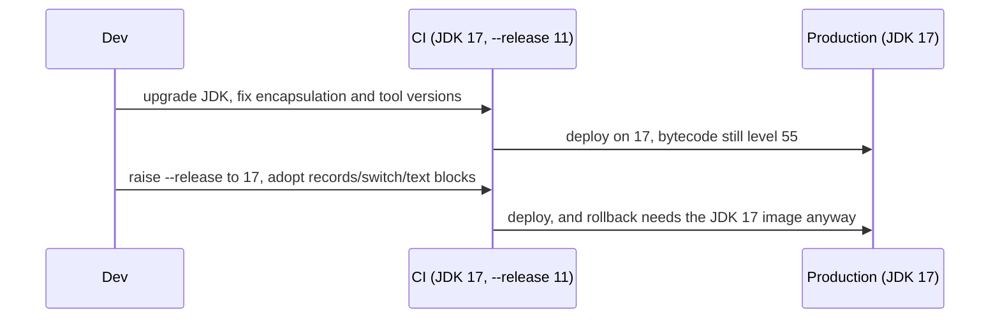

# 6.7 Migrating from Java 11 to 17

> **Goal:** Move a Java 11 application to 17 (or from 8 directly to 17) with a clear list of what breaks, what changes silently, and which ecosystem upgrades (Spring, Jakarta, build tools) the move usually drags along.

**Level:** the sequel to chapter 5.7. Read that chapter first for the method (scan, upgrade dependencies, run both JDKs in CI, canary). Here only the 11-to-17 specifics are covered.
**Verified on:** OpenJDK 21.0.12 compiling with `--release 17` where the target matters. Version statements about third-party frameworks are deliberately general; check release notes.

## Contents

1. [Is 17 a small step or a big one?](#1-is-17-a-small-step-or-a-big-one)
2. [Compile-time findings: warnings you should treat as work items](#2-compile-time-findings-warnings-you-should-treat-as-work-items)
3. [Run-time breakages](#3-run-time-breakages)
4. [The Jakarta EE namespace change](#4-the-jakarta-ee-namespace-change)
5. [Ecosystem requirements](#5-ecosystem-requirements)
6. [JVM flags and GC](#6-jvm-flags-and-gc)
7. [Silent behaviour changes](#7-silent-behaviour-changes)
8. [Using the new language features after the move](#8-using-the-new-language-features-after-the-move)
9. [Checklist](#9-checklist)
10. [Common gotchas](#10-common-gotchas)
11. [Interview questions](#11-interview-questions)

---

## 1. Is 17 a small step or a big one?

For code that already runs cleanly on 11 without warnings, the JDK step is usually small. The pain comes from two things that were *warnings* on 11 and are *errors* on 17, and from the ecosystem upgrades that require 17.

| Source of work | Why |
|---|---|
| Strong encapsulation (16/17) | reflective hacks that warned on 11 now fail |
| Removed JDK pieces | Nashorn (15), CMS (14), Pack200 (14), RMI Activation (17), Graal-based AOT/JIT (17) |
| Framework baselines | Spring Framework 6 / Spring Boot 3 require 17 and Jakarta EE 9+ |
| Deprecations turned up | Security Manager, finalization, value-based classes |

```text
 8 ----> 11 ----> 17 ----> 21 ----> 25
         |         |         |
  EE modules   encapsulation  virtual threads,
  removed      enforced       pattern switch
```

Class files: Java 17 emits version **61**, so every bytecode tool must support it (Section 2 shows the numbers).

## 2. Compile-time findings: warnings you should treat as work items

Two real `javac` runs with `-Xlint` against code that "works on 11":

```text
$ bash p6/lint.sh
# javac -Xlint:all --release 17 s/p6/ValueBased.java
s/p6/ValueBased.java:6: warning: [synchronization] attempt to synchronize on an instance of a value-based class
        synchronized (lock) {                               // synchronizing on a value-based class
        ^
s/p6/ValueBased.java:10: warning: [synchronization] attempt to synchronize on an instance of a value-based class
        synchronized (o) {
        ^
s/p6/ValueBased.java:13: warning: [removal] Integer(int) in Integer has been deprecated and marked for removal
        Integer a = new Integer(5);                         // deprecated for removal
                    ^
3 warnings

# javac -Xlint:removal --release 17 s/p6/Sm.java
s/p6/Sm.java:3: warning: [removal] SecurityManager in java.lang has been deprecated and marked for removal
        SecurityManager sm = System.getSecurityManager();
        ^
s/p6/Sm.java:3: warning: [removal] getSecurityManager() in System has been deprecated and marked for removal
        SecurityManager sm = System.getSecurityManager();
                                   ^
2 warnings
```

| Warning | Meaning | Action |
|---|---|---|
| `[synchronization] ... value-based class` | `Integer`, `Optional`, `LocalDate` and others are *value-based*; their identity is not meaningful and may be eliminated in the future | never lock on them; use a dedicated `Object` lock |
| `[removal] Integer(int) ... marked for removal` | the boxing constructors will be deleted | `Integer.valueOf` |
| `[removal] SecurityManager ... marked for removal` | the Security Manager is deprecated for removal (17) | stop depending on it; migrate any sandboxing to OS/container isolation |
| `[deprecation]` on `finalize`, `Thread.getId` (19) etc. | later releases | prefer `Cleaner` / `try-with-resources`, `threadId()` |

Class-file versions emitted by `--release N`, produced by the compiler here:

```text
$ bash p6/versions.sh
javac --release 8  ->   major version: 52
javac --release 11 ->   major version: 55
javac --release 17 ->   major version: 61
javac --release 21 ->   major version: 65
```

Any ASM-based tool (JaCoCo, Mockito/ByteBuddy, Spring, Hibernate, shading plugins, APM agents) must understand 61 before it can read your classes. If a build fails with `Unsupported class file major version 61`, upgrade that tool, not your JDK.

## 3. Run-time breakages

```java
import javax.script.*;
import java.lang.reflect.Field;
import java.util.*;

public class Mig17 {
    public static void main(String[] args) throws Exception {
        // 1. Nashorn (the JavaScript engine of 8 and 11) was removed in 15
        ScriptEngine js = new ScriptEngineManager().getEngineByName("nashorn");
        System.out.println("nashorn engine present: " + (js != null));

        // 2. strong encapsulation: the reflective hack that only warned on 9-15 now fails
        try {
            Field f = ArrayList.class.getDeclaredField("elementData");
            f.setAccessible(true);
            System.out.println("read elementData");
        } catch (RuntimeException e) {
            System.out.println(e.getClass().getSimpleName() + ": " + e.getMessage().replaceAll("@[0-9a-f]+", "@<hash>"));
        }

        // 3. things that still work: public API and jdk.unsupported
        System.out.println("sun.misc.Unsafe class loadable: " + (Class.forName("sun.misc.Unsafe") != null));

        // 4. Runtime version and class file version of this program
        System.out.println("Runtime.version().feature() = " + Runtime.version().feature());
        System.out.println("java.specification.version  = " + System.getProperty("java.specification.version"));
    }
}

// ---- Output ----
// nashorn engine present: false
// InaccessibleObjectException: Unable to make field transient java.lang.Object[] java.util.ArrayList.elementData accessible: module java.base does not "opens java.util" to unnamed module @<hash>
// sun.misc.Unsafe class loadable: true
// Runtime.version().feature() = 21
// java.specification.version  = 21
```

| Output | Meaning |
|---|---|
| `nashorn engine present: false` | `ScriptEngineManager().getEngineByName("nashorn")` returns `null`. Use GraalJS, Rhino or move the scripting to a separate service |
| `InaccessibleObjectException ... does not "opens java.util"` | the reflective hack that printed a warning on 11 is an error on 17. Upgrade the library, or add `--add-opens java.base/java.util=ALL-UNNAMED` |
| `sun.misc.Unsafe class loadable: true` | `jdk.unsupported` is still shipped, so libraries that depend on `Unsafe` (Netty, Kryo, older Hadoop clients) keep working for now |
| `Runtime.version().feature()` | use this, never string parsing, to detect the Java version |

The flag in action, from the previous chapter:

```text
$ bash p6/encap17.sh
# the removed option
OpenJDK 64-Bit Server VM warning: Ignoring option --illegal-access=permit; support was removed in 17.0

# reflecting into java.util from the class path
InaccessibleObjectException: Unable to make field transient java.lang.Object[] java.util.ArrayList.elementData accessible: module java.base does not "opens java.util" to unnamed module @<hash>

# with the package opened explicitly
read elementData
```

Finding every reflective access before production: run the test suite with `--add-opens` removed (the default), collect each `InaccessibleObjectException`, and fix them library by library. A temporary `--illegal-access=warn` does **not** exist on 17.

## 4. The Jakarta EE namespace change

Java EE was handed to the Eclipse Foundation and renamed **Jakarta EE**. From Jakarta EE 9 the packages changed from `javax.*` to `jakarta.*`:

| Old | New |
|---|---|
| `javax.servlet.*` | `jakarta.servlet.*` |
| `javax.persistence.*` | `jakarta.persistence.*` |
| `javax.validation.*` | `jakarta.validation.*` |
| `javax.annotation.*` | `jakarta.annotation.*` |
| `javax.xml.bind.*` | `jakarta.xml.bind.*` |
| `javax.inject.*`, `javax.ws.rs.*`, `javax.transaction.*` | `jakarta.inject.*`, `jakarta.ws.rs.*`, `jakarta.transaction.*` |

Important: `javax.sql`, `javax.crypto`, `javax.net`, `javax.script`, `javax.swing` and other **Java SE** packages did **not** change. Only the former Java EE packages moved.

This rename is the biggest hidden cost of moving to Spring Boot 3 / Spring Framework 6, Hibernate 6, Tomcat 10+ or Jetty 11+: the jump from 11 to 17 is often bundled with it because those releases require Java 17. Plan it as a separate step:

1. Upgrade to the last release of your framework line that still uses `javax.*` and runs on 17.
2. Run on 17, fix the JDK-level issues in this chapter.
3. Then upgrade to the `jakarta.*` line (tools such as OpenRewrite recipes and the Eclipse transformer automate the package renames in code, configuration and bytecode).

## 5. Ecosystem requirements

Use this table as a checklist of *categories*, and read each project's compatibility notes for the exact version.

| Component | What to verify for 17 |
|---|---|
| Spring Boot / Framework | 5.3.x and Boot 2.5+ run on 17; Boot 3 / Framework 6 **require** 17 |
| Hibernate / JPA | 5.6 runs on 17; 6.x requires Jakarta |
| Application servers | Tomcat 9 and 10, Jetty 10/11, WildFly, Payara, WebLogic: certified versions |
| Maven | compiler plugin with `<release>17</release>`, Surefire/Failsafe recent enough to fork a 17 JVM |
| Gradle | wrapper version that supports running and toolchains on 17 |
| Mockito | newer versions use the inline mock maker, which works on 17 and needs ByteBuddy updates |
| JaCoCo, ASM-based tools | versions that read class file 61 |
| Lombok | version that supports the 17 compiler internals |
| Kotlin, Scala, Groovy | compiler versions that target 17 |
| APM agents | agent versions supporting 17 |
| Docker images | `eclipse-temurin:17`, distroless, vendor images |

## 6. JVM flags and GC

| Task | How |
|---|---|
| CMS flags | remove `-XX:+UseConcMarkSweepGC` and `-XX:CMS*`; JVM will not start with them |
| Old GC logging | use `-Xlog:gc*`; several `Print*` flags are gone (chapter 5.5) |
| Illegal access | `--add-opens` per package |
| Biased locking | delete `-XX:+UseBiasedLocking` |
| `-XX:+UseContainerSupport` | already default; remove noise flags |
| ZGC / Shenandoah | production-ready; evaluate if pause time is your issue |
| `JAVA_TOOL_OPTIONS` | check it does not carry removed flags |

Re-test GC settings: defaults for G1 ergonomics improved over 11, so hand-tuned heap region sizes and pause goals from the Java 8 era often hurt rather than help.

## 7. Silent behaviour changes

| Change | Release | What you may notice |
|---|---|---|
| Locale data (CLDR) updates | 9 onward, notably 20 (narrow no-break space in time formats) | formatted dates/times differ; use explicit patterns for machine-readable output |
| `String` and `Collections` internals | various | `Set.of` order randomised; `HashMap` iteration order can change between releases |
| `Stream.toList()` available | 16 | code compiled on 17 using it is not runnable on 11 |
| TLS defaults tightened | 11 to 17 | TLS 1.0/1.1 disabled and some legacy algorithms restricted (see `jdk.tls.disabledAlgorithms` in your JDK's `java.security`); partner systems may break |
| Default charset | still platform default on 17; **UTF-8 by default from Java 18** | file I/O without an explicit charset behaves differently on 18+; specify `StandardCharsets.UTF_8` now |
| `Thread` APIs deprecated | 19+ | `getId()` deprecated in 19 |
| Biased locking | disabled 15 | different performance profile for old code with heavy uncontended locks |
| Finalization | deprecated for removal 18 | find `finalize()` implementations now |

The default-charset item is worth acting on during this migration even though it only changes in 18: grep for `new FileReader(`, `new InputStreamReader(x)` and `getBytes()` without a charset.

## 8. Using the new language features after the move

Do these *after* the application runs on 17 with `--release 8` or `--release 11` still set, then raise `--release 17`:

| Feature | Where | Typical first adoption |
|---|---|---|
| Switch expressions | 6.1 | replace old `switch` with `break` bugs |
| Text blocks | 6.1 | SQL, JSON, HTML in code and tests |
| Records | 6.2 | DTOs and value objects, immutable messages |
| `instanceof` patterns | 6.4 | `equals` methods, cast ladders |
| Sealed types | 6.3 | result types, ASTs, state |
| `Stream.toList()` | 6.5 | everywhere `collect(Collectors.toList())` |
| Helpful NPE messages | 6.6 | free once on 15+ |
| `RandomGenerator`, `HexFormat` | 6.5 | new code |



Remember the one-way door: once you compile with `--release 17`, the artifact no longer runs on 11. Do it only when every deployment target is on 17.

## 9. Checklist

```text
[ ] Target decided: 17 now, 21 soon? (many teams skip straight to 21)
[ ] Build tools and bytecode libraries support class file 61
[ ] javac -Xlint:all,removal run; synchronization-on-value-based-class and removal warnings triaged
[ ] jdeps --jdk-internals and jdeprscan --release 17 run on app and dependencies
[ ] Tests run without --add-opens first; each InaccessibleObjectException fixed or documented
[ ] Nashorn / CMS / Pack200 / RMI activation usages removed
[ ] Security Manager usage removed or isolated
[ ] Jakarta namespace migration planned as its own step
[ ] JVM flags cleaned; GC chosen and verified in the container
[ ] Charsets made explicit (UTF-8) ahead of Java 18
[ ] TLS endpoints tested (legacy protocols disabled)
[ ] Canary rollout, rollback image kept
[ ] Later: --release 17, adopt records/switch/text blocks/sealed types
```

## 10. Common gotchas

| Gotcha | Why | Fix |
|---|---|---|
| App starts on 11 and fails on 17 with `InaccessibleObjectException` | encapsulation enforced | upgrade library / `--add-opens` |
| `Unsupported class file major version 61` | old bytecode tool | upgrade the tool |
| JVM exits at startup: `Unrecognized VM option` | CMS or other removed flag | remove it |
| Spring Boot 3 upgrade breaks every import | `javax` to `jakarta` | transform packages with tooling |
| Scripting suddenly missing | Nashorn removed in 15 | GraalJS / Rhino |
| Code compiled with `--release 17` fails on a 11 server | newer class file and APIs | align runtimes first |
| Hand-tuned G1 flags worsen latency | defaults improved | re-measure from defaults |
| Tests flaky after upgrade | `Set.of`/`HashMap` order assumptions | sort or use ordered collections |
| Locks on boxed values | value-based class warnings | private lock object |

## 11. Interview questions

<details>
<summary><strong>Q1. What are the main risks when moving from Java 11 to 17?</strong></summary>

Strong encapsulation turning warnings into errors, tools that cannot read class file 61, removed features (Nashorn, CMS), and framework upgrades such as Spring Boot 3 that need 17 and the <code>jakarta.*</code> namespace.
</details>

<details>
<summary><strong>Q2. What is the Jakarta EE namespace change?</strong></summary>

From Jakarta EE 9 the former Java EE packages were renamed from <code>javax.*</code> to <code>jakarta.*</code> (servlet, persistence, validation, annotation, xml.bind and so on). Java SE packages such as <code>javax.sql</code> and <code>javax.crypto</code> were not renamed.
</details>

<details>
<summary><strong>Q3. Why does a library that worked on 11 throw <code>InaccessibleObjectException</code> on 17?</strong></summary>

It reflects into non-opened JDK packages. On 11 the access was permitted with a warning; since 16 it is denied, and 17 removed the <code>--illegal-access</code> switch. Fix with a newer library or <code>--add-opens</code>.
</details>

<details>
<summary><strong>Q4. What is a value-based class and why does javac warn about synchronizing on one?</strong></summary>

Classes like <code>Integer</code>, <code>Optional</code> and <code>LocalDate</code> whose identity is not meaningful and may change in the future. Synchronizing on them is unreliable (shared cached instances) and may be forbidden later; use a private lock object.
</details>

<details>
<summary><strong>Q5. Which things disappeared between 11 and 17?</strong></summary>

CMS and Pack200 (14), Nashorn and the Solaris/SPARC ports (15), RMI Activation and the experimental AOT/JIT compiler (17), and the <code>--illegal-access</code> option.
</details>

<details>
<summary><strong>Q6. Should you raise <code>--release</code> to 17 at the same time as upgrading the JDK?</strong></summary>

No. First run the existing bytecode on 17, then raise <code>--release</code> when all deployment targets are on 17 and you want to use the new language features.
</details>

<details>
<summary><strong>Q7. What does the Security Manager deprecation mean for applications?</strong></summary>

It is deprecated for removal since 17; code using <code>System.getSecurityManager()</code> compiles with removal warnings. Replace in-process sandboxing with OS, container or process-level isolation.
</details>

<details>
<summary><strong>Q8. What default-charset change is coming after 17?</strong></summary>

Java 18 makes UTF-8 the default charset for the standard APIs. Specify charsets explicitly now to avoid behaviour differences.
</details>

<details>
<summary><strong>Q9. How do you find all internal API uses before upgrading?</strong></summary>

<code>jdeps --jdk-internals</code> and <code>jdeprscan --release 17</code> on your code and dependencies, plus running the tests without any <code>--add-opens</code> to catch reflective access at run time.
</details>

<details>
<summary><strong>Q10. Can you skip 17 and go from 11 to 21?</strong></summary>

Yes. You face all the 17 issues plus the few new ones in 18 to 21 (UTF-8 default, finalization deprecation, dynamic agent warnings) at once; many teams do it anyway because 21 is the next LTS and the extra delta is small compared with the Jakarta/framework work.
</details>

---

[Previous: 6.6 JVM Changes 12 to 17](./06-jvm-changes-12-17.md) · [Part index](./README.md) · Next: [Part 7: LTS Java 21](../07-lts-java-21/README.md)